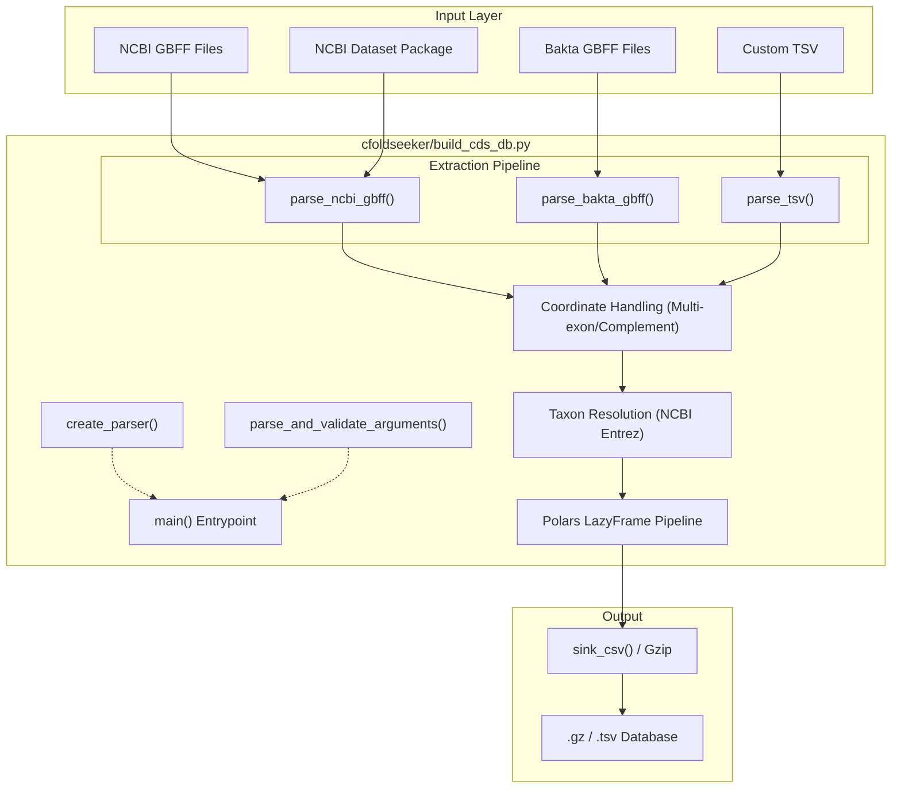
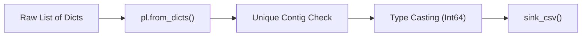

# CDS Database Builder (build_cds_db.py)

Relevant source files

The following files were used as context for generating this wiki page:

- [cfoldseeker/build_cds_db.py](cfoldseeker/build_cds_db.py)
- [docs/guide/usage.rst](docs/guide/usage.rst)

The `cfoldseeker-cds` utility (implemented in `cfoldseeker/build_cds_db.py`) is a high-performance ETL (Extract, Transform, Load) tool designed to construct a genomic context database. This database maps protein identifiers to their exact genomic coordinates (contig, start, end, strand) and taxonomic metadata, enabling `cfoldseeker` to identify biosynthetic gene clusters (BGCs) from structural search hits.

## System Overview and Data Flow

The builder utilizes **Polars** for lazy evaluation and streaming output, allowing it to process thousands of GenBank files or massive NCBI datasets with a low memory footprint.

### Data Flow Diagram
This diagram illustrates how biological records are transformed into the unified `cfoldseeker` database format.

**Sources:** [cfoldseeker/build_cds_db.py:32-82](), [cfoldseeker/build_cds_db.py:116-170](), [cfoldseeker/build_cds_db.py:536-618]()

## Supported Input Modes

The tool supports four distinct parsing modes via the `--mode` flag [cfoldseeker/build_cds_db.py:60-62]():

| Mode | Description | Implementation |
| :--- | :--- | :--- |
| `ncbi-gbff` | Standard NCBI GenBank Flat File format. | `parse_ncbi_gbff` [cfoldseeker/build_cds_db.py:204-266]() |
| `ncbi-package` | Folders structured by the NCBI Datasets CLI. | `parse_ncbi_gbff` [cfoldseeker/build_cds_db.py:204-266]() |
| `bakta-gbff` | GenBank files produced by the Bakta annotator. | `parse_bakta_gbff` [cfoldseeker/build_cds_db.py:269-328]() |
| `tsv` | Pre-parsed tab-separated values. | `parse_tsv` [cfoldseeker/build_cds_db.py:331-364]() |

## Core Implementation Details

### Multi-Exon and Coordinate Handling
The builder extracts coordinates from `SeqFeature` objects. It specifically handles:
1.  **Strand Normalization**: Converts Biopython strand integers (-1, 1) to string symbols ('-', '+') [cfoldseeker/build_cds_db.py:246-247]().
2.  **Location Joining**: For multi-exon genes, it extracts the start of the first operator and the end of the last operator to define the total genomic span [cfoldseeker/build_cds_db.py:244-245]().
3.  **Protein IDs**: Prioritizes `protein_id` tags, falling back to `locus_tag` if the former is missing [cfoldseeker/build_cds_db.py:249-251]().

### Taxon Name Resolution
A key feature of `cfoldseeker-cds` is the ability to resolve human-readable taxon names instead of relying on cryptic file accessions.

*   **Automatic (NCBI)**: When `-tna` is used, the tool extracts `taxon_id` from the GenBank features and queries the **NCBI Entrez** API to fetch the `ScientificName` [cfoldseeker/build_cds_db.py:440-474]().
*   **Manual Mapping**: Users can provide a TSV file via `-tnf` to map file labels to specific names [cfoldseeker/build_cds_db.py:477-501]().

### The Polars ETL Pipeline
The system uses a `Polars` pipeline to deduplicate contigs and clean the data before export.

**Sources:** [cfoldseeker/build_cds_db.py:596-618]()

## Key Functions Reference

### `parse_ncbi_gbff(input_path, mode, ...)`
Iterates through GenBank files using `SeqIO.parse`. It handles the directory recursion logic for `ncbi-package` vs `ncbi-gbff` and yields dictionaries for each CDS feature [cfoldseeker/build_cds_db.py:204-266]().

### `fetch_taxon_names_ncbi(taxids)`
Uses `Entrez.efetch` with `db="taxonomy"` to retrieve scientific names in batches of 20 to respect NCBI rate limits [cfoldseeker/build_cds_db.py:440-474]().

### `main()`
The orchestration logic:
1.  Initializes logging and validates paths [cfoldseeker/build_cds_db.py:536-563]().
2.  Triggers the appropriate parser based on `args.mode` [cfoldseeker/build_cds_db.py:570-580]().
3.  Collects results into a list of dictionaries [cfoldseeker/build_cds_db.py:583-594]().
4.  Processes the data via Polars and writes to the final `.gz` or `.tsv` file [cfoldseeker/build_cds_db.py:596-618]().

## Duplicate Contig Detection
To prevent issues during local search joins, the builder detects if multiple files contain the same contig accession. If detected, it logs a warning and keeps only the first occurrence to ensure genomic coordinate integrity [cfoldseeker/build_cds_db.py:603-609]().

**Sources:** 
- [cfoldseeker/build_cds_db.py:204-266]() (NCBI Parsing)
- [cfoldseeker/build_cds_db.py:440-474]() (Entrez Integration)
- [cfoldseeker/build_cds_db.py:596-618]() (Polars Pipeline)
- [docs/guide/usage.rst:41-80]() (User Guide context)

---