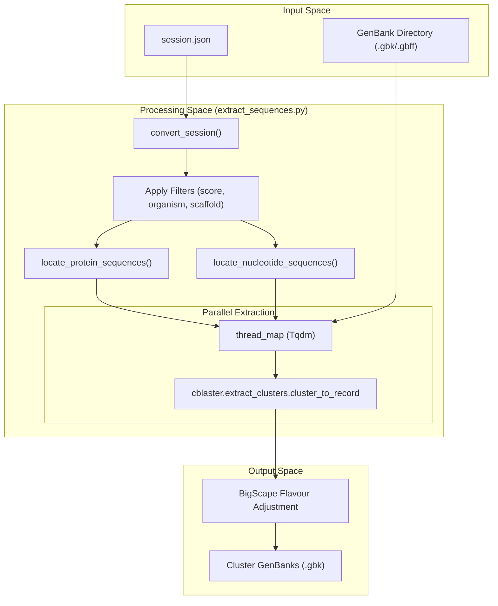
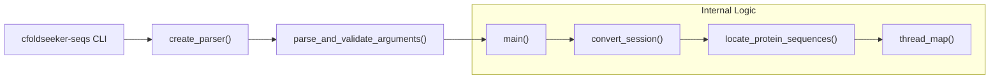

# Sequence Extractor (extract_sequences.py)

<details>
<summary>Relevant source files</summary>

The following files were used as context for generating this wiki page:

- [cfoldseeker/extract_sequences.py](cfoldseeker/extract_sequences.py)
- [docs/guide/usage.rst](docs/guide/usage.rst)

</details>


The `cfoldseeker-seqs` utility (implemented in `extract_sequences.py`) is a helper tool designed to extract genomic regions (gene clusters) from source GenBank files based on the results of a `cfoldseeker` search session. It serves as a bridge between structural search hits and downstream comparative genomics tools like `cblaster` and `clinker` by automating the retrieval of multi-gene loci from large genomic datasets.

### Overview and Integration
`extract_sequences.py` integrates directly with the `cblaster` API to perform the heavy lifting of GenBank parsing and cluster extraction. It acts as a wrapper that translates `cfoldseeker` session data into a format compatible with `cblaster.extract_clusters`, while adding specific features such as parallel processing via `thread_map` and support for "BigScape flavour" GenBank files.

Sources: `cfoldseeker/extract_sequences.py:12-14` [], `cfoldseeker/extract_sequences.py:47-49` []

---

### System Architecture and Data Flow

The extraction process follows a pipeline that moves from a JSON session file to filtered DataFrames, and finally to physical GenBank files on disk.

#### Logic Flow Diagram
"Logic Flow of cfoldseeker-seqs"

Sources: `cfoldseeker/extract_sequences.py:206-218` [], `cfoldseeker/extract_sequences.py:230-245` [], `cfoldseeker/extract_sequences.py:314-345` []

---

### Core Implementation Details

#### Session Conversion and Filtering
The tool begins by loading a `cfoldseeker` session using `cblaster.classes.Session.load()` [cfoldseeker/extract_sequences.py:206-208](). The `convert_session()` function then transforms this hierarchical session object into two Polars DataFrames:
1.  **Protein Sequences**: Maps every hit in every cluster to its specific genomic coordinates.
2.  **Nucleotide Sequences**: Maps clusters to their scaffold/contig boundaries.

Filtering is applied at the DataFrame level using criteria such as `score_threshold`, `organisms` (via regex), and specific `scaffolds` [cfoldseeker/extract_sequences.py:230-245]().

#### Parallel Extraction with thread_map
To handle large datasets efficiently, the extraction process is parallelized using `tqdm.contrib.concurrent.thread_map` [cfoldseeker/extract_sequences.py:314-345](). This function distributes the extraction of individual clusters across multiple CPU cores (defined by the `--cores` argument). 

Inside each thread:
1.  The tool identifies the source GenBank file in the provided directory that matches the hit's `filelabel` [cfoldseeker/extract_sequences.py:321-332]().
2.  It calls `cblaster.extract_clusters.cluster_to_record()` to slice the genomic region [cfoldseeker/extract_sequences.py:334-335]().

#### BigScape Flavour Support
If the `--flavour bigscape` flag is used, the script modifies the extracted GenBank records to ensure compatibility with the BigScape pipeline. This includes:
*   Ensuring the `description` field is populated [cfoldseeker/extract_sequences.py:341]().
*   Standardizing the `source` and `organism` fields [cfoldseeker/extract_sequences.py:342-343]().

Sources: `cfoldseeker/extract_sequences.py:72-73` [], `cfoldseeker/extract_sequences.py:337-343` []

---

### Code Entity Space Mapping

The following diagrams bridge the gap between user-facing concepts and the specific Python entities in the codebase.

#### Data Entity Mapping
"Mapping of Search Concepts to Code Entities"
```mermaid
classDiagram
    class "Session Object" as Session {
        +load(path)
        +clusters: List[Cluster]
    }
    class "Polars DataFrame" as DF {
        +locate_protein_sequences()
        +locate_nucleotide_sequences()
    }
    class "Extraction Logic" as Extract {
        +thread_map()
        +cluster_to_record()
    }

    Session --|> DF : convert_session()
    DF --|> Extract : feeds cluster metadata
```
Sources: `cfoldseeker/extract_sequences.py:12-13` [], `cfoldseeker/extract_sequences.py:206-218` []

#### Functional Pipeline Mapping
"CLI Execution to Internal Functions"

Sources: `cfoldseeker/extract_sequences.py:27-87` [], `cfoldseeker/extract_sequences.py:121-166` [], `cfoldseeker/extract_sequences.py:202-355` []

---

### Command Line Interface Reference

The `create_parser()` function defines the following key argument groups:

| Group | Argument | Description |
| :--- | :--- | :--- |
| **General** | `-c`, `--cores` | Number of parallel workers for extraction. |
| | `-f`, `--force` | Overwrite existing output directories. |
| **I/O** | `-s`, `--session` | Path to the `cfoldseeker` `session.json`. |
| | `-gb`, `--genbanks` | Path to the folder containing source `.gbk`/`.gbff` files. |
| | `--flavour` | Output format: `genbank` (standard) or `bigscape`. |
| **Filters** | `--score-threshold` | Minimum cluster score to extract. |
| | `--organisms` | Regex list to filter by taxon name. |

Sources: `cfoldseeker/extract_sequences.py:52-85` []

#### Usage Example
To extract clusters from a session with a score higher than 10.0 using 4 cores:
```bash
cfoldseeker-seqs -s results/session.json -gb ./data/genbanks -o ./extracted_clusters -c 4 --score-threshold 10.0
```
Sources: `docs/guide/usage.rst:147-151` []

---