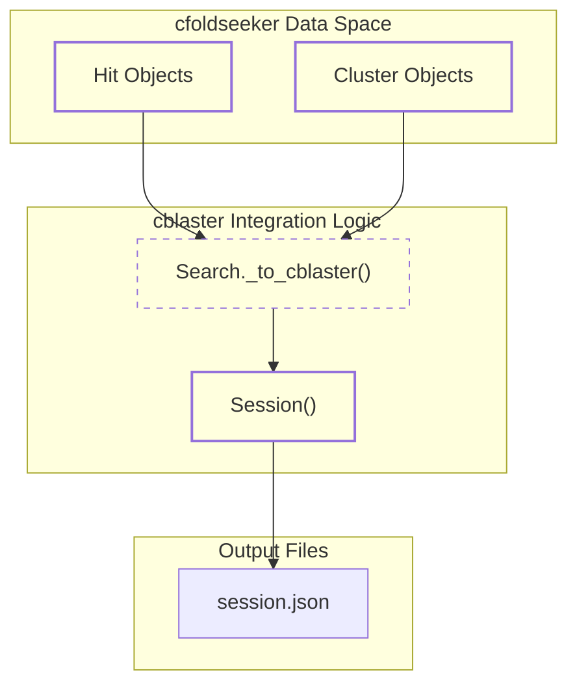
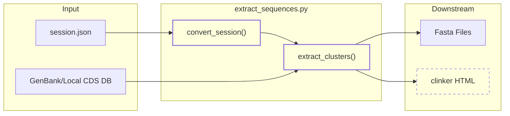

# Output Formats and Downstream Integration

Relevant source files

The following files were used as context for generating this wiki page:

- [cfoldseeker/classes.py](cfoldseeker/classes.py)
- [example/cfoldseeker_search/binary.txt](example/cfoldseeker_search/binary.txt)
- [example/cfoldseeker_search/clusters.tsv](example/cfoldseeker_search/clusters.tsv)
- [example/cfoldseeker_search/foldseek_result.txt](example/cfoldseeker_search/foldseek_result.txt)
- [example/cfoldseeker_search/hits.tsv](example/cfoldseeker_search/hits.tsv)
- [example/cfoldseeker_search/session.json](example/cfoldseeker_search/session.json)
- [example/cfoldseeker_search/summary.txt](example/cfoldseeker_search/summary.txt)

This page serves as a technical reference for the various output artefacts generated by `cfoldseeker`. It describes the file structures, data content, and how these files facilitate downstream analysis using tools like `cblaster` and `clinker`.

## Overview of Output Artefacts

`cfoldseeker` produces a suite of files designed for both human readability and programmatic consumption. The workflow culminates in the `generate_output()` method of the `Search` base class, which orchestrates the writing of TSV, JSON, and text summaries [cfoldseeker/classes.py:581-628]().

### Core Result Files

| File | Format | Description |
| :--- | :--- | :--- |
| `hits.tsv` | TSV | Comprehensive list of all structural hits passing filters, including genomic coordinates. |
| `clusters.tsv` | TSV | Identified Biosynthetic Gene Clusters (BGCs) based on hit proximity. |
| `session.json` | JSON | A `cblaster`-compatible session file containing all search metadata and results. |
| `binary.txt` | TSV | A presence/absence matrix of query proteins across identified genomic loci. |
| `summary.txt` | Text | A human-readable summary of hits organized by organism and scaffold. |
| `foldseek_result.txt` | TSV | The raw output from the FoldSeek binary (Local modes) or API (Remote). |

Sources: [cfoldseeker/classes.py:581-628](), [example/cfoldseeker_search/hits.tsv:1-4](), [example/cfoldseeker_search/binary.txt:1-2]()

---

## Data Structures and TSV Formats

### Hits Table (`hits.tsv`)
The `hits.tsv` file is generated by converting `Hit` objects into dictionaries via `Hit.as_dict()` [cfoldseeker/classes.py:102-126](). It provides the primary link between structural similarity and genomic context.

*   **Genomic Coordinates**: Stored as `start..end` pairs. For multi-exon genes, these are comma-separated (e.g., `100..200,300..400`) [cfoldseeker/classes.py:125]().
*   **Cross-referencing**: The `crossref_method` column indicates how the structural hit was mapped to a genomic locus (e.g., `KEGG`, `GenPept`, or `local`) [cfoldseeker/classes.py:80]().

### Clusters Table (`clusters.tsv`)
This file summarizes the clusters identified using `identify_clusters()` [cfoldseeker/classes.py:488-579]().
*   **Score**: The cumulative FoldSeek bitscore of all hits within the cluster.
*   **Intergenic Distance**: Clusters are formed if hits are within a user-defined `max_interspecific` distance (default 20kbp) [cfoldseeker/classes.py:504]().

### Binary Matrix (`binary.txt`)
The binary matrix provides a high-level view of hit distribution.
*   **Rows**: Represent unique genomic loci (Organism + Scaffold + Coordinates).
*   **Columns**: Represent Query proteins.
*   **Values**: `0` (absent), `1` (present), or `>1` (multiple hits for that query in the locus) [example/cfoldseeker_search/binary.txt:1-5]().

Sources: [cfoldseeker/classes.py:21-46](), [cfoldseeker/classes.py:102-126](), [cfoldseeker/classes.py:488-579]()

---

## The Session File and cblaster Integration

The `session.json` file is the primary vehicle for downstream integration. It implements the `cblaster.classes.Session` schema, allowing `cfoldseeker` results to be treated as native `cblaster` outputs.

### Session Construction Lifecycle

The following diagram illustrates how internal `Hit` and `Cluster` objects are transformed into a `cblaster` Session.

**Diagram: Session Object Assembly**

### Visualisation with cblaster
Because `cfoldseeker` produces a standard `cblaster` session, users can immediately generate plots:
1.  **Cluster Plot**: `cblaster plot session.json` invokes `cblaster.plot.plot_session` [cfoldseeker/classes.py:14]().
2.  **Heatmap**: The binary matrix data is embedded in the session for generating `cblaster` heatmaps.

Sources: [cfoldseeker/classes.py:13-15](), [cfoldseeker/classes.py:614-616](), [cfoldseeker/classes.py:642-658]()

---

## Downstream Extraction and clinker

`cfoldseeker` provides a dedicated utility, `cfoldseeker-seqs` (implemented in `extract_sequences.py`), to bridge structural hits to sequence-based comparative genomics.

### Sequence Extraction Pipeline
The `SequenceExtractor` class handles the retrieval of nucleotide or protein sequences for identified clusters [cfoldseeker/extract_sequences.py:34-45]().

**Diagram: Sequence Extraction and clinker Flow**

### clinker Integration
By passing the `--clinker` flag to `cfoldseeker-seqs`, the tool generates a `clinker` visualization.
*   The tool creates a temporary directory of GenBank files for each cluster [cfoldseeker/extract_sequences.py:466-480]().
*   It then invokes `clinker` to perform all-vs-all sequence alignments and produce an interactive HTML plot [cfoldseeker/extract_sequences.py:514]().

Sources: [cfoldseeker/extract_sequences.py:34-45](), [cfoldseeker/extract_sequences.py:466-480](), [cfoldseeker/extract_sequences.py:514]()

---

## Summary of Implementation Logic

The output generation is centralized in the `Search` base class to ensure consistency across Remote and Local modes.

*   **Graph-based Clustering**: `identify_clusters` uses `networkx.Graph` to find connected components of hits [cfoldseeker/classes.py:526-532]().
*   **Filtering**: Final output is subject to `min_identity`, `min_coverage`, and `require` (must-have query) filters [cfoldseeker/classes.py:408-417]().
*   **Polars Integration**: Local search results are processed as `LazyFrames` for performance before being materialized into the final `hits.tsv` [cfoldseeker/local.py:175-195]().

Sources: [cfoldseeker/classes.py:526-532](), [cfoldseeker/classes.py:408-417](), [cfoldseeker/local.py:175-195]()

---