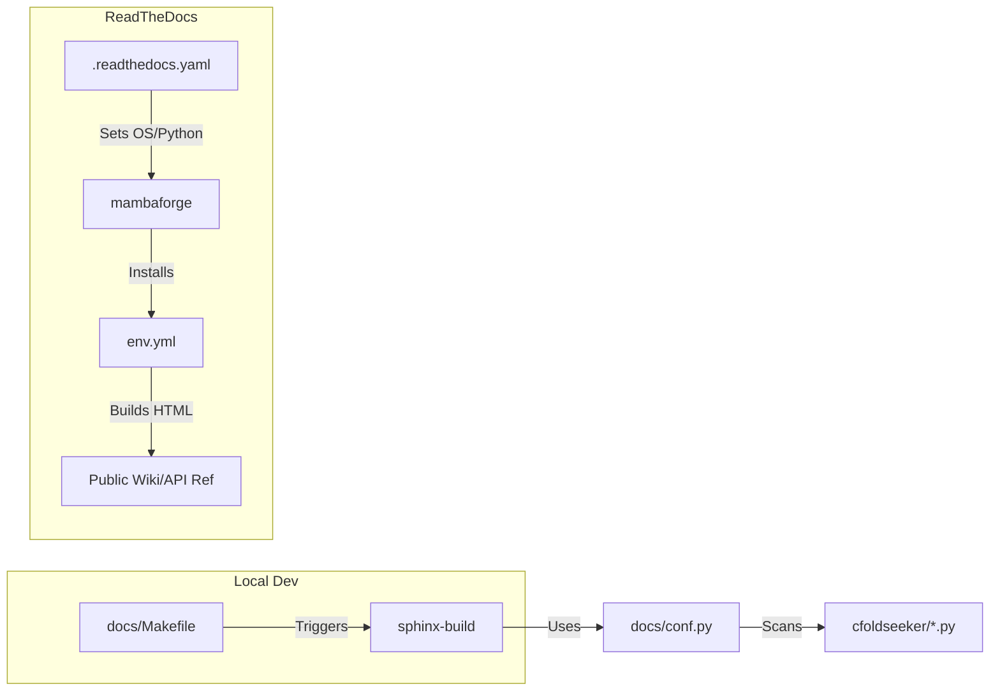

# Deployment and Distribution

<details>
<summary>Relevant source files</summary>

The following files were used as context for generating this wiki page:

- [.readthedocs.yaml](.readthedocs.yaml)
- [bioconda_recipe/meta.yaml](bioconda_recipe/meta.yaml)
- [docker/Dockerfile](docker/Dockerfile)
- [docs/Makefile](docs/Makefile)
- [docs/api_ref.rst](docs/api_ref.rst)
- [docs/conf.py](docs/conf.py)
- [docs/make.bat](docs/make.bat)
- [env.yml](env.yml)
- [pyproject.toml](pyproject.toml)

</details>


The `cfoldseeker` project utilizes modern Python packaging standards and bioinformatics-specific distribution channels to ensure reproducibility and ease of use across different computing environments. This page provides a high-level overview of how the codebase is packaged, distributed via Bioconda, containerized with Docker, and documented using Sphinx on ReadTheDocs.

The deployment infrastructure is designed to handle both Python-level dependencies and binary requirements, such as the `foldseek` executable, which is critical for local search operations.

### Deployment Architecture and Code Map

The following diagram bridges the high-level distribution concepts to the specific files in the repository that manage them.

**Distribution Entity Mapping**
```mermaid
graph TD
    subgraph "Python Packaging"
        A["pyproject.toml"] -- "Defines" --> B["setuptools build"]
        A -- "Exposes" --> C["cfoldseeker CLI"]
        A -- "Exposes" --> D["cfoldseeker-cds CLI"]
        A -- "Exposes" --> E["cfoldseeker-seqs CLI"]
    end

    subgraph "Conda/Bioconda"
        F["bioconda_recipe/meta.yaml"] -- "Wraps" --> A
        G["env.yml"] -- "Mirrors" --> F
    end

    subgraph "Containerization"
        H["docker/Dockerfile"] -- "Installs" --> F
    end

    subgraph "Documentation"
        I[".readthedocs.yaml"] -- "Builds" --> J["Sphinx Documentation"]
        J -- "Configured by" --> K["docs/conf.py"]
        J -- "Automates" --> L["docs/api_ref.rst"]
    end

    [cfoldseeker.main:main] -.-> C
    [cfoldseeker.build_cds_db:main] -.-> D
    [cfoldseeker.extract_sequences:main] -.-> E
```
**Sources:** [pyproject.toml:46-49](), [bioconda_recipe/meta.yaml:15-18](), [docker/Dockerfile:10-11](), [.readthedocs.yaml:26-27]()

---

## Python Packaging and Conda Distribution

The core of `cfoldseeker` is packaged as a standard Python library using `setuptools` as the build backend [pyproject.toml:1-3](). The package defines its metadata, including supported Python versions (>=3.12) and mandatory dependencies such as `polars`, `biopython`, and `cblaster` [pyproject.toml:24-38](). 

Key aspects of distribution include:
*   **Entry Points:** The package registers three primary command-line interfaces: `cfoldseeker`, `cfoldseeker-cds`, and `cfoldseeker-seqs` [pyproject.toml:46-49]().
*   **Bioconda Recipe:** To manage non-Python dependencies like the `foldseek` binary, a Bioconda recipe is provided. This recipe ensures that `foldseek` is available in the environment [bioconda_recipe/meta.yaml:33-33]().
*   **Noarch Strategy:** The Bioconda build uses `noarch: python`, signifying that the Python code itself is architecture-independent, while the environment management handles the architecture-specific binaries [bioconda_recipe/meta.yaml:14-14]().

For details on dependency resolution, build scripts, and the Conda environment configuration, see [Python Packaging and Conda Distribution](#7.1).

**Sources:** [pyproject.toml:1-52](), [bioconda_recipe/meta.yaml:1-54](), [env.yml:1-15]()

---

## Docker and Documentation Infrastructure

To ensure a "plug-and-play" experience and consistent documentation, the project maintains a Dockerfile and a Sphinx-based documentation suite.

### Containerization
The `Dockerfile` provides a minimal runtime environment based on `miniconda`. It automates the installation of `cfoldseeker` via the Bioconda channel, ensuring that all structural search dependencies are pre-configured [docker/Dockerfile:1-11](). This is particularly useful for HPC environments where users may not have permission to manage local Conda environments.

### Documentation Lifecycle
Documentation is generated from the source code docstrings using the Sphinx `autodoc` extension [docs/conf.py:22-22](). The build process is integrated with ReadTheDocs via a configuration file that specifies the build environment and requirements [ .readthedocs.yaml:1-35]().

**Documentation Build Flow**

**Sources:** [docs/Makefile:7-13](), [.readthedocs.yaml:8-16](), [docs/conf.py:7-8]()

For details on the Docker volume-mapping patterns and how to build or extend the Sphinx API reference locally, see [Docker and Documentation Infrastructure](#7.2).

**Sources:** [docker/Dockerfile:1-11](), [docs/api_ref.rst:1-74](), [docs/conf.py:1-33](), [.readthedocs.yaml:1-34]()

---