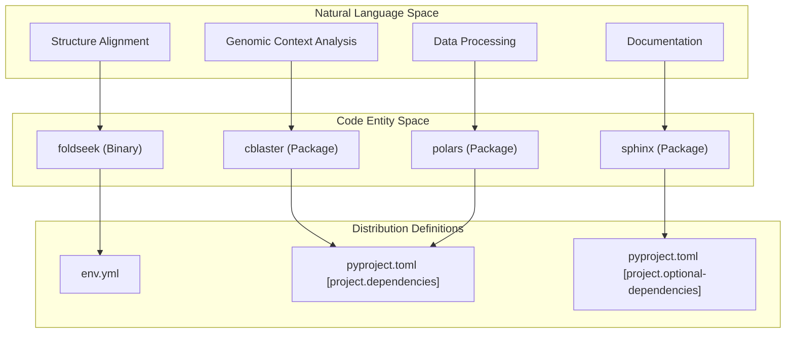
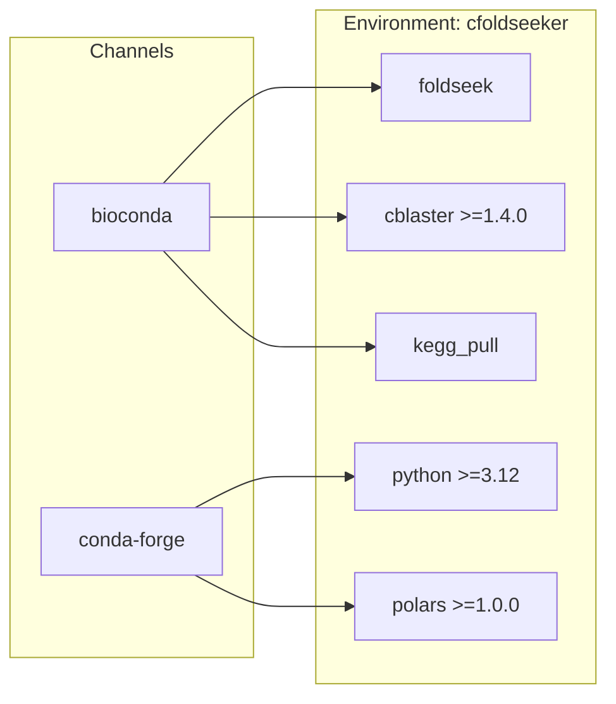

# Python Packaging and Conda Distribution

Relevant source files

The following files were used as context for generating this wiki page:

- [bioconda_recipe/meta.yaml](bioconda_recipe/meta.yaml)
- [env.yml](env.yml)
- [pyproject.toml](pyproject.toml)

This page details the configuration and strategies used to package, distribute, and manage dependencies for `cfoldseeker`. The project utilizes a modern Python packaging workflow centered around `pyproject.toml` and leverages the Bioconda ecosystem to handle complex bioinformatics binary dependencies.

## Build System and Metadata

`cfoldseeker` uses `setuptools` as its build backend, as defined in the `[build-system]` table of the configuration [pyproject.toml:1-3](). The project metadata specifies a minimum Python version of `3.12.0` [pyproject.toml:38-38]() and categorizes the tool under Science/Research and Bio-Informatics [pyproject.toml:21-22]().

### Entry Points
The package registers three distinct CLI commands through the `[project.scripts]` table. These map user-facing commands to specific `main` functions within the codebase:

| Command | Module Path | Function |
| :--- | :--- | :--- |
| `cfoldseeker` | `cfoldseeker.main` | `main` |
| `cfoldseeker-cds` | `cfoldseeker.build_cds_db` | `main` |
| `cfoldseeker-seqs` | `cfoldseeker.extract_sequences` | `main` |

**Sources:** [pyproject.toml:46-49]()

## Dependency Management

The project distinguishes between core runtime dependencies, optional documentation dependencies, and environment-level binary dependencies.

### Python Dependencies
Core dependencies are managed in `pyproject.toml` and include high-performance data handling (`polars`), graph theory for cluster identification (`networkx`), and bioinformatics utilities (`biopython`, `cblaster`, `kegg-pull`) [pyproject.toml:24-32](). 

Optional dependencies for building the Sphinx-based documentation are grouped under the `doc` extra [pyproject.toml:40-44]().

### Binary Dependencies
While Python-specific dependencies are handled by `pip`, the `foldseek` binary is a critical requirement for local search modes. To ensure this is available, `cfoldseeker` is distributed via Conda/Bioconda, which manages the non-Python binary alongside the Python environment [env.yml:10-10]().

### Dependency Mapping Diagram

The following diagram illustrates how abstract requirements in the Natural Language Space map to specific Code Entities and package definitions.

**Requirement to Entity Mapping**

**Sources:** [pyproject.toml:24-32](), [pyproject.toml:40-44](), [env.yml:5-15]()

## Bioconda Distribution

The Bioconda recipe (defined in `meta.yaml`) enables the installation of `cfoldseeker` and all its dependencies (including the `foldseek` binary) with a single command.

### The `noarch: python` Strategy
The recipe uses the `noarch: python` build strategy [bioconda_recipe/meta.yaml:14-14](). This indicates that the Python package itself does not contain compiled C/C++ extensions and can be installed on any architecture (macOS, Linux, Windows) using a single package build. However, the `run` requirements include `foldseek` [bioconda_recipe/meta.yaml:33-33](), which ensures that the architecture-specific `foldseek` binary is pulled into the environment during installation.

### Build and Test Lifecycle
1.  **Source**: The recipe pulls the source tarball from PyPI [bioconda_recipe/meta.yaml:8-10]().
2.  **Host Requirements**: Includes `python`, `pip`, and `setuptools` to build the wheel [bioconda_recipe/meta.yaml:24-27]().
3.  **Script**: Executes a standard `pip install` without build isolation [bioconda_recipe/meta.yaml:19-19]().
4.  **Test**: A basic smoke test is performed by running `cfoldseeker -h` to verify the entry point and dependency resolution [bioconda_recipe/meta.yaml:39-41]().

**Sources:** [bioconda_recipe/meta.yaml:1-54]()

## Environment Specification

For developers or users building from source, `env.yml` provides the canonical environment definition. It combines the Bioconda and Conda-Forge channels to resolve all necessary components.

**Environment Component Flow**

**Sources:** [env.yml:1-15]()

## Packaging Metadata Summary

| Feature | Implementation |
| :--- | :--- |
| **Build Backend** | `setuptools.build_meta` [pyproject.toml:3-3]() |
| **Python Requirement** | `>=3.12.0` [pyproject.toml:38-38]() |
| **Main Entry Point** | `cfoldseeker.main:main` [pyproject.toml:47-47]() |
| **Data Engine** | `polars >=1.0.0` [pyproject.toml:28-28]() |
| **License** | MIT [pyproject.toml:36-36]() |
| **Conda Build** | `noarch: python` [bioconda_recipe/meta.yaml:14-14]() |

**Sources:** [pyproject.toml:1-52](), [bioconda_recipe/meta.yaml:1-54]()

---