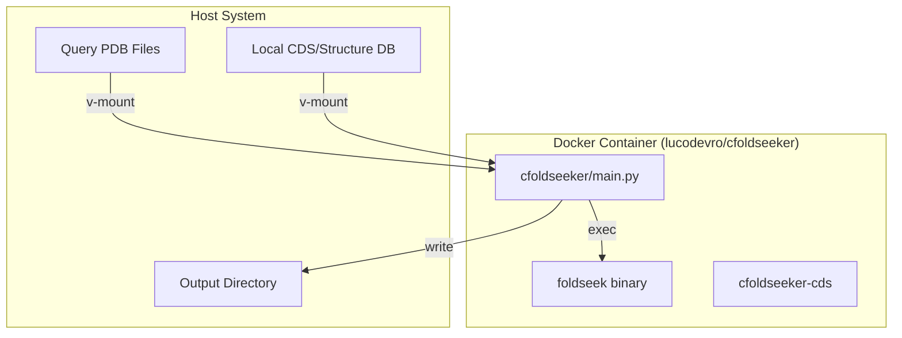
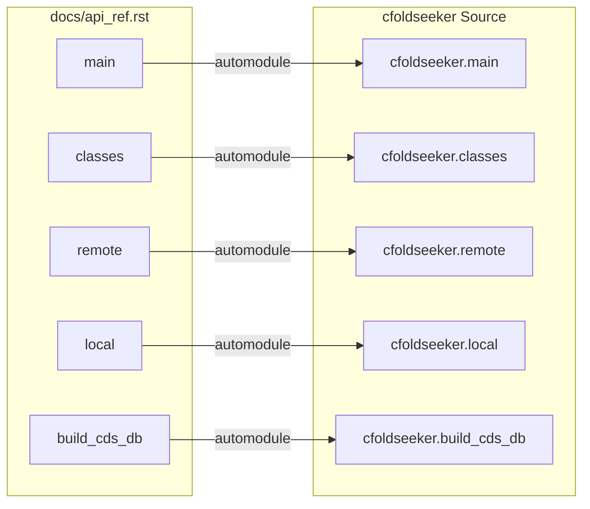

# Docker and Documentation Infrastructure

Relevant source files

The following files were used as context for generating this wiki page:

- [.readthedocs.yaml](.readthedocs.yaml)
- [docker/Dockerfile](docker/Dockerfile)
- [docs/Makefile](docs/Makefile)
- [docs/api_ref.rst](docs/api_ref.rst)
- [docs/conf.py](docs/conf.py)
- [docs/guide/index.rst](docs/guide/index.rst)
- [docs/make.bat](docs/make.bat)

This page documents the containerization and documentation lifecycle of `cfoldseeker`. It covers the configuration of the Docker image for reproducible runs, the volume-mapping patterns required for local search modes, and the Sphinx-based documentation infrastructure that powers the official API reference and user guides.

## Docker Infrastructure

The `cfoldseeker` Docker image provides a pre-configured environment containing all necessary binary dependencies (such as FoldSeek) and the Python runtime environment.

### Dockerfile Implementation
The image is built on a Miniconda base and installs `cfoldseeker` via the Bioconda channel to ensure all system-level dependencies are correctly resolved [docker/Dockerfile:1-11]().

| Layer | Purpose | Code Reference |
| :--- | :--- | :--- |
| **Base Image** | `vanallenlab/miniconda:3.12` | [docker/Dockerfile:1]() |
| **Package Manager** | Installs via `bioconda` and `conda-forge` | [docker/Dockerfile:10]() |
| **Environment** | Updates `PATH` to include the `cfoldseeker` environment | [docker/Dockerfile:11]() |

### Containerized Execution Flow
When running `cfoldseeker` in a container, users must map local directories to the container to provide input structures and retrieve output sessions.

**System Architecture: Containerized Run**

*Sources: [docker/Dockerfile:1-11](), [docs/guide/index.rst:11-12]()*

---

## Documentation Infrastructure

The `cfoldseeker` documentation is built using Sphinx and hosted on ReadTheDocs. It integrates handwritten guides with automated API references generated from the source code docstrings.

### Sphinx Configuration (`conf.py`)
The configuration enables several key extensions to bridge the gap between natural language documentation and the Python codebase:
*   `sphinx.ext.napoleon`: Parses Google/NumPy style docstrings.
*   `sphinx.ext.autodoc`: Automatically pulls documentation from code entities.
*   `sphinx.ext.viewcode`: Adds links to the source code for each documented function/class.

The documentation system prepends the root directory to `sys.path` to ensure the `cfoldseeker` package is importable during the build process [docs/conf.py:6-8]().

### API Reference Mapping
The `docs/api_ref.rst` file acts as the bridge between the documentation structure and the actual Python modules.

**Entity Mapping: Documentation to Code**

*Sources: [docs/api_ref.rst:1-74](), [docs/conf.py:22-22]()*

### Build Automation
The project supports both local and remote builds:

1.  **Local Builds**: Users can generate HTML documentation using the provided `Makefile` or `make.bat` [docs/Makefile:1-20](), [docs/make.bat:1-35]().
    *   Command: `make html` (Linux/macOS) or `.\make.bat html` (Windows).
2.  **ReadTheDocs (RTD)**: The `.readthedocs.yaml` file defines the remote build environment. It uses `mambaforge` to handle the `env.yml` environment file, ensuring that all dependencies required for `autodoc` are present [ .readthedocs.yaml:8-15]().

| Component | File Path | Role |
| :--- | :--- | :--- |
| **RTD Config** | `.readthedocs.yaml` | Defines OS (Ubuntu 24.04) and Python environment [ .readthedocs.yaml:9-11]() |
| **Sphinx Config** | `docs/conf.py` | Sets theme (`sphinx_rtd_theme`) and versioning [docs/conf.py:13-32]() |
| **Entry Point** | `docs/guide/index.rst` | Main landing page explaining tool purpose [docs/guide/index.rst:1-15]() |
| **API Map** | `docs/api_ref.rst` | Defines the `automodule` directives for the whole package [docs/api_ref.rst:1-74]() |

*Sources: [docs/conf.py:1-33](), [.readthedocs.yaml:1-34](), [docs/Makefile:1-20](), [docs/api_ref.rst:1-74]()*

---