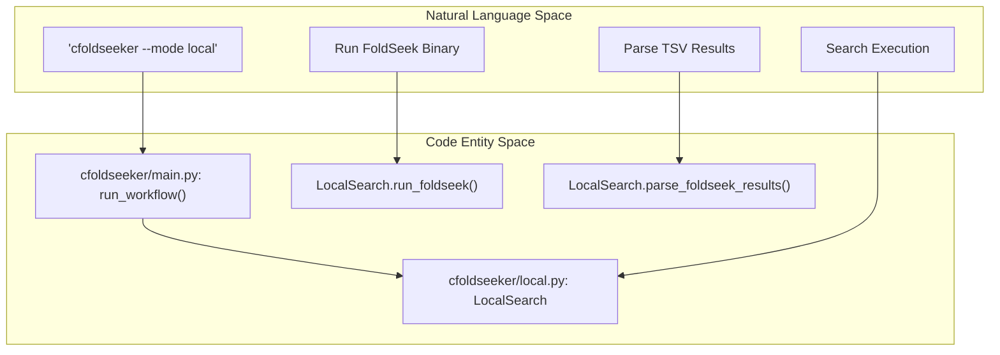
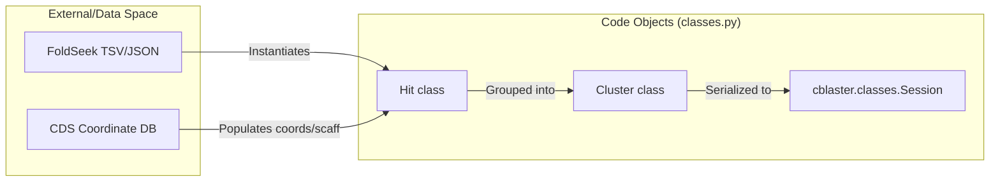

# Glossary

Relevant source files

The following files were used as context for generating this wiki page:

- [LICENSE](LICENSE)
- [README.md](README.md)
- [cfoldseeker/__init__.py](cfoldseeker/__init__.py)
- [cfoldseeker/build_cds_db.py](cfoldseeker/build_cds_db.py)
- [cfoldseeker/classes.py](cfoldseeker/classes.py)
- [cfoldseeker/communication.py](cfoldseeker/communication.py)
- [cfoldseeker/extract_sequences.py](cfoldseeker/extract_sequences.py)
- [cfoldseeker/local.py](cfoldseeker/local.py)
- [cfoldseeker/local_clustered.py](cfoldseeker/local_clustered.py)
- [cfoldseeker/main.py](cfoldseeker/main.py)
- [cfoldseeker/remote.py](cfoldseeker/remote.py)
- [cfoldseeker/remote_parsers.py](cfoldseeker/remote_parsers.py)
- [docs/guide/usage.rst](docs/guide/usage.rst)

This page provides definitions for codebase-specific terms, bioinformatics jargon, and domain concepts used within the `cfoldseeker` project. It serves as a reference for onboarding engineers to understand the implementation details and data structures.

## Core Concepts

### Hit
A `Hit` represents a single protein structure match identified by FoldSeek. It is the primary data unit used to bridge structural similarity with genomic context.
*   **Implementation**: Defined as the `Hit` class in `cfoldseeker/classes.py`.
*   **Key Attributes**: Includes `db_id` (database identifier), `query` (the query protein it matched), structural metrics (`evalue`, `score`, `seqid`, `qcov`, `tcov`), and genomic metadata (`scaff`, `coords`, `strand`).
*   **Sources**: [cfoldseeker/classes.py:21-96](), [cfoldseeker/classes.py:102-126]()

### Cluster
A `Cluster` is a group of `Hit` objects that are genomically colocalised (physically close to each other on a scaffold).
*   **Implementation**: Defined as the `Cluster` class in `cfoldseeker/classes.py`.
*   **Logic**: Clusters are identified using a graph-based approach where hits are nodes, and edges are drawn between hits on the same scaffold if their intergenic distance is below `max_gap`.
*   **Sources**: [cfoldseeker/classes.py:165-217](), [cfoldseeker/classes.py:657-695]()

### Search Lifecycle
The abstract base class `Search` defines the workflow for all search modes (Remote, Local, Local-Clustered).
*   **Data Flow**: `run_foldseek()` (Search) -> `identify_hits()` (Parse results) -> `identify_clusters()` (Graph clustering) -> `generate_output()` (Serialization).
*   **Sources**: [cfoldseeker/classes.py:389-445](), [cfoldseeker/classes.py:560-575]()

## Bioinformatics Jargon & Domain Terms

| Term | Definition | Code Pointer |
| :--- | :--- | :--- |
| **3Di Alphabet** | FoldSeek's internal 3-dimensional interaction alphabet used to represent protein tertiary structures as sequences. | [docs/guide/usage.rst:81-84]() |
| **AFDB** | AlphaFold Database. `cfoldseeker` supports remote searches against `afdb50`, `afdb-proteome`, and `afdb-swissprot`. | [cfoldseeker/main.py:90-91]() |
| **CDS Database** | A local TSV/CSV file containing genomic coordinates for Coding Sequences, typically generated by `cfoldseeker-cds`. | [cfoldseeker/build_cds_db.py:52-54]() |
| **Cross-referencing** | The process of mapping a structural hit (e.g., UniProt ID) to a genomic scaffold and coordinate set via external APIs (KEGG, ENA, UniSave). | [cfoldseeker/remote.py:34-36]() |
| **Intergenic Gap** | The distance in base pairs between two genes. Controlled by the `--max-gap` parameter. | [cfoldseeker/main.py:82-82]() |
| **ProstT5** | A protein language model used by FoldSeek to predict 3Di sequences from amino acid sequences without full folding. | [docs/guide/usage.rst:81-84]() |
| **Scaffold** | A contiguous genomic sequence (e.g., a chromosome, contig, or plasmid). | [cfoldseeker/classes.py:93-93]() |

## Code Architecture Mapping

### Natural Language to Code Entity Space: Search Execution
The following diagram maps the high-level search concepts to the specific Python classes and functions that execute them.

**Search Execution Mapping**

*   **Sources**: [cfoldseeker/main.py:192-212](), [cfoldseeker/local.py:47-62](), [cfoldseeker/local.py:107-151]()

### Data Entity Mapping: Structural Hit to Genomic Context
This diagram illustrates how a structural hit is transformed into a genomic context via the `Hit` and `Cluster` objects.

**Data Flow Mapping**

*   **Sources**: [cfoldseeker/classes.py:21-46](), [cfoldseeker/classes.py:165-180](), [cfoldseeker/classes.py:734-750]()

## Abbreviations

*   **BGC**: Biosynthetic Gene Cluster.
*   **ENA**: European Nucleotide Archive (source for GenPept/EMBL records). [cfoldseeker/communication.py:132-148]()
*   **KEGG**: Kyoto Encyclopedia of Genes and Genomes. [cfoldseeker/remote_parsers.py:1-10]()
*   **NCBI**: National Center for Biotechnology Information.
*   **QRS**: Queries. Often used in `min_cov_qrs` (minimum queries required to cover a cluster). [cfoldseeker/main.py:85-85]()
*   **TSV**: Tab-Separated Values.

## Implementation Details

### Graph-Based Clustering
`cfoldseeker` uses the `networkx` library to identify clusters.
1.  Hits are sorted by scaffold and start position.
2.  Edges are created between hits if `distance <= max_gap`.
3.  Connected components in the graph are identified as candidate clusters.
4.  Candidates are filtered by `min_hits`, `min_cov_qrs`, and `max_length`.
*   **Sources**: [cfoldseeker/classes.py:657-700]()

### Coordinate Parsing
Genomic coordinates are stored as a list of lists `[[start, end], ...]` to support multi-exon genes.
*   **Implementation**: `Hit.start()` returns the minimum coordinate across all exons, and `Hit.end()` returns the maximum.
*   **Sources**: [cfoldseeker/classes.py:130-160]()

### Remote Cross-referencing Tiered Logic
Remote mode attempts to find genomic coordinates in a specific order:
1.  **UniProt Mapping Table**: Direct lookup using the provided `.gz` mapping file.
2.  **KEGG API**: Fallback using `kegg_pull` for genes with KEGG identifiers.
3.  **ENA Browser API**: Final fallback to retrieve EMBL records for GenPept accessions.
*   **Sources**: [cfoldseeker/remote.py:34-36](), [cfoldseeker/remote.py:263-290]()