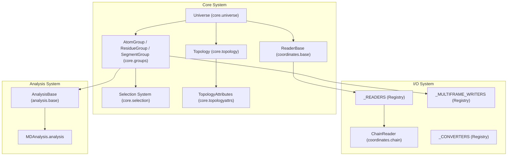
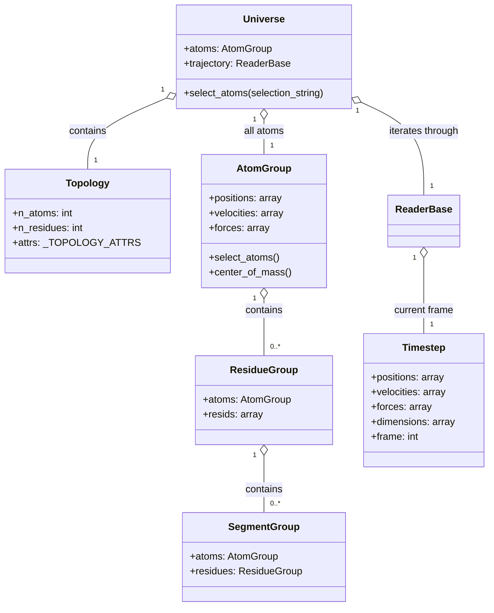

# MDAnalysis Overview

<details>
<summary>Relevant source files</summary>

The following files were used as context for generating this wiki page:

- [LICENSE](LICENSE)
- [README.rst](README.rst)
- [package/AUTHORS](package/AUTHORS)
- [package/CHANGELOG](package/CHANGELOG)
- [package/INSTALL](package/INSTALL)
- [package/MANIFEST.in](package/MANIFEST.in)
- [package/MDAnalysis/__init__.py](package/MDAnalysis/__init__.py)
- [package/MDAnalysis/core/__init__.py](package/MDAnalysis/core/__init__.py)
- [package/MDAnalysis/tests/__init__.py](package/MDAnalysis/tests/__init__.py)
- [package/MDAnalysis/version.py](package/MDAnalysis/version.py)
- [package/README](package/README)
- [package/doc/README](package/doc/README)
- [package/setup.py](package/setup.py)
- [testsuite/INSTALL](testsuite/INSTALL)
- [testsuite/MDAnalysisTests/__init__.py](testsuite/MDAnalysisTests/__init__.py)
- [testsuite/MDAnalysisTests/datafiles.py](testsuite/MDAnalysisTests/datafiles.py)
- [testsuite/README](testsuite/README)
- [testsuite/setup.py](testsuite/setup.py)

</details>


This document provides a high-level overview of MDAnalysis, a Python library for analyzing molecular dynamics simulations. It covers the core architecture, main components, and how they interact with each other. For installation instructions, see [Installation and Setup](#1.1), and for basic usage examples, see [Basic Usage Examples](#1.2).

## What is MDAnalysis?

MDAnalysis is a Python toolkit for analyzing molecular dynamics simulations of many-body systems at the molecular scale, spanning use cases from drug-protein interactions to novel materials [README.rst:13-13](). It provides a flexible and extensible framework for handling trajectory data from various simulation packages including GROMACS, Amber, NAMD, CHARMM, DL_POLY, HOOMD, LAMMPS, and many others [README.rst:15-15]().

The library allows users to:
- Read and write trajectory files in various formats [package/MDAnalysis/__init__.py:32-33]().
- Access atomic coordinates, velocities, and forces as NumPy arrays [README.rst:47-51]().
- Select atoms using a powerful selection language based on CHARMM-style commands [package/MDAnalysis/__init__.py:35-36]().
- Perform various analyses on molecular systems via the `MDAnalysis.analysis` module [README.rst:16-17]().
- Manipulate trajectories (e.g., fit to a reference structure, coordinate wrapping) [package/MDAnalysis/__init__.py:36-37]().

Sources: [package/MDAnalysis/__init__.py:24-44](), [README.rst:13-17]()

## Core Architecture

MDAnalysis is organized around several key components that work together to provide its functionality. The following diagram illustrates the high-level architecture and how code entities relate to system concepts:

**Core Architecture of MDAnalysis**



Sources: [package/MDAnalysis/__init__.py:153-153](), [package/MDAnalysis/__init__.py:170-186](), [package/MDAnalysis/core/__init__.py:28-32]()

## Core Components

### Universe

The `Universe` class is the central object in MDAnalysis [package/MDAnalysis/core/__init__.py:29-30](). It ties together the topology (structure) and trajectory (coordinates over time) of a molecular system [package/MDAnalysis/__init__.py:79-84]().

```python
import MDAnalysis as mda
u = mda.Universe('topology.pdb', 'trajectory.dcd')
```

The `Universe` provides access to all atoms in the system through its `atoms` attribute, which returns an `AtomGroup` [package/MDAnalysis/__init__.py:96-97](). It also provides the `select_atoms` method for filtering atoms [package/MDAnalysis/__init__.py:88-88]().

Sources: [package/MDAnalysis/__init__.py:69-105](), [package/MDAnalysis/__init__.py:153-153](), [package/MDAnalysis/core/__init__.py:34-36]()

### Data Hierarchy

MDAnalysis organizes molecular data in a hierarchical structure using a flyweight pattern to manage large systems efficiently.

**Data Hierarchy in MDAnalysis**



- `Universe`: The top-level container for a simulation system [package/MDAnalysis/core/__init__.py:29-30]().
- `Topology`: Stores static structural information such as bonds and atom types [package/MDAnalysis/__init__.py:180-186]().
- `AtomGroup`: The primary object for coordinate manipulation and analysis [package/MDAnalysis/core/__init__.py:28-28]().
- `Timestep`: Represents a single snapshot in time, containing coordinates and unit cell dimensions [package/MDAnalysis/__init__.py:116-117]().

Sources: [package/MDAnalysis/__init__.py:69-105](), [package/MDAnalysis/__init__.py:153-153](), [package/MDAnalysis/core/__init__.py:28-32]()

### TopologyAttributes

`TopologyAttributes` are properties of atoms, residues, or segments stored in the `Topology`. These include masses, charges, and connectivity information like bonds and angles [package/CHANGELOG:27-29](). MDAnalysis maintains a registry `_TOPOLOGY_ATTRS` to manage these classes [package/MDAnalysis/__init__.py:181-181]().

Sources: [package/MDAnalysis/__init__.py:180-186](), [package/CHANGELOG:27-29]()

## I/O System

MDAnalysis supports reading and writing various file formats through a registry-based dispatch system. The appropriate reader is automatically selected from the `_READERS` registry [package/MDAnalysis/__init__.py:172-172]().

### Readers and Writers

The library distinguishes between single-frame formats (like PDB or GRO) and multi-frame trajectories (like XTC or DCD) [package/MDAnalysis/__init__.py:174-175](). 
- `_READERS`: Registry for trajectory and topology readers [package/MDAnalysis/__init__.py:172-172]().
- `_SINGLEFRAME_WRITERS`: Registry for single-frame output [package/MDAnalysis/__init__.py:174-174]().
- `_MULTIFRAME_WRITERS`: Registry for trajectory output [package/MDAnalysis/__init__.py:175-175]().

### ChainReader

The `ChainReader` allows users to treat a sequence of trajectory files as a single continuous stream [package/MDAnalysis/__init__.py:172-173]().

Sources: [package/MDAnalysis/__init__.py:170-180](), [package/CHANGELOG:51-51]()

## Analysis System

The `MDAnalysis.analysis` module provides a unified framework for implementing complex analysis routines [README.rst:16-17]().

### AnalysisBase

`AnalysisBase` is the parent class for most analysis modules. it manages the iteration over trajectory frames and result storage [package/CHANGELOG:101-102](). Many modules now support parallelization, such as `AtomicDistances` [package/CHANGELOG:75-76]() and `DistanceMatrix` [package/CHANGELOG:97-98]().

Sources: [package/CHANGELOG:75-76](), [package/CHANGELOG:97-98](), [package/CHANGELOG:101-102]()

## Selection System

The selection system uses a Domain Specific Language (DSL) to filter atoms. Selections are performed on an `AtomGroup` and return a new `AtomGroup` [package/MDAnalysis/core/__init__.py:30-32]().

```python
# Select all water oxygens within 4 Angstroms of the protein
water_shell = u.select_atoms('name OH2 and around 4.0 protein')
```

Sources: [package/MDAnalysis/__init__.py:86-91](), [package/MDAnalysis/core/__init__.py:38-43]()

## Versioning and Development

MDAnalysis follows semantic versioning [package/MDAnalysis/version.py:29-30]().
- **MAJOR**: Incompatible API changes [package/MDAnalysis/version.py:36-36]().
- **MINOR**: Backwards-compatible functionality [package/MDAnalysis/version.py:37-38]().
- **PATCH**: Backwards-compatible bug fixes [package/MDAnalysis/version.py:39-39]().

The project is maintained by a Core Developer Team [package/AUTHORS:9-10]() and is fiscally sponsored by NumFOCUS [README.rst:20-21]().

Sources: [package/MDAnalysis/version.py:24-70](), [package/setup.py:61](), [package/AUTHORS:7-10]()

## Extending MDAnalysis

MDAnalysis is designed to be extensible via:
- **Subclassing `AnalysisBase`**: For custom analysis [package/CHANGELOG:101-102]().
- **Custom Readers/Parsers**: By registering in `_READERS` or `_PARSERS` [package/MDAnalysis/__init__.py:172-177]().
- **MDAKits**: External packages providing specialized functionality [README.rst:143-144]().

Sources: [package/MDAnalysis/__init__.py:152-185](), [README.rst:143-144]()

---