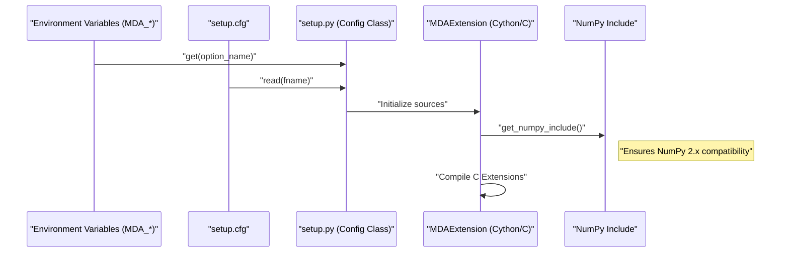

# Installation and Setup

<details>
<summary>Relevant source files</summary>

The following files were used as context for generating this wiki page:

- [.github/actions/build-src/action.yaml](.github/actions/build-src/action.yaml)
- [.github/actions/setup-deps/action.yaml](.github/actions/setup-deps/action.yaml)
- [.github/workflows/deploy.yaml](.github/workflows/deploy.yaml)
- [.github/workflows/gh-ci-cron.yaml](.github/workflows/gh-ci-cron.yaml)
- [.github/workflows/gh-ci.yaml](.github/workflows/gh-ci.yaml)
- [.github/workflows/labels.yaml](.github/workflows/labels.yaml)
- [.github/workflows/linters.yaml](.github/workflows/linters.yaml)
- [.readthedocs.yml](.readthedocs.yml)
- [LICENSE](LICENSE)
- [README.rst](README.rst)
- [azure-pipelines.yml](azure-pipelines.yml)
- [maintainer/conda/environment.yml](maintainer/conda/environment.yml)
- [package/AUTHORS](package/AUTHORS)
- [package/CHANGELOG](package/CHANGELOG)
- [package/INSTALL](package/INSTALL)
- [package/MANIFEST.in](package/MANIFEST.in)
- [package/MDAnalysis/__init__.py](package/MDAnalysis/__init__.py)
- [package/MDAnalysis/tests/__init__.py](package/MDAnalysis/tests/__init__.py)
- [package/MDAnalysis/version.py](package/MDAnalysis/version.py)
- [package/README](package/README)
- [package/doc/README](package/doc/README)
- [package/doc/sphinx/source/conf.py](package/doc/sphinx/source/conf.py)
- [package/pyproject.toml](package/pyproject.toml)
- [package/requirements.txt](package/requirements.txt)
- [package/setup.py](package/setup.py)
- [testsuite/INSTALL](testsuite/INSTALL)
- [testsuite/MDAnalysisTests/__init__.py](testsuite/MDAnalysisTests/__init__.py)
- [testsuite/MDAnalysisTests/datafiles.py](testsuite/MDAnalysisTests/datafiles.py)
- [testsuite/README](testsuite/README)
- [testsuite/pyproject.toml](testsuite/pyproject.toml)
- [testsuite/setup.py](testsuite/setup.py)

</details>


This page provides instructions for installing MDAnalysis and setting up a technical environment. It covers build configuration, dependency management, and the structure of the test suite.

## Overview

MDAnalysis is an object-oriented toolkit for the analysis of molecular dynamics trajectories [package/pyproject.toml:23](). It consists of a core package (`MDAnalysis`) and a separate test suite package (`MDAnalysisTests`) [testsuite/MDAnalysisTests/__init__.py:28-30](). Both must have matching version numbers to ensure compatibility [testsuite/MDAnalysisTests/__init__.py:30-33]().

## Installation Methods

### Using pip

The standard installation for users is via `pip`. MDAnalysis requires `numpy` to be present even during the setup phase [package/setup.py:27-28]().

```bash
pip install MDAnalysis
pip install MDAnalysisTests
```

Sources: [package/setup.py:29-31](), [testsuite/setup.py:30]()

### Build from Source (Development)

For development, MDAnalysis is typically installed in editable mode. This requires `Cython` (>= 0.28) to compile optimized C extensions [package/setup.py:68-74](). Development builds require `Cython` to be installed; otherwise, the setup script will exit [package/setup.py:89-92]().

```bash
git clone https://github.com/MDAnalysis/mdanalysis.git
cd mdanalysis
pip install -e ./package/
pip install -e ./testsuite/
```

Sources: [package/setup.py:61-92](), [testsuite/setup.py:80-88]()

## Dependencies

MDAnalysis manages dependencies through `pyproject.toml` and `setup.py`.

### Core Runtime Dependencies

The following diagram maps the logical dependency groups to the specific packages required for operation.

**Dependency Mapping: Core Runtime**
```mermaid
graph TD
    subgraph "Python_Environment"
        [MDAnalysis_Package]
        subgraph "Required_Packages"
            [NP_numpy_ge_1.26.0]
            [GDF_GridDataFormats_ge_0.4.0]
            [MMTF_mmtf-python_ge_1.0.0]
            [JL_joblib_ge_0.12]
            [SP_scipy_ge_1.5.0]
            [MPL_matplotlib_ge_1.5.1]
            [TQ_tqdm_ge_4.43.0]
            [TPC_threadpoolctl]
            [PK_packaging]
            [FL_filelock]
            [XDR_mda-xdrlib]
        end
    end

    [MDAnalysis_Package] --> [NP_numpy_ge_1.26.0]
    [MDAnalysis_Package] --> [GDF_GridDataFormats_ge_0.4.0]
    [MDAnalysis_Package] --> [MMTF_mmtf-python_ge_1.0.0]
    [MDAnalysis_Package] --> [JL_joblib_ge_0.12]
    [MDAnalysis_Package] --> [SP_scipy_ge_1.5.0]
    [MDAnalysis_Package] --> [MPL_matplotlib_ge_1.5.1]
    [MDAnalysis_Package] --> [TQ_tqdm_ge_4.43.0]
    [MDAnalysis_Package] --> [TPC_threadpoolctl]
    [MDAnalysis_Package] --> [PK_packaging]
    [MDAnalysis_Package] --> [FL_filelock]
    [MDAnalysis_Package] --> [XDR_mda-xdrlib]
```
Sources: [package/pyproject.toml:31-43]()

### Optional and Analysis Dependencies

MDAnalysis provides optional feature sets for extended file formats and specialized analysis modules.

| Group | Packages | Purpose |
| :--- | :--- | :--- |
| `extra_formats` | `netCDF4`, `h5py`, `chemfiles`, `parmed`, `pooch`, `pyedr`, `pytng`, `gsd`, `rdkit`, `imdclient` | Support for specialized trajectory and topology formats [package/pyproject.toml:70-81](). |
| `analysis` | `biopython`, `seaborn`, `scikit-learn`, `tidynamics`, `networkx`, `waterdynamics`, `pathsimanalysis`, `mdahole2` | Enhanced analysis capabilities and external tool integrations [package/pyproject.toml:82-91](). |
| `parallel` | `dask` | Support for distributed computing [package/pyproject.toml:100-102](). |

## Build Configuration

The build process is managed by `setup.py` and uses a `Config` wrapper to handle environment variables and `setup.cfg` options [package/setup.py:100-115]().

### Build-time Environment Variables
- `MDA_CYTHON_TRACE_NOGIL`: Enables Cython line tracing for debugging [package/setup.py:86]().
- `CYTHON_TRACE_NOGIL`: Used in CI to enable coverage on compiled extensions [.github/workflows/gh-ci.yaml:78]().

### C Extensions
MDAnalysis compiles several performance-critical components using Cython and C. This includes:
- `libmdaxdr`: An enhanced derivative of the GROMACS xdrfile library, including `xtc_seek.c` and `trr_seek.c` [package/AUTHORS:304-309]().
- `lib._cutils`: Optimized Cython implementation of `inverse_int_index()` for `AtomGroup` performance [package/CHANGELOG:81-83]().

**Build Pipeline Data Flow**

Sources: [package/setup.py:100-137](), [package/setup.py:139-169](), [package/pyproject.toml:1-17]()

## Verification and Testing

### Running the Test Suite
Verification is performed using `pytest`. The `MDAnalysisTests` package contains the full test suite [testsuite/MDAnalysisTests/__init__.py:28-33]().

```bash
pytest --pyargs MDAnalysisTests
```

For parallel execution:
```bash
pytest -n logical --pyargs MDAnalysisTests
```

Sources: [testsuite/MDAnalysisTests/__init__.py:38-47](), [.github/workflows/gh-ci.yaml:138]()

### Test Data
The `MDAnalysisTests.datafiles` module acts as a manifest for simulation data used in tests, including formats like PSF, DCD, GRO, XTC, and TPR [testsuite/MDAnalysisTests/datafiles.py:39-140](). This includes regression guards for specific issues, such as `TPR_gh_5145` [testsuite/MDAnalysisTests/datafiles.py:100]().

## System Compatibility

MDAnalysis is tested across multiple operating systems and Python versions via GitHub Actions and Azure Pipelines.

- **Python Versions**: 3.11, 3.12, 3.13, and experimental support for 3.14 [.github/workflows/gh-ci.yaml:31-45](), [package/pyproject.toml:58-61]().
- **Operating Systems**: Linux (Ubuntu), macOS, and Windows [package/pyproject.toml:54-56]().
- **CI Platforms**:
    - **GitHub Actions**: Primary CI for Linux/macOS and coverage reporting [.github/workflows/gh-ci.yaml:23-33]().
    - **Azure Pipelines**: Used for Windows-specific testing and wheel ABI compatibility checks [azure-pipelines.yml:24-57]().
    - **Cibuildwheel**: Used for building wheels across platforms (manylinux, win_amd64, macosx_arm64) [.github/workflows/deploy.yaml:39-58]().

Sources: [.github/workflows/gh-ci.yaml:1-10](), [azure-pipelines.yml:1-17](), [.github/workflows/deploy.yaml:31-70]()

---