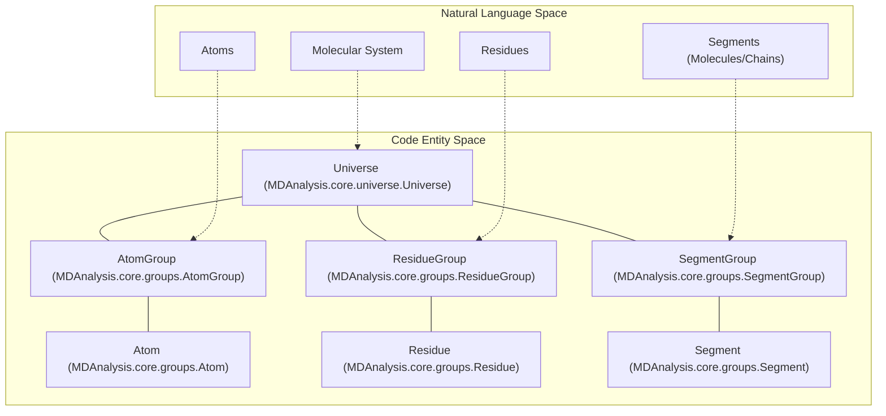
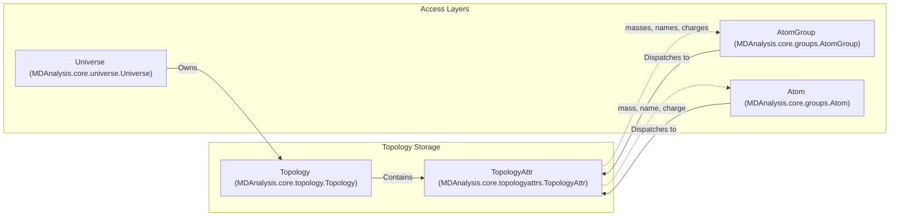

# Basic Usage Examples

<details>
<summary>Relevant source files</summary>

The following files were used as context for generating this wiki page:

- [package/AUTHORS](package/AUTHORS)
- [package/CHANGELOG](package/CHANGELOG)
- [package/MDAnalysis/__init__.py](package/MDAnalysis/__init__.py)
- [package/MDAnalysis/core/groups.py](package/MDAnalysis/core/groups.py)
- [package/MDAnalysis/core/topology.py](package/MDAnalysis/core/topology.py)
- [package/MDAnalysis/core/topologyattrs.py](package/MDAnalysis/core/topologyattrs.py)
- [package/MDAnalysis/core/universe.py](package/MDAnalysis/core/universe.py)
- [package/MDAnalysis/units.py](package/MDAnalysis/units.py)
- [package/MDAnalysis/version.py](package/MDAnalysis/version.py)
- [package/setup.py](package/setup.py)
- [testsuite/MDAnalysisTests/__init__.py](testsuite/MDAnalysisTests/__init__.py)
- [testsuite/MDAnalysisTests/core/test_atomgroup.py](testsuite/MDAnalysisTests/core/test_atomgroup.py)
- [testsuite/MDAnalysisTests/core/test_copying.py](testsuite/MDAnalysisTests/core/test_copying.py)
- [testsuite/MDAnalysisTests/core/test_groups.py](testsuite/MDAnalysisTests/core/test_groups.py)
- [testsuite/MDAnalysisTests/core/test_topology.py](testsuite/MDAnalysisTests/core/test_topology.py)
- [testsuite/MDAnalysisTests/core/test_topologyattrs.py](testsuite/MDAnalysisTests/core/test_topologyattrs.py)
- [testsuite/MDAnalysisTests/core/test_universe.py](testsuite/MDAnalysisTests/core/test_universe.py)
- [testsuite/MDAnalysisTests/datafiles.py](testsuite/MDAnalysisTests/datafiles.py)
- [testsuite/MDAnalysisTests/utils/test_authors.py](testsuite/MDAnalysisTests/utils/test_authors.py)
- [testsuite/MDAnalysisTests/utils/test_datafiles.py](testsuite/MDAnalysisTests/utils/test_datafiles.py)
- [testsuite/MDAnalysisTests/utils/test_failure.py](testsuite/MDAnalysisTests/utils/test_failure.py)
- [testsuite/MDAnalysisTests/utils/test_imports.py](testsuite/MDAnalysisTests/utils/test_imports.py)
- [testsuite/MDAnalysisTests/utils/test_log.py](testsuite/MDAnalysisTests/utils/test_log.py)
- [testsuite/MDAnalysisTests/utils/test_meta.py](testsuite/MDAnalysisTests/utils/test_meta.py)
- [testsuite/MDAnalysisTests/utils/test_modelling.py](testsuite/MDAnalysisTests/utils/test_modelling.py)
- [testsuite/MDAnalysisTests/utils/test_persistence.py](testsuite/MDAnalysisTests/utils/test_persistence.py)
- [testsuite/MDAnalysisTests/utils/test_qcprot.py](testsuite/MDAnalysisTests/utils/test_qcprot.py)
- [testsuite/MDAnalysisTests/utils/test_selections.py](testsuite/MDAnalysisTests/utils/test_selections.py)
- [testsuite/MDAnalysisTests/utils/test_transformations.py](testsuite/MDAnalysisTests/utils/test_transformations.py)
- [testsuite/MDAnalysisTests/utils/test_units.py](testsuite/MDAnalysisTests/utils/test_units.py)
- [testsuite/setup.py](testsuite/setup.py)

</details>


This page provides a concise introduction to the fundamental usage patterns of MDAnalysis. It demonstrates how to load molecular dynamics data, access structural information, and perform basic operations on molecular systems.

For more advanced usage, see [Core Data Structures](2) and [Analysis Modules](4).

## Creating a Universe

The `Universe` is the central object in MDAnalysis that ties a topology and a trajectory together [package/MDAnalysis/core/universe.py:29-31](). It is typically created from files by providing a topology (e.g., PSF, PDB, GRO) and an optional trajectory (e.g., DCD, XTC, TRR) [package/MDAnalysis/core/universe.py:33-37]().

```python
import MDAnalysis as mda

# Load from topology and trajectory files
u = mda.Universe("topology.psf", "trajectory.dcd")

# Load from a single file containing both topology and coordinates
u = mda.Universe("structure.pdb")
```

The `Universe` constructor utilizes `get_parser_for` and `get_reader_for` to dispatch the correct classes based on file extensions or explicit `format` arguments [package/MDAnalysis/core/universe.py:225-227](), [package/MDAnalysis/core/universe.py:83-83]().

**Sources:** [package/MDAnalysis/core/universe.py:25-55](), [package/MDAnalysis/core/universe.py:225-230](), [package/MDAnalysis/core/universe.py:330-350]()

## Accessing Atoms, Residues, and Segments

MDAnalysis organizes molecular systems into a hierarchy: `Atom` < `Residue` < `Segment` [package/MDAnalysis/core/groups.py:37-41](). Collections of these entities are handled by plural "Group" classes like `AtomGroup` [package/MDAnalysis/core/groups.py:30-33]().

### Entity Hierarchy Mapping
The following diagram maps the logical molecular hierarchy to the code entities that represent them.



You can access these groups directly as attributes of the `Universe`:

```python
# Access all atoms, residues, or segments
atoms = u.atoms
residues = u.residues
segments = u.segments

# Access individual components via slicing or indexing
atom = u.atoms[0]
residue = u.residues[10]

# Access attributes (e.g., name, resname, segid)
print(atom.name)
print(residue.resname)
```

**Sources:** [package/MDAnalysis/core/groups.py:25-41](), [package/MDAnalysis/core/groups.py:64-73](), [package/MDAnalysis/core/universe.py:84-93]()

## Atom Selection

The `select_atoms()` method is used to filter atoms using a powerful selection language DSL [package/MDAnalysis/core/groups.py:33-35]().

```python
# Select all protein atoms
protein = u.select_atoms("protein")

# Select atoms by name
ca_atoms = u.select_atoms("name CA")

# Combine selections with boolean operators
selection = u.select_atoms("protein and resid 10-30")

# Distance-based selection
near_residue = u.select_atoms("around 5.0 resid 42")
```

Selections return an `AtomGroup`, which is a view into the `Universe` [package/MDAnalysis/core/groups.py:30-33]().

**Sources:** [package/MDAnalysis/core/groups.py:30-35](), [package/MDAnalysis/core/universe.py:33-37]()

## Working with Atom Groups

`AtomGroup` objects support vectorised coordinate operations and geometric calculations [package/MDAnalysis/core/groups.py:30-35]().

```python
# Get the number of atoms
num_atoms = len(protein)

# Access coordinates (returns a numpy.ndarray)
coords = protein.positions

# Geometric calculations
com = protein.center_of_mass()
rg = protein.radius_of_gyration()

# Groups can be combined via addition
combined = protein + u.select_atoms("resname SOL")
```

**Sources:** [package/MDAnalysis/core/groups.py:49-58](), [package/MDAnalysis/core/topologyattrs.py:122-156]()

## Accessing Topology Information

Topology information (names, masses, bonds) is stored in the `Topology` object [package/MDAnalysis/core/topology.py:30-32](). These attributes are accessed through `TopologyAttr` descriptors mapped to the group classes [package/MDAnalysis/core/topologyattrs.py:28-33]().

### Data Flow for Topology Attributes
The diagram below illustrates how attributes flow from the `Topology` container to user-facing groups.



```python
# Access atom attributes
masses = u.atoms.masses
names = u.atoms.names

# Access connectivity if available in topology
bonds = u.atoms.bonds
```

**Sources:** [package/MDAnalysis/core/topology.py:25-32](), [package/MDAnalysis/core/topologyattrs.py:25-33](), [package/MDAnalysis/core/universe.py:95-106]()

## Working with Trajectories

Trajectories are accessed via `u.trajectory`. Iterating over the trajectory updates the state of the `Universe` (and all derived `AtomGroup` objects) to the current frame's coordinates [package/MDAnalysis/core/universe.py:29-31]().

```python
# Iterate through all frames
for ts in u.trajectory:
    # ts is a Timestep object
    print(f"Frame: {ts.frame}, Time: {ts.time}")
    
    # AtomGroup positions update automatically
    current_rg = protein.radius_of_gyration()

# Jump to a specific frame
u.trajectory[50]
```

**Sources:** [package/MDAnalysis/core/universe.py:29-31](), [package/MDAnalysis/core/groups.py:33-35]()

## Writing Data

The `write()` method on `AtomGroup` allows exporting structures or trajectory segments [testsuite/MDAnalysisTests/core/test_atomgroup.py:107-109]().

```python
# Write a single frame to a PDB
protein.write('protein_frame.pdb')

# Write a trajectory segment
u.atoms.write('output.xtc', frames=u.trajectory[10:100])
```

**Sources:** [testsuite/MDAnalysisTests/core/test_atomgroup.py:105-112](), [testsuite/MDAnalysisTests/core/test_atomgroup.py:131-136]()

## Updating Selections

An `UpdatingAtomGroup` re-evaluates its selection string at every frame, which is useful for dynamic properties like solvation shells [package/MDAnalysis/core/groups.py:58-60]().

```python
# Create an UpdatingAtomGroup
dynamic_solvation = u.select_atoms("resname SOL and around 5.0 protein", updating=True)

for ts in u.trajectory:
    # len(dynamic_solvation) changes as waters move
    print(f"Frame {ts.frame}: {len(dynamic_solvation)} waters")
```

**Sources:** [package/MDAnalysis/core/groups.py:58-60](), [package/MDAnalysis/core/groups.py:137-141]()

## Merging and Scratch Creation

You can create a `Universe` from scratch using `Universe.empty()` or combine existing groups with `Merge()` [package/MDAnalysis/core/universe.py:38-41]().

```python
# Create an empty universe
u_empty = mda.Universe.empty(n_atoms=100, n_residues=10)

# Merge groups from different universes
new_u = mda.Merge(u1.select_atoms("protein"), u2.select_atoms("resname LIG"))
```

**Sources:** [package/MDAnalysis/core/universe.py:53-55](), [package/MDAnalysis/core/universe.py:197-204]()

---