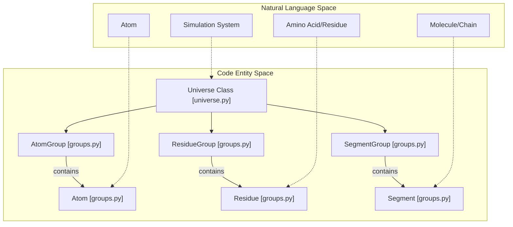
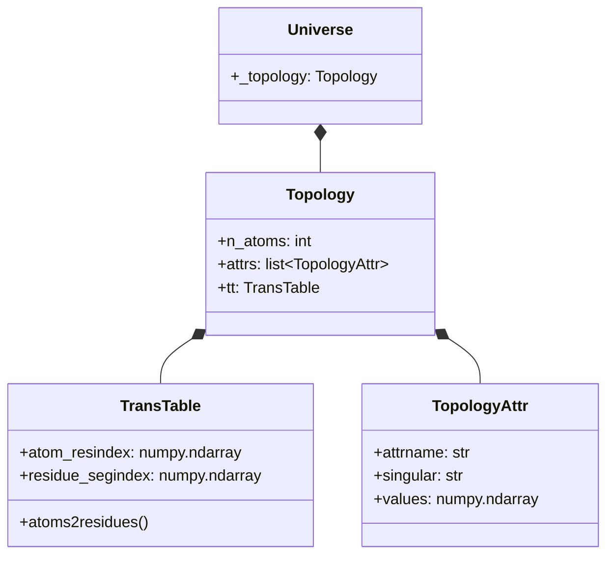

# Core Data Structures

Relevant source files

The following files were used as context for generating this wiki page:

- [package/MDAnalysis/core/groups.py](package/MDAnalysis/core/groups.py)
- [package/MDAnalysis/core/selection.py](package/MDAnalysis/core/selection.py)
- [package/MDAnalysis/core/topology.py](package/MDAnalysis/core/topology.py)
- [package/MDAnalysis/core/topologyattrs.py](package/MDAnalysis/core/topologyattrs.py)
- [package/MDAnalysis/core/topologyobjects.py](package/MDAnalysis/core/topologyobjects.py)
- [package/MDAnalysis/core/universe.py](package/MDAnalysis/core/universe.py)
- [package/doc/sphinx/source/documentation_pages/overview.rst](package/doc/sphinx/source/documentation_pages/overview.rst)
- [package/doc/sphinx/source/documentation_pages/selections.rst](package/doc/sphinx/source/documentation_pages/selections.rst)
- [package/doc/sphinx/source/documentation_pages/topology.rst](package/doc/sphinx/source/documentation_pages/topology.rst)
- [package/doc/sphinx/source/index.rst](package/doc/sphinx/source/index.rst)
- [testsuite/MDAnalysisTests/core/test_atomgroup.py](testsuite/MDAnalysisTests/core/test_atomgroup.py)
- [testsuite/MDAnalysisTests/core/test_atomselections.py](testsuite/MDAnalysisTests/core/test_atomselections.py)
- [testsuite/MDAnalysisTests/core/test_copying.py](testsuite/MDAnalysisTests/core/test_copying.py)
- [testsuite/MDAnalysisTests/core/test_groups.py](testsuite/MDAnalysisTests/core/test_groups.py)
- [testsuite/MDAnalysisTests/core/test_topology.py](testsuite/MDAnalysisTests/core/test_topology.py)
- [testsuite/MDAnalysisTests/core/test_topologyattrs.py](testsuite/MDAnalysisTests/core/test_topologyattrs.py)
- [testsuite/MDAnalysisTests/core/test_topologyobjects.py](testsuite/MDAnalysisTests/core/test_topologyobjects.py)
- [testsuite/MDAnalysisTests/core/test_universe.py](testsuite/MDAnalysisTests/core/test_universe.py)

This page describes the fundamental data structures that form the backbone of MDAnalysis. These core structures define how molecular systems are represented in memory and how users interact with them.

## Overview

MDAnalysis organizes molecular systems using a hierarchical structure. The `Universe` acts as the central hub, tying together the system's structure (`Topology`) and its coordinates over time (`Trajectory`) [package/MDAnalysis/core/universe.py:29-31]().

- **Universe**: The top-level container [package/MDAnalysis/core/universe.py:29-31]().
- **Atoms**: The fundamental particles [package/MDAnalysis/core/groups.py:29-30]().
- **Residues**: Groups of atoms forming chemical units [package/MDAnalysis/core/groups.py:37-38]().
- **Segments**: Collections of residues, often representing molecules or chains [package/MDAnalysis/core/groups.py:38-40]().

Sources: [package/MDAnalysis/core/universe.py:29-55](), [package/MDAnalysis/core/groups.py:24-92]()

## Universe
The `Universe` class is the primary entry point for most MDAnalysis workflows. It integrates topology information (from files like PSF, PDB, or TPR) with trajectory data (DCD, XTC, etc.) [package/MDAnalysis/core/universe.py:29-31](). It maintains a reference to the `Topology` and the `Trajectory` reader [package/MDAnalysis/core/universe.py:83-94]().

For details, see [Universe](#2.1).

Sources: [package/MDAnalysis/core/universe.py:24-55](), [package/MDAnalysis/core/universe.py:83-107]()

## Group Classes
MDAnalysis uses a "flyweight" pattern where groups like `AtomGroup`, `ResidueGroup`, and `SegmentGroup` do not store data themselves but instead reference the `Universe` and a set of indices [package/MDAnalysis/core/groups.py:177-191]().

- **AtomGroup**: The most critical object; provides access to coordinates, velocities, and topology attributes [package/MDAnalysis/core/groups.py:31-35]().
- **ResidueGroup/SegmentGroup**: Containers for higher-level chemical units [package/MDAnalysis/core/groups.py:37-40]().
- **UpdatingAtomGroup**: A special group that re-evaluates its selection string every time the trajectory frame changes [package/MDAnalysis/core/groups.py:58-60]().

For details, see [AtomGroup, ResidueGroup, and SegmentGroup](#2.2).

Sources: [package/MDAnalysis/core/groups.py:24-92](), [package/MDAnalysis/core/groups.py:143-174]()

## Topology and TopologyAttributes
The `Topology` object stores the static connectivity and properties of the system [package/MDAnalysis/core/topology.py:30-31](). Data is stored in `TopologyAttr` objects, which are categorized by their "level" (Atom, Residue, or Segment) [package/MDAnalysis/core/topologyattrs.py:31-33]().

- **TransTable**: Manages the mapping between levels (e.g., finding which residue an atom belongs to) [package/MDAnalysis/core/topology.py:140-150]().
- **Guesser**: A system to infer missing topology data (like masses or bonds) from available information [package/MDAnalysis/core/universe.py:108]().

Sources: [package/MDAnalysis/core/topology.py:140-183](), [package/MDAnalysis/core/topologyattrs.py:25-39](), [package/MDAnalysis/core/universe.py:113-214]()

For details, see [Topology and TopologyAttributes](#2.3).

## Selection System
MDAnalysis features a powerful selection language (DSL) that allows users to extract subsets of atoms using strings like `"resname ALA and name CA"` [package/doc/sphinx/source/documentation_pages/selections.rst:8-12]().

- **Parser**: The `Parser.parse` method converts selection strings into a `Selection` object [package/MDAnalysis/core/selection.py:30-34]().
- **Logic Operations**: Classes like `AndOperation` and `OrOperation` handle boolean logic between selections [package/MDAnalysis/core/selection.py:194-221]().

For details, see [Selection System](#2.4).

Sources: [package/MDAnalysis/core/selection.py:24-40](), [package/MDAnalysis/core/selection.py:194-221](), [package/doc/sphinx/source/documentation_pages/selections.rst:59-101]()

## Timestep
A `Timestep` represents a single snapshot of the system in time. It is the object that actually holds the numerical coordinate data during trajectory iteration [package/MDAnalysis/core/universe.py:1071-1075]().

- **Positions**: Typically a `numpy.float32` array of shape `(n_atoms, 3)`.
- **Dimensions**: Contains unit cell information (A, B, C, alpha, beta, gamma) [package/MDAnalysis/core/universe.py:94-106]().

For details, see [Timestep](#2.5).

Sources: [package/MDAnalysis/core/universe.py:1071-1080](), [package/MDAnalysis/core/topologyattrs.py:94-106]()

---