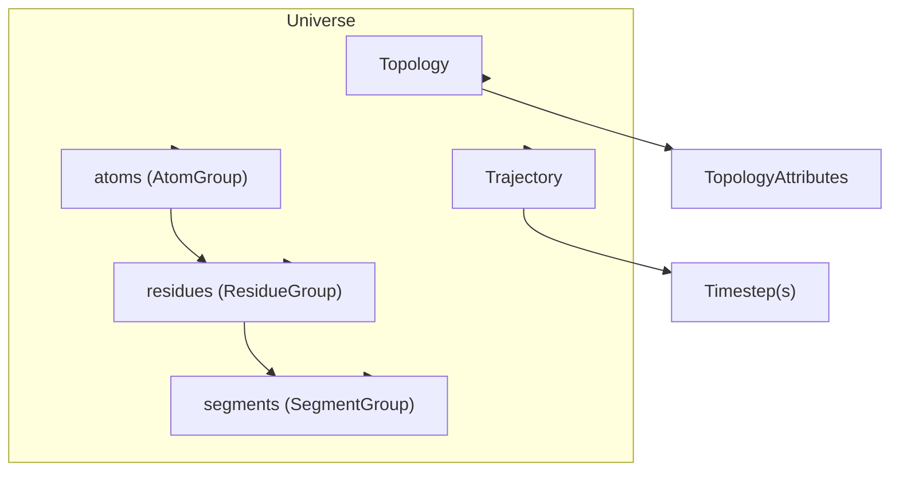
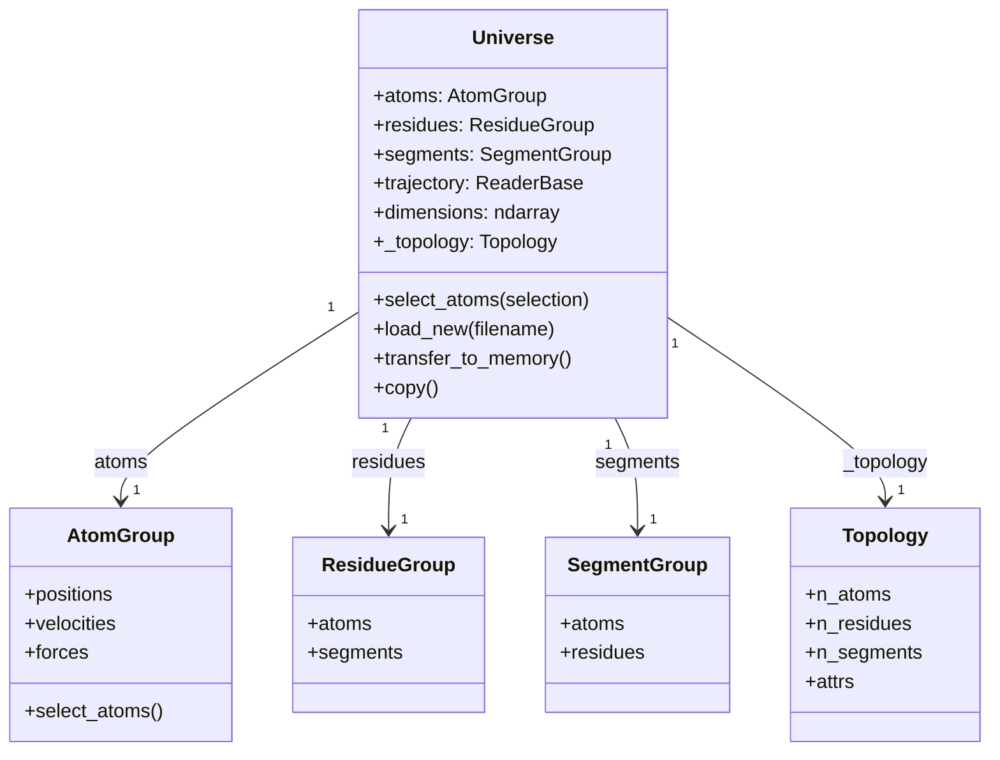
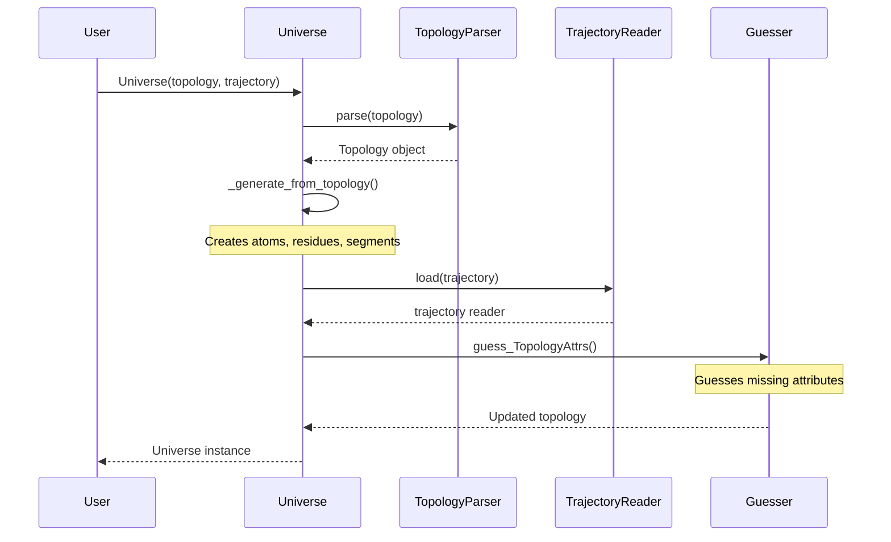

# Universe

<details>
<summary>Relevant source files</summary>

The following files were used as context for generating this wiki page:

- [package/AUTHORS](package/AUTHORS)
- [package/CHANGELOG](package/CHANGELOG)
- [package/MDAnalysis/__init__.py](package/MDAnalysis/__init__.py)
- [package/MDAnalysis/core/_get_readers.py](package/MDAnalysis/core/_get_readers.py)
- [package/MDAnalysis/core/groups.py](package/MDAnalysis/core/groups.py)
- [package/MDAnalysis/core/topology.py](package/MDAnalysis/core/topology.py)
- [package/MDAnalysis/core/topologyattrs.py](package/MDAnalysis/core/topologyattrs.py)
- [package/MDAnalysis/core/universe.py](package/MDAnalysis/core/universe.py)
- [package/MDAnalysis/version.py](package/MDAnalysis/version.py)
- [package/setup.py](package/setup.py)
- [testsuite/MDAnalysisTests/__init__.py](testsuite/MDAnalysisTests/__init__.py)
- [testsuite/MDAnalysisTests/core/test_atomgroup.py](testsuite/MDAnalysisTests/core/test_atomgroup.py)
- [testsuite/MDAnalysisTests/core/test_copying.py](testsuite/MDAnalysisTests/core/test_copying.py)
- [testsuite/MDAnalysisTests/core/test_groups.py](testsuite/MDAnalysisTests/core/test_groups.py)
- [testsuite/MDAnalysisTests/core/test_topology.py](testsuite/MDAnalysisTests/core/test_topology.py)
- [testsuite/MDAnalysisTests/core/test_topologyattrs.py](testsuite/MDAnalysisTests/core/test_topologyattrs.py)
- [testsuite/MDAnalysisTests/core/test_universe.py](testsuite/MDAnalysisTests/core/test_universe.py)
- [testsuite/MDAnalysisTests/datafiles.py](testsuite/MDAnalysisTests/datafiles.py)
- [testsuite/setup.py](testsuite/setup.py)

</details>


The `Universe` class is the central container for molecular systems in MDAnalysis. It serves as the primary entry point for working with molecular dynamics data, connecting topology information (atoms, residues, segments) with trajectory data (coordinates over time).

## Overview

The `Universe` class ties together two fundamental components:
1.  A **topology** - the structural description of the molecular system (atoms, bonds, etc.)
2.  A **trajectory** - the coordinates of atoms over time

### System Architecture

Title: Universe Data Model


Sources: [package/MDAnalysis/core/universe.py:29-55](), [package/MDAnalysis/core/universe.py:280-452]()

## Creating a Universe

A `Universe` can be created in several ways:

### From Files
The most common way to create a `Universe` is from topology and trajectory files:

```python
import MDAnalysis as mda
u = mda.Universe("topology.psf", "trajectory.dcd")
```

The topology file defines the structure (atoms, bonds, etc.), while the trajectory file contains coordinates. If the topology file also contains coordinates (like PDB files), you can create a `Universe` with just that file.

Sources: [package/MDAnalysis/core/universe.py:33-37](), [testsuite/MDAnalysisTests/core/test_universe.py:96-100]()

### From Streams
MDAnalysis supports loading topologies and trajectories from file-like objects (e.g., `io.StringIO` or `io.BytesIO`), provided the `format` is explicitly specified.

```python
from io import StringIO
u = mda.Universe(StringIO(pdb_content), format="PDB")
```

Sources: [package/MDAnalysis/core/universe.py:215-223](), [testsuite/MDAnalysisTests/core/test_universe.py:101-126]()

### Empty Universe
You can create an empty `Universe` and build it from scratch using `Universe.empty()`. This is useful for building systems programmatically without input files.

```python
u = mda.Universe.empty(n_atoms=100, n_residues=10, n_segments=2)
```

Sources: [package/MDAnalysis/core/universe.py:588-650]()

## Universe Structure

The `Universe` object provides access to the molecular system through several key attributes:

Title: Universe Entity Relationships


Sources: [package/MDAnalysis/core/universe.py:280-452](), [package/MDAnalysis/core/groups.py:24-92]()

### Key Attributes
- **atoms**: An `AtomGroup` containing all atoms in the system. [package/MDAnalysis/core/universe.py:423-452]()
- **residues**: A `ResidueGroup` containing all residues. [package/MDAnalysis/core/groups.py:49-57]()
- **segments**: A `SegmentGroup` containing all segments.
- **trajectory**: The trajectory reader for accessing coordinates. [package/MDAnalysis/core/universe.py:453-467]()

## Universe Initialization Process

When a `Universe` is created, it dispatches the correct parsers and readers based on file extensions or explicit `format` arguments.

1.  **Topology Parsing**: Calls `get_parser_for` to find the appropriate `TopologyReader`. [package/MDAnalysis/core/_get_readers.py:31-60]()
2.  **Hierarchy Generation**: Creates the `Topology` object and generates the internal hierarchy of atoms, residues, and segments. [package/MDAnalysis/core/topology.py:185-212]()
3.  **Trajectory Loading**: Calls `get_reader_for` to find the appropriate `TrajectoryReader`. [package/MDAnalysis/core/_get_readers.py:63-92]()
4.  **Attribute Guessing**: Uses the `Guesser` API to infer missing data (e.g., masses, bonds) if requested via `guess_bonds=True`. [package/MDAnalysis/core/universe.py:575-577]()

Title: Universe Initialization Workflow


Sources: [package/MDAnalysis/core/universe.py:256-278](), [package/MDAnalysis/core/universe.py:494-577]()

## Universe Implementation Details

### TransTable and Mappings
The `Universe` relies on the `TransTable` class to manage the mapping between levels (Atom -> Residue -> Segment). It uses `make_downshift_arrays` to convert many-to-one mappings (e.g., atoms to residues) into one-to-many mappings (residues to atoms).

Sources: [package/MDAnalysis/core/topology.py:68-138](), [package/MDAnalysis/core/topology.py:140-183]()

### Class Generation and Mixins
The system uses a class factory pattern in `MDAnalysis.core.groups.make_classes` to dynamically generate specialized classes for each `Universe` instance. This allows `TopologyAttributes` (like `Masses` or `Bonds`) to be "transplanted" onto the `AtomGroup` or `Universe` objects as methods or properties.

Sources: [package/MDAnalysis/core/groups.py:143-174](), [package/MDAnalysis/core/topologyattrs.py:213-230]()

### Topology Modification
The internal method `_update_topology_by_ids` is used to re-squash and update the topology when residue or segment identifiers change, ensuring the internal hierarchy remains consistent.

Sources: [package/MDAnalysis/core/universe.py:113-214]()

## Universe Operations

-   **copy()**: Creates an independent copy of the `Universe` and its underlying trajectory. [package/MDAnalysis/core/universe.py:580-586]()
-   **Merge()**: Combines multiple `AtomGroup` instances (potentially from different Universes) into a single new `Universe`. [package/MDAnalysis/core/universe.py:53-55]()
-   **Pickling**: Supports serialization via `pickle` for parallel processing and data persistence. [package/MDAnalysis/core/groups.py:128-141]()

Sources: [package/MDAnalysis/core/universe.py:580-650](), [testsuite/MDAnalysisTests/core/test_universe.py:395-400]()

---