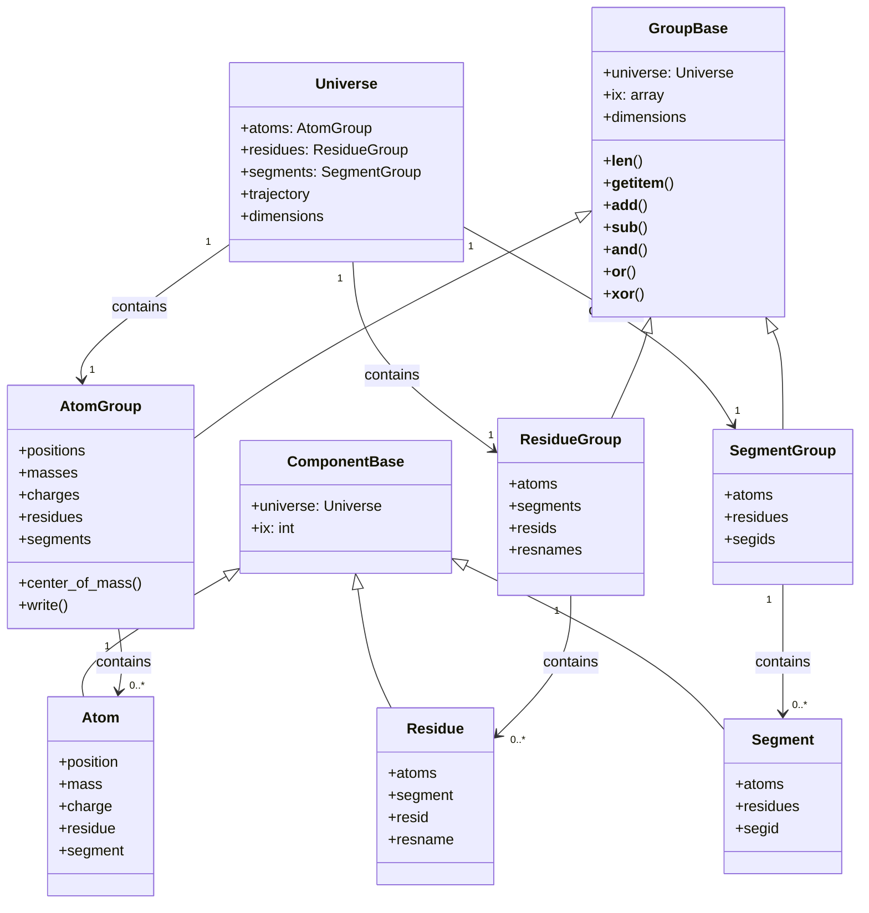
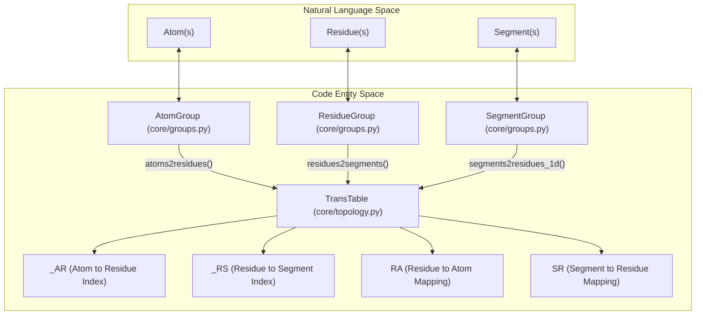

# AtomGroup, ResidueGroup, and SegmentGroup

Relevant source files

The following files were used as context for generating this wiki page:

- [package/MDAnalysis/core/groups.py](package/MDAnalysis/core/groups.py)
- [package/MDAnalysis/core/topology.py](package/MDAnalysis/core/topology.py)
- [package/MDAnalysis/core/topologyattrs.py](package/MDAnalysis/core/topologyattrs.py)
- [package/MDAnalysis/core/universe.py](package/MDAnalysis/core/universe.py)
- [testsuite/MDAnalysisTests/core/test_atom.py](testsuite/MDAnalysisTests/core/test_atom.py)
- [testsuite/MDAnalysisTests/core/test_atomgroup.py](testsuite/MDAnalysisTests/core/test_atomgroup.py)
- [testsuite/MDAnalysisTests/core/test_copying.py](testsuite/MDAnalysisTests/core/test_copying.py)
- [testsuite/MDAnalysisTests/core/test_group_traj_access.py](testsuite/MDAnalysisTests/core/test_group_traj_access.py)
- [testsuite/MDAnalysisTests/core/test_groups.py](testsuite/MDAnalysisTests/core/test_groups.py)
- [testsuite/MDAnalysisTests/core/test_residue.py](testsuite/MDAnalysisTests/core/test_residue.py)
- [testsuite/MDAnalysisTests/core/test_residuegroup.py](testsuite/MDAnalysisTests/core/test_residuegroup.py)
- [testsuite/MDAnalysisTests/core/test_segment.py](testsuite/MDAnalysisTests/core/test_segment.py)
- [testsuite/MDAnalysisTests/core/test_segmentgroup.py](testsuite/MDAnalysisTests/core/test_segmentgroup.py)
- [testsuite/MDAnalysisTests/core/test_topology.py](testsuite/MDAnalysisTests/core/test_topology.py)
- [testsuite/MDAnalysisTests/core/test_topologyattrs.py](testsuite/MDAnalysisTests/core/test_topologyattrs.py)
- [testsuite/MDAnalysisTests/core/test_universe.py](testsuite/MDAnalysisTests/core/test_universe.py)

This page describes the core group classes in MDAnalysis that represent collections of atoms, residues, and segments. These classes provide the primary interface for accessing and manipulating structural components in molecular systems.

## Overview

MDAnalysis organizes molecular structures hierarchically using a "flyweight" pattern where individual components (`Atom`, `Residue`, `Segment`) are lightweight proxies that point back to the central topology data and current coordinate state in a `Universe` [package/MDAnalysis/core/groups.py:29-40]().

The hierarchy consists of:
- **Atoms**: The fundamental particles.
- **Residues**: Chemically meaningful groups of atoms (e.g., amino acids).
- **Segments**: Groups of residues (e.g., protein chains or solvent blocks).

Each level has both individual component classes (singular) and group classes (plural) for collections.

Title: Component and Group Hierarchy

Sources: [package/MDAnalysis/core/groups.py:43-92](), [package/MDAnalysis/core/groups.py:155-174](), [package/MDAnalysis/core/universe.py:84-93]()

## The Class Factory and TopologyAttr Containers

MDAnalysis uses a class factory, `make_classes`, to generate `Universe`-specific versions of these groups [package/MDAnalysis/core/groups.py:143-174](). This allows `TopologyAttr` objects (like `Masses`, `Resids`, or `Bonds`) to be "transplanted" onto the classes as properties or methods.

The `_TopologyAttrContainer` serves as the base for this mechanism:
- **GBase**: Base for all group classes (`AtomGroup`, `ResidueGroup`, `SegmentGroup`) [package/MDAnalysis/core/groups.py:160-162]().
- **CBase**: Base for all individual component classes (`Atom`, `Residue`, `Segment`) [package/MDAnalysis/core/groups.py:164-168]().

This architecture ensures that if a topology file contains "tempfactors", the `Tempfactors` attribute is added to the `AtomGroup` of that specific `Universe` instance without affecting other universes [package/MDAnalysis/core/groups.py:177-191](). Stubs are built using `_build_stub` to provide documentation even when data is missing, raising a `NoDataError` if accessed [package/MDAnalysis/core/topologyattrs.py:213-222]().

Sources: [package/MDAnalysis/core/groups.py:143-174](), [package/MDAnalysis/core/groups.py:177-191](), [package/MDAnalysis/core/topologyattrs.py:213-222]()

## Common Group Properties and Methods

All group classes inherit from `GroupBase` and share core functionality for set theory and indexing.

### Basic Operations
- **Indexing and Slicing**: Groups support standard Python indexing and slicing, which return a new group of the same type [package/MDAnalysis/core/groups.py:613-669]().
- **Set Logic**: Groups support union (`|`), intersection (`&`), and difference (`-`) operations based on the underlying component indices [package/MDAnalysis/core/groups.py:726-778]().
- **Uniqueness and Sorting**: The `isunique` property checks for duplicate indices, and `issorted` checks if indices are in ascending order [testsuite/MDAnalysisTests/core/test_groups.py:62-103](). `asunique(sorted=True)` returns a copy with duplicates removed and indices sorted [package/MDAnalysis/core/groups.py:882-934]().

### Coordinate Operations (AtomGroup)
`AtomGroup` provides high-level access to coordinates stored in the `Timestep` of the `Universe`:
- **Positions**: Returns a NumPy array of shape (N, 3) [package/MDAnalysis/core/groups.py:1016-1043]().
- **Centers**: `center_of_mass()` calculates the mass-weighted center, while `center_of_geometry()` calculates the unweighted geometric center [package/MDAnalysis/core/groups.py:1367-1473]().
- **PBC Handling**: `wrap()` and `unwrap()` methods handle periodic boundary conditions using the `Timestep` dimensions [package/MDAnalysis/core/groups.py:1158-1243]().

Sources: [package/MDAnalysis/core/groups.py:613-669](), [package/MDAnalysis/core/groups.py:1016-1043](), [testsuite/MDAnalysisTests/core/test_groups.py:38-152]()

## Hierarchy Navigation and Translation

Navigating between levels (Atoms -> Residues -> Segments) is handled by the `TransTable` class in the topology system.

Title: Topology Level Translation

Sources: [package/MDAnalysis/core/topology.py:140-183](), [package/MDAnalysis/core/topology.py:198-212](), [package/MDAnalysis/core/topologyattrs.py:579-688]()

- **Upward Translation**: Mapping atoms to residues or residues to segments uses simple index arrays (`_AR` and `_RS`) [package/MDAnalysis/core/topology.py:198-212]().
- **Downward Translation**: Mapping residues to atoms uses "downshift" arrays (`RA` and `SR`) which are arrays of arrays (dtype object) created via `make_downshift_arrays` [package/MDAnalysis/core/topology.py:68-137]().

## Specialized Group Types

### UpdatingAtomGroup
An `UpdatingAtomGroup` is a dynamic collection that re-runs its selection string every time its attributes (like `positions`) are accessed [package/MDAnalysis/core/groups.py:58-59](). This is typically used for distance-based selections that change over time [package/MDAnalysis/core/groups.py:137-141]().

### Topology Objects from AtomGroup
`AtomGroup` provides convenience properties to quickly create topology objects if the group size is correct:
- `ag.bond`: Returns a `Bond` for a 2-atom group [testsuite/MDAnalysisTests/core/test_atomgroup.py:70-74]().
- `ag.angle`: Returns an `Angle` for a 3-atom group [testsuite/MDAnalysisTests/core/test_atomgroup.py:75-79]().
- `ag.dihedral`: Returns a `Dihedral` for a 4-atom group [testsuite/MDAnalysisTests/core/test_atomgroup.py:80-84]().

Sources: [package/MDAnalysis/core/groups.py:58-59](), [testsuite/MDAnalysisTests/core/test_atomgroup.py:63-98]()

## Summary of Key Methods

| Class | Method/Attribute | Description |
| :--- | :--- | :--- |
| `AtomGroup` | `write()` | Writes coordinates/topology to a file using the reader/writer dispatch [testsuite/MDAnalysisTests/core/test_atomgroup.py:105-121]() |
| `AtomGroup` | `select_atoms()` | Executes a selection string to return a new `AtomGroup` [package/MDAnalysis/core/groups.py:34-35]() |
| `ResidueGroup` | `sequence()` | Returns the 1-letter amino acid sequence (requires Biopython) [testsuite/MDAnalysisTests/core/test_residuegroup.py:42-51]() |
| `GroupBase` | `split()` | Splits the group into individual component instances [testsuite/MDAnalysisTests/core/test_atomgroup.py:540-579]() |
| `GroupBase` | `asunique()` | Returns unique components, with optional sorting [package/MDAnalysis/core/groups.py:882-934]() |

Sources: [package/MDAnalysis/core/groups.py:882-934](), [testsuite/MDAnalysisTests/core/test_atomgroup.py:105-121](), [testsuite/MDAnalysisTests/core/test_residuegroup.py:42-51]()

---