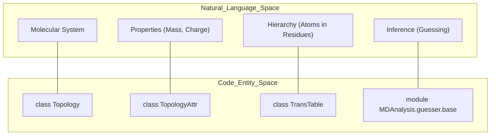
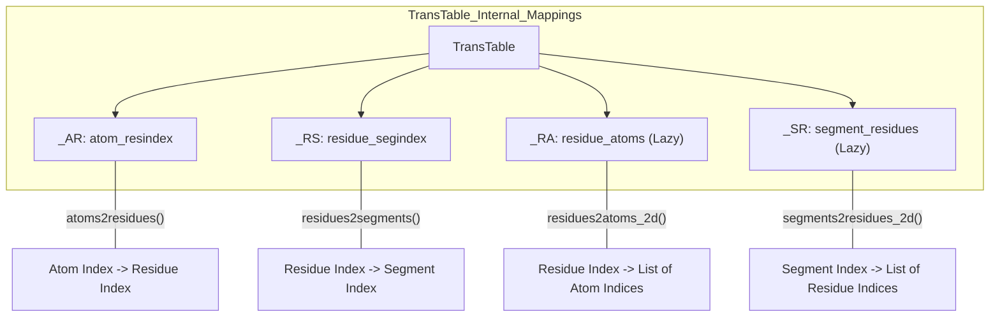
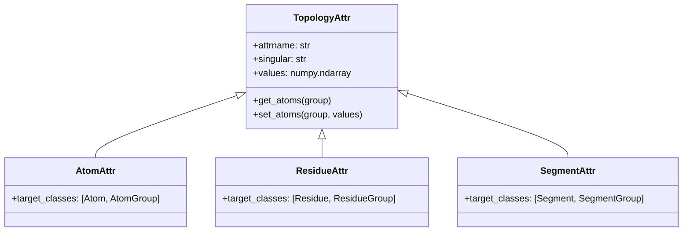
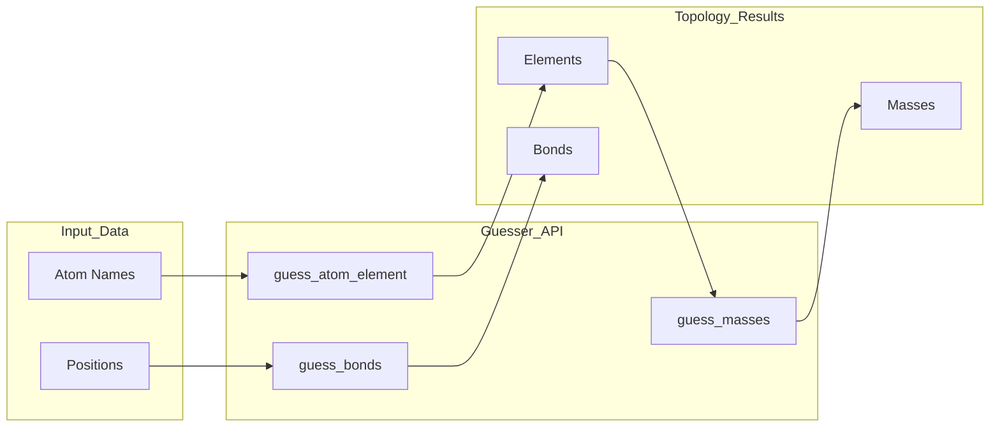

# Topology and TopologyAttributes

Relevant source files

The following files were used as context for generating this wiki page:

- [package/MDAnalysis/core/groups.py](package/MDAnalysis/core/groups.py)
- [package/MDAnalysis/core/topology.py](package/MDAnalysis/core/topology.py)
- [package/MDAnalysis/core/topologyattrs.py](package/MDAnalysis/core/topologyattrs.py)
- [package/MDAnalysis/core/universe.py](package/MDAnalysis/core/universe.py)
- [package/MDAnalysis/guesser/base.py](package/MDAnalysis/guesser/base.py)
- [package/MDAnalysis/guesser/default_guesser.py](package/MDAnalysis/guesser/default_guesser.py)
- [package/MDAnalysis/topology/guessers.py](package/MDAnalysis/topology/guessers.py)
- [package/MDAnalysis/topology/tables.py](package/MDAnalysis/topology/tables.py)
- [package/doc/sphinx/source/documentation_pages/guesser_modules.rst](package/doc/sphinx/source/documentation_pages/guesser_modules.rst)
- [package/doc/sphinx/source/documentation_pages/topology/guessers.rst](package/doc/sphinx/source/documentation_pages/topology/guessers.rst)
- [package/doc/sphinx/source/documentation_pages/topology/tables.rst](package/doc/sphinx/source/documentation_pages/topology/tables.rst)
- [testsuite/MDAnalysisTests/core/test_atomgroup.py](testsuite/MDAnalysisTests/core/test_atomgroup.py)
- [testsuite/MDAnalysisTests/core/test_copying.py](testsuite/MDAnalysisTests/core/test_copying.py)
- [testsuite/MDAnalysisTests/core/test_fragments.py](testsuite/MDAnalysisTests/core/test_fragments.py)
- [testsuite/MDAnalysisTests/core/test_groups.py](testsuite/MDAnalysisTests/core/test_groups.py)
- [testsuite/MDAnalysisTests/core/test_topology.py](testsuite/MDAnalysisTests/core/test_topology.py)
- [testsuite/MDAnalysisTests/core/test_topologyattrs.py](testsuite/MDAnalysisTests/core/test_topologyattrs.py)
- [testsuite/MDAnalysisTests/core/test_universe.py](testsuite/MDAnalysisTests/core/test_universe.py)
- [testsuite/MDAnalysisTests/data/adk_open_10res.pdb](testsuite/MDAnalysisTests/data/adk_open_10res.pdb)
- [testsuite/MDAnalysisTests/guesser/test_base.py](testsuite/MDAnalysisTests/guesser/test_base.py)
- [testsuite/MDAnalysisTests/guesser/test_default_guesser.py](testsuite/MDAnalysisTests/guesser/test_default_guesser.py)
- [testsuite/MDAnalysisTests/topology/test_guessers.py](testsuite/MDAnalysisTests/topology/test_guessers.py)
- [testsuite/MDAnalysisTests/topology/test_tables.py](testsuite/MDAnalysisTests/topology/test_tables.py)

The Topology system in MDAnalysis provides the fundamental structure that defines molecular systems. It describes how atoms are organized into residues and segments, and stores attributes like atom names, masses, and charges. This page explains the core Topology classes, the `TopologyAttr` metaclass system, and the Guesser API for inferring missing data.

## Core Topology Concepts

The topology system consists of several key components that define the identity and connectivity of the molecular system:

1.  **Topology**: The central container holding all structural information [package/MDAnalysis/core/topology.py:30-32]().
2.  **TopologyAttributes**: Properties attached to the topology (masses, names, etc.) [package/MDAnalysis/core/topologyattrs.py:28-32]().
3.  **TransTable**: Translation tables that map between atoms, residues, and segments [package/MDAnalysis/core/topology.py:140-142]().
4.  **Guessers**: API for inferring missing topology data (like elements or bonds) from existing data [package/MDAnalysis/topology/guessers.py:24-30]().

### Topology Entity Map

The following diagram maps natural language topology concepts to the specific code entities implementing them.

Sources: [package/MDAnalysis/core/topology.py:30-32](), [package/MDAnalysis/core/topology.py:140-183](), [package/MDAnalysis/core/topologyattrs.py:28-32](), [package/MDAnalysis/guesser/base.py:1-20]()

## The Topology Class and TransTable

The `Topology` class is the central container for all structural information. It defines the counts of atoms, residues, and segments and maintains their relationships via a `TransTable` [package/MDAnalysis/core/topology.py:140-183]().

### TransTable: Mapping Between Topology Levels

The `TransTable` provides methods to translate indices across the three levels: Atom, Residue, and Segment. Every atom must belong to a residue, and every residue must belong to a segment [package/MDAnalysis/core/topology.py:143-147]().

The `TransTable` uses lazy building for downward mappings (`RA` and `SR`) to optimize memory and initialization time [package/MDAnalysis/core/topology.py:181-183](). Downward mappings are generated using `make_downshift_arrays` which converts many-to-one mappings (upward) into one-to-many lists (downward) [package/MDAnalysis/core/topology.py:68-108]().

Sources: [package/MDAnalysis/core/topology.py:68-108](), [package/MDAnalysis/core/topology.py:140-220]()

## TopologyAttributes

`TopologyAttr` objects contain the actual data (e.g., an array of masses). They are managed via a class factory system that transplants attributes onto `AtomGroup`, `ResidueGroup`, and `SegmentGroup` [package/MDAnalysis/core/groups.py:177-191]().

### The Metaclass and Container System

Attributes are added to groups through `_TopologyAttrContainer`, which handles the namespace transplant of `TopologyAttr` objects onto the relevant group classes [package/MDAnalysis/core/groups.py:177-191](). The `make_classes` function initializes these bases and mixes them with the final container classes specific to each `Universe` [package/MDAnalysis/core/groups.py:143-174]().

### Attribute Access Flow

When a user accesses `atomgroup.masses`, the system routes the request through the `TopologyAttr` instance associated with that Universe's topology.

1.  **Lookup**: The group class (e.g., `AtomGroup`) has properties mixed in by `_TopologyAttrContainer` [package/MDAnalysis/core/groups.py:177-191]().
2.  **Dispatch**: The access triggers the `TopologyAttr` logic, often checking input lengths via decorators like `_check_length` [package/MDAnalysis/core/topologyattrs.py:88-157]().
3.  **Indexing**: The attribute uses the group's internal indices (`group.ix`) to slice its `values` array [package/MDAnalysis/core/topologyattrs.py:110-114]().

Sources: [package/MDAnalysis/core/topologyattrs.py:88-157](), [package/MDAnalysis/core/groups.py:143-191]()

## Guesser API: Inferring Missing Data

When topology files lack information such as masses or elements, MDAnalysis uses the Guesser API. Note that `MDAnalysis.topology.guessers` is deprecated in favor of the new Guessers API in `MDAnalysis.guesser` [package/MDAnalysis/topology/guessers.py:27-30]().

### Guessing Mechanism

The `guesser` system uses lookup tables in `MDAnalysis.guesser.tables` and string parsing to infer properties [package/MDAnalysis/topology/guessers.py:121-137]().

| Function | Target Attribute | Input Data |
| :--- | :--- | :--- |
| `guess_masses` | `masses` | Atom types [package/MDAnalysis/topology/guessers.py:121-137]() |
| `guess_types` | `types` | Atom names [package/MDAnalysis/topology/guessers.py:171-185]() |
| `guess_atom_element` | `elements` | Atom names [package/MDAnalysis/topology/guessers.py:211-230]() |
| `guess_bonds` | `bonds` | Coordinates and VdW radii [testsuite/MDAnalysisTests/topology/test_guessers.py:161-166]() |

### Guesser Architecture

The `get_guesser` function dispatches to the appropriate logic based on the required attribute [package/MDAnalysis/core/universe.py:108-109]().

Sources: [package/MDAnalysis/topology/guessers.py:24-103](), [package/MDAnalysis/core/universe.py:108-109](), [package/MDAnalysis/guesser/base.py:1-20]()

## Summary of Key Classes

| Class | File Path | Role |
| :--- | :--- | :--- |
| `Topology` | [package/MDAnalysis/core/topology.py:140]() | Main container for structural counts and the `TransTable`. |
| `TransTable` | [package/MDAnalysis/core/topology.py:140]() | Manages hierarchical mappings between topology levels. |
| `TopologyAttr` | [package/MDAnalysis/core/topologyattrs.py:424]() | Base class for all data-carrying topology properties. |
| `_TopologyAttrContainer` | [package/MDAnalysis/core/groups.py:177]() | Class factory for mixing `TopologyAttr` objects into groups. |

Sources: [package/MDAnalysis/core/topology.py:140-183](), [package/MDAnalysis/core/topologyattrs.py:424-430](), [package/MDAnalysis/core/groups.py:177-191]()

---