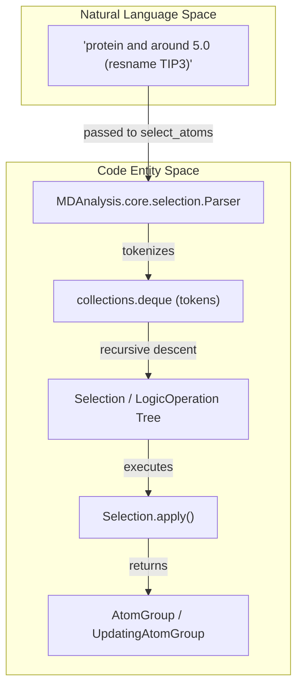
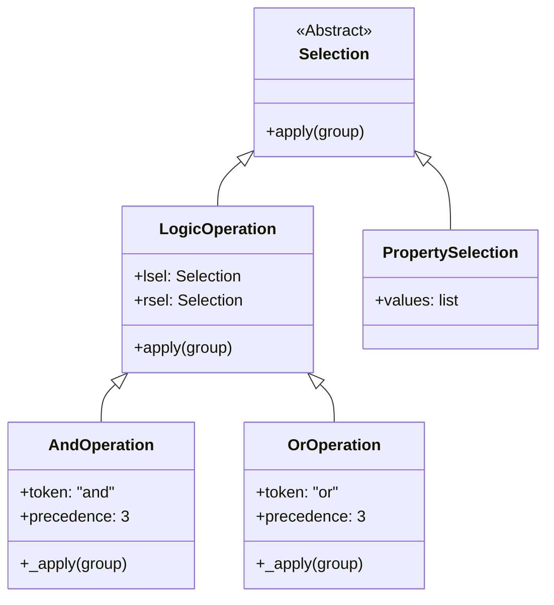
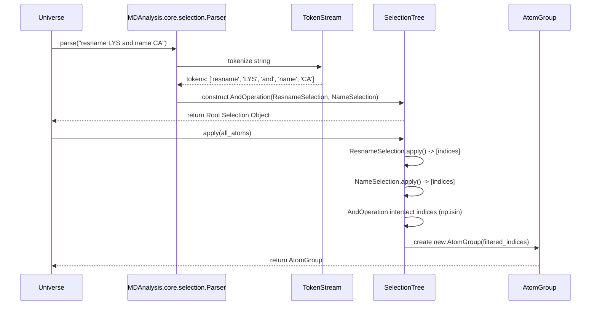

# Selection System

Relevant source files

The following files were used as context for generating this wiki page:

- [package/MDAnalysis/core/selection.py](package/MDAnalysis/core/selection.py)
- [package/MDAnalysis/core/topologyobjects.py](package/MDAnalysis/core/topologyobjects.py)
- [package/MDAnalysis/selections/__init__.py](package/MDAnalysis/selections/__init__.py)
- [package/MDAnalysis/selections/base.py](package/MDAnalysis/selections/base.py)
- [package/MDAnalysis/selections/charmm.py](package/MDAnalysis/selections/charmm.py)
- [package/MDAnalysis/selections/gromacs.py](package/MDAnalysis/selections/gromacs.py)
- [package/MDAnalysis/selections/jmol.py](package/MDAnalysis/selections/jmol.py)
- [package/MDAnalysis/selections/pymol.py](package/MDAnalysis/selections/pymol.py)
- [package/MDAnalysis/selections/vmd.py](package/MDAnalysis/selections/vmd.py)
- [package/doc/sphinx/source/documentation_pages/overview.rst](package/doc/sphinx/source/documentation_pages/overview.rst)
- [package/doc/sphinx/source/documentation_pages/selections.rst](package/doc/sphinx/source/documentation_pages/selections.rst)
- [package/doc/sphinx/source/documentation_pages/selections/jmol.rst](package/doc/sphinx/source/documentation_pages/selections/jmol.rst)
- [package/doc/sphinx/source/documentation_pages/selections_modules.rst](package/doc/sphinx/source/documentation_pages/selections_modules.rst)
- [package/doc/sphinx/source/documentation_pages/topology.rst](package/doc/sphinx/source/documentation_pages/topology.rst)
- [package/doc/sphinx/source/index.rst](package/doc/sphinx/source/index.rst)
- [testsuite/MDAnalysisTests/core/test_atomselections.py](testsuite/MDAnalysisTests/core/test_atomselections.py)
- [testsuite/MDAnalysisTests/core/test_topologyobjects.py](testsuite/MDAnalysisTests/core/test_topologyobjects.py)
- [testsuite/MDAnalysisTests/core/test_updating_atomgroup.py](testsuite/MDAnalysisTests/core/test_updating_atomgroup.py)

The Selection System in MDAnalysis provides a powerful way to select atoms from a molecular system based on various criteria. It allows users to create specific subsets of atoms using a CHARMM-like selection syntax, which is then parsed and applied to create new `AtomGroup` objects.

## Purpose and Scope

This document covers:
- The Domain Specific Language (DSL) parser implementation.
- Geometric selectors and coordinate-based filtering.
- Advanced features like SMARTS support and `UpdatingAtomGroup`.
- Data flow from selection strings to resulting `AtomGroup` entities.

Sources:
[package/MDAnalysis/core/selection.py:24-40]()

## Overview of the Selection System

The selection system allows users to select atoms from a `Universe` or `AtomGroup` using a text-based selection language. The primary entry point is the `select_atoms()` method.

### Natural Language to Code Entity Mapping

The following diagram bridges the user's intent (natural language) to the specific code components that handle the request.

**Selection System Architecture**

Sources:
[package/MDAnalysis/core/selection.py:24-40](), [package/MDAnalysis/core/selection.py:85-121](), [package/MDAnalysis/core/selection.py:165-173]()

## Internal Architecture and Implementation

The selection system consists of several key components that work together to parse and apply expressions.

### The Parser
The `Parser` class handles the conversion of strings into executable objects. It uses a recursive descent approach to handle precedence (e.g., `not` has higher precedence than `and`).

- **Tokenization**: Uses regex patterns like `FLOAT_PATTERN` and `INT_PATTERN` to identify values [package/MDAnalysis/core/selection.py:58-61]().
- **Keyword Handling**: The `is_keyword` function checks tokens against `_SELECTIONDICT` and `_OPERATIONS` [package/MDAnalysis/core/selection.py:68-83]().
- **Precedence**: Logic operations define a `precedence` attribute; for example, `AndOperation` and `OrOperation` both use precedence level 3 [package/MDAnalysis/core/selection.py:196-196](), [package/MDAnalysis/core/selection.py:209-209]().

Sources:
[package/MDAnalysis/core/selection.py:58-65](), [package/MDAnalysis/core/selection.py:68-83](), [package/MDAnalysis/core/selection.py:165-173](), [package/MDAnalysis/core/selection.py:194-222]()

### Selection Classes and Logic Operations
The system uses a class hierarchy to represent different selection types. The `_Operationmeta` metaclass automatically registers logical tokens like `and` or `or` into the `_OPERATIONS` registry [package/MDAnalysis/core/selection.py:175-182]().

**Selection Class Hierarchy**

Sources:
[package/MDAnalysis/core/selection.py:175-193](), [package/MDAnalysis/core/selection.py:194-206](), [package/MDAnalysis/core/selection.py:208-222]()

## Geometric and Dynamic Selectors

MDAnalysis provides advanced selectors that depend on coordinates or external libraries.

### Geometric Selectors
- **`around`**: Selects atoms within a radius of another selection.
- **`point`**: Selects atoms within a radius of a specific coordinate.
- **`sphlayer` / `sphzone`**: Selects atoms in spherical shells or zones.
- **`prop`**: Filters atoms based on coordinate properties (e.g., `prop x < 5`) [testsuite/MDAnalysisTests/core/test_updating_atomgroup.py:43-43]().

### SMARTS Support
The selection system integrates with RDKit for SMARTS-based chemical pattern matching via the `smarts` keyword. This requires the `MDAnalysis.converters.RDKit` module to map MDAnalysis atoms to RDKit molecules.

### UpdatingAtomGroup
When `updating=True` is passed to `select_atoms()`, the system returns an `UpdatingAtomGroup` [package/MDAnalysis/core/selection.py:167-170](). Unlike a standard `AtomGroup` which is a static list of indices, an `UpdatingAtomGroup` re-runs the selection `apply()` method whenever its indices are accessed if the trajectory frame has changed [testsuite/MDAnalysisTests/core/test_updating_atomgroup.py:65-92]().

Sources:
[package/MDAnalysis/core/selection.py:167-170](), [package/doc/sphinx/source/documentation_pages/selections.rst:202-235](), [testsuite/MDAnalysisTests/core/test_updating_atomgroup.py:42-49]()

## Data Flow: String to AtomGroup

When a user calls `Universe.select_atoms("resname LYS and name CA")`, the following sequence occurs:

**Selection Execution Flow**

Sources:
[package/MDAnalysis/core/selection.py:24-40](), [package/MDAnalysis/core/selection.py:194-206](), [package/doc/sphinx/source/documentation_pages/selections.rst:8-25]()

## Selection Keywords and Topology Attributes

Keywords are automatically generated for any suitable `TopologyAttr` (e.g., `mass`, `charge`, `occupancy`) [package/doc/sphinx/source/documentation_pages/selections.rst:71-78]().

| Keyword Type | Examples | Implementation |
|--------------|----------|----------------|
| **String** | `name`, `resname`, `segid` | `PropertySelection` subclasses |
| **Numeric** | `resid`, `resnum`, `mass` | Range-aware via `RANGE_PATTERN` [package/MDAnalysis/core/selection.py:63-65]() |
| **Geometric**| `around`, `point`, `prop` | Coordinate-based distance checks |
| **Logical**  | `and`, `or`, `not` | `LogicOperation` subclasses |

Sources:
[package/MDAnalysis/core/selection.py:124-162](), [package/doc/sphinx/source/documentation_pages/selections.rst:59-102]()

## Performance and Sorting

- **Sorting**: By default, `select_atoms` returns atoms sorted by index to ensure uniqueness [package/doc/sphinx/source/documentation_pages/selections.rst:21-25](). This can be disabled using `sorted=False` [package/doc/sphinx/source/documentation_pages/selections.rst:48-56]().
- **Precedence**: Logical operations are evaluated according to defined precedence to minimize the number of atoms passed to expensive geometric selectors.
- **Empty Groups**: The `@return_empty_on_apply` decorator optimizes performance by short-circuiting selections if the input `AtomGroup` is empty [package/MDAnalysis/core/selection.py:223-234]().

Sources:
[package/MDAnalysis/core/selection.py:223-234](), [package/doc/sphinx/source/documentation_pages/selections.rst:36-56]()

---