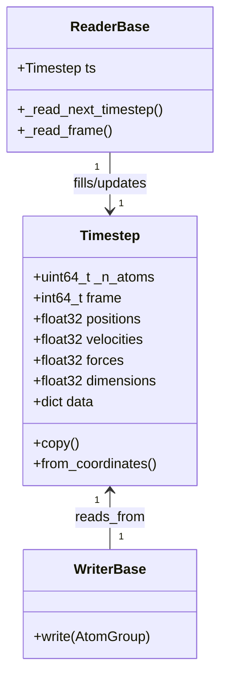
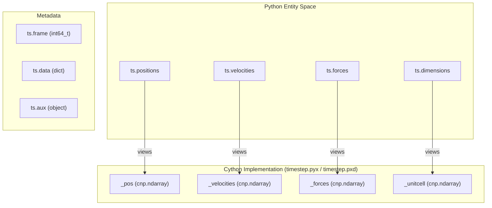
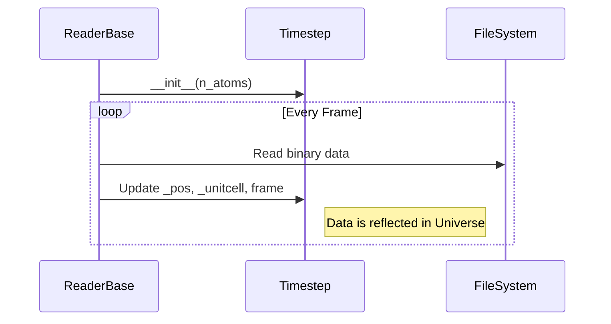

# Timestep

<details>
<summary>Relevant source files</summary>

The following files were used as context for generating this wiki page:

- [package/MDAnalysis/coordinates/__init__.py](package/MDAnalysis/coordinates/__init__.py)
- [package/MDAnalysis/coordinates/base.py](package/MDAnalysis/coordinates/base.py)
- [package/MDAnalysis/coordinates/timestep.pxd](package/MDAnalysis/coordinates/timestep.pxd)
- [package/MDAnalysis/coordinates/timestep.pyx](package/MDAnalysis/coordinates/timestep.pyx)
- [package/MDAnalysis/topology/__init__.py](package/MDAnalysis/topology/__init__.py)
- [package/doc/sphinx/source/documentation_pages/coordinates/timestep.rst](package/doc/sphinx/source/documentation_pages/coordinates/timestep.rst)
- [package/doc/sphinx/source/documentation_pages/coordinates_modules.rst](package/doc/sphinx/source/documentation_pages/coordinates_modules.rst)
- [package/doc/sphinx/source/documentation_pages/topology_modules.rst](package/doc/sphinx/source/documentation_pages/topology_modules.rst)
- [testsuite/MDAnalysisTests/coordinates/test_reader_api.py](testsuite/MDAnalysisTests/coordinates/test_reader_api.py)
- [testsuite/MDAnalysisTests/coordinates/test_timestep_api.py](testsuite/MDAnalysisTests/coordinates/test_timestep_api.py)

</details>


The `Timestep` class is a fundamental data structure in MDAnalysis that represents a single frame of a molecular dynamics trajectory. It holds coordinate data (positions, velocities, forces) and other frame-specific information such as unit cell dimensions and time information.

## Overview

The `Timestep` class serves as a container for coordinate data and associated metadata for a single point in time from a molecular dynamics simulation. It is used by trajectory readers to deliver frame data to the user and by writers to output trajectory data [package/MDAnalysis/coordinates/base.py:99-105](). In version 2.3.0, `Timestep` was converted to a Cython extension type to improve performance and memory management [package/MDAnalysis/coordinates/timestep.pyx:166-169]().

### Relationship Between Core Entities

The following diagram shows how `Timestep` bridges trajectory reading and writing.



Sources: [package/MDAnalysis/coordinates/timestep.pyx:144-169](), [package/MDAnalysis/coordinates/base.py:99-105](), [package/MDAnalysis/coordinates/timestep.pxd:7-49]()

## Core Properties and Attributes

The `Timestep` class provides access to several key properties, most of which are backed by NumPy arrays for efficient numerical operations.

### Coordinate Data
*   `positions`: A `numpy.ndarray` of shape `(n_atoms, 3)` containing atom coordinates in Å [package/MDAnalysis/coordinates/timestep.pyx:58-81]().
*   `velocities`: A `numpy.ndarray` of shape `(n_atoms, 3)` containing atom velocities in Å/ps [package/MDAnalysis/coordinates/timestep.pyx:82-99]().
*   `forces`: A `numpy.ndarray` of shape `(n_atoms, 3)` containing forces [package/MDAnalysis/coordinates/timestep.pyx:100-110]().

### Time and Frame Information
*   `frame`: 0-based frame number [package/MDAnalysis/coordinates/timestep.pyx:48-54]().
*   `time`: Current simulation time in ps [package/MDAnalysis/coordinates/timestep.pyx:56-56]().
*   `dt`: Time step between frames in ps [package/MDAnalysis/coordinates/timestep.pyx:57-57]().

### Unit Cell Information
*   `dimensions`: Box dimensions as `[A, B, C, alpha, beta, gamma]` [package/MDAnalysis/coordinates/timestep.pyx:112-112]().
*   `triclinic_dimensions`: Box dimensions represented as three vectors [package/MDAnalysis/coordinates/timestep.pyx:113-113]().
*   `volume`: Volume of the unit cell [package/MDAnalysis/coordinates/timestep.pyx:114-114]().

### Data Flow Architecture

The internal state of a `Timestep` is managed via C-level arrays for performance, while exposing Python properties to the user.



Sources: [package/MDAnalysis/coordinates/timestep.pyx:173-227](), [package/MDAnalysis/coordinates/timestep.pxd:7-49]()

## Creation and Initialization

A `Timestep` can be created via direct initialization or class methods:

1.  **Direct initialization**: `ts = Timestep(n_atoms)`. This allocates memory for the specified number of atoms [package/MDAnalysis/coordinates/timestep.pyx:173-184]().
2.  **From coordinates**: `ts = Timestep.from_coordinates(pos, vel, force)`. Creates a timestep from existing arrays [package/MDAnalysis/coordinates/timestep.pyx:45-45]().
3.  **From another timestep**: `ts = Timestep.from_timestep(other)`. Creates a deep copy of an existing `Timestep` [package/MDAnalysis/coordinates/timestep.pyx:46-46]().

### Memory Allocation
The class uses lazy allocation for optional arrays like velocities and forces. These are only allocated when the corresponding `has_velocities` or `has_forces` flag is set to `True` [package/MDAnalysis/coordinates/timestep.pyx:195-202](). During `__cinit__`, the shape of particle-dependent arrays is stored in `_particle_dependent_dim` as `(n_atoms, 3)` [package/MDAnalysis/coordinates/timestep.pxd:18-20]().

Sources: [package/MDAnalysis/coordinates/timestep.pyx:144-227](), [package/MDAnalysis/coordinates/timestep.pxd:7-49]()

## Data Access and Manipulation

### Coordinate Access
`Timestep` supports standard indexing and slicing. Indexing a `Timestep` object directly returns the position of the atom at that index [package/MDAnalysis/coordinates/timestep.pyx:121-121]().

```python
# Accessing positions
pos = ts.positions  # Full array
atom_0 = ts[0]      # Position of first atom

# Shortcuts for coordinates
x = ts._x  # All x-coordinates
y = ts._y  # All y-coordinates
z = ts._z  # All z-coordinates
```

Sources: [package/MDAnalysis/coordinates/timestep.pyx:58-81](), [testsuite/MDAnalysisTests/coordinates/test_timestep_api.py:195-201]()

### Unit Cell Manipulation
The unit cell is stored internally in `_unitcell` as a 6-element array `[A, B, C, alpha, beta, gamma]` [package/MDAnalysis/coordinates/timestep.pxd:35-35]().

```python
# Set box dimensions
ts.dimensions = [10.0, 11.0, 12.0, 90.0, 90.0, 90.0]

# Volume is calculated automatically
vol = ts.volume
```

Sources: [package/MDAnalysis/coordinates/timestep.pyx:112-114](), [testsuite/MDAnalysisTests/coordinates/test_timestep_api.py:94-96]()

## Integration with Trajectory Readers

Trajectory readers maintain a single `Timestep` instance (`self.ts`) that is updated in-place as the user iterates through the trajectory [package/MDAnalysis/coordinates/__init__.py:138-144]().



Sources: [package/MDAnalysis/coordinates/base.py:211-215](), [package/MDAnalysis/coordinates/__init__.py:138-144](), [testsuite/MDAnalysisTests/coordinates/test_reader_api.py:51-53]()

## Implementation Details

*   **Memory Order**: `Timestep` uses 'C' (row-major) order for NumPy arrays to ensure compatibility with modern hardware and the NumPy C API [package/MDAnalysis/coordinates/timestep.pyx:171-171]().
*   **Precision**: Data is typically hardcoded to `float32` (`cnp.NPY_FLOAT32`) [package/MDAnalysis/coordinates/timestep.pyx:193-193]().
*   **Pickling**: `Timestep` objects can be pickled and unpickled since version 2.0.0, which is critical for parallel processing [package/MDAnalysis/coordinates/timestep.pyx:161-166]().
*   **Weak References**: `Timestep` maintains a `_reader` attribute as a weakref to the reader that fills it to prevent circular dependencies [package/MDAnalysis/coordinates/timestep.pxd:45-46]().
*   **Auxiliary Data**: An `aux` namespace is provided to store data from auxiliary readers [package/MDAnalysis/coordinates/timestep.pxd:48-48]().

Sources: [package/MDAnalysis/coordinates/timestep.pyx:161-171](), [package/MDAnalysis/coordinates/timestep.pxd:1-49]()

---