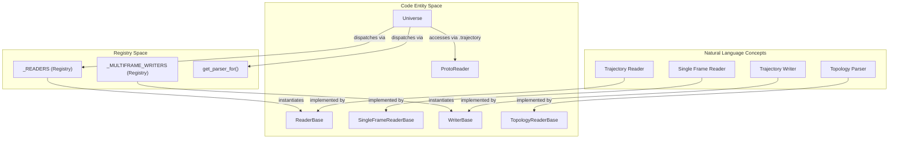
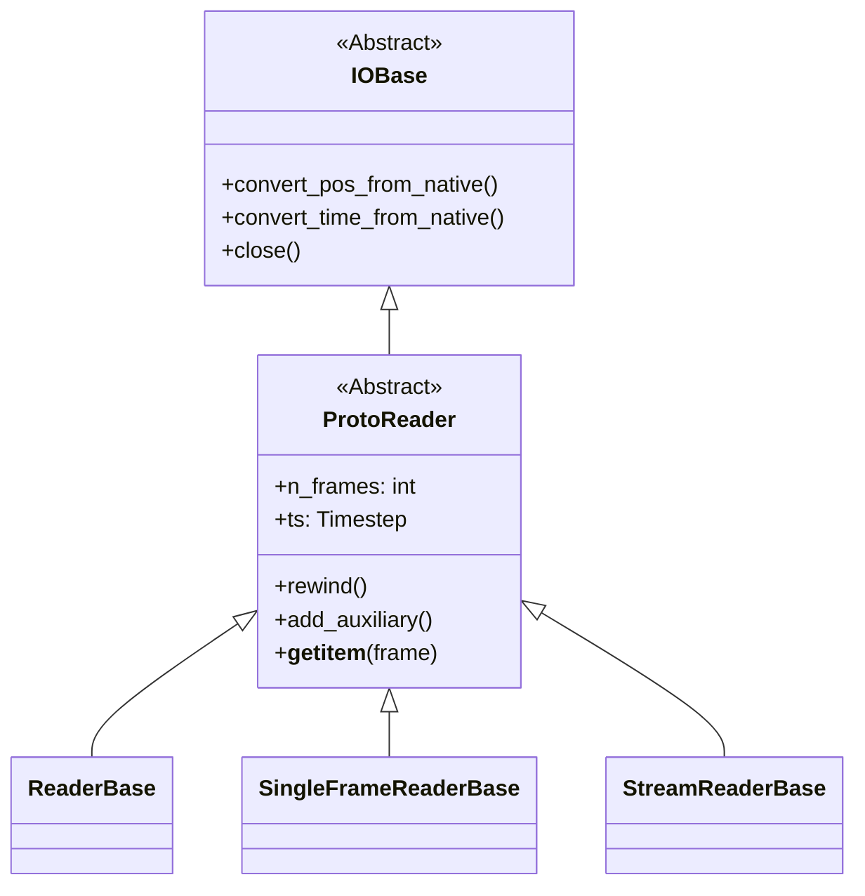

# File I/O

Relevant source files

The following files were used as context for generating this wiki page:

- [package/MDAnalysis/coordinates/__init__.py](package/MDAnalysis/coordinates/__init__.py)
- [package/MDAnalysis/coordinates/base.py](package/MDAnalysis/coordinates/base.py)
- [package/MDAnalysis/topology/CRDParser.py](package/MDAnalysis/topology/CRDParser.py)
- [package/MDAnalysis/topology/GMSParser.py](package/MDAnalysis/topology/GMSParser.py)
- [package/MDAnalysis/topology/GROParser.py](package/MDAnalysis/topology/GROParser.py)
- [package/MDAnalysis/topology/PSFParser.py](package/MDAnalysis/topology/PSFParser.py)
- [package/MDAnalysis/topology/TOPParser.py](package/MDAnalysis/topology/TOPParser.py)
- [package/MDAnalysis/topology/XYZParser.py](package/MDAnalysis/topology/XYZParser.py)
- [package/MDAnalysis/topology/__init__.py](package/MDAnalysis/topology/__init__.py)
- [package/MDAnalysis/topology/core.py](package/MDAnalysis/topology/core.py)
- [package/doc/sphinx/source/documentation_pages/coordinates_modules.rst](package/doc/sphinx/source/documentation_pages/coordinates_modules.rst)
- [package/doc/sphinx/source/documentation_pages/topology_modules.rst](package/doc/sphinx/source/documentation_pages/topology_modules.rst)
- [testsuite/MDAnalysisTests/coordinates/test_reader_api.py](testsuite/MDAnalysisTests/coordinates/test_reader_api.py)

MDAnalysis provides a comprehensive system for reading and writing molecular dynamics trajectory and topology files in various formats. This page describes the architecture of the file input/output (I/O) system, including the base classes for readers and writers, the supported file formats, and the dispatch mechanism used to handle diverse data sources.

## Overview of the File I/O System

The file I/O system in MDAnalysis is designed to handle a wide variety of molecular dynamics formats through a unified interface. The system consists of:

1.  **Base classes** that define the common API for all readers and writers.
2.  **Format-specific readers and writers** that implement the details for each file format.
3.  **Registry system** that allows MDAnalysis to automatically select the appropriate reader/writer based on file extension or content.

### Entity Mapping: Natural Language to Code Space

The following diagram maps high-level I/O concepts to the specific Python classes and registry structures used in the codebase.

Sources: [package/MDAnalysis/coordinates/base.py:136-141](), [package/MDAnalysis/coordinates/__init__.py:41-85](), [package/MDAnalysis/topology/core.py:38-38]()

## Base Classes

The file I/O system is built around a set of base classes in `MDAnalysis.coordinates.base` and `MDAnalysis.topology.base` that define the common interface.

### IOBase and ProtoReader

`IOBase` is the fundamental base class providing common functionality like unit conversions [package/MDAnalysis/coordinates/base.py:124-125](). `ProtoReader` defines the core trajectory API, including iteration, random access, and auxiliary data management [package/MDAnalysis/coordinates/base.py:88-90]().

Sources: [package/MDAnalysis/coordinates/base.py:88-103](), [package/MDAnalysis/coordinates/base.py:124-125]()

## Trajectory Readers and Writers

MDAnalysis distinguishes between multi-frame trajectories and single-frame coordinate files.

*   **ReaderBase**: Used for formats like DCD, XTC, and TRR that contain multiple time steps [package/MDAnalysis/coordinates/base.py:80-82]().
*   **SingleFrameReaderBase**: Used for formats like GRO or PDB when they serve as a single static snapshot [package/MDAnalysis/coordinates/base.py:84-86]().
*   **StreamReaderBase**: A specialized reader for continuous data streams (e.g., IMD live feeds) where random access is not possible [package/MDAnalysis/coordinates/__init__.py:69-73]().
*   **WriterBase**: Defines the API for writing `Timestep` data to disk [package/MDAnalysis/coordinates/base.py:102-103]().

For details on specific implementations and unit handling, see [Trajectory Readers and Writers](#3.1).

## Topology Parsers

Topology parsers are responsible for building the static structure of the `Universe` (atoms, residues, segments, and connectivity). All parsers derive from `TopologyReaderBase`.

| Parser | Format | Attributes Extracted |
| :--- | :--- | :--- |
| `PSFParser` | PSF | ids, names, types, masses, charges, resids, resnames, segids, bonds, angles, dihedrals, impropers [package/MDAnalysis/topology/PSFParser.py:74-90]() |
| `GROParser` | GRO | resids, resnames, atomids, atomnames [package/MDAnalysis/topology/GROParser.py:61-69]() |
| `TOPParser` | PRMTOP | names, charges, masses, elements, types, resnames, type_indices, bonds, angles, dihedrals [package/MDAnalysis/topology/TOPParser.py:131-147]() |
| `XYZParser` | XYZ | atomnames, elements [package/MDAnalysis/topology/XYZParser.py:56-61]() |
| `CRDParser` | CRD | atomids, atomnames, tempfactors, resids, resnames, resnums, segids [package/MDAnalysis/topology/CRDParser.py:69-80]() |

For details on the parsing logic and the attribute guessing system, see [Topology Parsers](#3.2).

## ChainReader and Multiple Trajectories

When dealing with a simulation split across multiple files, MDAnalysis uses specialized readers to provide a continuous view.

*   **ChainReader**: Seamlessly iterates over a sequence of files, even if they are in different formats [package/MDAnalysis/coordinates/__init__.py:75-79]().
*   **MemoryReader**: Allows loading trajectory data directly from NumPy arrays into memory [package/doc/sphinx/source/documentation_pages/coordinates_modules.rst:49-49]().

For details on handling multi-file datasets and auxiliary data, see [ChainReader and Multiple Trajectories](#3.3).

## Frame Iterators

Slicing a trajectory (e.g., `u.trajectory[10:100:2]`) returns a `FrameIterator`. These objects allow efficient iteration over subsets of frames without loading the entire trajectory into memory.

*   `FrameIteratorSliced`: Handles standard Python slices [package/MDAnalysis/coordinates/base.py:180-215]().
*   `FrameIteratorIndices`: Handles fancy indexing with an array of frame numbers [package/MDAnalysis/coordinates/base.py:276-290]().

Sources: [package/MDAnalysis/coordinates/base.py:33-54]()

## Summary of Supported Formats

MDAnalysis supports a vast array of formats through its plugin architecture. Key formats include:
*   **Coordinates**: DCD, XTC, TRR, NetCDF, PDB, GRO, XYZ, LAMMPS, H5MD, GSD, MMTF, TNG.
*   **Topology**: PSF, PRMTOP (Amber), TPR (Gromacs), MOL2, PQR, ITP, DMS, PDBQT.

Sources: [package/MDAnalysis/coordinates/__init__.py:151-163](), [package/MDAnalysis/topology/__init__.py:42-134](), [package/doc/sphinx/source/documentation_pages/coordinates_modules.rst:21-51]()

---