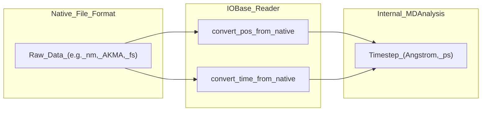

# Trajectory Readers and Writers

<details>
<summary>Relevant source files</summary>

The following files were used as context for generating this wiki page:

- [package/LICENSE](package/LICENSE)
- [package/MDAnalysis/coordinates/CRD.py](package/MDAnalysis/coordinates/CRD.py)
- [package/MDAnalysis/coordinates/DCD.py](package/MDAnalysis/coordinates/DCD.py)
- [package/MDAnalysis/coordinates/DLPoly.py](package/MDAnalysis/coordinates/DLPoly.py)
- [package/MDAnalysis/coordinates/DMS.py](package/MDAnalysis/coordinates/DMS.py)
- [package/MDAnalysis/coordinates/FHIAIMS.py](package/MDAnalysis/coordinates/FHIAIMS.py)
- [package/MDAnalysis/coordinates/GMS.py](package/MDAnalysis/coordinates/GMS.py)
- [package/MDAnalysis/coordinates/GRO.py](package/MDAnalysis/coordinates/GRO.py)
- [package/MDAnalysis/coordinates/GSD.py](package/MDAnalysis/coordinates/GSD.py)
- [package/MDAnalysis/coordinates/H5MD.py](package/MDAnalysis/coordinates/H5MD.py)
- [package/MDAnalysis/coordinates/INPCRD.py](package/MDAnalysis/coordinates/INPCRD.py)
- [package/MDAnalysis/coordinates/LAMMPS.py](package/MDAnalysis/coordinates/LAMMPS.py)
- [package/MDAnalysis/coordinates/MOL2.py](package/MDAnalysis/coordinates/MOL2.py)
- [package/MDAnalysis/coordinates/PDB.py](package/MDAnalysis/coordinates/PDB.py)
- [package/MDAnalysis/coordinates/PDBQT.py](package/MDAnalysis/coordinates/PDBQT.py)
- [package/MDAnalysis/coordinates/PQR.py](package/MDAnalysis/coordinates/PQR.py)
- [package/MDAnalysis/coordinates/TRJ.py](package/MDAnalysis/coordinates/TRJ.py)
- [package/MDAnalysis/coordinates/TRR.py](package/MDAnalysis/coordinates/TRR.py)
- [package/MDAnalysis/coordinates/TRZ.py](package/MDAnalysis/coordinates/TRZ.py)
- [package/MDAnalysis/coordinates/XDR.py](package/MDAnalysis/coordinates/XDR.py)
- [package/MDAnalysis/coordinates/XTC.py](package/MDAnalysis/coordinates/XTC.py)
- [package/MDAnalysis/coordinates/XYZ.py](package/MDAnalysis/coordinates/XYZ.py)
- [package/MDAnalysis/coordinates/__init__.py](package/MDAnalysis/coordinates/__init__.py)
- [package/MDAnalysis/coordinates/base.py](package/MDAnalysis/coordinates/base.py)
- [package/MDAnalysis/coordinates/chemfiles.py](package/MDAnalysis/coordinates/chemfiles.py)
- [package/MDAnalysis/lib/formats/include/endianswap.h](package/MDAnalysis/lib/formats/include/endianswap.h)
- [package/MDAnalysis/lib/formats/include/readdcd.h](package/MDAnalysis/lib/formats/include/readdcd.h)
- [package/MDAnalysis/lib/formats/include/trr_seek.h](package/MDAnalysis/lib/formats/include/trr_seek.h)
- [package/MDAnalysis/lib/formats/include/xdrfile.h](package/MDAnalysis/lib/formats/include/xdrfile.h)
- [package/MDAnalysis/lib/formats/include/xdrfile_trr.h](package/MDAnalysis/lib/formats/include/xdrfile_trr.h)
- [package/MDAnalysis/lib/formats/include/xdrfile_xtc.h](package/MDAnalysis/lib/formats/include/xdrfile_xtc.h)
- [package/MDAnalysis/lib/formats/include/xtc_seek.h](package/MDAnalysis/lib/formats/include/xtc_seek.h)
- [package/MDAnalysis/lib/formats/libdcd.pxd](package/MDAnalysis/lib/formats/libdcd.pxd)
- [package/MDAnalysis/lib/formats/libdcd.pyx](package/MDAnalysis/lib/formats/libdcd.pyx)
- [package/MDAnalysis/lib/formats/libmdaxdr.pxd](package/MDAnalysis/lib/formats/libmdaxdr.pxd)
- [package/MDAnalysis/lib/formats/libmdaxdr.pyx](package/MDAnalysis/lib/formats/libmdaxdr.pyx)
- [package/MDAnalysis/lib/formats/src/trr_seek.c](package/MDAnalysis/lib/formats/src/trr_seek.c)
- [package/MDAnalysis/lib/formats/src/xdrfile.c](package/MDAnalysis/lib/formats/src/xdrfile.c)
- [package/MDAnalysis/lib/formats/src/xdrfile_trr.c](package/MDAnalysis/lib/formats/src/xdrfile_trr.c)
- [package/MDAnalysis/lib/formats/src/xdrfile_xtc.c](package/MDAnalysis/lib/formats/src/xdrfile_xtc.c)
- [package/MDAnalysis/lib/formats/src/xtc_seek.c](package/MDAnalysis/lib/formats/src/xtc_seek.c)
- [package/MDAnalysis/topology/DLPolyParser.py](package/MDAnalysis/topology/DLPolyParser.py)
- [package/MDAnalysis/topology/GSDParser.py](package/MDAnalysis/topology/GSDParser.py)
- [package/MDAnalysis/topology/LAMMPSParser.py](package/MDAnalysis/topology/LAMMPSParser.py)
- [package/MDAnalysis/topology/__init__.py](package/MDAnalysis/topology/__init__.py)
- [package/doc/sphinx/source/documentation_pages/coordinates/pickle_readers.rst](package/doc/sphinx/source/documentation_pages/coordinates/pickle_readers.rst)
- [package/doc/sphinx/source/documentation_pages/coordinates_modules.rst](package/doc/sphinx/source/documentation_pages/coordinates_modules.rst)
- [package/doc/sphinx/source/documentation_pages/topology_modules.rst](package/doc/sphinx/source/documentation_pages/topology_modules.rst)
- [package/setup.cfg](package/setup.cfg)
- [testsuite/LICENSE](testsuite/LICENSE)
- [testsuite/MDAnalysisTests/coordinates/base.py](testsuite/MDAnalysisTests/coordinates/base.py)
- [testsuite/MDAnalysisTests/coordinates/reference.py](testsuite/MDAnalysisTests/coordinates/reference.py)
- [testsuite/MDAnalysisTests/coordinates/test_chemfiles.py](testsuite/MDAnalysisTests/coordinates/test_chemfiles.py)
- [testsuite/MDAnalysisTests/coordinates/test_crd.py](testsuite/MDAnalysisTests/coordinates/test_crd.py)
- [testsuite/MDAnalysisTests/coordinates/test_dcd.py](testsuite/MDAnalysisTests/coordinates/test_dcd.py)
- [testsuite/MDAnalysisTests/coordinates/test_dms.py](testsuite/MDAnalysisTests/coordinates/test_dms.py)
- [testsuite/MDAnalysisTests/coordinates/test_fhiaims.py](testsuite/MDAnalysisTests/coordinates/test_fhiaims.py)
- [testsuite/MDAnalysisTests/coordinates/test_gro.py](testsuite/MDAnalysisTests/coordinates/test_gro.py)
- [testsuite/MDAnalysisTests/coordinates/test_gsd.py](testsuite/MDAnalysisTests/coordinates/test_gsd.py)
- [testsuite/MDAnalysisTests/coordinates/test_h5md.py](testsuite/MDAnalysisTests/coordinates/test_h5md.py)
- [testsuite/MDAnalysisTests/coordinates/test_lammps.py](testsuite/MDAnalysisTests/coordinates/test_lammps.py)
- [testsuite/MDAnalysisTests/coordinates/test_mol2.py](testsuite/MDAnalysisTests/coordinates/test_mol2.py)
- [testsuite/MDAnalysisTests/coordinates/test_netcdf.py](testsuite/MDAnalysisTests/coordinates/test_netcdf.py)
- [testsuite/MDAnalysisTests/coordinates/test_pdb.py](testsuite/MDAnalysisTests/coordinates/test_pdb.py)
- [testsuite/MDAnalysisTests/coordinates/test_pdbqt.py](testsuite/MDAnalysisTests/coordinates/test_pdbqt.py)
- [testsuite/MDAnalysisTests/coordinates/test_pqr.py](testsuite/MDAnalysisTests/coordinates/test_pqr.py)
- [testsuite/MDAnalysisTests/coordinates/test_reader_api.py](testsuite/MDAnalysisTests/coordinates/test_reader_api.py)
- [testsuite/MDAnalysisTests/coordinates/test_trj.py](testsuite/MDAnalysisTests/coordinates/test_trj.py)
- [testsuite/MDAnalysisTests/coordinates/test_trz.py](testsuite/MDAnalysisTests/coordinates/test_trz.py)
- [testsuite/MDAnalysisTests/coordinates/test_writer_api.py](testsuite/MDAnalysisTests/coordinates/test_writer_api.py)
- [testsuite/MDAnalysisTests/coordinates/test_xdr.py](testsuite/MDAnalysisTests/coordinates/test_xdr.py)
- [testsuite/MDAnalysisTests/coordinates/test_xyz.py](testsuite/MDAnalysisTests/coordinates/test_xyz.py)
- [testsuite/MDAnalysisTests/data/cobrotoxin.h5md](testsuite/MDAnalysisTests/data/cobrotoxin.h5md)
- [testsuite/MDAnalysisTests/data/coordinates/README.md](testsuite/MDAnalysisTests/data/coordinates/README.md)
- [testsuite/MDAnalysisTests/data/coordinates/test.h5md](testsuite/MDAnalysisTests/data/coordinates/test.h5md)
- [testsuite/MDAnalysisTests/data/example.gsd](testsuite/MDAnalysisTests/data/example.gsd)
- [testsuite/MDAnalysisTests/data/example_bonds.gsd](testsuite/MDAnalysisTests/data/example_bonds.gsd)
- [testsuite/MDAnalysisTests/data/legacy_DCD_c36_coords.npy](testsuite/MDAnalysisTests/data/legacy_DCD_c36_coords.npy)
- [testsuite/MDAnalysisTests/data/mol2/test_crysin.mol2](testsuite/MDAnalysisTests/data/mol2/test_crysin.mol2)
- [testsuite/MDAnalysisTests/formats/test_libdcd.py](testsuite/MDAnalysisTests/formats/test_libdcd.py)
- [testsuite/MDAnalysisTests/topology/test_gsd.py](testsuite/MDAnalysisTests/topology/test_gsd.py)
- [testsuite/MDAnalysisTests/utils/test_pickleio.py](testsuite/MDAnalysisTests/utils/test_pickleio.py)

</details>


This page documents the trajectory reader and writer system in MDAnalysis, which enables the loading, manipulation, and saving of molecular dynamics trajectory data in various file formats.

## Overview

MDAnalysis provides a unified interface for reading and writing trajectory files. The system is built around base classes that define common functionality, with format-specific implementations inheriting from these. The core abstraction is that a `Universe` contains a `trajectory` object (a Reader) which iterates over `Timestep` objects.

The trajectory I/O system consists of:
1.  **Readers**: Classes that take trajectory data in a given format and present it via a common API.
2.  **Writers**: Classes that write information from a `Timestep` to a file.
3.  **Timestep**: The fundamental data container for a single frame (coordinates, dimensions, etc.).
4.  **FrameIterators**: Objects that allow sliced or indexed access to trajectory subsets.

Sources: [package/MDAnalysis/coordinates/__init__.py:29-54](), [package/MDAnalysis/coordinates/base.py:60-104]()

## Architecture and Data Flow

The following diagram bridges the natural language concepts of "File Access" and "Frame Navigation" to the specific classes and methods in the codebase.

### Trajectory Access Architecture
Title: Trajectory Access Architecture
```mermaid
graph TD
    subgraph "Navigation_Space"
        A["Iteration_(for_ts_in_u.trajectory)"]
        B["Indexing_(u.trajectory[5])"]
        C["Slicing_(u.trajectory[::10])"]
    end

    subgraph "Code_Entity_Space"
        D["ProtoReader"]
        E["ReaderBase"]
        F["SingleFrameReaderBase"]
        G["FrameIteratorSliced"]
        H["Timestep"]
    end

    A -->|"calls_mda_iter_or_next"| D
    B -->|"calls_read_frame"| D
    C -->|"returns"| G
    D -->|"updates_returns"| H
    E --|> D
    F --|> D
    G -->|"references"| D
```
Sources: [package/MDAnalysis/coordinates/base.py:180-210](), [package/MDAnalysis/coordinates/base.py:640-660](), [package/MDAnalysis/coordinates/base.py:833-875]()

## Core API Classes

### IOBase and ProtoReader
`IOBase` is the foundation for all I/O, providing unit conversion and context management. `ProtoReader` defines the trajectory API, including properties like `n_frames`, `dt`, and `totaltime`.

*   **`ReaderBase`**: Used for multi-frame formats (e.g., XTC, DCD). It implements a `__del__` method to ensure file handles are closed during garbage collection. [package/MDAnalysis/coordinates/base.py:60-75]()
*   **`SingleFrameReaderBase`**: Optimized for single-coordinate files (e.g., GRO, PDB). It avoids certain cleanup side effects that can cause memory leaks in single-frame contexts. [package/MDAnalysis/coordinates/base.py:84-86]()
*   **`StreamReaderBase`**: Specialized for continuous data streams (like IMD connections) where random access and length determination are not possible. [package/MDAnalysis/coordinates/__init__.py:69-73]()

Sources: [package/MDAnalysis/coordinates/base.py:348-400](), [package/MDAnalysis/coordinates/base.py:640-750]()

### WriterBase
`WriterBase` provides the standard `write()` method. Writers can accept an `AtomGroup`, a `Universe`, or a `Timestep` as input.

Sources: [package/MDAnalysis/coordinates/base.py:99-104](), [package/MDAnalysis/coordinates/base.py:1024-1050]()

## Key Format Implementations

### DCD (CHARMM, NAMD, LAMMPS)
The `DCDReader` uses a high-performance Cython backend (`libdcd.pyx`).
*   **Implementation**: It wraps the `DCDFile` class which handles the low-level binary C-structure of DCD files. [package/MDAnalysis/lib/formats/libdcd.pyx:117-160]()
*   **Unit Handling**: DCDs typically use AKMA time units. MDAnalysis converts these to picoseconds (ps) during reading via `mdaunits.convert`. [package/MDAnalysis/coordinates/DCD.py:153-157]()
*   **Dimensions**: The reader attempts to guess the unitcell representation (symmetric box vectors vs. cosines) based on the `flavor` (CHARMM vs NAMD). [package/MDAnalysis/coordinates/DCD.py:87-101]()

Sources: [package/MDAnalysis/coordinates/DCD.py:73-130](), [package/MDAnalysis/lib/formats/libdcd.pyx:29-66]()

### PDB (Protein Data Bank)
The `PDBReader` is a pure-Python implementation supporting the PDB 3.3 standard.
*   **Multi-Model Support**: Reads multi-MODEL PDB files as trajectories. [package/MDAnalysis/coordinates/PDB.py:180-185]()
*   **Metadata**: Parses `CRYST1`, `TITLE`, `HEADER`, `COMPND`, and `REMARK` records into attributes like `header`, `title`, and `remarks`. [package/MDAnalysis/coordinates/PDB.py:168-178]()
*   **Writing**: The `PDBWriter` can write single frames by default or multi-frame trajectories if `multiframe=True` is passed. [package/MDAnalysis/coordinates/PDB.py:67-75]()

Sources: [package/MDAnalysis/coordinates/PDB.py:167-200](), [testsuite/MDAnalysisTests/coordinates/test_pdb.py:151-220]()

### XTC and TRR (GROMACS)
These formats use the `XDR` (External Data Representation) library for portable binary I/O.
*   **Offsets**: To enable fast random access in these compressed/variable-block formats, MDAnalysis generates an offset index file (e.g., `.xtc_offsets.npz`). [testsuite/MDAnalysisTests/coordinates/test_xdr.py:65-75]()
*   **TRR**: Stores coordinates, velocities, and forces. [package/MDAnalysis/coordinates/TRR.py:23-30]()
*   **XTC**: Uses lossy compression for coordinates and does not store velocities/forces. [package/MDAnalysis/coordinates/XTC.py:23-30]()

Sources: [package/MDAnalysis/coordinates/XDR.py:47-60](), [testsuite/MDAnalysisTests/coordinates/test_xdr.py:109-128]()

### AMBER (NetCDF and ASCII)
*   **NCDFReader**: Reads binary NetCDF trajectories using `scipy.io.netcdf` or `netCDF4`. It can handle velocities and forces if present. [package/MDAnalysis/coordinates/TRJ.py:47-60]()
*   **TRJReader**: Reads ASCII "mdcrd" files. Because these files lack atom counts in the header, the `n_atoms` keyword is mandatory. [package/MDAnalysis/coordinates/TRJ.py:155-165]()

Sources: [package/MDAnalysis/coordinates/TRJ.py:23-43](), [package/MDAnalysis/coordinates/TRJ.py:180-185]()

### LAMMPS
*   **DCD**: Specialized `DCDReader` for LAMMPS that allows users to override the time unit (often femtoseconds in LAMMPS instead of AKMA). [package/MDAnalysis/coordinates/LAMMPS.py:32-47]()
*   **Dump**: `DumpReader` handles ASCII dump files in the 'atom' format, parsing coordinates and optionally masses. [package/MDAnalysis/coordinates/LAMMPS.py:58-60]()
*   **Data**: `DATAReader`/`DATAWriter` for LAMMPS DATA files, supporting various atom styles. [package/MDAnalysis/coordinates/LAMMPS.py:128-133]()

Sources: [package/MDAnalysis/coordinates/LAMMPS.py:25-48](), [package/MDAnalysis/topology/LAMMPSParser.py:123-150]()

## Unit Conversion and Transformations

MDAnalysis standardizes units to Ångströms and picoseconds.

### Unit Conversion Flow
Title: Unit Conversion Data Flow

Sources: [package/MDAnalysis/coordinates/base.py:350-380](), [package/MDAnalysis/coordinates/DCD.py:128-130](), [package/MDAnalysis/coordinates/LAMMPS.py:174-180]()

### Transformations Pipeline
Readers support an on-the-fly transformation pipeline via `add_transformations()`. When a frame is read, it is passed through a list of transformation functions (e.g., `translate`, `rotate`) before being returned to the user.

Sources: [package/MDAnalysis/coordinates/base.py:860-870](), [testsuite/MDAnalysisTests/coordinates/base.py:35-37]()

## Implementation Details: Timestep

The `Timestep` class is the primary data structure for coordinates. It encapsulates all per-frame information.

| Attribute | Type | Description |
| :--- | :--- | :--- |
| `positions` | `numpy.ndarray` | (n_atoms, 3) float32 array of coordinates |
| `velocities` | `numpy.ndarray` | (n_atoms, 3) array (optional) |
| `forces` | `numpy.ndarray` | (n_atoms, 3) array (optional) |
| `dimensions` | `numpy.ndarray` | (6,) array [A, B, C, alpha, beta, gamma] |

Sources: [package/MDAnalysis/coordinates/base.py:134-135](), [package/MDAnalysis/coordinates/PDB.py:157-158](), [package/MDAnalysis/coordinates/base.py:833-850]()

## Supported Formats Summary

| Format | Reader | Writer | Features |
| :--- | :--- | :--- | :--- |
| **DCD** | `DCDReader` | `DCDWriter` | Binary, fast, CHARMM/NAMD/LAMMPS flavors |
| **XTC** | `XTCReader` | `XTCWriter` | Compressed, GROMACS, coordinates only |
| **TRR** | `TRRReader` | `TRRWriter` | Uncompressed, GROMACS, coords/vels/forces |
| **PDB** | `PDBReader` | `PDBWriter` | ASCII, widely supported, metadata rich |
| **NetCDF** | `NCDFReader` | `NCDFWriter` | Binary, AMBER/H5MD, structured |
| **GRO** | `GROReader` | `GROWriter` | ASCII, GROMACS structure/trajectory |
| **GSD** | `GSDReader` | `GSDWriter` | HOOMD-blue format, schema-based |
| **H5MD** | `H5MDReader` | - | HDF5-based molecular data |

Sources: [package/MDAnalysis/coordinates/__init__.py:154-165](), [package/MDAnalysis/coordinates/TRJ.py:47-65](), [package/MDAnalysis/coordinates/GSD.py:1-20]()

---