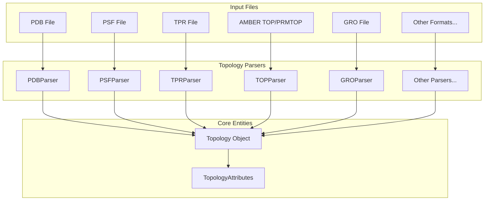
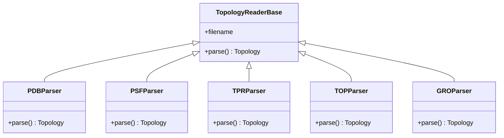
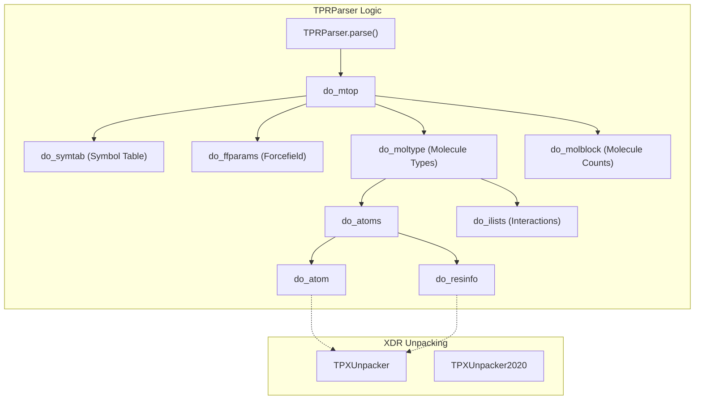

# Topology Parsers

Relevant source files

The following files were used as context for generating this wiki page:

- [package/MDAnalysis/coordinates/chain.py](package/MDAnalysis/coordinates/chain.py)
- [package/MDAnalysis/coordinates/core.py](package/MDAnalysis/coordinates/core.py)
- [package/MDAnalysis/coordinates/memory.py](package/MDAnalysis/coordinates/memory.py)
- [package/MDAnalysis/topology/CRDParser.py](package/MDAnalysis/topology/CRDParser.py)
- [package/MDAnalysis/topology/DMSParser.py](package/MDAnalysis/topology/DMSParser.py)
- [package/MDAnalysis/topology/FHIAIMSParser.py](package/MDAnalysis/topology/FHIAIMSParser.py)
- [package/MDAnalysis/topology/GMSParser.py](package/MDAnalysis/topology/GMSParser.py)
- [package/MDAnalysis/topology/GROParser.py](package/MDAnalysis/topology/GROParser.py)
- [package/MDAnalysis/topology/HoomdXMLParser.py](package/MDAnalysis/topology/HoomdXMLParser.py)
- [package/MDAnalysis/topology/ITPParser.py](package/MDAnalysis/topology/ITPParser.py)
- [package/MDAnalysis/topology/MOL2Parser.py](package/MDAnalysis/topology/MOL2Parser.py)
- [package/MDAnalysis/topology/PDBParser.py](package/MDAnalysis/topology/PDBParser.py)
- [package/MDAnalysis/topology/PDBQTParser.py](package/MDAnalysis/topology/PDBQTParser.py)
- [package/MDAnalysis/topology/PQRParser.py](package/MDAnalysis/topology/PQRParser.py)
- [package/MDAnalysis/topology/PSFParser.py](package/MDAnalysis/topology/PSFParser.py)
- [package/MDAnalysis/topology/TOPParser.py](package/MDAnalysis/topology/TOPParser.py)
- [package/MDAnalysis/topology/TPRParser.py](package/MDAnalysis/topology/TPRParser.py)
- [package/MDAnalysis/topology/XYZParser.py](package/MDAnalysis/topology/XYZParser.py)
- [package/MDAnalysis/topology/base.py](package/MDAnalysis/topology/base.py)
- [package/MDAnalysis/topology/core.py](package/MDAnalysis/topology/core.py)
- [package/MDAnalysis/topology/guessers.py](package/MDAnalysis/topology/guessers.py)
- [package/MDAnalysis/topology/tables.py](package/MDAnalysis/topology/tables.py)
- [package/MDAnalysis/topology/tpr/__init__.py](package/MDAnalysis/topology/tpr/__init__.py)
- [package/MDAnalysis/topology/tpr/obj.py](package/MDAnalysis/topology/tpr/obj.py)
- [package/MDAnalysis/topology/tpr/setting.py](package/MDAnalysis/topology/tpr/setting.py)
- [package/MDAnalysis/topology/tpr/utils.py](package/MDAnalysis/topology/tpr/utils.py)
- [package/doc/sphinx/source/documentation_pages/topology/TPRParser.rst](package/doc/sphinx/source/documentation_pages/topology/TPRParser.rst)
- [package/doc/sphinx/source/documentation_pages/topology/guessers.rst](package/doc/sphinx/source/documentation_pages/topology/guessers.rst)
- [package/doc/sphinx/source/documentation_pages/topology/tables.rst](package/doc/sphinx/source/documentation_pages/topology/tables.rst)
- [testsuite/MDAnalysisTests/coordinates/test_chainreader.py](testsuite/MDAnalysisTests/coordinates/test_chainreader.py)
- [testsuite/MDAnalysisTests/coordinates/test_copying.py](testsuite/MDAnalysisTests/coordinates/test_copying.py)
- [testsuite/MDAnalysisTests/coordinates/test_memory.py](testsuite/MDAnalysisTests/coordinates/test_memory.py)
- [testsuite/MDAnalysisTests/coordinates/test_tpr.py](testsuite/MDAnalysisTests/coordinates/test_tpr.py)
- [testsuite/MDAnalysisTests/core/test_fragments.py](testsuite/MDAnalysisTests/core/test_fragments.py)
- [testsuite/MDAnalysisTests/data/281_small.tpr](testsuite/MDAnalysisTests/data/281_small.tpr)
- [testsuite/MDAnalysisTests/data/atomtypes_charge.itp](testsuite/MDAnalysisTests/data/atomtypes_charge.itp)
- [testsuite/MDAnalysisTests/data/gromacs/gromos54a7_edited.ff/test.itp](testsuite/MDAnalysisTests/data/gromacs/gromos54a7_edited.ff/test.itp)
- [testsuite/MDAnalysisTests/data/tprs/2lyz_gmx_2026_0.tpr](testsuite/MDAnalysisTests/data/tprs/2lyz_gmx_2026_0.tpr)
- [testsuite/MDAnalysisTests/data/tprs/Linear_Angle.tpr](testsuite/MDAnalysisTests/data/tprs/Linear_Angle.tpr)
- [testsuite/MDAnalysisTests/data/tprs/ala_nnpot_gmx_2026_0.tpr](testsuite/MDAnalysisTests/data/tprs/ala_nnpot_gmx_2026_0.tpr)
- [testsuite/MDAnalysisTests/data/tprs/all_bonded/dummy_2026_0.tpr](testsuite/MDAnalysisTests/data/tprs/all_bonded/dummy_2026_0.tpr)
- [testsuite/MDAnalysisTests/data/tprs/virtual_sites/extra-interactions-2026_0.tpr](testsuite/MDAnalysisTests/data/tprs/virtual_sites/extra-interactions-2026_0.tpr)
- [testsuite/MDAnalysisTests/topology/base.py](testsuite/MDAnalysisTests/topology/base.py)
- [testsuite/MDAnalysisTests/topology/test_crd.py](testsuite/MDAnalysisTests/topology/test_crd.py)
- [testsuite/MDAnalysisTests/topology/test_dlpoly.py](testsuite/MDAnalysisTests/topology/test_dlpoly.py)
- [testsuite/MDAnalysisTests/topology/test_dms.py](testsuite/MDAnalysisTests/topology/test_dms.py)
- [testsuite/MDAnalysisTests/topology/test_gms.py](testsuite/MDAnalysisTests/topology/test_gms.py)
- [testsuite/MDAnalysisTests/topology/test_gro.py](testsuite/MDAnalysisTests/topology/test_gro.py)
- [testsuite/MDAnalysisTests/topology/test_guessers.py](testsuite/MDAnalysisTests/topology/test_guessers.py)
- [testsuite/MDAnalysisTests/topology/test_hoomdxml.py](testsuite/MDAnalysisTests/topology/test_hoomdxml.py)
- [testsuite/MDAnalysisTests/topology/test_itp.py](testsuite/MDAnalysisTests/topology/test_itp.py)
- [testsuite/MDAnalysisTests/topology/test_lammpsdata.py](testsuite/MDAnalysisTests/topology/test_lammpsdata.py)
- [testsuite/MDAnalysisTests/topology/test_mol2.py](testsuite/MDAnalysisTests/topology/test_mol2.py)
- [testsuite/MDAnalysisTests/topology/test_pdb.py](testsuite/MDAnalysisTests/topology/test_pdb.py)
- [testsuite/MDAnalysisTests/topology/test_pdbqt.py](testsuite/MDAnalysisTests/topology/test_pdbqt.py)
- [testsuite/MDAnalysisTests/topology/test_pqr.py](testsuite/MDAnalysisTests/topology/test_pqr.py)
- [testsuite/MDAnalysisTests/topology/test_psf.py](testsuite/MDAnalysisTests/topology/test_psf.py)
- [testsuite/MDAnalysisTests/topology/test_tables.py](testsuite/MDAnalysisTests/topology/test_tables.py)
- [testsuite/MDAnalysisTests/topology/test_top.py](testsuite/MDAnalysisTests/topology/test_top.py)
- [testsuite/MDAnalysisTests/topology/test_topology_base.py](testsuite/MDAnalysisTests/topology/test_topology_base.py)
- [testsuite/MDAnalysisTests/topology/test_tprparser.py](testsuite/MDAnalysisTests/topology/test_tprparser.py)
- [testsuite/MDAnalysisTests/topology/test_xpdb.py](testsuite/MDAnalysisTests/topology/test_xpdb.py)
- [testsuite/MDAnalysisTests/topology/test_xyz.py](testsuite/MDAnalysisTests/topology/test_xyz.py)

This page documents the topology parser system in MDAnalysis, which is responsible for reading various molecular topology file formats and converting them into MDAnalysis's internal topology representation. Topology files contain information about atoms, bonds, angles, dihedrals, and other structural components of molecular systems.

## Overview of Topology Parsers

Topology parsers in MDAnalysis read molecular structure information from various file formats and convert it into a standardized internal representation. This allows MDAnalysis to work with molecular systems from different simulation packages using a consistent interface.

Title: Topology Parsing Workflow

Sources:
[package/MDAnalysis/topology/PDBParser.py:165-180](), [package/MDAnalysis/topology/PSFParser.py:74-90](), [package/MDAnalysis/topology/TPRParser.py:117-126](), [package/MDAnalysis/topology/GROParser.py:61-69](), [package/MDAnalysis/topology/TOPParser.py:131-147]()

## Parser Architecture

All topology parsers in MDAnalysis inherit from the `TopologyReaderBase` class [package/MDAnalysis/topology/base.py](). Each parser implements a `parse()` method that reads a specific file format and returns a `Topology` object [package/MDAnalysis/core/topology.py]() containing the molecular structure information.

Title: Topology Parser Class Hierarchy

Sources:
[package/MDAnalysis/topology/PDBParser.py:165-165](), [package/MDAnalysis/topology/PSFParser.py:74-74](), [package/MDAnalysis/topology/TPRParser.py:175-175](), [package/MDAnalysis/topology/TOPParser.py:131-131](), [package/MDAnalysis/topology/GROParser.py:61-61]()

## Key Topology Parsers

### PDB Parser
The `PDBParser` [package/MDAnalysis/topology/PDBParser.py:165-217]() reads standard Protein Data Bank files. It handles hybrid36 decoding for systems with more than 99,999 atoms via `hy36decode` [package/MDAnalysis/topology/PDBParser.py:136-162](). It extracts attributes such as `Atomnames`, `Resids`, `ChainIDs`, and `Tempfactors`. It also parses `CONECT` records to build `Bonds` [package/MDAnalysis/topology/PDBParser.py:178-178]().

### PSF Parser
The `PSFParser` [package/MDAnalysis/topology/PSFParser.py:74-98]() reads CHARMM, NAMD, and XPLOR PSF files. It supports `STANDARD`, `EXTENDED`, and `NAMD` formats [package/MDAnalysis/topology/PSFParser.py:118-123](). It populates connectivity attributes including `Bonds`, `Angles`, `Dihedrals`, and `Impropers` [package/MDAnalysis/topology/PSFParser.py:144-147]().

### TPR Parser (Gromacs)
The `TPRParser` [package/MDAnalysis/topology/TPRParser.py:175-180]() is a pure-python implementation for reading Gromacs binary run files. It utilizes `TPXUnpacker` [package/MDAnalysis/topology/tpr/utils.py:78-132]() and `TPXUnpacker2020` [package/MDAnalysis/topology/tpr/utils.py:133-181]() to handle XDR-encoded data across different Gromacs versions. It supports versions from 58 to 138 [package/MDAnalysis/topology/tpr/setting.py:41-58]().

### AMBER TOP Parser
The `TOPParser` [package/MDAnalysis/topology/TOPParser.py:131-178]() reads AMBER `PRMTOP` or `PARM7` files. It maps AMBER flags (e.g., `ATOM_NAME`, `CHARGE`, `MASS`) to MDAnalysis attributes [package/MDAnalysis/topology/TOPParser.py:32-59](). It also extracts `TypeIndices` for atoms [package/MDAnalysis/topology/TOPParser.py:123-128]().

### GRO Parser
The `GROParser` [package/MDAnalysis/topology/GROParser.py:61-80]() reads Gromacs fixed-format ASCII files. It handles residue index wrapping (Gromacs wraps at 100,000) by detecting resets to zero and applying offsets [package/MDAnalysis/topology/GROParser.py:120-136]().

## Topology Guessing System

When topology files are missing critical information (like masses or elements), MDAnalysis uses a guessing system. As of version 2.8.0, automatic guessing during parser execution has been reduced in favor of the `Universe.guess_TopologyAttrs()` API [package/MDAnalysis/topology/PDBParser.py:211-214]().

Key guessing functions in `MDAnalysis.topology.core` [package/MDAnalysis/topology/core.py:43-53]() include:
* `guess_atom_element`: Infers elements from atom names [package/MDAnalysis/topology/guessers.py:211-212]().
* `guess_atom_mass`: Assigns masses based on element or name [package/MDAnalysis/topology/guessers.py:121-137]().
* `guess_bonds`: Geometric bond guessing based on VDW radii [package/MDAnalysis/topology/guessers.py:49-49]().

Sources:
[package/MDAnalysis/topology/core.py:43-53](), [package/MDAnalysis/topology/PDBParser.py:38-44](), [package/MDAnalysis/topology/guessers.py:24-103]()

## TPR Parsing Data Flow

The TPR parser follows a specific call order to reconstruct the molecular topology from binary blocks using the `TPXUnpacker` utility classes.

Title: TPR Parser Internal Data Flow

Sources:
[package/MDAnalysis/topology/tpr/utils.py:33-48](), [package/MDAnalysis/topology/TPRParser.py:182-200]()

## Supported Attributes by Parser

| Attribute | PDB | PSF | TPR | TOP | GRO |
| :--- | :---: | :---: | :---: | :---: | :---: |
| `Atomnames` | Yes | Yes | Yes | Yes | Yes |
| `Atomids` | Yes | Yes | Yes | Yes | Yes |
| `Masses` | No | Yes | Yes | Yes | No |
| `Charges` | No | Yes | Yes | Yes | No |
| `Bonds` | Yes | Yes | Yes | Yes | No |
| `Resids` | Yes | Yes | Yes | Yes | Yes |
| `Segids` | Yes | Yes | Yes | Yes | Yes |

Sources:
[package/MDAnalysis/topology/PDBParser.py:168-180](), [package/MDAnalysis/topology/PSFParser.py:77-89](), [package/MDAnalysis/topology/TPRParser.py:120-125](), [package/MDAnalysis/topology/TOPParser.py:134-147](), [package/MDAnalysis/topology/GROParser.py:64-68]()

## Integration with Universe

The `Universe` class uses `get_parser_for` [package/MDAnalysis/topology/core.py:38-38]() to dispatch the correct parser based on the file extension. The `Topology` object created by the parser is then used to initialize the `AtomGroup` and `ResidueGroup` hierarchies.

Sources:
[package/MDAnalysis/topology/core.py:38-38](), [package/MDAnalysis/topology/GROParser.py:153-162]()

---