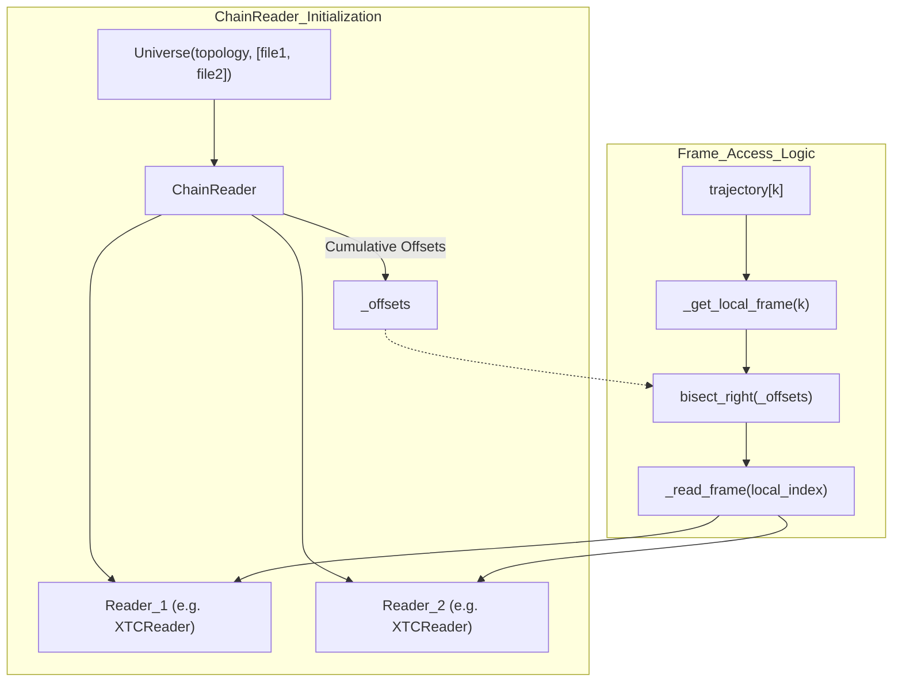
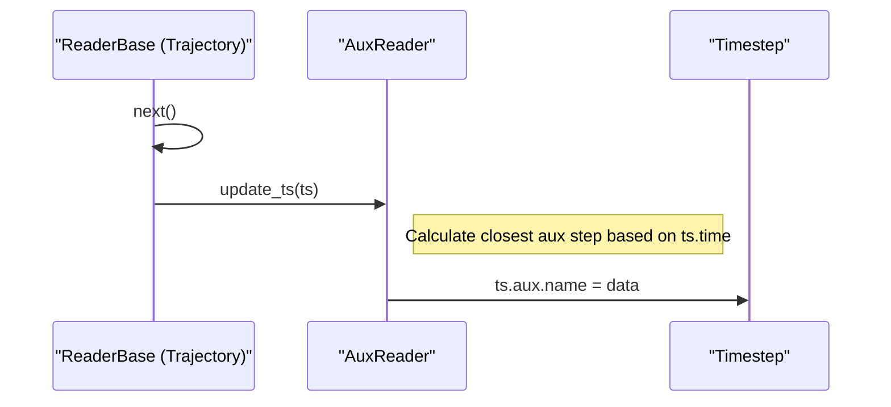
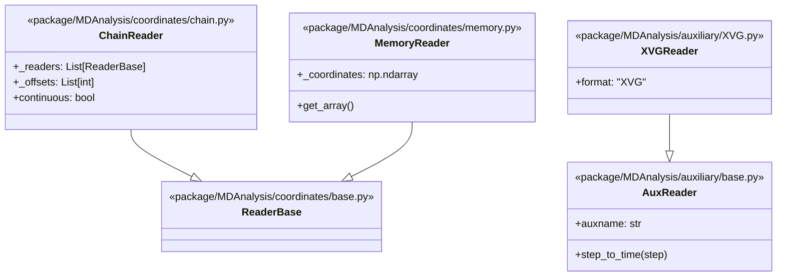

# ChainReader and Multiple Trajectories

Relevant source files

The following files were used as context for generating this wiki page:

- [package/MDAnalysis/auxiliary/EDR.py](package/MDAnalysis/auxiliary/EDR.py)
- [package/MDAnalysis/auxiliary/XVG.py](package/MDAnalysis/auxiliary/XVG.py)
- [package/MDAnalysis/auxiliary/__init__.py](package/MDAnalysis/auxiliary/__init__.py)
- [package/MDAnalysis/auxiliary/base.py](package/MDAnalysis/auxiliary/base.py)
- [package/MDAnalysis/auxiliary/core.py](package/MDAnalysis/auxiliary/core.py)
- [package/MDAnalysis/coordinates/__init__.py](package/MDAnalysis/coordinates/__init__.py)
- [package/MDAnalysis/coordinates/base.py](package/MDAnalysis/coordinates/base.py)
- [package/MDAnalysis/coordinates/chain.py](package/MDAnalysis/coordinates/chain.py)
- [package/MDAnalysis/coordinates/core.py](package/MDAnalysis/coordinates/core.py)
- [package/MDAnalysis/coordinates/memory.py](package/MDAnalysis/coordinates/memory.py)
- [package/MDAnalysis/topology/__init__.py](package/MDAnalysis/topology/__init__.py)
- [package/MDAnalysis/topology/base.py](package/MDAnalysis/topology/base.py)
- [package/doc/sphinx/source/documentation_pages/coordinates_modules.rst](package/doc/sphinx/source/documentation_pages/coordinates_modules.rst)
- [package/doc/sphinx/source/documentation_pages/topology_modules.rst](package/doc/sphinx/source/documentation_pages/topology_modules.rst)
- [testsuite/MDAnalysisTests/auxiliary/base.py](testsuite/MDAnalysisTests/auxiliary/base.py)
- [testsuite/MDAnalysisTests/auxiliary/test_core.py](testsuite/MDAnalysisTests/auxiliary/test_core.py)
- [testsuite/MDAnalysisTests/auxiliary/test_edr.py](testsuite/MDAnalysisTests/auxiliary/test_edr.py)
- [testsuite/MDAnalysisTests/auxiliary/test_xvg.py](testsuite/MDAnalysisTests/auxiliary/test_xvg.py)
- [testsuite/MDAnalysisTests/coordinates/test_chainreader.py](testsuite/MDAnalysisTests/coordinates/test_chainreader.py)
- [testsuite/MDAnalysisTests/coordinates/test_copying.py](testsuite/MDAnalysisTests/coordinates/test_copying.py)
- [testsuite/MDAnalysisTests/coordinates/test_memory.py](testsuite/MDAnalysisTests/coordinates/test_memory.py)
- [testsuite/MDAnalysisTests/coordinates/test_reader_api.py](testsuite/MDAnalysisTests/coordinates/test_reader_api.py)
- [testsuite/MDAnalysisTests/data/test_highf.xvg](testsuite/MDAnalysisTests/data/test_highf.xvg)
- [testsuite/MDAnalysisTests/data/test_lowf.xvg](testsuite/MDAnalysisTests/data/test_lowf.xvg)
- [testsuite/MDAnalysisTests/topology/test_topology_base.py](testsuite/MDAnalysisTests/topology/test_topology_base.py)

This page explains how to work with multiple trajectory files in MDAnalysis using `ChainReader`, managing in-memory trajectories with `MemoryReader`, and synchronizing non-coordinate time-series using auxiliary data readers.

## Purpose and Scope

The `ChainReader` is designed to handle cases where a simulation is split across multiple trajectory files or where disparate simulation segments need to be analyzed as a continuous sequence [package/MDAnalysis/coordinates/chain.py:25-31](). This page also covers the `MemoryReader` for high-performance in-memory operations [package/MDAnalysis/coordinates/memory.py:36-42]() and the `AuxReader` framework for integrating external data (like forces or energies) with trajectory frames [package/MDAnalysis/auxiliary/base.py:26-29]().

## ChainReader: Virtual Concatenation

`ChainReader` is a specialized trajectory reader that creates a virtual trajectory from multiple files. It presents these files as a single continuous trajectory to the user, handling the complexity of switching between underlying file handles internally [package/MDAnalysis/coordinates/chain.py:177-183]().

### Continuous vs. Discrete Chains
By default, `ChainReader` reads all frames from all provided files in order. However, it can handle trajectories split over files with overlapping time steps using the `continuous=True` flag [package/MDAnalysis/coordinates/chain.py:184-193]().

- **Discrete (Default):** All frames from File A, then all from File B.
- **Continuous:** Uses `filter_times` to ensure time is strictly monotonically increasing, skipping overlapping frames [package/MDAnalysis/coordinates/chain.py:78-105](). This is currently supported for XTC, TRR, and LAMMPSDUMP formats [package/MDAnalysis/coordinates/chain.py:209-211]().

### ChainReader Implementation Flow

Title: "ChainReader Internal Frame Mapping"

Sources: [package/MDAnalysis/coordinates/chain.py:177-220](), [package/MDAnalysis/coordinates/chain.py:46-48](), [package/MDAnalysis/coordinates/chain.py:333-350]()

## MemoryReader: In-Memory Trajectories

The `MemoryReader` operates on coordinates stored in a NumPy array rather than reading from disk. This allows for extremely fast analysis and on-the-fly modifications to trajectory data [package/MDAnalysis/coordinates/memory.py:36-42]().

### Usage Modes
1.  **Automatic Transfer:** Using `in_memory=True` in the `Universe` constructor [package/MDAnalysis/coordinates/memory.py:60-68]().
2.  **Manual Transfer:** Calling `Universe.transfer_to_memory()` [package/MDAnalysis/coordinates/memory.py:78-82]().
3.  **From Array:** Creating a `Universe` directly from a NumPy array of shape `(n_frames, n_atoms, 3)` [package/MDAnalysis/coordinates/memory.py:89-108]().

### Data Layout
`MemoryReader` supports different memory layouts via the `order` parameter (e.g., 'afc' for atoms-frames-coordinates or 'fac' for frames-atoms-coordinates) [package/MDAnalysis/coordinates/memory.py:107-108](). It provides views into the underlying array via the `timeseries()` method to minimize memory overhead [testsuite/MDAnalysisTests/coordinates/test_memory.py:154-157]().

Sources: [package/MDAnalysis/coordinates/memory.py:36-108](), [testsuite/MDAnalysisTests/coordinates/test_memory.py:108-115]()

## Auxiliary Data Readers

Auxiliary readers (`AuxReader`) are used to read time-series data (e.g., XVG files from GROMACS) that accompany a trajectory [package/MDAnalysis/auxiliary/base.py:26-29]().

### Synchronization Mechanism
Auxiliary data is synchronized with trajectory frames by matching the simulation time. The `AuxReader` identifies the auxiliary step closest to the trajectory `Timestep.time` [package/MDAnalysis/auxiliary/base.py:137-152]().

| Class | Role | Source |
| :--- | :--- | :--- |
| `AuxReader` | Base class for reading auxiliary data | [package/MDAnalysis/auxiliary/base.py:34-36]() |
| `AuxStep` | Stores data for a single auxiliary time step | [package/MDAnalysis/auxiliary/base.py:72-115]() |
| `XVGReader` | Specialized reader for GROMACS .xvg files | [package/MDAnalysis/auxiliary/XVG.py:160-181]() |
| `AuxFileReader` | Base for readers that access files step-by-step | [package/MDAnalysis/auxiliary/base.py:37-39]() |

### Auxiliary Data Flow

Title: "Auxiliary Data Synchronization"

Sources: [package/MDAnalysis/coordinates/base.py:225-230](), [package/MDAnalysis/auxiliary/base.py:137-152]()

## Code Entity Mapping

This diagram bridges the natural language concepts to the specific classes and files implementing them.

Title: "Trajectory and Auxiliary Reader Hierarchy"

Sources: [package/MDAnalysis/coordinates/chain.py:177](), [package/MDAnalysis/coordinates/memory.py:190](), [package/MDAnalysis/auxiliary/base.py:34](), [package/MDAnalysis/auxiliary/XVG.py:160]()

## Technical Implementation Details

### Frame Indexing in ChainReader
`ChainReader` uses `bisect_right` on a list of cumulative frame offsets (`_offsets`) to find which sub-reader contains a requested global frame index [package/MDAnalysis/coordinates/chain.py:46-48](), [package/MDAnalysis/coordinates/chain.py:333-350]().

### MemoryReader Views
The `MemoryReader.timeseries()` method is designed to return a view of the underlying coordinate array whenever possible (e.g., when the requested order matches the internal layout) to avoid expensive data copying [testsuite/MDAnalysisTests/coordinates/test_memory.py:154-171]().

### Auxiliary Step Selection
`AuxStep` allows for flexible data selection via `time_selector` and `data_selector`. These keys enable the reader to extract specific columns or properties from the raw auxiliary data stream [package/MDAnalysis/auxiliary/base.py:91-102]().

Sources: [package/MDAnalysis/coordinates/chain.py:333-350](), [package/MDAnalysis/coordinates/memory.py:36-42](), [package/MDAnalysis/auxiliary/base.py:72-115]()

---