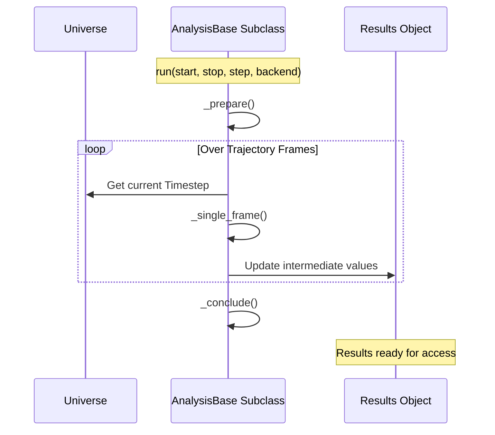

# Analysis Modules

<details>
<summary>Relevant source files</summary>

The following files were used as context for generating this wiki page:

- [package/MDAnalysis/analysis/__init__.py](package/MDAnalysis/analysis/__init__.py)
- [package/MDAnalysis/analysis/base.py](package/MDAnalysis/analysis/base.py)
- [package/MDAnalysis/analysis/diffusionmap.py](package/MDAnalysis/analysis/diffusionmap.py)
- [package/MDAnalysis/analysis/gnm.py](package/MDAnalysis/analysis/gnm.py)
- [package/MDAnalysis/analysis/lineardensity.py](package/MDAnalysis/analysis/lineardensity.py)
- [package/MDAnalysis/analysis/polymer.py](package/MDAnalysis/analysis/polymer.py)
- [package/MDAnalysis/lib/log.py](package/MDAnalysis/lib/log.py)
- [package/doc/sphinx/source/documentation_pages/analysis/diffusionmap.rst](package/doc/sphinx/source/documentation_pages/analysis/diffusionmap.rst)
- [package/doc/sphinx/source/documentation_pages/analysis_modules.rst](package/doc/sphinx/source/documentation_pages/analysis_modules.rst)
- [package/doc/sphinx/source/documentation_pages/references.rst](package/doc/sphinx/source/documentation_pages/references.rst)
- [testsuite/MDAnalysisTests/analysis/test_base.py](testsuite/MDAnalysisTests/analysis/test_base.py)
- [testsuite/MDAnalysisTests/analysis/test_diffusionmap.py](testsuite/MDAnalysisTests/analysis/test_diffusionmap.py)
- [testsuite/MDAnalysisTests/analysis/test_gnm.py](testsuite/MDAnalysisTests/analysis/test_gnm.py)
- [testsuite/MDAnalysisTests/analysis/test_lineardensity.py](testsuite/MDAnalysisTests/analysis/test_lineardensity.py)
- [testsuite/MDAnalysisTests/analysis/test_persistencelength.py](testsuite/MDAnalysisTests/analysis/test_persistencelength.py)
- [testsuite/MDAnalysisTests/lib/test_log.py](testsuite/MDAnalysisTests/lib/test_log.py)

</details>


This page provides an overview of the analysis modules in MDAnalysis, which offer a wide range of tools for analyzing molecular dynamics simulations. These modules build upon the core data structures (see [Core Data Structures](#2)) and file I/O capabilities (see [File I/O](#3)) to provide specialized analysis functionality.

## Overview of Analysis Framework

MDAnalysis provides a consistent framework for trajectory analysis through the `AnalysisBase` class. This base class handles common tasks such as iterating through trajectory frames, showing progress bars, and storing results in a structured `Results` object. This framework allows analysis developers to focus on implementing the specific analysis algorithm while inheriting support for frame selection and parallelization.

### Analysis Hierarchy and Result Storage

The following diagram maps the relationship between the base framework classes and specific analysis implementations.

```mermaid
graph TD
    subgraph "Framework Core [package/MDAnalysis/analysis/base.py]"
        AnalysisBase["class AnalysisBase"]
        Results["class Results"]
        ResultsGroup["class ResultsGroup"]
    end

    subgraph "Specific Tools"
        RMSD["class RMSD [rms.py]"]
        PersistenceLength["class PersistenceLength [polymer.py]"]
        GNMAnalysis["class GNMAnalysis [gnm.py]"]
        DistanceMatrix["class DistanceMatrix [diffusionmap.py]"]
        LinearDensity["class LinearDensity [lineardensity.py]"]
    end

    AnalysisBase -->|"stores data in"| Results
    ResultsGroup -->|"aggregates"| Results
    AnalysisBase <|-- RMSD
    AnalysisBase <|-- PersistenceLength
    AnalysisBase <|-- GNMAnalysis
    AnalysisBase <|-- DistanceMatrix
    AnalysisBase <|-- LinearDensity
```

Sources: [package/MDAnalysis/analysis/base.py:173-205](), [package/MDAnalysis/analysis/base.py:168-168](), [package/MDAnalysis/analysis/polymer.py:109-109](), [package/MDAnalysis/analysis/gnm.py:202-202](), [package/MDAnalysis/analysis/diffusionmap.py:151-151](), [package/MDAnalysis/analysis/lineardensity.py:77-77]()

## Common Analysis Workflow

The standard workflow for using analysis modules follows a "Split-Apply-Combine" pattern, even in serial execution. The `run()` method orchestrates the lifecycle by iterating through the trajectory and calling internal hooks.



Sources: [package/MDAnalysis/analysis/base.py:39-49](), [package/MDAnalysis/analysis/base.py:456-550](), [package/MDAnalysis/analysis/base.py:588-615]()

## Key Analysis Capabilities

MDAnalysis organizes its tools into specialized modules. Detailed documentation for each is found in the child pages.

### Structural and Alignment Tools
Detail how to align structures and calculate RMSD. This includes the QCP algorithm for fast rotational superposition.
For details, see [Alignment and RMSD](#4.2).

### Distance and Contact Analysis
Explain distance calculations between atoms, including `distance_array`, `capped_distance`, and contact matrices.
For details, see [Distance Calculations](#4.3).

### Conformational Analysis
Detail how to analyze dihedral angles (Ramachandran/Janin plots) and study protein dynamics using Elastic Network Models like `GNMAnalysis` or non-linear dimensionality reduction via `DiffusionMap`.
For details, see [Dihedral Analysis](#4.4) and [Principal Component Analysis](#4.7).

### Polymer and Ensemble Analysis
Analyze polymer chains using `PersistenceLength` and `sort_backbone`. Compare ensembles of structures using the `encore` module for similarity metrics and clustering.
For details, see [Ensemble Analysis](#4.5) and [Nucleic Acid and Protein Structure Analysis](#4.9).

### Density and Volumetric Analysis
Calculate 3D volumetric maps or 1D linear density profiles along Cartesian axes using `LinearDensity`.
For details, see [Density Analysis](#4.6).

### Hydrogen Bond Analysis
Analyze hydrogen bonds, water bridges, and their autocorrelation over time using `HydrogenBondAnalysis`.
For details, see [Hydrogen Bond Analysis](#4.8).

Sources: [package/MDAnalysis/analysis/polymer.py:109-134](), [package/MDAnalysis/analysis/gnm.py:202-225](), [package/MDAnalysis/analysis/lineardensity.py:77-107](), [package/MDAnalysis/analysis/diffusionmap.py:31-45](), [package/doc/sphinx/source/documentation_pages/analysis_modules.rst:149-210]()

## Parallel Analysis Capabilities

Many analysis tools support parallel execution via the `multiprocessing` or `dask` backends. This is controlled by the `_analysis_algorithm_is_parallelizable` flag and the `get_supported_backends` method. The `ProgressBar` class provides visual feedback during both serial and parallel runs.

```python
# Example of parallel execution
from MDAnalysis.analysis.rms import RMSD
import multiprocessing

rmsd = RMSD(u, select='backbone')
# backend can be 'serial', 'multiprocessing', or 'dask'
rmsd.run(backend='multiprocessing', n_workers=multiprocessing.cpu_count())
```

| Backend | Code Entity | Dependency |
| :--- | :--- | :--- |
| **Serial** | `BackendSerial` | None (Standard) |
| **Multiprocessing** | `BackendMultiprocessing` | Python `multiprocessing` |
| **Dask** | `BackendDask` | `dask` and `distributed` |

Sources: [package/MDAnalysis/analysis/base.py:110-129](), [package/MDAnalysis/analysis/base.py:162-167](), [package/doc/sphinx/source/documentation_pages/analysis_modules.rst:51-81](), [package/lib/log.py:183-210]()

## Results and Data Handling

Results are stored in a `Results` container, which allows both dictionary-style and attribute-style access. For parallel runs, a `ResultsGroup` and an aggregator (defined in `_get_aggregator`) are used to combine results from different workers using methods like `ndarray_vstack` or `ndarray_hstack`.

```python
# Result Access Example
analysis = SomeAnalysis(u).run()
data = analysis.results.timeseries  # Attribute access
# OR
data = analysis.results['timeseries']  # Key access
```

Sources: [package/MDAnalysis/analysis/base.py:44-49](), [package/MDAnalysis/analysis/base.py:126-127](), [package/MDAnalysis/analysis/results.py:168-168]()

## Creating Custom Analysis

To create a new tool, developers subclass `AnalysisBase` and implement the core lifecycle methods.

```python
from MDAnalysis.analysis.base import AnalysisBase
import numpy as np

class MyTool(AnalysisBase):
    def _prepare(self):
        # Initialize result containers
        self.results.data = []

    def _single_frame(self):
        # Logic for one frame
        # self._ts is the current Timestep
        val = self._ag.positions.mean()
        self.results.data.append(val)

    def _conclude(self):
        # Finalize data (e.g., convert to numpy array)
        self.results.data = np.array(self.results.data)
```

For details on the framework internals, see [AnalysisBase Framework](#4.1).

Sources: [package/MDAnalysis/analysis/base.py:93-107](), [testsuite/MDAnalysisTests/analysis/test_base.py:36-61]()

---