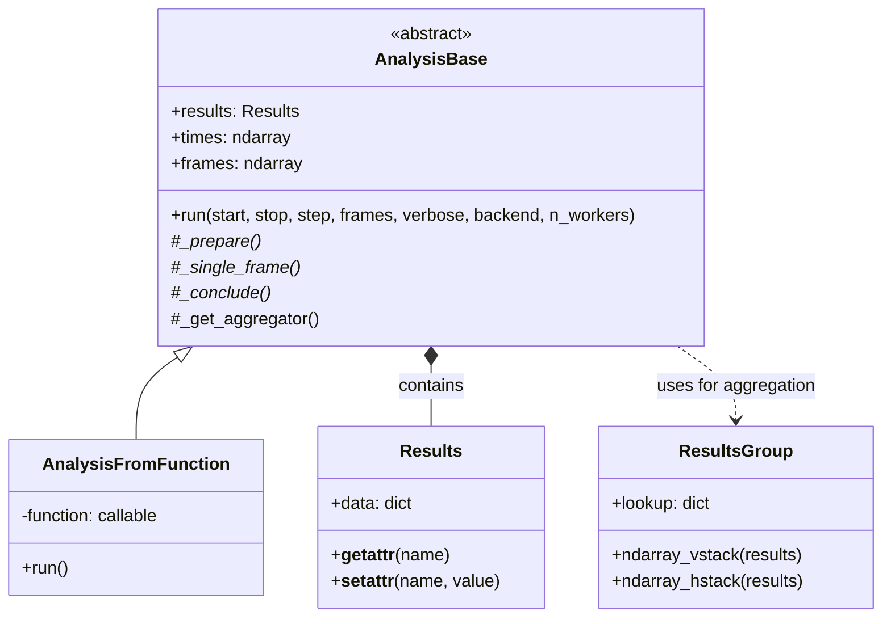
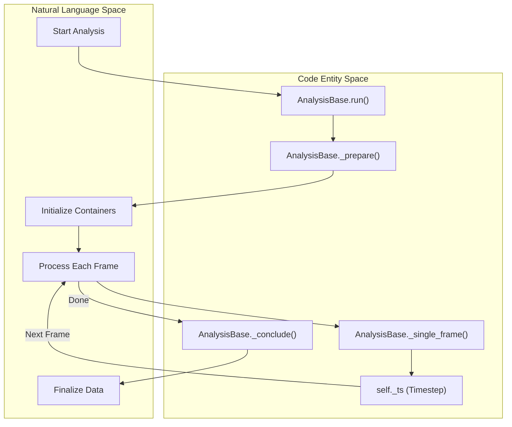
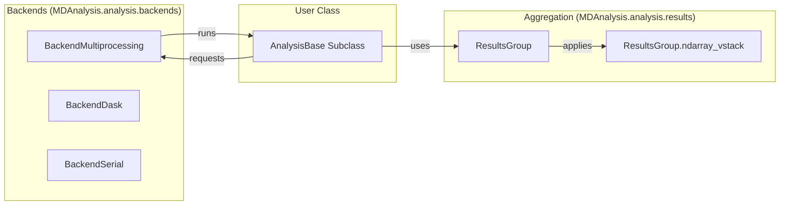

# AnalysisBase Framework

Relevant source files

The following files were used as context for generating this wiki page:

- [package/MDAnalysis/analysis/atomicdistances.py](package/MDAnalysis/analysis/atomicdistances.py)
- [package/MDAnalysis/analysis/base.py](package/MDAnalysis/analysis/base.py)
- [package/MDAnalysis/analysis/gnm.py](package/MDAnalysis/analysis/gnm.py)
- [package/MDAnalysis/analysis/lineardensity.py](package/MDAnalysis/analysis/lineardensity.py)
- [package/MDAnalysis/analysis/polymer.py](package/MDAnalysis/analysis/polymer.py)
- [package/MDAnalysis/lib/log.py](package/MDAnalysis/lib/log.py)
- [package/doc/sphinx/source/documentation_pages/analysis/parallelization.rst](package/doc/sphinx/source/documentation_pages/analysis/parallelization.rst)
- [package/doc/sphinx/source/images/AnalysisBase_parallel.png](package/doc/sphinx/source/images/AnalysisBase_parallel.png)
- [testsuite/MDAnalysisTests/analysis/conftest.py](testsuite/MDAnalysisTests/analysis/conftest.py)
- [testsuite/MDAnalysisTests/analysis/test_atomicdistances.py](testsuite/MDAnalysisTests/analysis/test_atomicdistances.py)
- [testsuite/MDAnalysisTests/analysis/test_base.py](testsuite/MDAnalysisTests/analysis/test_base.py)
- [testsuite/MDAnalysisTests/analysis/test_gnm.py](testsuite/MDAnalysisTests/analysis/test_gnm.py)
- [testsuite/MDAnalysisTests/analysis/test_lineardensity.py](testsuite/MDAnalysisTests/analysis/test_lineardensity.py)
- [testsuite/MDAnalysisTests/analysis/test_persistencelength.py](testsuite/MDAnalysisTests/analysis/test_persistencelength.py)
- [testsuite/MDAnalysisTests/lib/test_log.py](testsuite/MDAnalysisTests/lib/test_log.py)

The `AnalysisBase` framework provides a standardized structure for creating trajectory analysis tools in MDAnalysis. It serves as the foundation for most analysis classes in the MDAnalysis library, offering a common workflow and API that ensures consistency and facilitates the implementation of features like progress bars and parallelization.

## Overview

The AnalysisBase framework follows a structured lifecycle for processing trajectories. An analysis is instantiated with a `Universe` or `AtomGroup`, and the computation is triggered by the `run()` method.

Sources: [package/MDAnalysis/analysis/base.py:173-181](), [package/MDAnalysis/analysis/base.py:44-49](), [package/MDAnalysis/analysis/base.py:907-910]()

## The Analysis Lifecycle

The `run()` method manages the iteration over trajectory frames and coordinates the execution of internal hook methods.

### Execution Flow
1.  **Setup**: The `run()` method processes frame selection arguments (`start`, `stop`, `step`, or a list of `frames`) [package/MDAnalysis/analysis/base.py:503-545]().
2.  **Preparation**: Calls `_prepare()`, where the user initializes result containers [package/MDAnalysis/analysis/base.py:748-750]().
3.  **Iteration**: Iterates through the trajectory. For each frame, it updates `self._ts` and calls `_single_frame()` [package/MDAnalysis/analysis/base.py:756-760]().
4.  **Conclusion**: Calls `_conclude()` to perform post-processing (e.g., averaging or normalization) [package/MDAnalysis/analysis/base.py:764-766]().

Sources: [package/MDAnalysis/analysis/base.py:492-768](), [package/MDAnalysis/analysis/base.py:207-239]()

## Results and Data Storage

All results must be stored in the `self.results` attribute, which is an instance of `MDAnalysis.analysis.results.Results` [package/MDAnalysis/analysis/base.py:181-183]().

-   **Results Object**: A dictionary-like object that allows attribute access (e.g., `self.results.rmsd` instead of `self.results['rmsd']`) [package/MDAnalysis/analysis/base.py:44-46]().
-   **Times and Frames**: After `run()`, `self.times` and `self.frames` store the time stamps and indices of all analyzed frames [package/MDAnalysis/analysis/base.py:48-49]().

Sources: [package/MDAnalysis/analysis/base.py:44-49](), [package/MDAnalysis/analysis/results.py:1-30]()

## Parallelization Support

`AnalysisBase` supports parallel execution via the "Split-Apply-Combine" pattern. The trajectory is split into chunks, processed independently, and then merged.

### Parallel Architecture

| Component | Responsibility | Code Reference |
| :--- | :--- | :--- |
| **Backend** | Orchestrates task distribution (`serial`, `multiprocessing`, `dask`) | [package/MDAnalysis/analysis/base.py:162-167]() |
| **Aggregator** | Defines how to merge partial results from workers | [package/MDAnalysis/analysis/base.py:126-128]() |
| **ResultsGroup** | Utility for common aggregation logic (e.g., `vstack`, `mean`) | [package/MDAnalysis/analysis/results.py:100-150]() |

### Implementation for Subclasses
To make an analysis parallelizable, the subclass must:
1.  Set `_analysis_algorithm_is_parallelizable = True` [package/MDAnalysis/analysis/base.py:119]().
2.  Define `get_supported_backends()` to return allowed backends [package/MDAnalysis/analysis/base.py:121-123]().
3.  Implement `_get_aggregator()` returning a `ResultsGroup` configured with merge functions for each result key [package/MDAnalysis/analysis/base.py:126-128]().

Sources: [package/MDAnalysis/analysis/base.py:110-129](), [package/MDAnalysis/analysis/base.py:547-618](), [testsuite/MDAnalysisTests/analysis/test_base.py:39-61]()

## Subclassing AnalysisBase

When creating a new tool, developers primarily override three methods.

### Example: AtomicDistances
The `AtomicDistances` class calculates distances between two `AtomGroup` objects across a trajectory.

-   **Initialization**: Checks if `AtomGroup` sizes match [package/MDAnalysis/analysis/atomicdistances.py:171-180]().
-   **_prepare()**: Initializes `self.results.distances` as an empty list [package/MDAnalysis/analysis/atomicdistances.py:202-203]().
-   **_single_frame()**: Calculates distances for the current frame using `calc_bonds` and appends to results [package/MDAnalysis/analysis/atomicdistances.py:205-210]().
-   **_get_aggregator()**: Uses `ndarray_vstack` to combine frame-wise distances into a single array [package/MDAnalysis/analysis/atomicdistances.py:217-219]().

Sources: [package/MDAnalysis/analysis/atomicdistances.py:122-220]()

## Simplified Analysis Tools

### AnalysisFromFunction
A wrapper for users who want to perform analysis using a simple function without defining a class. It automatically creates an `AnalysisBase` compliant object [package/MDAnalysis/analysis/base.py:907-940]().

### analysis_class
A decorator/function factory that converts a single-frame function into a full `AnalysisBase` subclass [package/MDAnalysis/analysis/base.py:1009-1030]().

Sources: [package/MDAnalysis/analysis/base.py:907-1030]()

## Existing Implementations

| Module | Purpose | Class |
| :--- | :--- | :--- |
| **Polymer** | Persistence length calculation | `PersistenceLength` [package/MDAnalysis/analysis/polymer.py:109]() |
| **GNM** | Gaussian Network Model analysis | `GNMAnalysis` [package/MDAnalysis/analysis/gnm.py:202]() |
| **LinearDensity** | Mass/Charge density profiles | `LinearDensity` [package/MDAnalysis/analysis/lineardensity.py:77]() |
| **AtomicDistances** | Efficient distance calculation | `AtomicDistances` [package/MDAnalysis/analysis/atomicdistances.py:122]() |

Sources: [package/MDAnalysis/analysis/polymer.py:109](), [package/MDAnalysis/analysis/gnm.py:202](), [package/MDAnalysis/analysis/lineardensity.py:77](), [package/MDAnalysis/analysis/atomicdistances.py:122]()

---