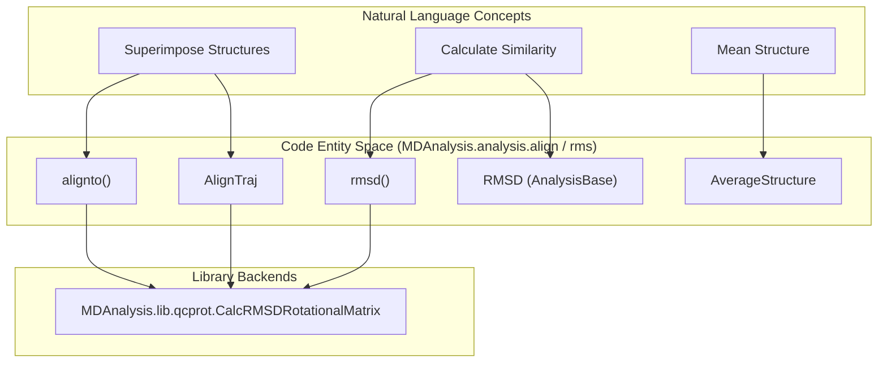
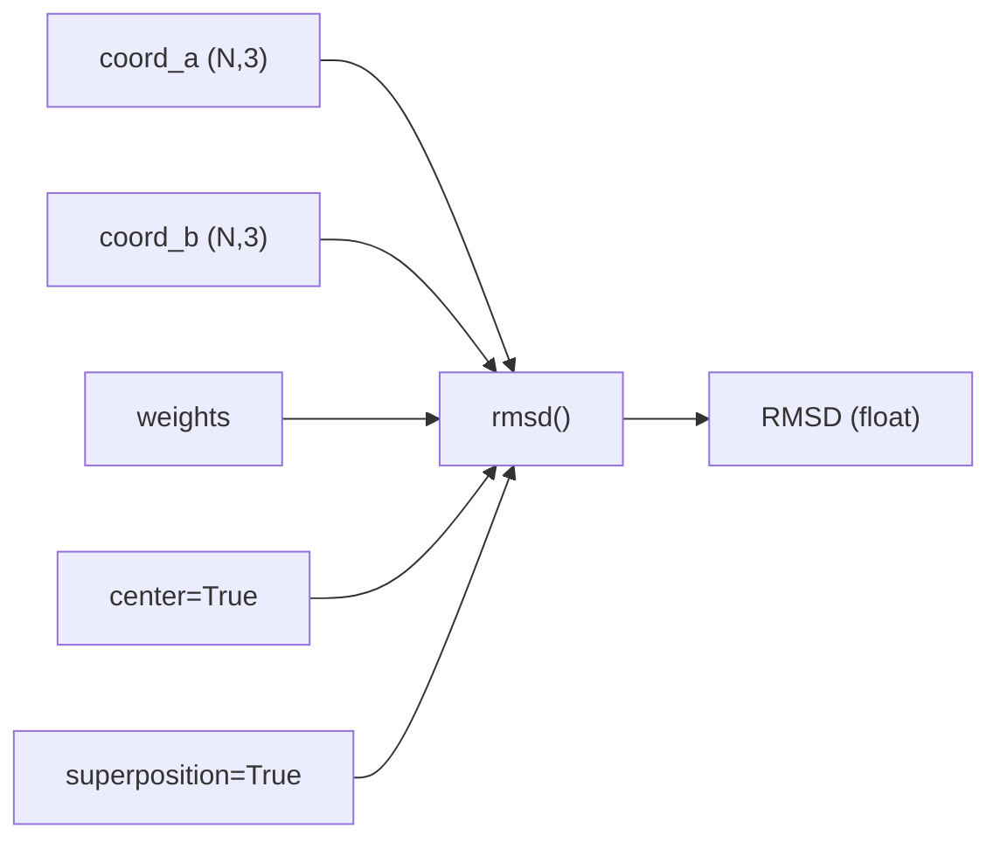
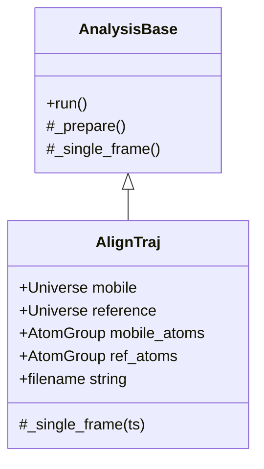

# Alignment and RMSD

Relevant source files

The following files were used as context for generating this wiki page:

- [package/MDAnalysis/analysis/align.py](package/MDAnalysis/analysis/align.py)
- [package/MDAnalysis/analysis/contacts.py](package/MDAnalysis/analysis/contacts.py)
- [package/MDAnalysis/analysis/distances.py](package/MDAnalysis/analysis/distances.py)
- [package/MDAnalysis/analysis/rms.py](package/MDAnalysis/analysis/rms.py)
- [package/MDAnalysis/lib/_augment.pyx](package/MDAnalysis/lib/_augment.pyx)
- [package/MDAnalysis/lib/c_distances.pyx](package/MDAnalysis/lib/c_distances.pyx)
- [package/MDAnalysis/lib/c_distances_openmp.pyx](package/MDAnalysis/lib/c_distances_openmp.pyx)
- [package/MDAnalysis/lib/include/calc_distances.h](package/MDAnalysis/lib/include/calc_distances.h)
- [package/MDAnalysis/lib/qcprot.pyx](package/MDAnalysis/lib/qcprot.pyx)
- [testsuite/MDAnalysisTests/analysis/test_align.py](testsuite/MDAnalysisTests/analysis/test_align.py)
- [testsuite/MDAnalysisTests/analysis/test_contacts.py](testsuite/MDAnalysisTests/analysis/test_contacts.py)
- [testsuite/MDAnalysisTests/analysis/test_rms.py](testsuite/MDAnalysisTests/analysis/test_rms.py)
- [testsuite/MDAnalysisTests/lib/test_augment.py](testsuite/MDAnalysisTests/lib/test_augment.py)

This page documents the alignment and RMSD (Root Mean Square Deviation) calculation capabilities in MDAnalysis. These tools allow users to superimpose structures, calculate structural similarity, and analyze conformational changes in molecular dynamics trajectories.

For distance calculations without structural alignment, see [Distance Calculations]().

## Overview

The alignment and RMSD modules provide functions and classes to calculate structural similarity and perform optimal rotational superposition. The implementation primarily utilizes the fast **QCP (Quaternion Characteristic Polynomial)** algorithm [package/MDAnalysis/lib/qcprot.pyx:89-92]() for RMSD calculations and rotational fitting.

Sources: [package/MDAnalysis/analysis/align.py:24-42](), [package/MDAnalysis/analysis/rms.py:37-44](), [package/MDAnalysis/lib/qcprot.pyx:79-92]().

## Core Functions

### RMSD Calculation
The `rmsd()` function calculates the Root Mean Square Deviation between two coordinate sets `a` and `b` [package/MDAnalysis/analysis/rms.py:178](). It supports optional mass-weighting, centering, and rotational superposition using the QCP algorithm [package/MDAnalysis/analysis/rms.py:205-207]().

Sources: [package/MDAnalysis/analysis/rms.py:178-212]().

### Rotation Matrix Calculation
The `rotation_matrix()` function calculates the optimal rotation matrix $R$ to superimpose a mobile set of coordinates onto a reference set while minimizing the RMSD [package/MDAnalysis/analysis/align.py:224-230](). It returns both the $3 \times 3$ matrix and the minimized RMSD value [package/MDAnalysis/analysis/align.py:307]().

Sources: [package/MDAnalysis/analysis/align.py:224-307]().

## Alignment and Trajectory Fitting

### alignto
The `alignto()` function performs a one-time alignment of a mobile `Universe` or `AtomGroup` to a reference [package/MDAnalysis/analysis/align.py:369](). It modifies the coordinates of the mobile object in-place [package/MDAnalysis/analysis/align.py:539-541]().

1. **Atom Selection**: Matches atoms between mobile and reference based on a selection string [package/MDAnalysis/analysis/align.py:465-470]().
2. **Centering**: Translates both selections to their centers of geometry (or mass if weights are provided) [package/MDAnalysis/analysis/align.py:504-510]().
3. **Rotation**: Calculates the QCP rotation matrix and applies it to the mobile `AtomGroup` [package/MDAnalysis/analysis/align.py:527-536]().

Sources: [package/MDAnalysis/analysis/align.py:369-544]().

### AlignTraj
`AlignTraj` is an `AnalysisBase` subclass that fits every frame of a trajectory to a reference structure [package/MDAnalysis/analysis/align.py:666](). It can write the aligned coordinates to a new file or modify an in-memory trajectory [package/MDAnalysis/analysis/align.py:716-724]().

Sources: [package/MDAnalysis/analysis/align.py:666-867]().

## Average Structures and RMSF

### AverageStructure
This class calculates the average coordinates of a trajectory after aligning each frame to a reference [package/MDAnalysis/analysis/align.py:870](). The result is available in `results.positions` [package/MDAnalysis/analysis/align.py:999]().

### iterative_average
For cases where a single reference frame is not ideal, `iterative_average()` computes an optimal reference by repeatedly aligning the trajectory to the current average and updating the average until convergence [package/MDAnalysis/analysis/align.py:552-565]().

### RMSF (Root Mean Square Fluctuation)
The `RMSF` class calculates the per-atom fluctuations over time [package/MDAnalysis/analysis/rms.py:1023](). Unlike RMSD, which is a single value per frame, RMSF provides a value for each atom, representing its variance around its mean position [package/MDAnalysis/analysis/rms.py:38-39]().

Sources: [package/MDAnalysis/analysis/align.py:870-1000](), [package/MDAnalysis/analysis/align.py:552-663](), [package/MDAnalysis/analysis/rms.py:1023-1120]().

## RMSD Time-Series Analysis

The `RMSD` class analyzes structural deviation over a trajectory [package/MDAnalysis/analysis/rms.py:335](). It can simultaneously track multiple selections (`groupselections`) relative to a single global alignment selection [package/MDAnalysis/analysis/rms.py:532-540]().

### Data Flow for RMSD.run()
1. **Preparation**: Centers and aligns the reference structure [package/MDAnalysis/analysis/rms.py:657-665]().
2. **Frame Iteration**: For each frame, it calculates the optimal superposition for the `select` AtomGroup [package/MDAnalysis/analysis/rms.py:734-740]().
3. **Group Calculation**: After the global alignment is determined, it calculates the RMSD for all `groupselections` without further fitting [package/MDAnalysis/analysis/rms.py:746-750]().
4. **Results**: Stores data in `results.rmsd` as an $N \times (3 + G)$ array (frame, time, global_rmsd, group_1_rmsd, ...) [package/MDAnalysis/analysis/rms.py:128-132]().

Sources: [package/MDAnalysis/analysis/rms.py:335-815]().

## Implementation: The QCP Algorithm

The `MDAnalysis.lib.qcprot` module implements the Quaternion Characteristic Polynomial algorithm [package/MDAnalysis/lib/qcprot.pyx:89](). 

Key functions include:
- `CalcRMSDRotationalMatrix()`: The primary entry point for calculating the minimized RMSD and the rotation matrix [package/MDAnalysis/lib/qcprot.pyx:253]().
- `InnerProduct()`: Calculates the inner product of centered coordinate sets, a prerequisite for the characteristic polynomial [package/MDAnalysis/lib/qcprot.pyx:179]().
- `FastCalcRMSDAndRotation()`: The core mathematical solver for the characteristic polynomial [package/MDAnalysis/lib/qcprot.pyx:358]().

Sources: [package/MDAnalysis/lib/qcprot.pyx:179-450]().

---