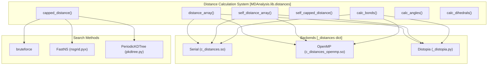
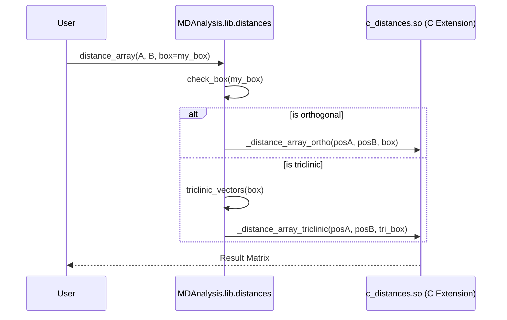

# Distance Calculations

<details>
<summary>Relevant source files</summary>

The following files were used as context for generating this wiki page:

- [package/MDAnalysis/analysis/leaflet.py](package/MDAnalysis/analysis/leaflet.py)
- [package/MDAnalysis/analysis/pca.py](package/MDAnalysis/analysis/pca.py)
- [package/MDAnalysis/analysis/rdf.py](package/MDAnalysis/analysis/rdf.py)
- [package/MDAnalysis/lib/NeighborSearch.py](package/MDAnalysis/lib/NeighborSearch.py)
- [package/MDAnalysis/lib/__init__.py](package/MDAnalysis/lib/__init__.py)
- [package/MDAnalysis/lib/_distopia.py](package/MDAnalysis/lib/_distopia.py)
- [package/MDAnalysis/lib/distances.py](package/MDAnalysis/lib/distances.py)
- [package/MDAnalysis/lib/mdamath.py](package/MDAnalysis/lib/mdamath.py)
- [package/MDAnalysis/lib/nsgrid.pyx](package/MDAnalysis/lib/nsgrid.pyx)
- [package/MDAnalysis/lib/pkdtree.py](package/MDAnalysis/lib/pkdtree.py)
- [package/MDAnalysis/lib/util.py](package/MDAnalysis/lib/util.py)
- [package/doc/sphinx/source/documentation_pages/analysis/base.rst](package/doc/sphinx/source/documentation_pages/analysis/base.rst)
- [package/doc/sphinx/source/documentation_pages/analysis/lineardensity.rst](package/doc/sphinx/source/documentation_pages/analysis/lineardensity.rst)
- [package/doc/sphinx/source/documentation_pages/analysis/polymer.rst](package/doc/sphinx/source/documentation_pages/analysis/polymer.rst)
- [package/doc/sphinx/source/documentation_pages/analysis/rdf.rst](package/doc/sphinx/source/documentation_pages/analysis/rdf.rst)
- [package/doc/sphinx/source/documentation_pages/core_modules.rst](package/doc/sphinx/source/documentation_pages/core_modules.rst)
- [package/doc/sphinx/source/documentation_pages/lib/pkdtree.rst](package/doc/sphinx/source/documentation_pages/lib/pkdtree.rst)
- [package/doc/sphinx/source/documentation_pages/lib_modules.rst](package/doc/sphinx/source/documentation_pages/lib_modules.rst)
- [testsuite/MDAnalysisTests/analysis/test_distances.py](testsuite/MDAnalysisTests/analysis/test_distances.py)
- [testsuite/MDAnalysisTests/analysis/test_leaflet.py](testsuite/MDAnalysisTests/analysis/test_leaflet.py)
- [testsuite/MDAnalysisTests/analysis/test_pca.py](testsuite/MDAnalysisTests/analysis/test_pca.py)
- [testsuite/MDAnalysisTests/analysis/test_rdf.py](testsuite/MDAnalysisTests/analysis/test_rdf.py)
- [testsuite/MDAnalysisTests/analysis/test_rdf_s.py](testsuite/MDAnalysisTests/analysis/test_rdf_s.py)
- [testsuite/MDAnalysisTests/lib/test_distances.py](testsuite/MDAnalysisTests/lib/test_distances.py)
- [testsuite/MDAnalysisTests/lib/test_neighborsearch.py](testsuite/MDAnalysisTests/lib/test_neighborsearch.py)
- [testsuite/MDAnalysisTests/lib/test_nsgrid.py](testsuite/MDAnalysisTests/lib/test_nsgrid.py)
- [testsuite/MDAnalysisTests/lib/test_pkdtree.py](testsuite/MDAnalysisTests/lib/test_pkdtree.py)
- [testsuite/MDAnalysisTests/lib/test_util.py](testsuite/MDAnalysisTests/lib/test_util.py)

</details>


This page documents the distance calculation functionality in MDAnalysis, which provides efficient methods for computing distances between atoms in molecular simulations. These calculations form the foundation for many analyses in molecular dynamics, including finding neighboring atoms, calculating radial distribution functions (RDF), and identifying molecular contacts.

## Overview

MDAnalysis provides several optimized functions for calculating distances between atoms, with support for periodic boundary conditions (PBC). The core distance calculation functions are implemented in C/Cython for performance and are accessible through the `MDAnalysis.lib.distances` module.

Title: Distance Calculation Architecture


Sources: [package/MDAnalysis/lib/distances.py:25-141](), [package/MDAnalysis/lib/distances.py:163-176](), [package/MDAnalysis/lib/nsgrid.pyx:195-203](), [package/MDAnalysis/lib/pkdtree.py:46-63]()

## Core Distance Functions

MDAnalysis provides several key functions for distance calculations in `MDAnalysis.lib.distances`.

### distance_array

The `distance_array` function calculates all pairwise distances between two sets of coordinates. It handles the dispatching to different backends based on the `backend` keyword [package/MDAnalysis/lib/distances.py:38-41]().

**Function signature:**
`distance_array(reference, configuration, box=None, result=None, backend="serial")` [package/MDAnalysis/lib/distances.py:283-305]()

- `reference`: Coordinates of shape `(n, 3)` or an `AtomGroup` [package/MDAnalysis/lib/distances.py:28-30]().
- `configuration`: Coordinates of shape `(m, 3)` or an `AtomGroup` [package/MDAnalysis/lib/distances.py:28-30]().
- `box`: Box dimensions for periodic boundary conditions.
- `backend`: Calculation backend ('serial', 'OpenMP', or 'distopia') [package/MDAnalysis/lib/distances.py:44-54]().

Returns a distance matrix of shape `(n, m)` containing all pairwise distances.

Sources: [package/MDAnalysis/lib/distances.py:283-394]()

### self_distance_array

Calculates all pairwise distances within a single set of coordinates. To save memory, it returns only the upper triangle of the distance matrix as a 1D array.

**Function signature:**
`self_distance_array(reference, box=None, result=None, backend="serial")` [package/MDAnalysis/lib/distances.py:398-417]()

Returns a 1D array of shape `(n*(n-1)/2,)`.

Sources: [package/MDAnalysis/lib/distances.py:398-503]()

### capped_distance

Efficiently finds pairs of atoms within a specified cutoff distance. This is significantly faster than `distance_array` for large systems because it uses advanced search algorithms rather than $O(N^2)$ brute force.

**Function signature:**
`capped_distance(reference, configuration, max_cutoff, min_cutoff=None, box=None, method=None, return_distances=True, backend="serial")` [package/MDAnalysis/lib/distances.py:514-554]()

Returns a tuple of `(pairs, distances)` where `pairs` is an array of shape `(k, 2)` containing indices.

Sources: [package/MDAnalysis/lib/distances.py:514-650]()

## Search Methods and Backends

### NS Grid (Cell Lists)
The `FastNS` class in `MDAnalysis.lib.nsgrid` implements a grid-based neighbor search inspired by GROMACS [package/MDAnalysis/lib/nsgrid.pyx:40-43](). It divides the domain into cells of size at least the `cutoff`. Atoms are assigned to cells, and the search only checks the atom's own cell and its immediate neighbors [package/MDAnalysis/lib/nsgrid.pyx:61-67]().

- **Data Flow**: `FastNS` populates an `NSResults` object which stores the resulting pairs and distances using C++ vectors for efficiency [package/MDAnalysis/lib/nsgrid.pyx:127-151]().
- **Triclinic Support**: Handles non-orthogonal boxes by transforming coordinates to a normalized space [package/MDAnalysis/lib/nsgrid.pyx:201-203]().

Sources: [package/MDAnalysis/lib/nsgrid.pyx:33-77](), [package/MDAnalysis/lib/nsgrid.pyx:127-151](), [package/MDAnalysis/lib/nsgrid.pyx:195-203]()

### Periodic KDTree
The `PeriodicKDTree` class wraps `scipy.spatial.cKDTree` [package/MDAnalysis/lib/pkdtree.py:47](). To handle PBC, it "augments" the coordinates by creating images of atoms near the boundaries that fall within the `cutoff` distance [package/MDAnalysis/lib/pkdtree.py:53-58]().

- **Augmentation**: Uses `MDAnalysis.lib.distances.augment_coordinates` to generate image particles [package/MDAnalysis/lib/pkdtree.py:150-155]().
- **Mapping**: Results are mapped back to original indices using `undo_augment` [package/MDAnalysis/lib/pkdtree.py:59-62]().

Sources: [package/MDAnalysis/lib/pkdtree.py:46-63](), [package/MDAnalysis/lib/pkdtree.py:139-165]()

### Acceleration Backends
1. **Serial**: The default Cython implementation in `c_distances` [package/MDAnalysis/lib/distances.py:47]().
2. **OpenMP**: Parallelized version using OpenMP, implemented in `c_distances_openmp` [package/MDAnalysis/lib/distances.py:49-50]().
3. **Distopia**: A SIMD-accelerated library (`distopia`) for explicit vectorization using Instruction Set Architecture (ISA) specific intrinsics [package/MDAnalysis/lib/distances.py:52-54](), [package/MDAnalysis/lib/distances.py:94-96]().

Sources: [package/MDAnalysis/lib/distances.py:35-54](), [package/MDAnalysis/lib/distances.py:57-87]()

## Radial Distribution Functions (RDF)

The `MDAnalysis.analysis.rdf` module provides tools for calculating $g(r)$ [package/MDAnalysis/analysis/rdf.py:24-30]().

| Class | Purpose |
| :--- | :--- |
| `InterRDF` | Calculates the RDF between two `AtomGroup` objects [package/MDAnalysis/analysis/rdf.py:122-149](). |
| `InterRDF_s` | A version of `InterRDF` that allows for multiple selections and calculates the RDF between all pairs of groups [testsuite/MDAnalysisTests/analysis/test_rdf_s.py:29-30](). |

The RDF is calculated by histogramming distances while taking PBC into account via the minimum image convention [package/MDAnalysis/analysis/rdf.py:133-137](). It can be normalized as a density (`norm='density'`), standard RDF (`norm='rdf'`), or raw counts (`norm='none'`) [package/MDAnalysis/analysis/rdf.py:154-159]().

Sources: [package/MDAnalysis/analysis/rdf.py:24-78](), [package/MDAnalysis/analysis/rdf.py:122-175]()

## Leaflet Analysis

The `LeafletFinder` (in `MDAnalysis.analysis.leaflet`) uses distance-based connectivity to identify separate leaflets in a lipid bilayer [package/MDAnalysis/analysis/leaflet.py:25-35](). It treats lipids as nodes in a graph and identifies connected components where lipids are within a certain distance of each other.

Sources: [package/MDAnalysis/analysis/leaflet.py:25-50]()

## Internal Logic: Natural Language to Code Entities

Title: Neighbor Search Logic Flow
```mermaid
graph TD
    "Find Neighbors" --> "Determine Method [_determine_method]"
    "Determine Method [_determine_method]" -->|"Small System / Large Cutoff"| "Brute Force [_bruteforce_capped]"
    "Determine Method [_determine_method]" -->|"Large System / Small Cutoff"| "Grid Search [_nsgrid_capped]"
    "Determine Method [_determine_method]" -->|"KDTree Requested"| "KDTree [_pkdtree_capped]"

    subgraph "Code Entity Space"
        "Grid Search [_nsgrid_capped]" --> FastNS["MDAnalysis.lib.nsgrid.FastNS"]
        "KDTree [_pkdtree_capped]" --> PKD["MDAnalysis.lib.pkdtree.PeriodicKDTree"]
        "Brute Force [_bruteforce_capped]" --> DistLib["MDAnalysis.lib.distances"]
    end

    FastNS --> NSResults["MDAnalysis.lib.nsgrid.NSResults"]
    PKD --> ScipyTree["scipy.spatial.cKDTree"]
```

Sources: [package/MDAnalysis/lib/distances.py:653-730](), [package/MDAnalysis/lib/nsgrid.pyx:195-203](), [package/MDAnalysis/lib/pkdtree.py:46-63]()

## Summary of PBC Handling

PBC are handled by the `box` argument, which expects an array of `[lx, ly, lz, alpha, beta, gamma]` [package/MDAnalysis/lib/util.py:181-193]().

Title: PBC Calculation Sequence


Sources: [package/MDAnalysis/lib/distances.py:366-379](), [package/MDAnalysis/lib/mdamath.py:44-45](), [package/MDAnalysis/lib/util.py:181-193]()

---