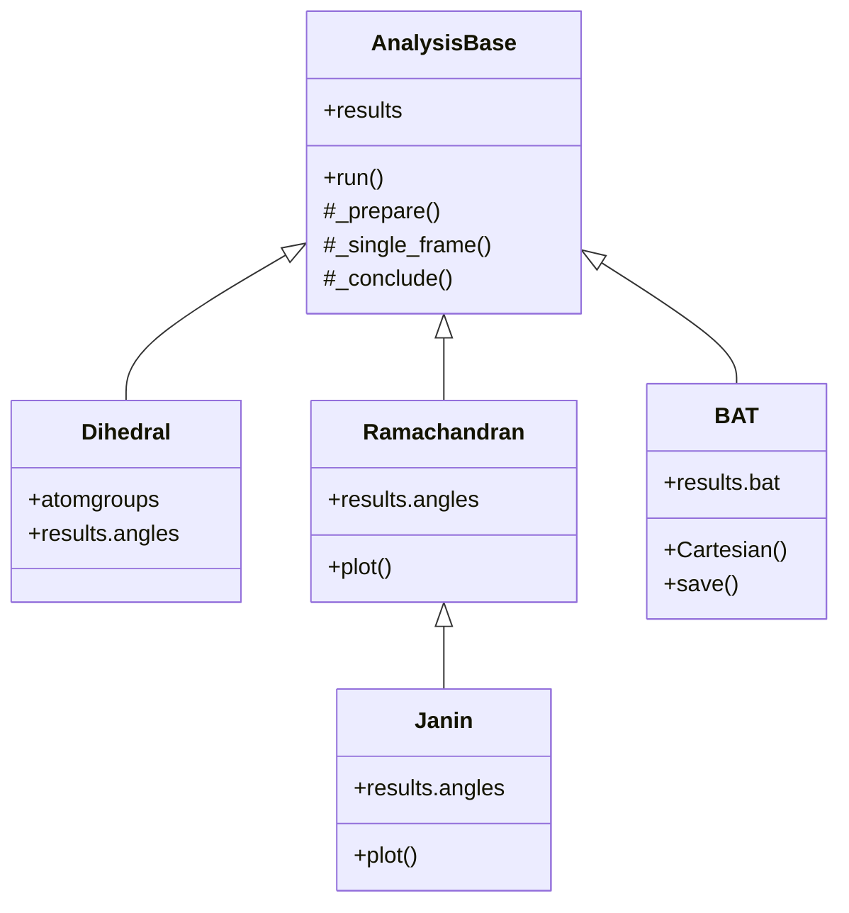
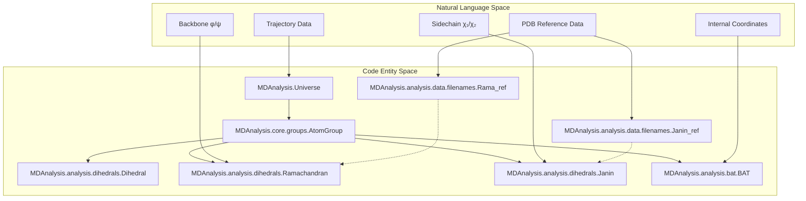

# Dihedral Analysis

Relevant source files

The following files were used as context for generating this wiki page:

- [package/MDAnalysis/analysis/bat.py](package/MDAnalysis/analysis/bat.py)
- [package/MDAnalysis/analysis/data/filenames.py](package/MDAnalysis/analysis/data/filenames.py)
- [package/MDAnalysis/analysis/dihedrals.py](package/MDAnalysis/analysis/dihedrals.py)
- [package/doc/sphinx/source/documentation_pages/analysis/bat.rst](package/doc/sphinx/source/documentation_pages/analysis/bat.rst)
- [package/doc/sphinx/source/documentation_pages/analysis/data.rst](package/doc/sphinx/source/documentation_pages/analysis/data.rst)
- [package/doc/sphinx/source/images/janin_ref_plot.png](package/doc/sphinx/source/images/janin_ref_plot.png)
- [package/doc/sphinx/source/images/rama_ref_plot.png](package/doc/sphinx/source/images/rama_ref_plot.png)
- [testsuite/MDAnalysisTests/analysis/test_bat.py](testsuite/MDAnalysisTests/analysis/test_bat.py)
- [testsuite/MDAnalysisTests/analysis/test_data.py](testsuite/MDAnalysisTests/analysis/test_data.py)
- [testsuite/MDAnalysisTests/analysis/test_dihedrals.py](testsuite/MDAnalysisTests/analysis/test_dihedrals.py)
- [testsuite/MDAnalysisTests/data/mol2_comments_header_bat.npy](testsuite/MDAnalysisTests/data/mol2_comments_header_bat.npy)

This document covers the dihedral angle analysis capabilities in MDAnalysis, which allow users to calculate and analyze various types of dihedral angles in molecular dynamics trajectories. The module provides tools for general dihedral angle calculations, protein-specific backbone (Ramachandran) and sidechain (Janin) dihedrals, and the complete Bond-Angle-Torsion (BAT) coordinate system.

## Overview

The dihedral analysis module provides classes for calculating arbitrary dihedrals and specialized protein plots. These classes inherit from `AnalysisBase` [package/MDAnalysis/analysis/dihedrals.py:253-253](), which provides the standard `run()` lifecycle and results handling.

### Dihedral Analysis Class Hierarchy

Sources: [package/MDAnalysis/analysis/dihedrals.py:253-253](), [package/MDAnalysis/analysis/dihedrals.py:341-341](), [package/MDAnalysis/analysis/dihedrals.py:578-578](), [package/MDAnalysis/analysis/bat.py:132-132](), [package/MDAnalysis/analysis/bat.py:167-167]()

## Dihedral Angle Calculation

A dihedral angle is defined by four atoms. In MDAnalysis, these are calculated using `calc_dihedrals()` from the `MDAnalysis.lib.distances` library [package/MDAnalysis/analysis/dihedrals.py:44-45](), [package/MDAnalysis/analysis/bat.py:169-169]().

### The `Dihedral` Class
The `Dihedral` class calculates angles for a list of `AtomGroup` objects, where each group contains exactly 4 atoms [package/MDAnalysis/analysis/dihedrals.py:253-267]().

*   **Input**: A list of `AtomGroup` objects [package/MDAnalysis/analysis/dihedrals.py:269-270]().
*   **Results**: Stored in `results.angles` as an `n_frames × n_dihedrals` array [package/MDAnalysis/analysis/dihedrals.py:177-181]().

Sources: [package/MDAnalysis/analysis/dihedrals.py:253-339](), [testsuite/MDAnalysisTests/analysis/test_dihedrals.py:46-110]()

## Protein Structure Analysis

### Ramachandran Analysis
The `Ramachandran` class identifies residues and calculates the backbone $\phi$ (phi) and $\psi$ (psi) angles [package/MDAnalysis/analysis/dihedrals.py:341-360]().

*   **Implementation**: It automatically identifies atoms for $\phi$ ($C_{i-1}-N_i-CA_i-C_i$) and $\psi$ ($N_i-CA_i-C_i-N_{i+1}$) [package/MDAnalysis/analysis/dihedrals.py:75-77]().
*   **Plotting**: Includes a `plot()` method that can overlay reference data from `Rama_ref` [package/MDAnalysis/analysis/dihedrals.py:512-515](), [package/MDAnalysis/analysis/data/filenames.py:36-39]().
*   **Limitations**: Prone to errors if the topology contains duplicate `altloc` atoms or missing backbone atoms [package/MDAnalysis/analysis/dihedrals.py:108-115]().

### Janin Analysis
The `Janin` class calculates sidechain $\chi_1$ and $\chi_2$ angles [package/MDAnalysis/analysis/dihedrals.py:578-595]().

*   **Filtering**: Many residues (ALA, CYS, GLY, PRO, SER, THR, VAL) lack $\chi_2$ dihedrals and are excluded by default to avoid errors [package/MDAnalysis/analysis/dihedrals.py:146-150]().
*   **Reference**: Uses `Janin_ref` data derived from 500 PDB structures [package/MDAnalysis/analysis/data/filenames.py:70-75](), [package/MDAnalysis/analysis/data/filenames.py:116-116]().

Sources: [package/MDAnalysis/analysis/dihedrals.py:341-736](), [package/MDAnalysis/analysis/data/filenames.py:36-117](), [testsuite/MDAnalysisTests/analysis/test_dihedrals.py:112-206]()

## Bond-Angle-Torsion (BAT) Coordinates

The `BAT` class provides a complete, non-redundant internal coordinate system for a given set of atoms [package/MDAnalysis/analysis/bat.py:32-35]().

### Coordinate System Components
1.  **External Coordinates**: 6 degrees of freedom. The first three are the center of mass of the initial atom. The next three are external angles ($\phi, \theta, \omega$) following the axis-angle convention [package/MDAnalysis/analysis/bat.py:140-145]().
2.  **Internal Coordinates**: Bond lengths ($r_{01}, r_{12}$), bond angles ($a_{012}$), and then all other bond distances, angles, and torsions (including improper torsions to minimize correlations) [package/MDAnalysis/analysis/bat.py:146-151]().

### Key Features
*   **Reconstruction**: The `Cartesian()` method converts BAT coordinates back to Cartesian positions [package/MDAnalysis/analysis/bat.py:103-103]().
*   **Persistence**: Results can be saved to disk via `save()` and reloaded into a new instance using the `filename` parameter [package/MDAnalysis/analysis/bat.py:119-124]().
*   **Results**: Stored in `results.bat` as an `(n_frames, 3N)` array [package/MDAnalysis/analysis/bat.py:136-139]().

Sources: [package/MDAnalysis/analysis/bat.py:23-159](), [testsuite/MDAnalysisTests/analysis/test_bat.py:43-169]()

## Data Flow and Entities

The following diagram maps the Natural Language concepts to the specific Code Entities used in the dihedral analysis workflow.

Sources: [package/MDAnalysis/analysis/dihedrals.py:59-90](), [package/MDAnalysis/analysis/bat.py:80-94](), [package/MDAnalysis/analysis/data/filenames.py:112-117]()

## Parallel Processing Support

Dihedral analysis classes support parallel execution via the `AnalysisBase` framework. The backend and number of workers are typically managed during the `run()` call [testsuite/MDAnalysisTests/analysis/test_dihedrals.py:56-63]().

| Backend | Implementation | Usage |
| :--- | :--- | :--- |
| `serial` | Standard single-threaded execution | Default |
| `multiprocessing` | Uses Python's multiprocessing module | `run(backend='multiprocessing')` |
| `dask` | Uses Dask for distributed/parallel computing | `run(backend='dask')` |

Sources: [testsuite/MDAnalysisTests/analysis/test_dihedrals.py:56-63](), [package/MDAnalysis/analysis/bat.py:51-53](), [package/MDAnalysis/analysis/dihedrals.py:67-68]()

---