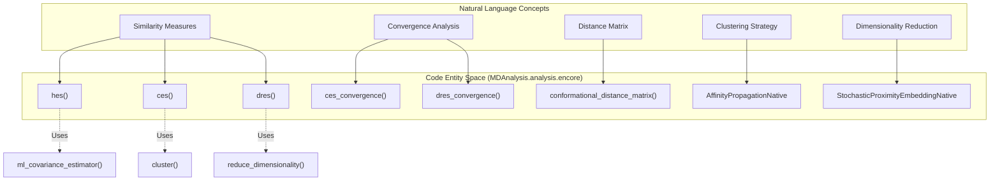
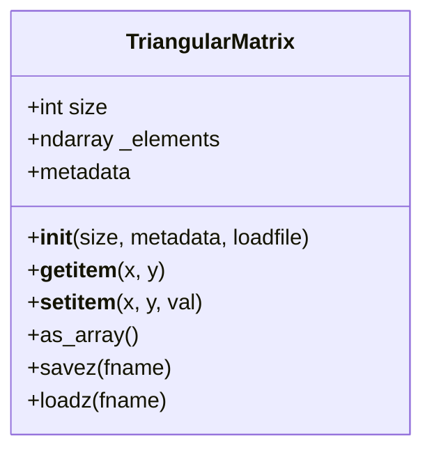
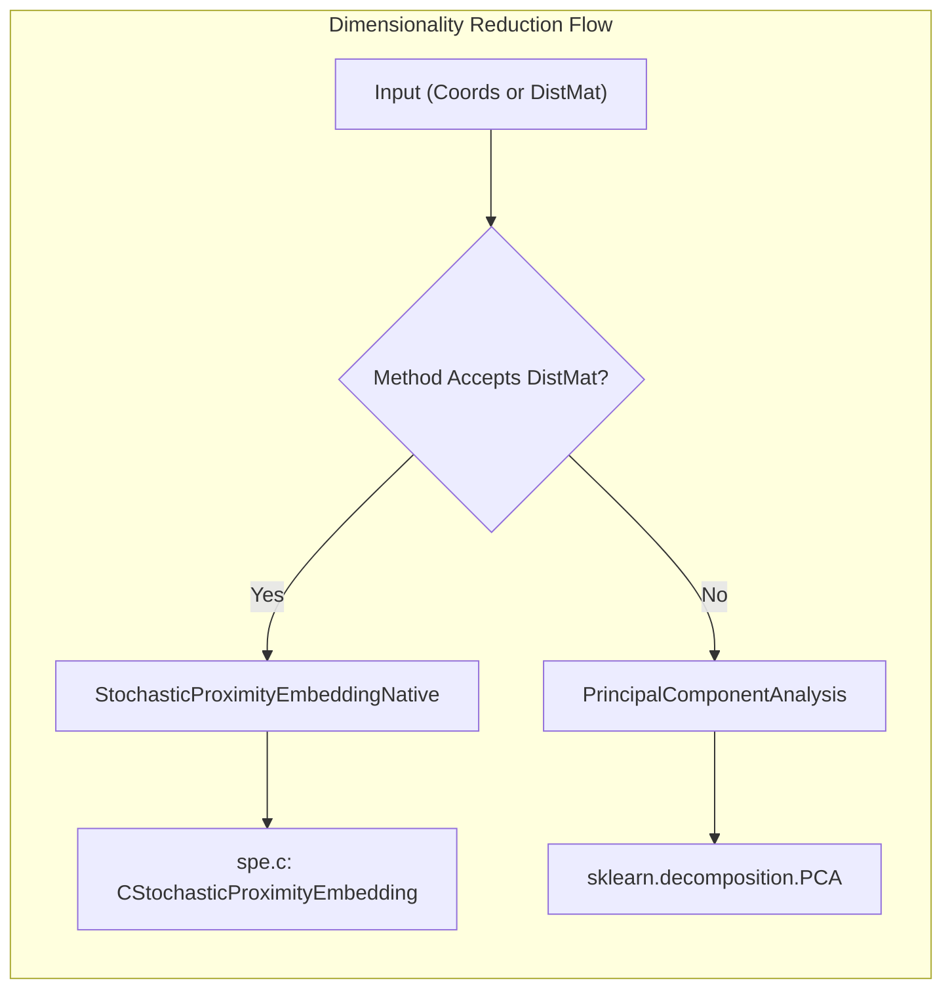

# Ensemble Analysis

Relevant source files

The following files were used as context for generating this wiki page:

- [package/MDAnalysis/analysis/encore/__init__.py](package/MDAnalysis/analysis/encore/__init__.py)
- [package/MDAnalysis/analysis/encore/bootstrap.py](package/MDAnalysis/analysis/encore/bootstrap.py)
- [package/MDAnalysis/analysis/encore/clustering/ClusterCollection.py](package/MDAnalysis/analysis/encore/clustering/ClusterCollection.py)
- [package/MDAnalysis/analysis/encore/clustering/ClusteringMethod.py](package/MDAnalysis/analysis/encore/clustering/ClusteringMethod.py)
- [package/MDAnalysis/analysis/encore/clustering/__init__.py](package/MDAnalysis/analysis/encore/clustering/__init__.py)
- [package/MDAnalysis/analysis/encore/clustering/affinityprop.pyx](package/MDAnalysis/analysis/encore/clustering/affinityprop.pyx)
- [package/MDAnalysis/analysis/encore/clustering/cluster.py](package/MDAnalysis/analysis/encore/clustering/cluster.py)
- [package/MDAnalysis/analysis/encore/clustering/include/ap.h](package/MDAnalysis/analysis/encore/clustering/include/ap.h)
- [package/MDAnalysis/analysis/encore/clustering/src/ap.c](package/MDAnalysis/analysis/encore/clustering/src/ap.c)
- [package/MDAnalysis/analysis/encore/confdistmatrix.py](package/MDAnalysis/analysis/encore/confdistmatrix.py)
- [package/MDAnalysis/analysis/encore/covariance.py](package/MDAnalysis/analysis/encore/covariance.py)
- [package/MDAnalysis/analysis/encore/cutils.pyx](package/MDAnalysis/analysis/encore/cutils.pyx)
- [package/MDAnalysis/analysis/encore/dimensionality_reduction/DimensionalityReductionMethod.py](package/MDAnalysis/analysis/encore/dimensionality_reduction/DimensionalityReductionMethod.py)
- [package/MDAnalysis/analysis/encore/dimensionality_reduction/__init__.py](package/MDAnalysis/analysis/encore/dimensionality_reduction/__init__.py)
- [package/MDAnalysis/analysis/encore/dimensionality_reduction/include/spe.h](package/MDAnalysis/analysis/encore/dimensionality_reduction/include/spe.h)
- [package/MDAnalysis/analysis/encore/dimensionality_reduction/reduce_dimensionality.py](package/MDAnalysis/analysis/encore/dimensionality_reduction/reduce_dimensionality.py)
- [package/MDAnalysis/analysis/encore/dimensionality_reduction/src/spe.c](package/MDAnalysis/analysis/encore/dimensionality_reduction/src/spe.c)
- [package/MDAnalysis/analysis/encore/dimensionality_reduction/stochasticproxembed.pyx](package/MDAnalysis/analysis/encore/dimensionality_reduction/stochasticproxembed.pyx)
- [package/MDAnalysis/analysis/encore/similarity.py](package/MDAnalysis/analysis/encore/similarity.py)
- [package/MDAnalysis/analysis/encore/utils.py](package/MDAnalysis/analysis/encore/utils.py)
- [testsuite/MDAnalysisTests/analysis/test_encore.py](testsuite/MDAnalysisTests/analysis/test_encore.py)

Ensemble Analysis in MDAnalysis provides tools for comparing multiple molecular dynamics ensembles and evaluating their similarities. This module implements methods for quantifying differences between ensembles of structures, which is useful for assessing convergence of simulations, comparing different force fields, or evaluating the impact of mutations on protein dynamics.

The `encore` module (Ensemble Comparison in MDAnalysis) offers three main similarity measures between ensembles, as well as methods for evaluating trajectory convergence. Note that as of MDAnalysis 2.8.0, the `encore` module is deprecated in favor of the MDAKit `mdaencore` package and will be removed in MDAnalysis 3.0.0 [package/MDAnalysis/analysis/encore/similarity.py:32-35]().

## Overview of Ensemble Analysis

Ensemble Analysis in MDAnalysis allows researchers to:

1.  Compare multiple ensembles of molecular structures using different similarity metrics.
2.  Evaluate the convergence of molecular dynamics trajectories.
3.  Perform clustering of conformations across multiple ensembles.
4.  Reduce the dimensionality of conformational space for visualization.

### Architecture: Natural Language to Code Entity Space

The following diagram maps high-level ensemble analysis concepts to the specific code entities in the `encore` module.

Sources: [package/MDAnalysis/analysis/encore/similarity.py:48-59](), [package/MDAnalysis/analysis/encore/similarity.py:158-164](), [package/MDAnalysis/analysis/encore/clustering/cluster.py:47-55](), [package/MDAnalysis/analysis/encore/dimensionality_reduction/reduce_dimensionality.py:48-56]()

## Core Similarity Measures

The ENCORE module implements three primary methods for calculating similarity measures between ensembles, defined in `MDAnalysis.analysis.encore.similarity`:

### Harmonic Ensemble Similarity (HES)
HES assumes each ensemble is derived from a multivariate normal distribution. It calculates the mean and covariance matrix and compares them using a symmetrized Kullback-Leibler divergence [package/MDAnalysis/analysis/encore/similarity.py:151-153]().
*   **Implementation**: `hes(ensembles, ...)` [package/MDAnalysis/analysis/encore/similarity.py:787-857]().
*   **Range**: Unbounded [0, ∞) [package/MDAnalysis/analysis/encore/similarity.py:87-88]().

### Clustering Ensemble Similarity (CES)
CES uses clustering algorithms to group conformations from merged ensembles. It calculates probability densities from cluster memberships and uses Jensen-Shannon divergence [package/MDAnalysis/analysis/encore/similarity.py:148-150]().
*   **Implementation**: `ces(ensembles, ...)` [package/MDAnalysis/analysis/encore/similarity.py:1051-1143]().
*   **Range**: Bounded [0, ln(2)] [package/MDAnalysis/analysis/encore/similarity.py:149-150]().

### Dimensional Reduction Ensemble Similarity (DRES)
DRES reduces dimensionality (via SPE or PCA) and estimates probability density in the reduced space [package/MDAnalysis/analysis/encore/similarity.py:110-113]().
*   **Implementation**: `dres(ensembles, ...)` [package/MDAnalysis/analysis/encore/similarity.py:1237-1329]().
*   **Range**: Bounded [0, ln(2)] [package/MDAnalysis/analysis/encore/similarity.py:149-150]().

Sources: [package/MDAnalysis/analysis/encore/similarity.py:37-60](), [package/MDAnalysis/analysis/encore/similarity.py:74-85](), [package/MDAnalysis/analysis/encore/similarity.py:148-153]()

## Data Structures and Implementation

### Triangular Matrix Representation
The `TriangularMatrix` class in `encore.utils` provides a memory-efficient representation of symmetric distance matrices by storing only the lower triangle in row-major order [package/MDAnalysis/analysis/encore/utils.py:34-42]().

*   **Access Logic**: Indices `(x, y)` are swapped if `x < y` to ensure the lower triangle is always accessed [package/MDAnalysis/analysis/encore/utils.py:83-93]().
*   **Storage**: Elements are stored in a 1D array of size `(size + 1) * size // 2` [package/MDAnalysis/analysis/encore/utils.py:73]().

Sources: [package/MDAnalysis/analysis/encore/utils.py:34-192]()

### Clustering System
The `cluster()` function serves as a front-end for various algorithms [package/MDAnalysis/analysis/encore/clustering/cluster.py:47-55](). Results are encapsulated in `ClusterCollection` and `Cluster` objects.

| Component | Code Entity | Description |
| :--- | :--- | :--- |
| **Native Algorithm** | `AffinityPropagationNative` | C-based implementation of message-passing clustering [package/MDAnalysis/analysis/encore/clustering/ClusteringMethod.py:105-178](). |
| **External Interface** | `AffinityPropagation` | Wrapper for `sklearn.cluster.AffinityPropagation` [package/MDAnalysis/analysis/encore/clustering/ClusteringMethod.py:183-187](). |
| **Data Container** | `Cluster` | Stores cluster ID, centroid index, and element list [package/MDAnalysis/analysis/encore/clustering/ClusterCollection.py:43-66](). |
| **Collection** | `ClusterCollection` | Maps conformations to centroids [package/MDAnalysis/analysis/encore/clustering/ClusterCollection.py:150-161](). |

Sources: [package/MDAnalysis/analysis/encore/clustering/ClusteringMethod.py:74-102](), [package/MDAnalysis/analysis/encore/clustering/cluster.py:159-181](), [package/MDAnalysis/analysis/encore/clustering/ClusterCollection.py:163-194](), [package/MDAnalysis/analysis/encore/clustering/affinityprop.pyx:42-81]()

## Dimensionality Reduction

Dimensionality reduction is performed via `reduce_dimensionality()` [package/MDAnalysis/analysis/encore/dimensionality_reduction/reduce_dimensionality.py:48-56]().

### Stochastic Proximity Embedding (SPE)
SPE is the default native method. It is a self-organizing algorithm that attempts to preserve pairwise distances in a lower-dimensional space [package/MDAnalysis/analysis/encore/dimensionality_reduction/DimensionalityReductionMethod.py:94-97]().
*   **Native Class**: `StochasticProximityEmbeddingNative` [package/MDAnalysis/analysis/encore/dimensionality_reduction/DimensionalityReductionMethod.py:94-137]().
*   **C Implementation**: The core logic is implemented in `CStochasticProximityEmbedding` in `spe.c`, which uses a learning rate `lam` that decreases over cycles [package/MDAnalysis/analysis/encore/dimensionality_reduction/src/spe.c:176-229]().

### Principal Component Analysis (PCA)
A wrapper for `sklearn.decomposition.PCA`. Unlike SPE, it does not accept a distance matrix directly and works on raw coordinates [package/MDAnalysis/analysis/encore/dimensionality_reduction/DimensionalityReductionMethod.py:170-178]().

Sources: [package/MDAnalysis/analysis/encore/dimensionality_reduction/DimensionalityReductionMethod.py:62-91](), [package/MDAnalysis/analysis/encore/dimensionality_reduction/reduce_dimensionality.py:158-167](), [package/MDAnalysis/analysis/encore/dimensionality_reduction/src/spe.c:176-230]()

## Covariance Estimation

For HES calculations, covariance matrices are estimated using the `covariance_matrix` function [package/MDAnalysis/analysis/encore/covariance.py:187-219]().

1.  **Maximum Likelihood**: `ml_covariance_estimator` calculates the standard covariance by measuring distance to the average [package/MDAnalysis/analysis/encore/covariance.py:43-79]().
2.  **Shrinkage Estimator**: `shrinkage_covariance_estimator` uses the Ledoit-Wolf method to provide a more robust estimate when the number of features (coordinates) is large relative to the number of frames [package/MDAnalysis/analysis/encore/covariance.py:82-113]().

Sources: [package/MDAnalysis/analysis/encore/covariance.py:24-39](), [package/MDAnalysis/analysis/encore/covariance.py:187-223]()

## Convergence Analysis

ENCORE provides two primary methods for assessing if a simulation has sampled its ensemble sufficiently:
1.  **`ces_convergence(ensemble, window_size, ...)`**: Measures similarity between successive trajectory windows using clustering [package/MDAnalysis/analysis/encore/similarity.py:1331-1407]().
2.  **`dres_convergence(ensemble, window_size, ...)`**: Measures similarity between successive trajectory windows using dimensionality reduction [package/MDAnalysis/analysis/encore/similarity.py:1409-1485]().

Sources: [package/MDAnalysis/analysis/encore/similarity.py:55-59](), [package/MDAnalysis/analysis/encore/similarity.py:504-547]()

---