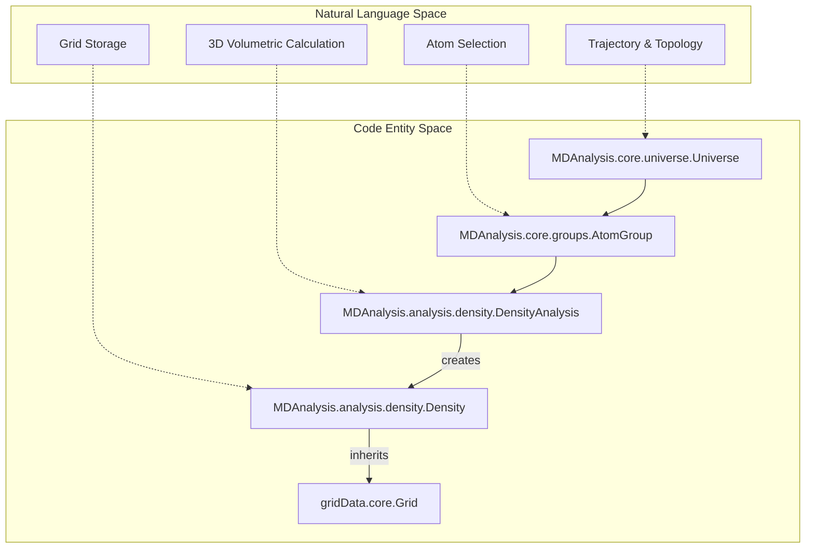
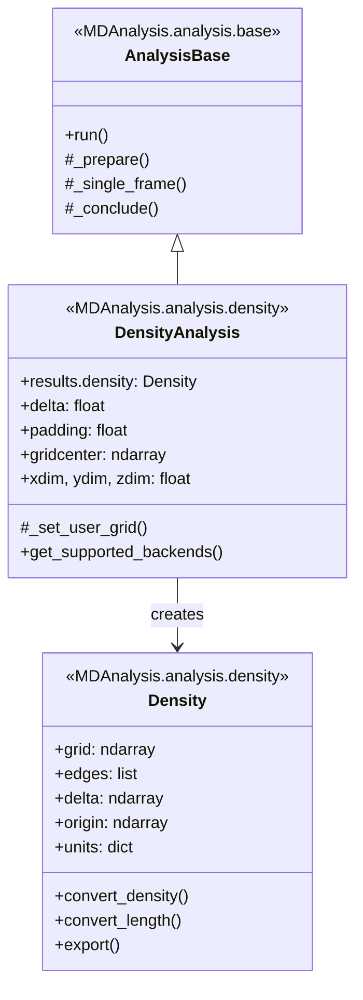
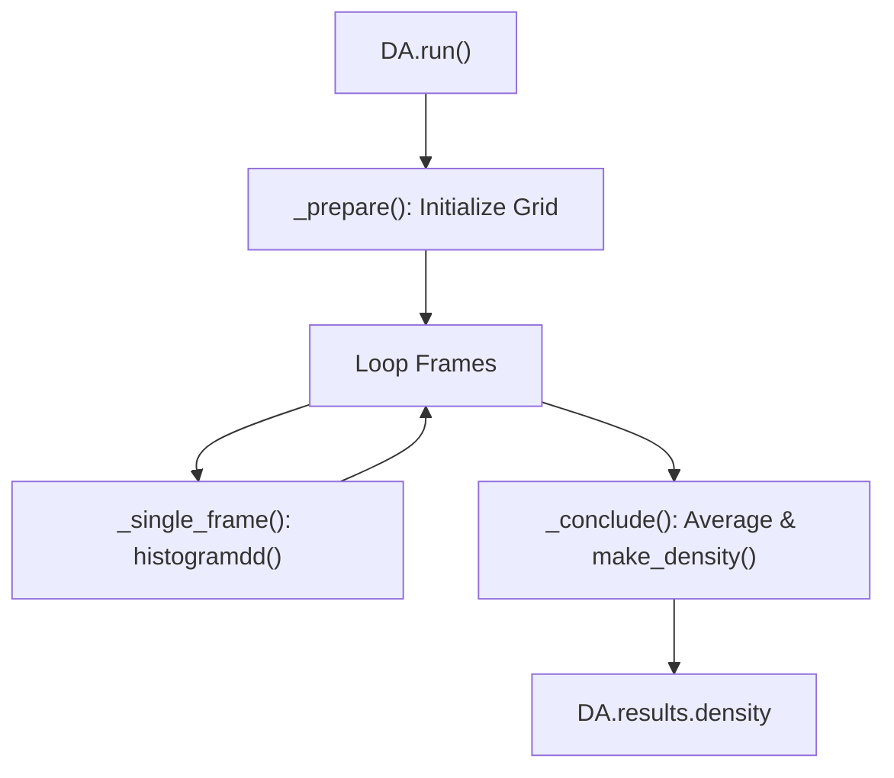

# Density Analysis

<details>
<summary>Relevant source files</summary>

The following files were used as context for generating this wiki page:

- [package/MDAnalysis/analysis/base.py](package/MDAnalysis/analysis/base.py)
- [package/MDAnalysis/analysis/density.py](package/MDAnalysis/analysis/density.py)
- [package/MDAnalysis/analysis/gnm.py](package/MDAnalysis/analysis/gnm.py)
- [package/MDAnalysis/analysis/hbonds/hbond_autocorrel.py](package/MDAnalysis/analysis/hbonds/hbond_autocorrel.py)
- [package/MDAnalysis/analysis/lineardensity.py](package/MDAnalysis/analysis/lineardensity.py)
- [package/MDAnalysis/analysis/polymer.py](package/MDAnalysis/analysis/polymer.py)
- [package/MDAnalysis/analysis/psa.py](package/MDAnalysis/analysis/psa.py)
- [package/MDAnalysis/analysis/waterdynamics.py](package/MDAnalysis/analysis/waterdynamics.py)
- [package/MDAnalysis/lib/log.py](package/MDAnalysis/lib/log.py)
- [testsuite/MDAnalysisTests/analysis/test_base.py](testsuite/MDAnalysisTests/analysis/test_base.py)
- [testsuite/MDAnalysisTests/analysis/test_density.py](testsuite/MDAnalysisTests/analysis/test_density.py)
- [testsuite/MDAnalysisTests/analysis/test_gnm.py](testsuite/MDAnalysisTests/analysis/test_gnm.py)
- [testsuite/MDAnalysisTests/analysis/test_hydrogenbondautocorrel.py](testsuite/MDAnalysisTests/analysis/test_hydrogenbondautocorrel.py)
- [testsuite/MDAnalysisTests/analysis/test_lineardensity.py](testsuite/MDAnalysisTests/analysis/test_lineardensity.py)
- [testsuite/MDAnalysisTests/analysis/test_persistencelength.py](testsuite/MDAnalysisTests/analysis/test_persistencelength.py)
- [testsuite/MDAnalysisTests/analysis/test_psa.py](testsuite/MDAnalysisTests/analysis/test_psa.py)
- [testsuite/MDAnalysisTests/analysis/test_waterdynamics.py](testsuite/MDAnalysisTests/analysis/test_waterdynamics.py)
- [testsuite/MDAnalysisTests/lib/test_log.py](testsuite/MDAnalysisTests/lib/test_log.py)

</details>


The Density Analysis module in MDAnalysis provides tools for calculating and analyzing volumetric density data from molecular dynamics simulations. This page covers the functionality for generating density profiles from trajectory data, particularly focusing on the spatial distribution of atoms or molecules around structures of interest.

The primary use case is analyzing solvent density around biomolecules, such as water distribution around proteins, which can reveal important information about solvation, binding sites, and molecular interactions.

## Overview of Density Analysis

The density analysis system allows users to:

1. Calculate 3D density distributions from trajectory data.
2. Convert between different units of density measurement.
3. Export density data to various file formats for visualization.
4. Analyze the spatial distribution of selected atoms or molecules.

The main components of the density analysis system are the `DensityAnalysis` class, which performs the calculation, and the `Density` class, which stores and manipulates the resulting density data.

### System Architecture

The following diagram illustrates the relationship between MDAnalysis core entities and the density analysis components.



Sources: [package/MDAnalysis/analysis/density.py:28-152](), [package/MDAnalysis/analysis/density.py:183-606]()

## DensityAnalysis Class

The `DensityAnalysis` class is the main entry point for performing density calculations. It inherits from `AnalysisBase` [package/MDAnalysis/analysis/base.py:173-181](), which provides the framework for trajectory analysis.

### Key Features

- Calculates density distributions on a 3D grid using `numpy.histogramdd`.
- Supports both static and dynamic atom selections via `UpdatingAtomGroup` [package/MDAnalysis/analysis/density.py:191-194]().
- Allows for custom grid definitions using `_set_user_grid` [package/MDAnalysis/analysis/density.py:435-443]().
- Parallelizable across multiple backends including `multiprocessing` and `dask` [package/MDAnalysis/analysis/density.py:408-412]().

### Class Structure



Sources: [package/MDAnalysis/analysis/density.py:183-606](), [package/MDAnalysis/analysis/base.py:173-181]()

### Usage

The `DensityAnalysis` class takes an `AtomGroup` as input and histograms the positions of these atoms on a 3D grid. The grid spacing is controlled by the `delta` parameter.

```python
from MDAnalysis.analysis import density

# Create a DensityAnalysis object for water oxygens
water_oxygen = universe.select_atoms("name OW")
D = density.DensityAnalysis(water_oxygen, delta=1.0)

# Run the analysis
D.run()

# Access the resulting density
water_density = D.results.density

# Convert to relative density (compared to bulk TIP4P water)
water_density.convert_density('TIP4P')

# Export to OpenDX format
water_density.export("water.dx", type="double")
```

Sources: [package/MDAnalysis/analysis/density.py:72-79](), [package/MDAnalysis/analysis/density.py:262-347]()

## Density Class

The `Density` class represents a volumetric density on a regular cartesian grid. It inherits from `gridData.core.Grid` [package/MDAnalysis/analysis/density.py:625-635]().

### Density Units and Conversion

The `Density` class provides methods to convert between different units:

- `convert_density()`: Converts the density to different units (e.g., Å⁻³, nm⁻³, or relative to water models like 'TIP4P' or 'SPC') [package/MDAnalysis/analysis/density.py:759-789]().
- `convert_length()`: Converts the grid spacing and dimensions to different length units [package/MDAnalysis/analysis/density.py:716-757]().

Sources: [package/MDAnalysis/analysis/density.py:625-789]()

## Linear Density Profiles

In addition to 3D volumetric densities, MDAnalysis provides `LinearDensity` for 1D profiles along a specific axis (x, y, or z).

### Key Features
- Calculates mass and charge density profiles.
- Supports grouping by residues or segments.
- Results are stored in `results.x.pos`, `results.x.pos_std`, `results.x.mass`, etc.

Sources: [package/MDAnalysis/analysis/lineardensity.py:100-150]()

## Implementation Details

### Grid Creation and Frame Processing

The density grid is created by histogramming atom positions. If no grid is provided, MDAnalysis calculates a bounding box around the atoms across all frames, plus a specified `padding` [package/MDAnalysis/analysis/density.py:465-505]().



Sources: [package/MDAnalysis/analysis/density.py:511-530](), [package/MDAnalysis/analysis/density.py:545-606]()

### Parallelization

`DensityAnalysis` supports parallel execution via the `AnalysisBase` framework [package/MDAnalysis/analysis/base.py:110-129]().

```python
# Check supported backends
print(D.get_supported_backends()) 
# Output: ('serial', 'multiprocessing', 'dask')
```

Sources: [package/MDAnalysis/analysis/density.py:408-412](), [package/MDAnalysis/analysis/base.py:123-128]()

## Prerequisites for Accurate Density Analysis

For accurate density analysis, the trajectory must be pre-processed:
1. **Centered**: The solute must be centered [package/MDAnalysis/analysis/density.py:47-48]().
2. **Whole**: Molecules broken across PBC must be wrapped [package/MDAnalysis/analysis/density.py:58-60]().
3. **Aligned**: Frames should be superimposed on a reference structure to provide a fixed frame of reference [package/MDAnalysis/analysis/density.py:64-67]().

Sources: [package/MDAnalysis/analysis/density.py:44-70]()

## Deprecated Modules and MDAKits

Certain specialized density/dynamics modules have been moved to the **MDAKit** ecosystem to streamline the core library:

- **Water Dynamics**: `MDAnalysis.analysis.waterdynamics` is deprecated in favor of the `waterdynamics` MDAKit [package/MDAnalysis/analysis/waterdynamics.py:33-41](). This includes classes like `SurvivalProbability` and `WaterOrientationalRelaxation` [package/MDAnalysis/analysis/waterdynamics.py:45-50]().
- **Path Similarity Analysis (PSA)**: `MDAnalysis.analysis.psa` is deprecated in favor of the `pathsimanalysis` MDAKit [package/MDAnalysis/analysis/psa.py:34-45](). This module provided metrics like Hausdorff distance and Discrete Frechet distance for trajectory paths [package/MDAnalysis/analysis/psa.py:50-65]().

Sources: [package/MDAnalysis/analysis/waterdynamics.py:33-65](), [package/MDAnalysis/analysis/psa.py:34-80]()

---