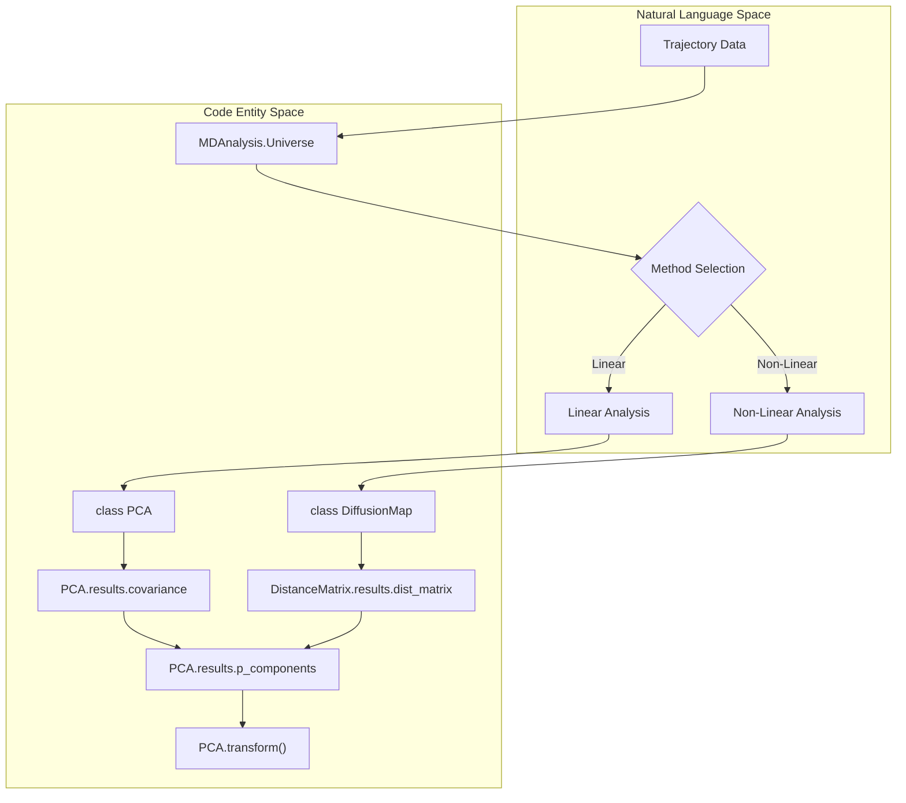
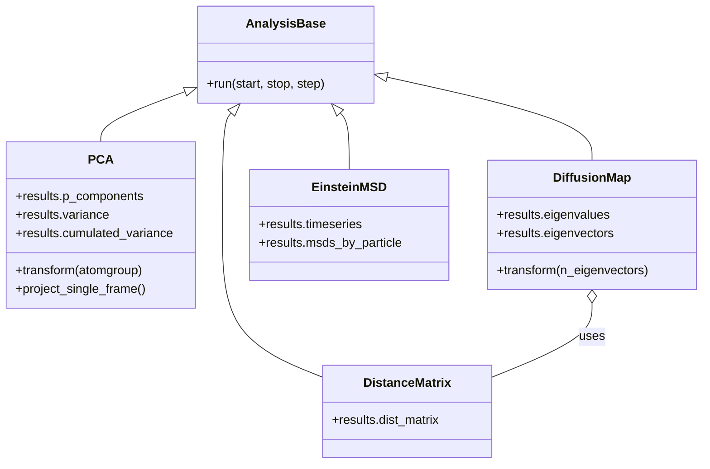

# Principal Component Analysis

<details>
<summary>Relevant source files</summary>

The following files were used as context for generating this wiki page:

- [package/MDAnalysis/analysis/__init__.py](package/MDAnalysis/analysis/__init__.py)
- [package/MDAnalysis/analysis/diffusionmap.py](package/MDAnalysis/analysis/diffusionmap.py)
- [package/MDAnalysis/analysis/leaflet.py](package/MDAnalysis/analysis/leaflet.py)
- [package/MDAnalysis/analysis/msd.py](package/MDAnalysis/analysis/msd.py)
- [package/MDAnalysis/analysis/pca.py](package/MDAnalysis/analysis/pca.py)
- [package/doc/sphinx/source/documentation_pages/analysis/diffusionmap.rst](package/doc/sphinx/source/documentation_pages/analysis/diffusionmap.rst)
- [package/doc/sphinx/source/documentation_pages/analysis_modules.rst](package/doc/sphinx/source/documentation_pages/analysis_modules.rst)
- [package/doc/sphinx/source/documentation_pages/references.rst](package/doc/sphinx/source/documentation_pages/references.rst)
- [testsuite/MDAnalysisTests/analysis/test_diffusionmap.py](testsuite/MDAnalysisTests/analysis/test_diffusionmap.py)
- [testsuite/MDAnalysisTests/analysis/test_distances.py](testsuite/MDAnalysisTests/analysis/test_distances.py)
- [testsuite/MDAnalysisTests/analysis/test_leaflet.py](testsuite/MDAnalysisTests/analysis/test_leaflet.py)
- [testsuite/MDAnalysisTests/analysis/test_msd.py](testsuite/MDAnalysisTests/analysis/test_msd.py)
- [testsuite/MDAnalysisTests/analysis/test_pca.py](testsuite/MDAnalysisTests/analysis/test_pca.py)
- [testsuite/MDAnalysisTests/data/analysis/msd/test_non_linear.dump.bz2](testsuite/MDAnalysisTests/data/analysis/msd/test_non_linear.dump.bz2)

</details>


Principal Component Analysis (PCA) is a dimensionality reduction technique implemented in MDAnalysis to analyze molecular dynamics trajectories. This module sorts atomic coordinates into directions of descending variance, allowing users to identify and visualize the most significant collective motions in their simulations. In addition to linear PCA, MDAnalysis provides non-linear dimensionality reduction via Diffusion Maps and specialized analysis of movement through Mean Squared Displacement (MSD).

## Overview

PCA reduces the high-dimensional space of atomic coordinates (3N dimensions for N atoms) to a smaller set of orthogonal vectors (principal components) that capture the largest variations in the data. This technique is particularly useful for identifying dominant motions in biomolecular systems, visualizing conformational changes, and assessing simulation convergence.

Sources: [package/MDAnalysis/analysis/pca.py:33-57]()

## Core Concepts

The following diagram maps the conceptual dimensionality reduction workflow to the specific MDAnalysis classes and mathematical entities used in the implementation.

### Dimensionality Reduction Logic



Sources: [package/MDAnalysis/analysis/pca.py:132-148](), [package/MDAnalysis/analysis/diffusionmap.py:31-45](), [package/MDAnalysis/analysis/pca.py:170-175]()

### Covariance Matrix (PCA)
The PCA problem is solved by finding the eigenvectors of the covariance matrix, a $3N \times 3N$ matrix where element $(i, j)$ is the covariance between coordinates $i$ and $j$. The principal components are these eigenvectors, and their corresponding eigenvalues represent the variance explained.

Sources: [package/MDAnalysis/analysis/pca.py:40-44](), [package/MDAnalysis/analysis/pca.py:185-188]()

### Distance Matrix (Diffusion Maps)
Diffusion maps utilize a distance matrix between all pairs of frames. This matrix is transformed into a diffusion matrix using a Gaussian kernel with a scale parameter `epsilon`. The eigenvectors of this diffusion matrix represent "collective coordinates."

Sources: [package/MDAnalysis/analysis/diffusionmap.py:31-36](), [package/MDAnalysis/analysis/diffusionmap.py:151-180]()

## Implementation in MDAnalysis

### Analysis Class Hierarchy

The following diagram shows the inheritance structure and key result attributes for the dimensionality reduction and motion analysis classes.



Sources: [package/MDAnalysis/analysis/pca.py:132-148](), [package/MDAnalysis/analysis/diffusionmap.py:214-220](), [package/MDAnalysis/analysis/msd.py:25-25](), [package/MDAnalysis/analysis/diffusionmap.py:151-152]()

### Diffusion Map Parameters

| Parameter | Role |
| :--- | :--- |
| `epsilon` | Scale parameter for the Gaussian kernel [package/MDAnalysis/analysis/diffusionmap.py:236-237]() |
| `metric` | Distance function mapping two arrays to a float (defaults to `rmsd`) [package/MDAnalysis/analysis/diffusionmap.py:171-177]() |
| `n_eigenvectors` | Number of collective coordinates to retain [package/MDAnalysis/analysis/diffusionmap.py:246-247]() |

Sources: [package/MDAnalysis/analysis/diffusionmap.py:214-255]()

## Usage Examples

### Principal Component Analysis
The `PCA` class supports automatic trajectory alignment to a reference structure during the calculation of the covariance matrix.

```python
import MDAnalysis as mda
import MDAnalysis.analysis.pca as pca

u = mda.Universe(PSF, DCD)
# PCA on backbone atoms with automatic alignment
PSF_pca = pca.PCA(u, select='backbone', align=True).run()

# Access variance explained
cum_var = PSF_pca.results.cumulated_variance

# Project trajectory onto the first 3 components
pca_space = PSF_pca.transform(u.select_atoms('backbone'), n_components=3)
```

Sources: [package/MDAnalysis/analysis/pca.py:82-98](), [package/MDAnalysis/analysis/pca.py:156-158]()

### Mean Squared Displacement (MSD)
MSD analysis computes particle displacement over time. For correct results, coordinates must be in the **unwrapped** (no-jump) convention.

```python
from MDAnalysis.analysis.msd import EinsteinMSD
from MDAnalysis.transformations import NoJump

# Apply NoJump transformation to unwrap coordinates
u.trajectory.add_transformations(NoJump(u))

# Compute MSD using FFT (requires tidynamics)
MSD = EinsteinMSD(u, select='all', msd_type='xyz', fft=True)
MSD.run()

# Results access
msd_values = MSD.results.timeseries
lag_times = MSD.results.delta_t_values
```

Sources: [package/MDAnalysis/analysis/msd.py:65-90](), [package/MDAnalysis/analysis/msd.py:131-140]()

## Specialized Metrics

### Cosine Content
The `cosine_content` function (range 0 to 1) measures how closely a principal component resembles a half-cosine. Values near 1 suggest that the component represents random diffusion rather than sampled conformational transitions, often indicating insufficient sampling.

Sources: [package/MDAnalysis/analysis/pca.py:110](), [package/MDAnalysis/analysis/pca.py:793-828]()

### Subspace Comparison
Two functions are provided to compare eigenvectors from different simulations:
*   **RMSIP (Root Mean Square Inner Product)**: Quantifies similarity between two sets of eigenvectors [package/MDAnalysis/analysis/pca.py:837-840]().
*   **Cumulative Overlap**: Measures how well a specific vector is represented in a target subspace [package/MDAnalysis/analysis/pca.py:922-925]().

Sources: [package/MDAnalysis/analysis/pca.py:837-967]()

## Performance Considerations

*   **PCA Memory**: The covariance matrix requires $O((3N_{atoms})^2)$ space. For large systems, it is recommended to perform PCA on a subset of atoms like C$\alpha$ [package/MDAnalysis/analysis/pca.py:291-296]().
*   **Diffusion Map Complexity**: Time complexity scales as $O(N_{frames}^3)$ due to eigendecomposition, and storage scales as $O(N_{frames}^2)$ for the distance matrix [package/MDAnalysis/analysis/diffusionmap.py:35-37]().
*   **MSD Algorithms**: The default algorithm is $O(N^2)$. Setting `fft=True` uses a Fast Fourier Transform approach with $O(N \log N)$ scaling, which is significantly faster for long trajectories [package/MDAnalysis/analysis/msd.py:54-60]().

Sources: [package/MDAnalysis/analysis/pca.py:291-296](), [package/MDAnalysis/analysis/diffusionmap.py:35-37](), [package/MDAnalysis/analysis/msd.py:54-60]()

---