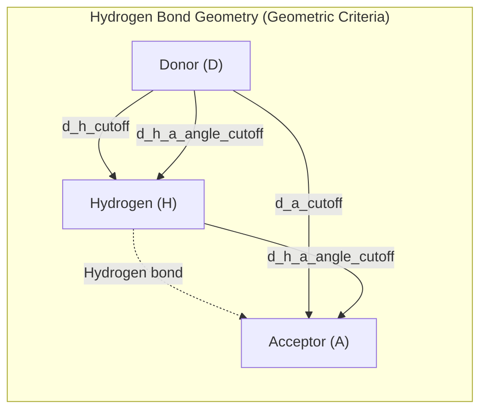
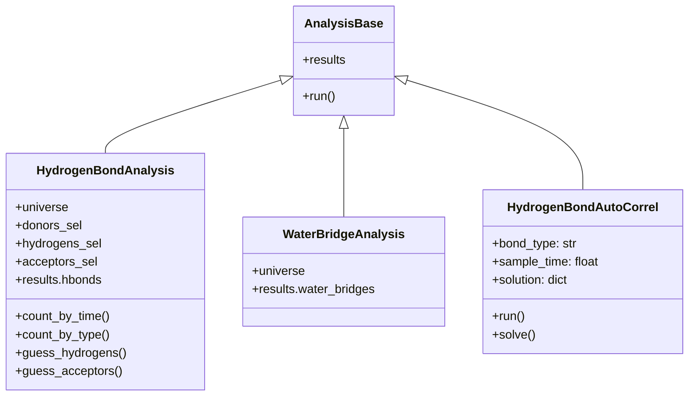
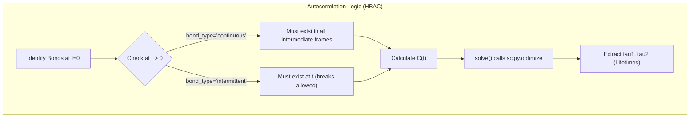

# Hydrogen Bond Analysis

Relevant source files

The following files were used as context for generating this wiki page:

- [.gitignore](.gitignore)
- [benchmarks/README.rst](benchmarks/README.rst)
- [benchmarks/asv.conf.json](benchmarks/asv.conf.json)
- [benchmarks/benchmarks/__init__.py](benchmarks/benchmarks/__init__.py)
- [package/MDAnalysis/analysis/density.py](package/MDAnalysis/analysis/density.py)
- [package/MDAnalysis/analysis/hbonds/__init__.py](package/MDAnalysis/analysis/hbonds/__init__.py)
- [package/MDAnalysis/analysis/hbonds/hbond_autocorrel.py](package/MDAnalysis/analysis/hbonds/hbond_autocorrel.py)
- [package/MDAnalysis/analysis/hydrogenbonds/__init__.py](package/MDAnalysis/analysis/hydrogenbonds/__init__.py)
- [package/MDAnalysis/analysis/hydrogenbonds/hbond_analysis.py](package/MDAnalysis/analysis/hydrogenbonds/hbond_analysis.py)
- [package/MDAnalysis/analysis/hydrogenbonds/hbond_autocorrel.py](package/MDAnalysis/analysis/hydrogenbonds/hbond_autocorrel.py)
- [package/MDAnalysis/analysis/hydrogenbonds/wbridge_analysis.py](package/MDAnalysis/analysis/hydrogenbonds/wbridge_analysis.py)
- [package/MDAnalysis/analysis/psa.py](package/MDAnalysis/analysis/psa.py)
- [package/MDAnalysis/analysis/waterdynamics.py](package/MDAnalysis/analysis/waterdynamics.py)
- [package/doc/sphinx/source/documentation_pages/analysis/hbond_autocorrel.rst](package/doc/sphinx/source/documentation_pages/analysis/hbond_autocorrel.rst)
- [package/doc/sphinx/source/documentation_pages/analysis/hbond_autocorrel_deprecated.rst](package/doc/sphinx/source/documentation_pages/analysis/hbond_autocorrel_deprecated.rst)
- [package/doc/sphinx/source/documentation_pages/analysis/wbridge_analysis.rst](package/doc/sphinx/source/documentation_pages/analysis/wbridge_analysis.rst)
- [testsuite/MDAnalysisTests/analysis/test_density.py](testsuite/MDAnalysisTests/analysis/test_density.py)
- [testsuite/MDAnalysisTests/analysis/test_hydrogenbondautocorrel.py](testsuite/MDAnalysisTests/analysis/test_hydrogenbondautocorrel.py)
- [testsuite/MDAnalysisTests/analysis/test_hydrogenbondautocorrel_deprecated.py](testsuite/MDAnalysisTests/analysis/test_hydrogenbondautocorrel_deprecated.py)
- [testsuite/MDAnalysisTests/analysis/test_hydrogenbonds_analysis.py](testsuite/MDAnalysisTests/analysis/test_hydrogenbonds_analysis.py)
- [testsuite/MDAnalysisTests/analysis/test_psa.py](testsuite/MDAnalysisTests/analysis/test_psa.py)
- [testsuite/MDAnalysisTests/analysis/test_waterdynamics.py](testsuite/MDAnalysisTests/analysis/test_waterdynamics.py)
- [testsuite/MDAnalysisTests/analysis/test_wbridge.py](testsuite/MDAnalysisTests/analysis/test_wbridge.py)
- [testsuite/MDAnalysisTests/utils/test_streamio.py](testsuite/MDAnalysisTests/utils/test_streamio.py)

This page documents the hydrogen bond analysis capabilities in MDAnalysis. Hydrogen bonds are essential interactions in biomolecular systems, playing crucial roles in protein structure, nucleic acid stability, and many other biological processes. MDAnalysis provides tools to identify and analyze hydrogen bonds in molecular dynamics trajectories through the `MDAnalysis.analysis.hydrogenbonds` namespace.

## Overview

The hydrogen bond analysis in MDAnalysis allows users to:

1.  Identify hydrogen bonds in molecular structures based on geometric criteria.
2.  Track hydrogen bonds over time in trajectories using `HydrogenBondAnalysis`.
3.  Analyze water bridges (hydrogen bond paths mediated by water) using `WaterBridgeAnalysis`.
4.  Calculate hydrogen bond autocorrelation functions to study bond lifetimes and kinetics.

Sources: [package/MDAnalysis/analysis/hydrogenbonds/hbond_analysis.py:24-34](), [package/MDAnalysis/analysis/hbonds/hbond_autocorrel.py:23-43]()

## Core Concepts and Geometry

Hydrogen bonds are typically defined using geometric criteria involving a Donor (D), a Hydrogen (H) covalently bound to the donor, and an Acceptor (A).

A hydrogen bond is considered to exist when:
-   **Distance criterion**: The distance between the donor (D) and acceptor (A) atoms is less than a specified cutoff $d_{DA}$ (typically 3.0 Å). [package/MDAnalysis/analysis/hydrogenbonds/hbond_analysis.py:54-54]()
-   **Angle criterion**: The angle formed by the donor-hydrogen-acceptor (D-H-A) is greater than a specified cutoff (typically 150 degrees). [package/MDAnalysis/analysis/hydrogenbonds/hbond_analysis.py:55-55]()

### Natural Language to Code Entity Mapping: Geometry

| Concept | Code Parameter | Default Value | File Reference |
| :--- | :--- | :--- | :--- |
| Donor-Hydrogen Distance | `d_h_cutoff` | 1.2 Å | [package/MDAnalysis/analysis/hydrogenbonds/hbond_analysis.py:53-53]() |
| Donor-Acceptor Distance | `d_a_cutoff` | 3.0 Å | [package/MDAnalysis/analysis/hydrogenbonds/hbond_analysis.py:54-54]() |
| D-H-A Angle | `d_h_a_angle_cutoff` | 150° | [package/MDAnalysis/analysis/hydrogenbonds/hbond_analysis.py:55-55]() |

Hydrogen bond geometry visualization:

Sources: [package/MDAnalysis/analysis/hydrogenbonds/hbond_analysis.py:46-56]()

## Hydrogen Bond Analysis Classes

The hydrogen bond analysis suite is built upon the `AnalysisBase` framework, providing consistent lifecycle management (`run()`, `results`).

Class hierarchy for hydrogen bond tools:

Sources: [package/MDAnalysis/analysis/hydrogenbonds/hbond_analysis.py:35-42](), [package/MDAnalysis/analysis/hbonds/hbond_autocorrel.py:69-75](), [testsuite/MDAnalysisTests/analysis/test_hydrogenbonds_analysis.py:37-39]()

## HydrogenBondAnalysis

The `HydrogenBondAnalysis` class (HBA) identifies hydrogen bonds frame-by-frame. It can automatically guess donor-hydrogen pairs if bonding information exists in the topology. [package/MDAnalysis/analysis/hydrogenbonds/hbond_analysis.py:87-89]()

### Implementation Details
The analysis generates a `numpy.ndarray` stored in `results.hbonds`. Each row represents one observation with the following schema:
`[<frame>, <donor_index>, <hydrogen_index>, <acceptor_index>, <distance>, <angle>]`. [package/MDAnalysis/analysis/hydrogenbonds/hbond_analysis.py:69-82]()

### Selection Logic
-   **`donors_sel`**: If `None`, identified via topology. [package/MDAnalysis/analysis/hydrogenbonds/hbond_analysis.py:50-50]()
-   **`hydrogens_sel`**: If `None`, identified via charge and mass. [package/MDAnalysis/analysis/hydrogenbonds/hbond_analysis.py:51-51]()
-   **`between`**: Optional keyword to find bonds only between specific groups (e.g., protein and water). [package/MDAnalysis/analysis/hydrogenbonds/hbond_analysis.py:144-158]()

Sources: [package/MDAnalysis/analysis/hydrogenbonds/hbond_analysis.py:46-60](), [testsuite/MDAnalysisTests/analysis/test_hydrogenbonds_analysis.py:51-58]()

## Hydrogen Bond Autocorrelation

`HydrogenBondAutoCorrel` calculates the time-correlation function $C(t)$ for hydrogen bonds to determine their stability and kinetics.

### Bond Dynamics Types
1.  **Continuous**: $C(t)$ measures the probability that a bond present at $t_0$ remains unbroken until $t$. [testsuite/MDAnalysisTests/analysis/test_hydrogenbondautocorrel.py:62-68]()
2.  **Intermittent**: $C(t)$ measures the probability that a bond present at $t_0$ is also present at $t$, regardless of whether it broke in between. [testsuite/MDAnalysisTests/analysis/test_hydrogenbondautocorrel.py:118-125]()

### Kinetic Fitting
The `solve()` method fits the resulting autocorrelation function to exponential decay models to extract relaxation times $\tau$. [testsuite/MDAnalysisTests/analysis/test_hydrogenbondautocorrel.py:203-228]()

Autocorrelation data flow:

Sources: [testsuite/MDAnalysisTests/analysis/test_hydrogenbondautocorrel.py:203-245](), [package/MDAnalysis/analysis/hbonds/hbond_autocorrel.py:69-75]()

## Namespace Transition and Deprecation

Several modules have been deprecated in favor of external **MDAKits** or moved to new internal namespaces to improve maintainability.

| Legacy Namespace | New Namespace / Target | Status |
| :--- | :--- | :--- |
| `MDAnalysis.analysis.hbonds.HydrogenBondAnalysis` | `MDAnalysis.analysis.hydrogenbonds.hbond_analysis.HydrogenBondAnalysis` | Deprecated (2.0.0) |
| `MDAnalysis.analysis.hbonds.hbond_autocorrel` | `MDAnalysis.analysis.hydrogenbonds.hbond_autocorrel` | Deprecated (2.0.0) |
| `MDAnalysis.analysis.waterdynamics` | [waterdynamics MDAKit](https://www.mdanalysis.org/waterdynamics/) | Deprecated (2.8.0) |
| `MDAnalysis.analysis.psa` | [PathSimAnalysis MDAKit](https://github.com/MDAnalysis/PathSimAnalysis) | Deprecated (2.8.0) |

Sources: [package/MDAnalysis/analysis/hbonds/hbond_autocorrel.py:32-37](), [package/MDAnalysis/analysis/waterdynamics.py:33-36](), [package/MDAnalysis/analysis/psa.py:34-38]()

## Performance and Parallelization

The hydrogen bond analysis classes inherit from `AnalysisBase`, which supports parallel execution.
-   **Updating Selections**: If `update_selections=True`, atom groups are re-evaluated every frame, which is necessary for "around" selections but increases overhead. [package/MDAnalysis/analysis/hydrogenbonds/hbond_analysis.py:56-56]()
-   **Neighbor Search**: Geometric searches for donors and acceptors utilize optimized backends like `MDAnalysis.lib.distances.capped_distance`. [package/MDAnalysis/analysis/density.py:173-173]()

Sources: [package/MDAnalysis/analysis/density.py:183-188](), [package/MDAnalysis/analysis/hydrogenbonds/hbond_analysis.py:56-56]()

---