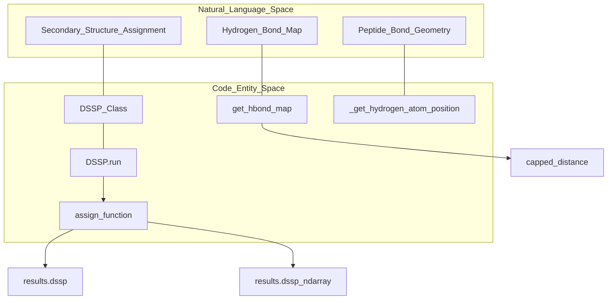
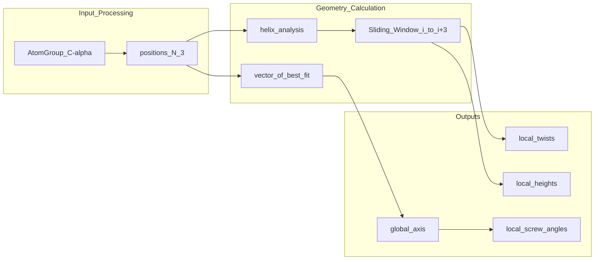

# Nucleic Acid and Protein Structure Analysis

Relevant source files

The following files were used as context for generating this wiki page:

- [benchmarks/benchmarks/analysis/dssp.py](benchmarks/benchmarks/analysis/dssp.py)
- [package/MDAnalysis/analysis/align.py](package/MDAnalysis/analysis/align.py)
- [package/MDAnalysis/analysis/contacts.py](package/MDAnalysis/analysis/contacts.py)
- [package/MDAnalysis/analysis/distances.py](package/MDAnalysis/analysis/distances.py)
- [package/MDAnalysis/analysis/dssp/dssp.py](package/MDAnalysis/analysis/dssp/dssp.py)
- [package/MDAnalysis/analysis/dssp/pydssp_numpy.py](package/MDAnalysis/analysis/dssp/pydssp_numpy.py)
- [package/MDAnalysis/analysis/helix_analysis.py](package/MDAnalysis/analysis/helix_analysis.py)
- [package/MDAnalysis/analysis/nucleicacids.py](package/MDAnalysis/analysis/nucleicacids.py)
- [package/MDAnalysis/analysis/nuclinfo.py](package/MDAnalysis/analysis/nuclinfo.py)
- [package/MDAnalysis/analysis/rms.py](package/MDAnalysis/analysis/rms.py)
- [package/MDAnalysis/lib/formats/cython_util.pxd](package/MDAnalysis/lib/formats/cython_util.pxd)
- [package/MDAnalysis/lib/formats/cython_util.pyx](package/MDAnalysis/lib/formats/cython_util.pyx)
- [package/MDAnalysis/lib/transformations.py](package/MDAnalysis/lib/transformations.py)
- [package/doc/sphinx/source/documentation_pages/analysis/nucleicacids.rst](package/doc/sphinx/source/documentation_pages/analysis/nucleicacids.rst)
- [testsuite/MDAnalysisTests/analysis/test_align.py](testsuite/MDAnalysisTests/analysis/test_align.py)
- [testsuite/MDAnalysisTests/analysis/test_contacts.py](testsuite/MDAnalysisTests/analysis/test_contacts.py)
- [testsuite/MDAnalysisTests/analysis/test_dssp.py](testsuite/MDAnalysisTests/analysis/test_dssp.py)
- [testsuite/MDAnalysisTests/analysis/test_helix_analysis.py](testsuite/MDAnalysisTests/analysis/test_helix_analysis.py)
- [testsuite/MDAnalysisTests/analysis/test_nucleicacids.py](testsuite/MDAnalysisTests/analysis/test_nucleicacids.py)
- [testsuite/MDAnalysisTests/analysis/test_nuclinfo.py](testsuite/MDAnalysisTests/analysis/test_nuclinfo.py)
- [testsuite/MDAnalysisTests/analysis/test_rms.py](testsuite/MDAnalysisTests/analysis/test_rms.py)
- [testsuite/MDAnalysisTests/data/analysis/1k5i_c36.pdb.gz](testsuite/MDAnalysisTests/data/analysis/1k5i_c36.pdb.gz)
- [testsuite/MDAnalysisTests/data/analysis/1k5i_c36.psf.gz](testsuite/MDAnalysisTests/data/analysis/1k5i_c36.psf.gz)
- [testsuite/MDAnalysisTests/data/dssp/1eteA.pdb.dssp](testsuite/MDAnalysisTests/data/dssp/1eteA.pdb.dssp)
- [testsuite/MDAnalysisTests/data/dssp/2fvvA.pdb.dssp](testsuite/MDAnalysisTests/data/dssp/2fvvA.pdb.dssp)
- [testsuite/MDAnalysisTests/data/dssp/2j49A.pdb.dssp](testsuite/MDAnalysisTests/data/dssp/2j49A.pdb.dssp)
- [testsuite/MDAnalysisTests/data/dssp/3a4rA.pdb.dssp](testsuite/MDAnalysisTests/data/dssp/3a4rA.pdb.dssp)
- [testsuite/MDAnalysisTests/data/dssp/3aqgA.pdb.dssp](testsuite/MDAnalysisTests/data/dssp/3aqgA.pdb.dssp)
- [testsuite/MDAnalysisTests/data/dssp/3e8mA.pdb.dssp](testsuite/MDAnalysisTests/data/dssp/3e8mA.pdb.dssp)
- [testsuite/MDAnalysisTests/data/dssp/3gfsA.pdb.dssp](testsuite/MDAnalysisTests/data/dssp/3gfsA.pdb.dssp)
- [testsuite/MDAnalysisTests/data/dssp/wrong_hydrogens.pdb.gz](testsuite/MDAnalysisTests/data/dssp/wrong_hydrogens.pdb.gz)

The `MDAnalysis.analysis` module provides specialized tools for characterizing the structural geometry of biological macromolecules. This page covers the analysis of nucleic acid base-pairing and dihedrals, protein secondary structure assignment using the DSSP algorithm, detailed helix geometry quantification, and native contact analysis.

## 1. Nucleic Acid Analysis

MDAnalysis offers two modules for nucleic acid analysis: the legacy `nuclinfo` and the high-performance `nucleicacids` module. Both tools calculate geometric properties including Watson-Crick distances, groove widths, and backbone dihedrals.

### 1.1 High-Performance Nucleic Acid Analysis (`nucleicacids`)
The `nucleicacids` module provides an `AnalysisBase`-derived framework for efficient trajectory analysis [package/MDAnalysis/analysis/nucleicacids.py:25-33](). It uses `ResidueGroup` objects to define strands and computes distances between specific atom pairs across frames. It supports parallel execution via `multiprocessing` and `dask` backends [package/MDAnalysis/analysis/nucleicacids.py:163-173]().

**Key Classes:**
*   `NucPairDist`: The base class for nucleic acid distance calculations [package/MDAnalysis/analysis/nucleicacids.py:86-102]().
*   `WatsonCrickDist`: Specifically computes the distance between N1 (purines) and N3 (pyrimidines) [package/MDAnalysis/analysis/nucleicacids.py:47-50]().
*   `MajorPairDist` / `MinorPairDist`: Computes distances corresponding to major and minor groove interactions [package/MDAnalysis/analysis/nucleicacids.py:52-60]().

**Data Flow for Nucleic Acid Distances:**
1.  **Input**: Two `ResidueGroup` objects representing paired strands [package/MDAnalysis/analysis/nucleicacids.py:202-212]().
2.  **Selection**: The `select_strand_atoms` method identifies specific atoms (e.g., N1, N3, O2, C2) based on residue names (A, U, G, C, T) [package/MDAnalysis/analysis/nucleicacids.py:201-230]().
3.  **Calculation**: Distances are calculated using `calc_bonds` for each frame [package/MDAnalysis/analysis/nucleicacids.py:72-73]().
4.  **Results**: Stored in `results.distances` as a 2D array of shape `(n_frames, n_pairs)` [package/MDAnalysis/analysis/nucleicacids.py:123-130]().

### 1.2 Legacy Nucleic Acid Analysis (`nuclinfo`)
The `nuclinfo` module provides functional interfaces for calculating specific dihedrals and phase angles [package/MDAnalysis/analysis/nuclinfo.py:25-39]().

*   **Backbone Dihedrals**: Functions like `tors_alpha`, `tors_beta`, `tors_gamma`, `tors_delta`, `tors_eps`, and `tors_zeta` calculate the standard nucleic acid backbone angles [package/MDAnalysis/analysis/nuclinfo.py:76-87]().
*   **Sugar Pucker**: `phase_cp` and `phase_as` calculate the pseudorotational phase angles of the ribose/deoxyribose ring [package/MDAnalysis/analysis/nuclinfo.py:66-68]().
*   **Basepair Distances**: Functional versions like `wc_pair`, `minor_pair`, and `major_pair` compute distances for specific residue indices [package/MDAnalysis/analysis/nuclinfo.py:101-255]().

Sources: [package/MDAnalysis/analysis/nucleicacids.py:25-230](), [package/MDAnalysis/analysis/nuclinfo.py:25-255]().

## 2. Protein Secondary Structure (DSSP)

The `MDAnalysis.analysis.dssp` module implements the Kabsch-Sander algorithm to assign secondary structure based on hydrogen bond patterns [package/MDAnalysis/analysis/dssp/dssp.py:1-17]().

### 2.1 Implementation Details
The module uses a NumPy-based re-implementation of the DSSP algorithm. It identifies three primary categories: 'H' (Helix), 'E' (Strand), and '-' (Loop) [package/MDAnalysis/analysis/dssp/dssp.py:183-193]().

**Entity Association Diagram:**
This diagram maps the high-level DSSP analysis to the internal functions and data structures.

Title: "DSSP_Analysis_Entity_Mapping"

Sources: [package/MDAnalysis/analysis/dssp/dssp.py:107-135](), [package/MDAnalysis/analysis/dssp/pydssp_numpy.py:122-181]().

### 2.2 Data Flow and Calculation
1.  **Coordinate Extraction**: The `DSSP` class extracts coordinates for N, CA, C, and O atoms [package/MDAnalysis/analysis/dssp/dssp.py:199-206]().
2.  **Hydrogen Placement**: If hydrogens are missing, `_get_hydrogen_atom_position` places them based on ideal peptide bond geometry (N-H bond length 1.01 Å) [package/MDAnalysis/analysis/dssp/pydssp_numpy.py:79-119]().
3.  **HBond Energy**: `get_hbond_map` calculates electrostatic interaction energy between N-H and C=O groups using `capped_distance` for efficiency [package/MDAnalysis/analysis/dssp/pydssp_numpy.py:122-212]().
4.  **Assignment**: The `assign` function evaluates these energy maps to determine patterns of $i \rightarrow i+3, 4, 5$ bonds for helices and bridge patterns for sheets [package/MDAnalysis/analysis/dssp/pydssp_numpy.py:170-172]().

Sources: [package/MDAnalysis/analysis/dssp/dssp.py:183-206](), [package/MDAnalysis/analysis/dssp/pydssp_numpy.py:79-212]().

## 3. Helix Analysis (HELANAL)

The `HELANAL` module quantifies the geometry of protein helices using alpha-carbon ($C\alpha$) positions [package/MDAnalysis/analysis/helix_analysis.py:34-41]().

### 3.1 Helical Parameters
The analysis calculates both local and global parameters:
*   **Local Twist**: Rotation angle between residues $i+1$ and $i+2$ [package/MDAnalysis/analysis/helix_analysis.py:209-210]().
*   **Local Height (Rise)**: Translation along the helix axis per residue [package/MDAnalysis/analysis/helix_analysis.py:213-214]().
*   **Bending Angles**: Angles between successive local helix axes [package/MDAnalysis/analysis/helix_analysis.py:40-41]().

### 3.2 Computational Logic
The analysis uses a sliding window of 4 atoms to define local axes [package/MDAnalysis/analysis/helix_analysis.py:194-196]().

**Process Mapping:**
Title: "HELANAL_Internal_Logic"

Sources: [package/MDAnalysis/analysis/helix_analysis.py:109-132](), [package/MDAnalysis/analysis/helix_analysis.py:190-215]().

**Key Functions:**
*   `vector_of_best_fit(coordinates)`: Uses Singular Value Decomposition (SVD) on centered coordinates to find the principal helix axis [package/MDAnalysis/analysis/helix_analysis.py:109-125]().
*   `local_screw_angles(global_axis, ref_axis, helix_directions)`: Calculates cylindrical azimuth angles projected onto the helix cross-section [package/MDAnalysis/analysis/helix_analysis.py:134-156]().

Sources: [package/MDAnalysis/analysis/helix_analysis.py:109-187]().

## 4. Contact Analysis

The `MDAnalysis.analysis.contacts` module analyzes native contacts $Q$ over a trajectory [package/MDAnalysis/analysis/contacts.py:25-34]().

### 4.1 Metrics and Methods
*   **Hard Cut**: Contacts are counted if atoms $i$ and $j$ are closer than in the reference structure [package/MDAnalysis/analysis/contacts.py:36-37]().
*   **Soft Cut**: Uses a potential function (implemented in `soft_cut_q`) that decays from 1 to 0 based on distance [package/MDAnalysis/analysis/contacts.py:39-42]().
*   **Radius Cut**: Contacts are counted if distance is below a fixed `radius` [package/MDAnalysis/analysis/contacts.py:44-45]().

### 4.2 Distance Backends
The module utilizes `MDAnalysis.analysis.distances.contact_matrix` which supports both `numpy` (fast, high memory) and `sparse` (slower, low memory) return types [package/MDAnalysis/analysis/distances.py:71-90](). It handles Periodic Boundary Conditions (PBC) via `contact_matrix_pbc` [package/MDAnalysis/analysis/distances.py:128-130]().

Sources: [package/MDAnalysis/analysis/contacts.py:25-45](), [package/MDAnalysis/analysis/distances.py:71-134]().

## 5. Summary of Analysis Results

| Analysis Type | Module | Key Result Attributes | Data Shape |
| :--- | :--- | :--- | :--- |
| **Nucleic Acid** | `nucleicacids` | `results.distances` | `(n_frames, n_pairs)` |
| **DSSP** | `dssp` | `results.dssp` | `(n_frames, n_residues)` |
| **DSSP (One-Hot)** | `dssp` | `results.dssp_ndarray` | `(n_frames, n_residues, 3)` |
| **Helix** | `helix_analysis` | `results.summary` | Dictionary of arrays |
| **Contacts** | `contacts` | `results.timeseries` | `(n_frames, 2)` |

Sources: [package/MDAnalysis/analysis/nucleicacids.py:123-130](), [package/MDAnalysis/analysis/dssp/dssp.py:114-129](), [package/MDAnalysis/analysis/helix_analysis.py:66-68](), [package/MDAnalysis/analysis/contacts.py:89-91]().

---