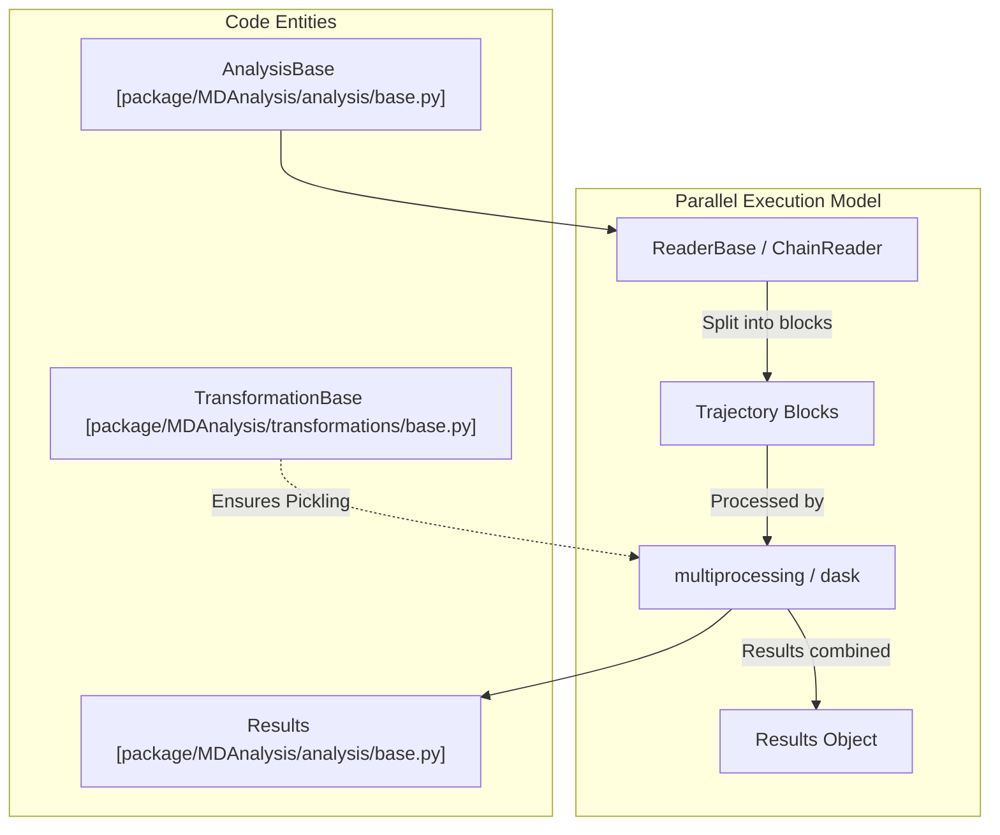
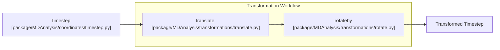
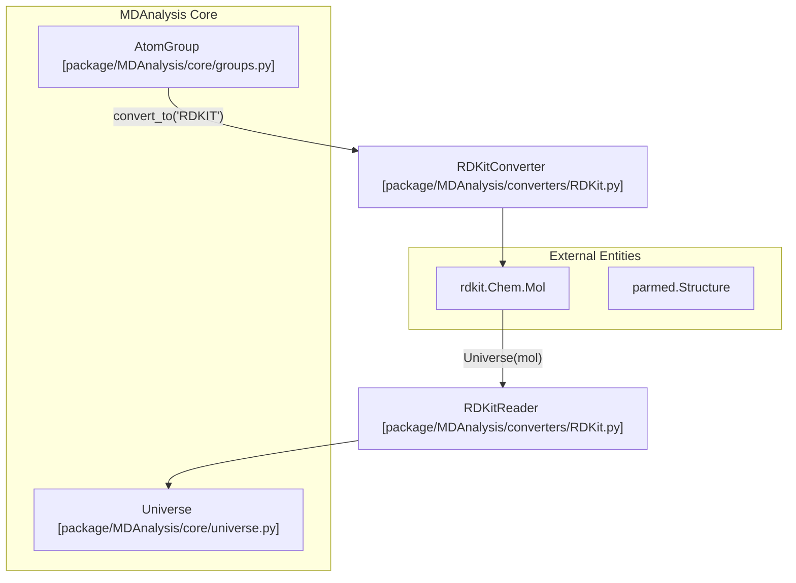

# Advanced Topics

Relevant source files

The following files were used as context for generating this wiki page:

- [package/MDAnalysis/converters/ParmEd.py](package/MDAnalysis/converters/ParmEd.py)
- [package/MDAnalysis/converters/RDKit.py](package/MDAnalysis/converters/RDKit.py)
- [package/MDAnalysis/converters/RDKitInferring.py](package/MDAnalysis/converters/RDKitInferring.py)
- [package/MDAnalysis/converters/RDKitParser.py](package/MDAnalysis/converters/RDKitParser.py)
- [package/MDAnalysis/converters/__init__.py](package/MDAnalysis/converters/__init__.py)
- [package/MDAnalysis/converters/base.py](package/MDAnalysis/converters/base.py)
- [package/MDAnalysis/transformations/__init__.py](package/MDAnalysis/transformations/__init__.py)
- [package/MDAnalysis/transformations/fit.py](package/MDAnalysis/transformations/fit.py)
- [package/MDAnalysis/transformations/positionaveraging.py](package/MDAnalysis/transformations/positionaveraging.py)
- [package/MDAnalysis/transformations/rotate.py](package/MDAnalysis/transformations/rotate.py)
- [package/MDAnalysis/transformations/translate.py](package/MDAnalysis/transformations/translate.py)
- [package/MDAnalysis/transformations/wrap.py](package/MDAnalysis/transformations/wrap.py)
- [package/doc/sphinx/source/documentation_pages/converters/RDKit.rst](package/doc/sphinx/source/documentation_pages/converters/RDKit.rst)
- [package/doc/sphinx/source/documentation_pages/trajectory_transformations.rst](package/doc/sphinx/source/documentation_pages/trajectory_transformations.rst)
- [testsuite/MDAnalysisTests/converters/test_base.py](testsuite/MDAnalysisTests/converters/test_base.py)
- [testsuite/MDAnalysisTests/converters/test_parmed.py](testsuite/MDAnalysisTests/converters/test_parmed.py)
- [testsuite/MDAnalysisTests/converters/test_rdkit.py](testsuite/MDAnalysisTests/converters/test_rdkit.py)
- [testsuite/MDAnalysisTests/converters/test_rdkit_parser.py](testsuite/MDAnalysisTests/converters/test_rdkit_parser.py)
- [testsuite/MDAnalysisTests/transformations/test_fit.py](testsuite/MDAnalysisTests/transformations/test_fit.py)
- [testsuite/MDAnalysisTests/transformations/test_positionaveraging.py](testsuite/MDAnalysisTests/transformations/test_positionaveraging.py)
- [testsuite/MDAnalysisTests/transformations/test_rotate.py](testsuite/MDAnalysisTests/transformations/test_rotate.py)
- [testsuite/MDAnalysisTests/transformations/test_translate.py](testsuite/MDAnalysisTests/transformations/test_translate.py)
- [testsuite/MDAnalysisTests/transformations/test_wrap.py](testsuite/MDAnalysisTests/transformations/test_wrap.py)
- [testsuite/MDAnalysisTests/util.py](testsuite/MDAnalysisTests/util.py)

This page covers advanced features and techniques for using MDAnalysis beyond basic functionality. It focuses on specialized capabilities that enable complex analyses, performance optimization, and extension of the library's functionality through transformations, converters, and the MDAKit ecosystem.

## Parallel Processing in MDAnalysis

MDAnalysis provides support for parallel processing to accelerate analysis tasks, particularly for large trajectories or computationally intensive analyses. This is primarily handled through the `AnalysisBase` framework and its integration with backends like `multiprocessing` and `dask`.

For details, see [Parallel Processing](#5.1).

### Parallel Analysis Framework

The parallel analysis framework allows analyses to be run across multiple CPU cores by splitting trajectories into blocks. Modern transformations are implemented as classes to ensure they can be serialized (pickled) for these parallel schemes [package/MDAnalysis/transformations/__init__.py:113-118]().

Sources: [package/MDAnalysis/analysis/base.py:1-100](), [package/MDAnalysis/transformations/__init__.py:113-118]()

## On-the-fly Transformations

MDAnalysis allows modifying trajectory coordinates on-the-fly during analysis. A *transformation* is a function-like class that modifies the data for the current `Timestep` and returns it [package/MDAnalysis/transformations/__init__.py:29-33](). Transformations inherit from `TransformationBase` to manage thread limits and parallel compatibility [package/MDAnalysis/transformations/base.py:1-50]().

For details, see [On-the-fly Transformations](#5.2).

### Transformation Pipeline

Transformations are applied in a serial workflow. They can be added to a universe via `u.trajectory.add_transformations()` [package/MDAnalysis/transformations/__init__.py:75]().

| Class | Purpose | File Reference |
| :--- | :--- | :--- |
| `translate` | Moves coordinates by a vector | [package/MDAnalysis/transformations/translate.py:45]() |
| `rotateby` | Rotates coordinates around an axis | [package/MDAnalysis/transformations/rotate.py:43]() |
| `center_in_box` | Centers an `AtomGroup` in the unit cell | [package/MDAnalysis/transformations/translate.py:91]() |
| `fit_rot_trans` | Minimizes RMSD by aligning to a reference | [package/MDAnalysis/transformations/fit.py:152]() |
| `PositionAverager` | Averages coordinates over N previous frames | [package/MDAnalysis/transformations/positionaveraging.py:41]() |
| `NoJump` | Removes periodic boundary jumps | [package/MDAnalysis/transformations/__init__.py:132]() |

Sources: [package/MDAnalysis/transformations/__init__.py:128-136](), [package/MDAnalysis/transformations/base.py:1-50](), [package/MDAnalysis/transformations/translate.py:45-91](), [package/MDAnalysis/transformations/rotate.py:43-124]()

## Converters

Converters allow MDAnalysis to interoperate with other molecular simulation libraries by transforming `Universe` or `AtomGroup` objects into external objects (and vice-versa).

For details, see [Converters](#5.3).

### Interoperability Ecosystem

MDAnalysis supports several external libraries through specific converter classes inheriting from `ConverterBase` [package/MDAnalysis/converters/base.py:38]().

*   **RDKit**: Convert to `rdkit.Chem.rdchem.Mol` using `RDKitConverter` [package/MDAnalysis/converters/RDKit.py:178](). It supports inferring bond orders and charges using `MDAnalysisInferrer` [package/MDAnalysis/converters/RDKit.py:109]().
*   **ParmEd**: Interoperate with ParmEd `Structure` objects via `ParmEdConverter`.
*   **OpenMM**: Integration with OpenMM `System` and `Topology` objects.

Sources: [package/MDAnalysis/converters/RDKit.py:24-49](), [package/MDAnalysis/converters/RDKit.py:135-141](), [package/MDAnalysis/converters/RDKit.py:178-192]()

## MDAKits and External Packages

The MDAKit ecosystem consists of external packages that extend MDAnalysis. This modular approach allows specialized or legacy code to be maintained independently of the core library.

For details, see [MDAKits and External Packages](#5.4).

### Deprecated Modules and Redirection

Several modules previously in the core library have been transitioned to standalone kits. This ensures the core remains lean while providing a path for specialized analysis.

| Legacy Module | Target MDAKit |
| :--- | :--- |
| `MDAnalysis.analysis.waterdynamics` | `waterdynamics` |
| `MDAnalysis.analysis.psa` | `pathsimanalysis` |
| `MDAnalysis.analysis.hole2` | `mdahole2` |

Sources: [package/MDAnalysis/analysis/__init__.py]() (Conceptual reference for module redirection)

## Performance Optimization

Advanced performance can be achieved through:
*   **In-Memory Trajectories**: Loading trajectories into memory using `MemoryReader` to bypass disk I/O bottlenecks [package/MDAnalysis/converters/RDKit.py:135]().
*   **Fast Backends**: Utilizing `distopia` for accelerated distance calculations [testsuite/MDAnalysisTests/util.py:41]().
*   **Serialization**: Using class-based transformations (inheriting from `TransformationBase`) to allow pickling for parallel execution [package/MDAnalysis/transformations/translate.py:70-72]().
*   **Thread Control**: Limiting threads in specific transformations like `rotateby` and `fit_rot_trans` (often set to `max_threads=1`) where they perform better [package/MDAnalysis/transformations/rotate.py:52-53](), [package/MDAnalysis/transformations/fit.py:166-167]().

Sources: [package/MDAnalysis/transformations/base.py:1-50](), [testsuite/MDAnalysisTests/util.py:41-43](), [package/MDAnalysis/transformations/rotate.py:134](), [package/MDAnalysis/transformations/fit.py:166-167]()

---