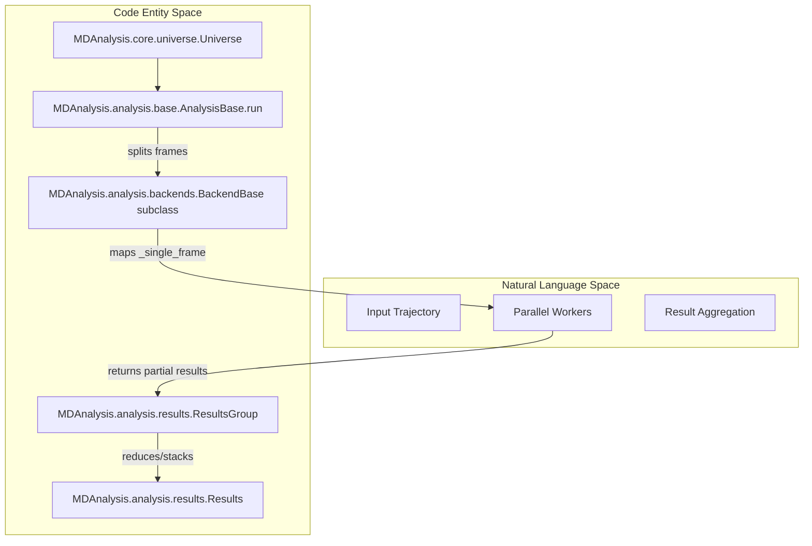
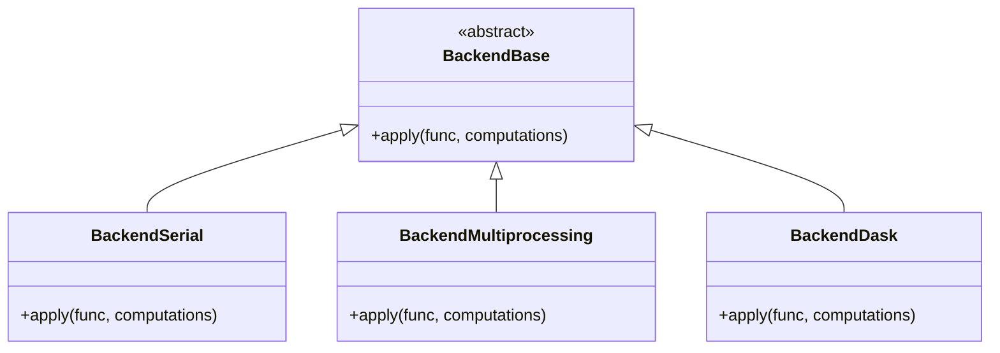

# Parallel Processing

<details>
<summary>Relevant source files</summary>

The following files were used as context for generating this wiki page:

- [package/MDAnalysis/analysis/base.py](package/MDAnalysis/analysis/base.py)
- [package/MDAnalysis/analysis/gnm.py](package/MDAnalysis/analysis/gnm.py)
- [package/MDAnalysis/analysis/lineardensity.py](package/MDAnalysis/analysis/lineardensity.py)
- [package/MDAnalysis/analysis/polymer.py](package/MDAnalysis/analysis/polymer.py)
- [package/MDAnalysis/lib/log.py](package/MDAnalysis/lib/log.py)
- [package/MDAnalysis/tests/datafiles.py](package/MDAnalysis/tests/datafiles.py)
- [package/doc/sphinx/source/documentation_pages/analysis/parallelization.rst](package/doc/sphinx/source/documentation_pages/analysis/parallelization.rst)
- [package/doc/sphinx/source/images/AnalysisBase_parallel.png](package/doc/sphinx/source/images/AnalysisBase_parallel.png)
- [testsuite/MDAnalysisTests/analysis/test_base.py](testsuite/MDAnalysisTests/analysis/test_base.py)
- [testsuite/MDAnalysisTests/analysis/test_gnm.py](testsuite/MDAnalysisTests/analysis/test_gnm.py)
- [testsuite/MDAnalysisTests/analysis/test_lineardensity.py](testsuite/MDAnalysisTests/analysis/test_lineardensity.py)
- [testsuite/MDAnalysisTests/analysis/test_persistencelength.py](testsuite/MDAnalysisTests/analysis/test_persistencelength.py)
- [testsuite/MDAnalysisTests/data/coordinates/create_data.py](testsuite/MDAnalysisTests/data/coordinates/create_data.py)
- [testsuite/MDAnalysisTests/data/coordinates/create_h5md_data.py](testsuite/MDAnalysisTests/data/coordinates/create_h5md_data.py)
- [testsuite/MDAnalysisTests/data/coordinates/test.trr](testsuite/MDAnalysisTests/data/coordinates/test.trr)
- [testsuite/MDAnalysisTests/data/coordinates/test.xtc](testsuite/MDAnalysisTests/data/coordinates/test.xtc)
- [testsuite/MDAnalysisTests/data/coordinates/test.xyz](testsuite/MDAnalysisTests/data/coordinates/test.xyz)
- [testsuite/MDAnalysisTests/data/coordinates/test_topology.pdb](testsuite/MDAnalysisTests/data/coordinates/test_topology.pdb)
- [testsuite/MDAnalysisTests/formats/test_libmdaxdr.py](testsuite/MDAnalysisTests/formats/test_libmdaxdr.py)
- [testsuite/MDAnalysisTests/import/fork_called.py](testsuite/MDAnalysisTests/import/fork_called.py)
- [testsuite/MDAnalysisTests/import/test_import.py](testsuite/MDAnalysisTests/import/test_import.py)
- [testsuite/MDAnalysisTests/lib/test_log.py](testsuite/MDAnalysisTests/lib/test_log.py)
- [testsuite/MDAnalysisTests/parallelism/test_multiprocessing.py](testsuite/MDAnalysisTests/parallelism/test_multiprocessing.py)
- [testsuite/MDAnalysisTests/parallelism/test_pickle_transformation.py](testsuite/MDAnalysisTests/parallelism/test_pickle_transformation.py)

</details>


This page explains how to use parallel processing capabilities in MDAnalysis to accelerate analysis tasks. Parallel processing allows computations to be distributed across multiple CPU cores or even multiple machines, significantly improving performance for computationally intensive analyses.

MDAnalysis provides a flexible framework for parallel processing through its analysis base classes, with support for multiple backends including multiprocessing and Dask.

## Overview of Parallel Processing in MDAnalysis

MDAnalysis supports parallel processing for analysis tasks through a **split-apply-combine** approach [package/MDAnalysis/analysis/base.py:267-267](). This pattern involves:

1.  **Split**: The trajectory frames are partitioned into chunks based on the number of workers.
2.  **Apply**: Each worker independently executes the analysis on its assigned chunk.
3.  **Combine**: The results from all workers are aggregated into a single `Results` object using an aggregator.

This approach is highly effective for "embarrassingly parallel" tasks where each frame can be processed independently without communication between workers.

### Parallel Data Flow

The following diagram illustrates the data flow from a `Universe` through the parallel backends to the final aggregated `Results`.

**Diagram: Parallel Analysis Execution Flow**

Sources: [package/MDAnalysis/analysis/base.py:267-280](), [package/MDAnalysis/analysis/base.py:465-485](), [package/MDAnalysis/analysis/results.py:39-43]()

## Supported Backends

MDAnalysis provides several backends for parallel processing, all inheriting from a common base class.

**Diagram: Backend Class Hierarchy**


1.  **BackendSerial**: The default backend that processes frames sequentially in the main process [package/MDAnalysis/analysis/base.py:162-167]().
2.  **BackendMultiprocessing**: Uses Python's `multiprocessing` module. It creates a pool of workers to distribute work across CPU cores on a single machine [package/MDAnalysis/analysis/base.py:162-167]().
3.  **BackendDask**: Uses the Dask library, enabling parallelization on a single machine or across a distributed cluster [package/MDAnalysis/analysis/base.py:162-167]().

Sources: [package/MDAnalysis/analysis/base.py:162-167](), [testsuite/MDAnalysisTests/analysis/test_base.py:123-132]()

## Using Parallel Processing

To use parallel processing, specify the `backend` and `n_workers` arguments in the `run()` method of an analysis class.

### Example Usage
```python
import MDAnalysis as mda
from MDAnalysis.analysis.polymer import PersistenceLength

u = mda.Universe(PSF, DCD)
ags = [u.atoms.fragments[0]] # Example selection
plen = PersistenceLength(ags)

# Run using multiprocessing with 4 workers
plen.run(backend='multiprocessing', n_workers=4)
```
Sources: [package/MDAnalysis/analysis/base.py:116-127](), [testsuite/MDAnalysisTests/analysis/test_persistencelength.py:64-66]()

## Parallelizable Analysis Classes

An analysis class is only parallelizable if it explicitly supports the split-apply-combine API. A class must:
1.  Set `_analysis_algorithm_is_parallelizable = True` [package/MDAnalysis/analysis/base.py:119-119]().
2.  Implement `get_supported_backends()` to return a tuple of allowed backend names (e.g., `'multiprocessing'`, `'dask'`) [package/MDAnalysis/analysis/base.py:121-123]().
3.  Implement `_get_aggregator()` which returns a `ResultsGroup` object. This object defines how to merge results from different workers (e.g., using `np.vstack` or `np.hstack`) [package/MDAnalysis/analysis/base.py:126-127]().

### Built-in Parallel Modules
Several modules in MDAnalysis are already optimized for parallel execution:
*   **Polymer Analysis**: `PersistenceLength` [package/MDAnalysis/analysis/polymer.py:109-110]().
*   **Density Analysis**: `LinearDensity` [package/MDAnalysis/analysis/lineardensity.py:77-78]().
*   **Elastic Network Models**: `GNMAnalysis` [package/MDAnalysis/analysis/gnm.py:202-202]().

Sources: [package/MDAnalysis/analysis/polymer.py:109-119](), [package/MDAnalysis/analysis/lineardensity.py:77-78](), [testsuite/MDAnalysisTests/analysis/test_persistencelength.py:39-48]()

## Pickling Support and Data Flow

For parallel processing (especially `multiprocessing` with the `spawn` start method), the `Universe` and its associated data must be **picklable**.

### Trajectory Reader Pickling
Trajectory readers like `XTCReader` and `TRRReader` must support pickling to be passed to worker processes. MDAnalysis ensures that when a reader is pickled, its file state (filename and current frame offset) is preserved. Upon unpickling, the reader re-opens the file and seeks to the correct position [testsuite/MDAnalysisTests/formats/test_libmdaxdr.py:150-154]().

### Multiprocessing Contexts
To avoid deadlocks in complex environments (like `pytest-xdist`), MDAnalysis tests often explicitly use the `spawn` context [testsuite/MDAnalysisTests/parallelism/test_multiprocessing.py:134-137](). This ensures that workers start with a fresh Python interpreter, necessitating robust pickling of the `Universe` [testsuite/MDAnalysisTests/parallelism/test_multiprocessing.py:153-162]().

Sources: [testsuite/MDAnalysisTests/parallelism/test_multiprocessing.py:134-145](), [testsuite/MDAnalysisTests/formats/test_libmdaxdr.py:150-154]()

## Implementation Details: ResultsGroup

The `ResultsGroup` class is the key to the "Combine" step. It acts as a template for merging the `Results` dictionaries produced by different workers.

| Aggregator Method | Description | Usage Example |
| :--- | :--- | :--- |
| `ndarray_vstack` | Stacks arrays vertically (along axis 0). | Time-series data where each frame is a row [testsuite/MDAnalysisTests/analysis/test_base.py:127-128](). |
| `ndarray_hstack` | Stacks arrays horizontally. | Concatenating list-like results [testsuite/MDAnalysisTests/analysis/test_base.py:59-61](). |
| `mean` | Calculates the mean across workers. | Averaging properties calculated per-chunk. |

Example implementation in `AnalysisBase`:
```python
def _get_aggregator(self):
    return ResultsGroup(lookup={'timeseries': ResultsGroup.ndarray_vstack})
```
Sources: [package/MDAnalysis/analysis/base.py:126-128](), [testsuite/MDAnalysisTests/analysis/test_base.py:58-61]()

## Performance Considerations and Troubleshooting

1.  **Overhead**: Parallelization introduces overhead (pickling data, starting processes). For very short trajectories or extremely fast `_single_frame` operations, the serial backend may be faster [package/MDAnalysis/analysis/base.py:267-267]().
2.  **Memory**: Each worker in `multiprocessing` may load its own copy of certain data structures. Ensure the machine has sufficient RAM for `n_workers`.
3.  **Conflict Errors**:
    *   **Double n_workers**: Specifying `n_workers` both in the backend instance and the `run()` method raises a `ValueError` [testsuite/MDAnalysisTests/analysis/test_base.py:151-157]().
    *   **Frame/Step Conflict**: Combining a specific `frames` list with `start`/`stop`/`step` is not allowed [testsuite/MDAnalysisTests/analysis/test_base.py:139-148]().
4.  **Backend Support**: If an analysis class does not list a backend in `get_supported_backends()`, `run()` will raise a `ValueError` unless `unsupported_backend=True` is passed [testsuite/MDAnalysisTests/analysis/test_base.py:160-178]().

Sources: [testsuite/MDAnalysisTests/analysis/test_base.py:133-137](), [testsuite/MDAnalysisTests/analysis/test_base.py:228-233](), [testsuite/MDAnalysisTests/parallelism/test_multiprocessing.py:165-172]()

---