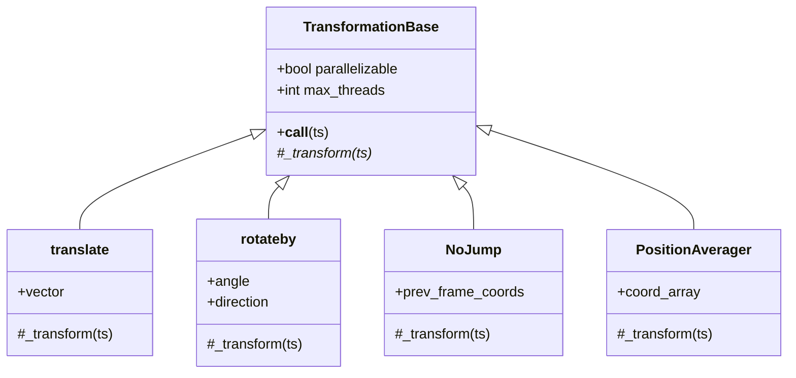

# On-the-fly Transformations

<details>
<summary>Relevant source files</summary>

The following files were used as context for generating this wiki page:

- [package/MDAnalysis/coordinates/__init__.py](package/MDAnalysis/coordinates/__init__.py)
- [package/MDAnalysis/coordinates/base.py](package/MDAnalysis/coordinates/base.py)
- [package/MDAnalysis/topology/__init__.py](package/MDAnalysis/topology/__init__.py)
- [package/MDAnalysis/transformations/__init__.py](package/MDAnalysis/transformations/__init__.py)
- [package/MDAnalysis/transformations/base.py](package/MDAnalysis/transformations/base.py)
- [package/MDAnalysis/transformations/boxdimensions.py](package/MDAnalysis/transformations/boxdimensions.py)
- [package/MDAnalysis/transformations/fit.py](package/MDAnalysis/transformations/fit.py)
- [package/MDAnalysis/transformations/nojump.py](package/MDAnalysis/transformations/nojump.py)
- [package/MDAnalysis/transformations/positionaveraging.py](package/MDAnalysis/transformations/positionaveraging.py)
- [package/MDAnalysis/transformations/rotate.py](package/MDAnalysis/transformations/rotate.py)
- [package/MDAnalysis/transformations/translate.py](package/MDAnalysis/transformations/translate.py)
- [package/MDAnalysis/transformations/wrap.py](package/MDAnalysis/transformations/wrap.py)
- [package/doc/sphinx/source/documentation_pages/coordinates_modules.rst](package/doc/sphinx/source/documentation_pages/coordinates_modules.rst)
- [package/doc/sphinx/source/documentation_pages/topology_modules.rst](package/doc/sphinx/source/documentation_pages/topology_modules.rst)
- [package/doc/sphinx/source/documentation_pages/trajectory_transformations.rst](package/doc/sphinx/source/documentation_pages/trajectory_transformations.rst)
- [testsuite/MDAnalysisTests/coordinates/test_reader_api.py](testsuite/MDAnalysisTests/coordinates/test_reader_api.py)
- [testsuite/MDAnalysisTests/transformations/test_base.py](testsuite/MDAnalysisTests/transformations/test_base.py)
- [testsuite/MDAnalysisTests/transformations/test_boxdimensions.py](testsuite/MDAnalysisTests/transformations/test_boxdimensions.py)
- [testsuite/MDAnalysisTests/transformations/test_fit.py](testsuite/MDAnalysisTests/transformations/test_fit.py)
- [testsuite/MDAnalysisTests/transformations/test_nojump.py](testsuite/MDAnalysisTests/transformations/test_nojump.py)
- [testsuite/MDAnalysisTests/transformations/test_positionaveraging.py](testsuite/MDAnalysisTests/transformations/test_positionaveraging.py)
- [testsuite/MDAnalysisTests/transformations/test_rotate.py](testsuite/MDAnalysisTests/transformations/test_rotate.py)
- [testsuite/MDAnalysisTests/transformations/test_translate.py](testsuite/MDAnalysisTests/transformations/test_translate.py)
- [testsuite/MDAnalysisTests/transformations/test_wrap.py](testsuite/MDAnalysisTests/transformations/test_wrap.py)

</details>


In MDAnalysis, a **transformation** is a function-like class that modifies the data for the current `Timestep` and returns that `Timestep` [package/doc/sphinx/source/documentation_pages/trajectory_transformations.rst:10-12](). These modifications happen "on-the-fly," meaning the data read from a trajectory file is changed in memory before being accessed by `AtomGroup.positions` or analysis routines [package/doc/sphinx/source/documentation_pages/trajectory_transformations.rst:31-35]().

---

## The Transformation Pipeline

Transformations are typically organized into a **workflow**—a sequence of operations applied in a specific order to every frame as it is loaded [package/doc/sphinx/source/documentation_pages/trajectory_transformations.rst:45-52]().

### Workflow Implementation
Workflows can be added to a trajectory in two ways:
1.  **During Universe creation:** Using the `transformations` keyword argument [package/doc/sphinx/source/documentation_pages/trajectory_transformations.rst:80-82]().
2.  **Post-initialization:** Using the `add_transformations()` method of the trajectory reader [package/MDAnalysis/transformations/__init__.py:80-81]().

Once a workflow is defined, it cannot be changed for that instance [package/doc/sphinx/source/documentation_pages/trajectory_transformations.rst:84-85]().

### Diagram: Trajectory Data Flow with Transformations

```mermaid
graph TD
    "ReaderBase.next"["ReaderBase.next()"]
    "RawTimestep"["Raw Timestep (File Data)"]
    "Pipeline"["Transformation Pipeline (Workflow)"]
    "Trans1"["Transformation 1"]
    "Trans2"["Transformation 2"]
    "FinalTimestep"["Transformed Timestep"]
    "AtomGroup"["AtomGroup.positions"]

    "ReaderBase.next" --> "RawTimestep"
    "RawTimestep" --> "Pipeline"
    subgraph "Pipeline"
        "Trans1" --> "Trans2"
    end
    "Pipeline" --> "FinalTimestep"
    "FinalTimestep" --> "AtomGroup"
```
**Sources:**
- [package/MDAnalysis/transformations/__init__.py:86-94]()
- [package/doc/sphinx/source/documentation_pages/trajectory_transformations.rst:48-75]()

---

## Core Transformation Classes

All modern transformations in MDAnalysis inherit from `TransformationBase` [package/MDAnalysis/transformations/base.py:42](). This base class ensures compatibility with serialization (required for parallelization) and provides a standard `__call__` interface [package/MDAnalysis/transformations/__init__.py:114-126]().

### 1. Translation and Centering
- **`translate(vector)`**: Translates the coordinates of a given `Timestep` by a provided vector [package/MDAnalysis/transformations/translate.py:45-88]().
- **`center_in_box(ag, center='geometry', point=None, wrap=False)`**: Translates coordinates so that the center of geometry or mass of an `AtomGroup` is aligned to the unit cell center or a specific point [package/MDAnalysis/transformations/translate.py:91-191]().

### 2. Rotation
- **`rotateby(angle, direction, point=None, ag=None)`**: Rotates the trajectory by a given angle around an axis defined by a direction vector and a point (fixed or `AtomGroup` center) [package/MDAnalysis/transformations/rotate.py:43-198]().

### 3. Fitting and Alignment
- **`fit_translation(ag, reference)`**: Translates the `AtomGroup` to match the center of a reference structure [package/MDAnalysis/transformations/fit.py:43-149]().
- **`fit_rot_trans(ag, reference)`**: Performs a full spatial superposition (RMSD fit) to align an `AtomGroup` to a reference [package/MDAnalysis/transformations/fit.py:152-180]().

### 4. PBC Handling (Wrap/Unwrap)
- **`wrap(ag, compound='atoms')`**: Moves atoms or compounds back into the primary unit cell [package/MDAnalysis/transformations/wrap.py:44]().
- **`unwrap(ag)`**: Reconstructs molecules that have been split across periodic boundaries [package/MDAnalysis/transformations/wrap.py:146]().
- **`NoJump()`**: Prevents atoms from "jumping" across the periodic boundary by ensuring no atom moves more than half a box length between consecutive frames [package/MDAnalysis/transformations/nojump.py:46-170]().

### 5. Position Averaging
- **`PositionAverager(avg_frames)`**: Replaces the current coordinates with the average positions calculated over a specified number of preceding frames [package/MDAnalysis/transformations/positionaveraging.py:41-182]().

**Sources:**
- [package/MDAnalysis/transformations/translate.py:45-191]()
- [package/MDAnalysis/transformations/rotate.py:43-124]()
- [package/MDAnalysis/transformations/fit.py:43-180]()
- [package/MDAnalysis/transformations/nojump.py:46-90]()
- [package/MDAnalysis/transformations/positionaveraging.py:41-142]()
- [package/MDAnalysis/transformations/wrap.py:44-146]()

---

## Implementation Details

### Serialization and Parallelism
Modern transformations are implemented as classes rather than closures to ensure they can be pickled for use with `multiprocessing` [package/MDAnalysis/transformations/__init__.py:114-118]().
- `__init__` stores parameters and performs pre-calculations [package/MDAnalysis/transformations/translate.py:74-84]().
- `_transform(ts)` contains the actual coordinate manipulation logic [package/MDAnalysis/transformations/translate.py:86-88]().
- The `parallelizable` attribute indicates if the transformation is safe for parallel analysis. Transformations that depend on the state of previous frames (e.g., `NoJump`, `PositionAverager`) are marked `parallelizable=False` [package/MDAnalysis/transformations/nojump.py:105-106]().

### Diagram: Natural Language to Code Entities


**Sources:**
- [package/MDAnalysis/transformations/base.py:42]()
- [package/MDAnalysis/transformations/translate.py:45-72]()
- [package/MDAnalysis/transformations/rotate.py:43-124]()
- [package/MDAnalysis/transformations/nojump.py:46-106]()

---

## Creating Custom Transformations

Custom transformations should inherit from `TransformationBase` and implement the `_transform` method [package/doc/sphinx/source/documentation_pages/trajectory_transformations.rst:116-121]().

```python
from MDAnalysis.transformations import TransformationBase
import numpy as np

class ShiftZ(TransformationBase):
    def __init__(self, shift):
        super().__init__(parallelizable=True)
        self.shift = shift

    def _transform(self, ts):
        ts.positions[:, 2] += self.shift
        return ts
```

**Sources:**
- [package/doc/sphinx/source/documentation_pages/trajectory_transformations.rst:128-135]()
- [package/MDAnalysis/transformations/__init__.py:35-52]()

---

## Summary of Transformation API

| Transformation | Class Name | Key Parameter | Parallelizable |
| :--- | :--- | :--- | :--- |
| **Translation** | `translate` | `vector` | Yes [package/MDAnalysis/transformations/translate.py:74]() |
| **Centering** | `center_in_box` | `ag` | Yes [package/MDAnalysis/transformations/translate.py:142]() |
| **Rotation** | `rotateby` | `angle`, `direction` | Yes [package/MDAnalysis/transformations/rotate.py:135]() |
| **Fitting** | `fit_rot_trans` | `ag`, `reference` | Yes [package/MDAnalysis/transformations/fit.py:168]() |
| **No Jump** | `NoJump` | N/A | **No** [package/MDAnalysis/transformations/nojump.py:106]() |
| **Averaging** | `PositionAverager` | `avg_frames` | **No** [package/MDAnalysis/transformations/positionaveraging.py:149]() |

**Sources:**
- [package/MDAnalysis/transformations/translate.py:74-142]()
- [package/MDAnalysis/transformations/rotate.py:135]()
- [package/MDAnalysis/transformations/nojump.py:105-106]()
- [package/MDAnalysis/transformations/positionaveraging.py:149]()
- [package/MDAnalysis/transformations/fit.py:164-168]()

---