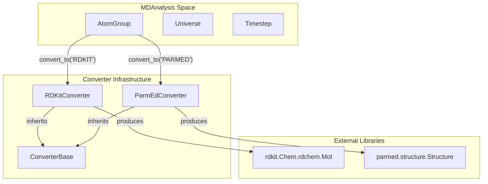
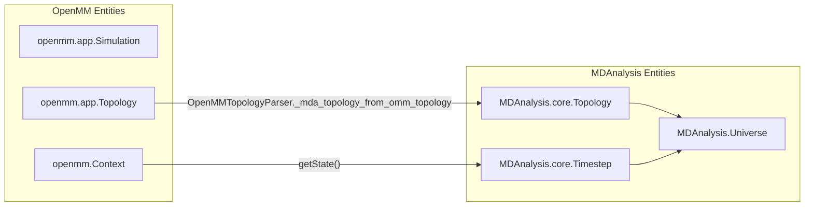

# Converters

Relevant source files

The following files were used as context for generating this wiki page:

- [package/MDAnalysis/converters/OpenMM.py](package/MDAnalysis/converters/OpenMM.py)
- [package/MDAnalysis/converters/OpenMMParser.py](package/MDAnalysis/converters/OpenMMParser.py)
- [package/MDAnalysis/converters/ParmEd.py](package/MDAnalysis/converters/ParmEd.py)
- [package/MDAnalysis/converters/ParmEdParser.py](package/MDAnalysis/converters/ParmEdParser.py)
- [package/MDAnalysis/converters/RDKit.py](package/MDAnalysis/converters/RDKit.py)
- [package/MDAnalysis/converters/RDKitInferring.py](package/MDAnalysis/converters/RDKitInferring.py)
- [package/MDAnalysis/converters/RDKitParser.py](package/MDAnalysis/converters/RDKitParser.py)
- [package/MDAnalysis/converters/__init__.py](package/MDAnalysis/converters/__init__.py)
- [package/MDAnalysis/converters/base.py](package/MDAnalysis/converters/base.py)
- [package/MDAnalysis/coordinates/ParmEd.py](package/MDAnalysis/coordinates/ParmEd.py)
- [package/MDAnalysis/topology/ParmEdParser.py](package/MDAnalysis/topology/ParmEdParser.py)
- [package/doc/sphinx/source/documentation_pages/converters/RDKit.rst](package/doc/sphinx/source/documentation_pages/converters/RDKit.rst)
- [testsuite/MDAnalysisTests/converters/test_base.py](testsuite/MDAnalysisTests/converters/test_base.py)
- [testsuite/MDAnalysisTests/converters/test_openmm.py](testsuite/MDAnalysisTests/converters/test_openmm.py)
- [testsuite/MDAnalysisTests/converters/test_openmm_parser.py](testsuite/MDAnalysisTests/converters/test_openmm_parser.py)
- [testsuite/MDAnalysisTests/converters/test_parmed.py](testsuite/MDAnalysisTests/converters/test_parmed.py)
- [testsuite/MDAnalysisTests/converters/test_rdkit.py](testsuite/MDAnalysisTests/converters/test_rdkit.py)
- [testsuite/MDAnalysisTests/converters/test_rdkit_parser.py](testsuite/MDAnalysisTests/converters/test_rdkit_parser.py)
- [testsuite/MDAnalysisTests/util.py](testsuite/MDAnalysisTests/util.py)

## Purpose and Scope

Converters in MDAnalysis provide a robust mechanism for interoperability between the MDAnalysis `Universe` and other molecular simulation and cheminformatics libraries. This system allows users to leverage specialized tools from libraries like **RDKit**, **ParmEd**, and **OpenMM** while maintaining the powerful selection and analysis capabilities of MDAnalysis.

The converter system consists of two primary components:
1.  **Readers/Parsers**: Import external objects (e.g., an RDKit `Mol` or OpenMM `Simulation`) into an MDAnalysis `Universe`.
2.  **Converters**: Export MDAnalysis `AtomGroup` or `Universe` objects to external library formats using the `convert_to` API.

Sources: [package/MDAnalysis/converters/RDKit.py:24-31](), [package/MDAnalysis/converters/ParmEd.py:24-29](), [package/MDAnalysis/converters/OpenMM.py:24-31]()

---

## The ConverterBase Interface

All converters inherit from `ConverterBase`, which defines the standard interface for transforming MDAnalysis objects into external representations.

### Data Flow for Conversion
The `convert_to` method on an `AtomGroup` dispatches the request to the appropriate converter class registered in `MDAnalysis._CONVERTERS` based on the requested format string (e.g., `"RDKIT"`, `"PARMED"`) [testsuite/MDAnalysisTests/converters/test_rdkit.py:192-194]().

Title: Converter Class Hierarchy and Conversion Flow

Sources: [package/MDAnalysis/converters/base.py:1-40](), [package/MDAnalysis/converters/RDKit.py:178-185](), [package/MDAnalysis/converters/ParmEd.py:144-165]()

---

## RDKit Interoperability

The RDKit integration allows for high-fidelity conversion between MDAnalysis and RDKit, supporting bond orders, charges, and chirality.

### RDKitReader and RDKitParser
*   **`RDKitParser`**: Extracts topology information (bonds, aromaticity, atom names, elements) from an `rdkit.Chem.rdchem.Mol` object [package/MDAnalysis/converters/RDKitParser.py:84-110](). It handles RDKit-specific properties like `_CIPCode` for chirality [package/MDAnalysis/converters/RDKitParser.py:76-81]().
*   **`RDKitReader`**: Inherits from `MemoryReader` to handle coordinates. It treats each RDKit conformer as a separate trajectory frame [package/MDAnalysis/converters/RDKit.py:135-165]().

### RDKitConverter
The `RDKitConverter` transforms an `AtomGroup` into an RDKit molecule. It maps MDAnalysis attributes to RDKit's `AtomPDBResidueInfo` (for PDB-standard data) or atom properties (for others) [package/MDAnalysis/converters/RDKit.py:178-192]().

| MDAnalysis Attribute | RDKit Mapping |
| :--- | :--- |
| `names` | `atom.GetMonomerInfo().GetName()` |
| `resnames` | `atom.GetMonomerInfo().GetResidueName()` |
| `tempfactors` | `atom.GetMonomerInfo().GetTempFactor()` |
| `charges` | `_GasteigerCharge` or `_TriposPartialCharge` |

Sources: [package/MDAnalysis/converters/RDKit.py:114-124](), [package/MDAnalysis/converters/RDKitParser.py:112-146]()

### Bond Order Inference
Because MDAnalysis topologies often lack explicit bond orders, the `RDKitConverter` uses an inferrer (defaulting to `MDAnalysisInferrer`) to deduce bond orders and formal charges from connectivity and atom types [package/MDAnalysis/converters/RDKit.py:60-77](). Users can provide a custom `inferrer` or a `TemplateInferrer` to match against a known SMILES string [package/MDAnalysis/converters/RDKit.py:66-71]().

---

## ParmEd Interoperability

ParmEd is frequently used for system manipulation such as Hydrogen Mass Repartitioning [package/MDAnalysis/converters/ParmEd.py:34-37]().

### Implementation Details
*   **`ParmEdReader`**: Reads coordinates and box dimensions directly from a `parmed.Structure` [package/MDAnalysis/converters/ParmEd.py:93-127]().
*   **`ParmEdConverter`**: Iterates through MDAnalysis atoms and connectivity (bonds, angles, dihedrals, impropers, CMAPs, and Urey-Bradleys) to build a ParmEd `Structure` [package/MDAnalysis/converters/ParmEd.py:144-220]().

### Attribute Mapping
MDAnalysis uses a translation table `MDA2PMD` to map attribute names to ParmEd's internal nomenclature [package/MDAnalysis/converters/ParmEd.py:130-137]():
*   `tempfactor` -> `bfactor`
*   `altLoc` -> `altloc`
*   `id` -> `number`

Sources: [package/MDAnalysis/converters/ParmEd.py:130-137](), [testsuite/MDAnalysisTests/converters/test_parmed.py:121-133]()

---

## OpenMM Interoperability

MDAnalysis supports importing data from the OpenMM Application layer, including `Simulation`, `PDBFile`, `Modeller`, and `PDBxFile` objects.

### Readers
1.  **`OpenMMSimulationReader`**: Connects to an active `openmm.app.Simulation` object. It retrieves positions, velocities, forces, and energies (kinetic/potential) directly from the OpenMM `Context` using `state.getPositions()`, `state.getVelocities()`, etc [package/MDAnalysis/converters/OpenMM.py:72-148]().
2.  **`OpenMMAppReader`**: Handles static objects like `Modeller` or `PDBxFile` by extracting topology and positions [package/MDAnalysis/converters/OpenMM.py:151-174]().

### Topology Parsing
The `OpenMMTopologyParser` converts an `openmm.app.topology.Topology` into an MDAnalysis `Topology` object. It maps OpenMM `Chain` objects to MDAnalysis `Segments` and handles unit conversion (e.g., OpenMM `daltons` to MDAnalysis `masses`) [package/MDAnalysis/converters/OpenMMParser.py:82-160]().

Title: OpenMM to MDAnalysis Mapping

Sources: [package/MDAnalysis/converters/OpenMM.py:118-148](), [package/MDAnalysis/converters/OpenMMParser.py:98-160]()

---

## Summary of Supported Libraries

| Library | Reader Class | Converter Class | Key Functionality |
| :--- | :--- | :--- | :--- |
| **RDKit** | `RDKitReader` | `RDKitConverter` | SMILES/SMARTS, conformer handling, bond order inference [package/MDAnalysis/converters/RDKit.py:24-31](). |
| **ParmEd** | `ParmEdReader` | `ParmEdConverter` | Topology manipulation, force field parameter access [package/MDAnalysis/converters/ParmEd.py:24-29](). |
| **OpenMM** | `OpenMMSimulationReader` | N/A | In-memory access to simulation states, forces, and energies [package/MDAnalysis/converters/OpenMM.py:24-31](). |

Sources: [package/MDAnalysis/converters/RDKit.py:24-31](), [package/MDAnalysis/converters/ParmEd.py:24-29](), [package/MDAnalysis/converters/OpenMM.py:24-31]()

---