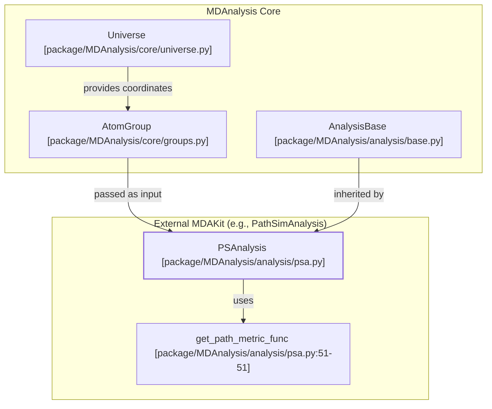
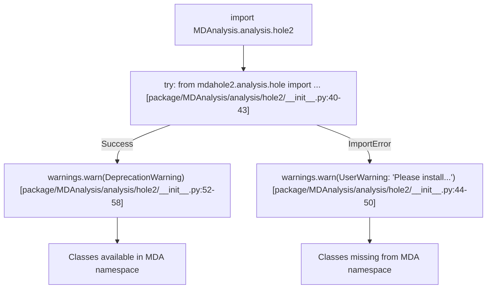

# 5.4 MDAKits and External Packages

<details>
<summary>Relevant source files</summary>

The following files were used as context for generating this wiki page:

- [package/MDAnalysis/analysis/density.py](package/MDAnalysis/analysis/density.py)
- [package/MDAnalysis/analysis/hbonds/hbond_autocorrel.py](package/MDAnalysis/analysis/hbonds/hbond_autocorrel.py)
- [package/MDAnalysis/analysis/hole2/__init__.py](package/MDAnalysis/analysis/hole2/__init__.py)
- [package/MDAnalysis/analysis/legacy/x3dna.py](package/MDAnalysis/analysis/legacy/x3dna.py)
- [package/MDAnalysis/analysis/psa.py](package/MDAnalysis/analysis/psa.py)
- [package/MDAnalysis/analysis/waterdynamics.py](package/MDAnalysis/analysis/waterdynamics.py)
- [package/doc/sphinx/source/documentation_pages/analysis/hole2.rst](package/doc/sphinx/source/documentation_pages/analysis/hole2.rst)
- [testsuite/MDAnalysisTests/analysis/test_density.py](testsuite/MDAnalysisTests/analysis/test_density.py)
- [testsuite/MDAnalysisTests/analysis/test_hole2.py](testsuite/MDAnalysisTests/analysis/test_hole2.py)
- [testsuite/MDAnalysisTests/analysis/test_hydrogenbondautocorrel.py](testsuite/MDAnalysisTests/analysis/test_hydrogenbondautocorrel.py)
- [testsuite/MDAnalysisTests/analysis/test_psa.py](testsuite/MDAnalysisTests/analysis/test_psa.py)
- [testsuite/MDAnalysisTests/analysis/test_waterdynamics.py](testsuite/MDAnalysisTests/analysis/test_waterdynamics.py)
- [testsuite/MDAnalysisTests/utils/test_duecredit.py](testsuite/MDAnalysisTests/utils/test_duecredit.py)

</details>


## Purpose and Scope

MDAKits are extension packages for MDAnalysis that provide specialized functionality beyond the core library. This modular approach allows the core MDAnalysis package to remain lightweight and maintainable while enabling the community to develop domain-specific tools that integrate seamlessly with `Universe` and `AtomGroup` objects. This page details the implementation of the redirection system for deprecated modules and the architectural relationship between core MDAnalysis and external kits.

Sources: [package/MDAnalysis/analysis/waterdynamics.py:24-41](), [package/MDAnalysis/analysis/psa.py:25-45]()

## The MDAKit Ecosystem

The MDAKit ecosystem consists of independent Python packages that utilize the MDAnalysis framework. These kits typically subclass `AnalysisBase` [package/MDAnalysis/analysis/density.py:183-183]() to leverage the standard `run()` lifecycle and parallelization capabilities of the core library.

### Core-Kit Interaction Logic

The following diagram illustrates the data flow between core entities and an external MDAKit.

**Data Flow: Core to MDAKit Integration**

Sources: [package/MDAnalysis/analysis/psa.py:49-65](), [package/MDAnalysis/analysis/waterdynamics.py:44-50](), [package/MDAnalysis/analysis/density.py:183-183]()

## Redirection and Deprecation System

To manage the transition of features from the core library to external packages, MDAnalysis employs a "proxy" pattern in the `MDAnalysis.analysis` namespace. When a module is moved to an MDAKit, the original file in the core library is updated to attempt an import from the new external package.

### Implementation of Module Redirection

The redirection logic handles two scenarios:
1. **Kit Installed**: The core module imports the classes from the external package and issues a `DeprecationWarning` [package/MDAnalysis/analysis/waterdynamics.py:59-65]().
2. **Kit Missing**: The core module catches the `ImportError` and raises a `UserWarning` with instructions on how to install the required MDAKit [package/MDAnalysis/analysis/waterdynamics.py:51-57]().

| Deprecated Module | External Package | Key Classes/Functions Redirected |
| :--- | :--- | :--- |
| `analysis.waterdynamics` | `waterdynamics` | `WaterOrientationalRelaxation`, `AngularDistribution`, `SurvivalProbability` |
| `analysis.psa` | `pathsimanalysis` | `PSAnalysis`, `PSAPair`, `hausdorff`, `discrete_frechet` |
| `analysis.hole2` | `mdahole2` | `HoleAnalysis`, `hole`, `create_vmd_surface` |

**Redirection Logic Flow**

Sources: [package/MDAnalysis/analysis/waterdynamics.py:44-65](), [package/MDAnalysis/analysis/psa.py:49-80](), [package/MDAnalysis/analysis/hole2/__init__.py:40-58]()

## Using MDAKits

### Installation and Migration
Users are encouraged to migrate from core imports to direct kit imports. Modules such as `waterdynamics`, `psa`, and `hole2` are deprecated as of version 2.8.0 and scheduled for removal in 3.0.0 [package/MDAnalysis/analysis/waterdynamics.py:33-36](), [package/MDAnalysis/analysis/psa.py:34-38](), [package/MDAnalysis/analysis/hole2/__init__.py:53-56]().

```python
# DEPRECATED: Accessing via MDAnalysis core
from MDAnalysis.analysis.waterdynamics import WaterOrientationalRelaxation

# RECOMMENDED: Direct access from the MDAKit
from waterdynamics.waterdynamics import WaterOrientationalRelaxation
```

### Verification in Test Suite
The MDAnalysis test suite verifies this redirection behavior using `pytest.warns` and `importlib.reload` to ensure users are properly notified of the migration [testsuite/MDAnalysisTests/analysis/test_waterdynamics.py:34-38](), [testsuite/MDAnalysisTests/analysis/test_psa.py:35-39](), [testsuite/MDAnalysisTests/analysis/test_hole2.py:36-40]().

Sources: [testsuite/MDAnalysisTests/analysis/test_waterdynamics.py:30-47](), [package/MDAnalysis/analysis/psa.py:74-80](), [testsuite/MDAnalysisTests/analysis/test_hole2.py:32-50]()

## Development Guidelines for Kits

Developers creating MDAKit-compatible packages should adhere to the following technical standards:

1.  **Base Class Inheritance**: Analysis routines should inherit from `MDAnalysis.analysis.base.AnalysisBase` to ensure compatibility with the standard `run()` method and `results` storage [package/MDAnalysis/analysis/density.py:183-183]().
2.  **Object Compatibility**: Kits must accept `AtomGroup` or `Universe` objects as primary data inputs [package/MDAnalysis/analysis/density.py:186-194]().
3.  **Namespace**: Kits should be published under descriptive names but use a clean top-level package name for imports (e.g., `mdahole2` for `hole2` analysis) [package/MDAnalysis/analysis/hole2/__init__.py:41-43]().
4.  **Citation Support**: Kits are encouraged to integrate with the `duecredit` system to ensure authors receive proper attribution when their tools are used [testsuite/MDAnalysisTests/utils/test_duecredit.py:100-108]().

Sources: [package/MDAnalysis/analysis/waterdynamics.py:33-36](), [package/MDAnalysis/analysis/psa.py:34-38](), [package/MDAnalysis/analysis/density.py:183-194](), [testsuite/MDAnalysisTests/utils/test_duecredit.py:100-108]()

## Summary of Active Migrations

| Feature | Core Path | Kit Repository / Documentation | Deprecation Version |
| :--- | :--- | :--- | :--- |
| Water Dynamics | `MDAnalysis.analysis.waterdynamics` | [waterdynamics](https://www.mdanalysis.org/waterdynamics/) | 2.8.0 |
| Path Similarity | `MDAnalysis.analysis.psa` | [PathSimAnalysis](https://github.com/MDAnalysis/PathSimAnalysis) | 2.8.0 |
| HOLE Analysis | `MDAnalysis.analysis.hole2` | [mdahole2](https://www.mdanalysis.org/mdahole2/) | 2.8.0 |

Sources: [package/MDAnalysis/analysis/waterdynamics.py:33-36](), [package/MDAnalysis/analysis/psa.py:34-38](), [package/MDAnalysis/analysis/hole2/__init__.py:53-56]()

---