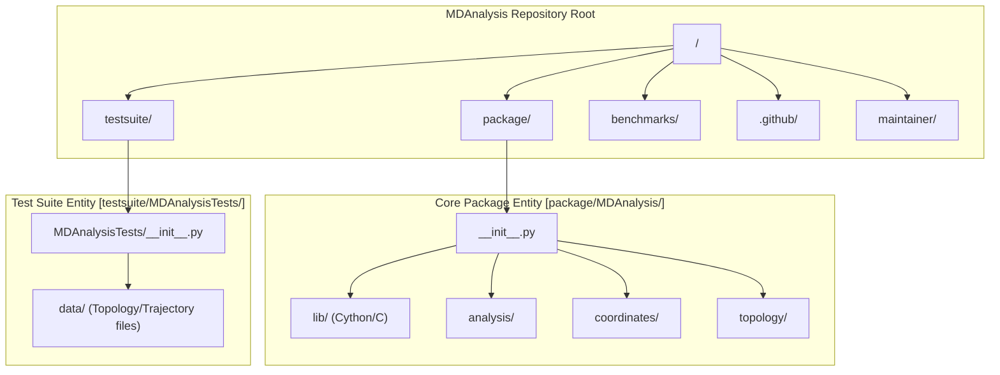
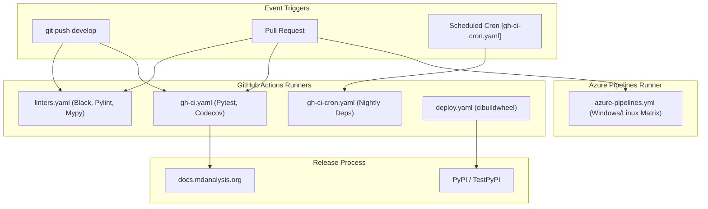

# Development Guide

Relevant source files

The following files were used as context for generating this wiki page:

- [.github/CONTRIBUTING.md](.github/CONTRIBUTING.md)
- [.github/ISSUE_TEMPLATE/bug_report.md](.github/ISSUE_TEMPLATE/bug_report.md)
- [.github/ISSUE_TEMPLATE/feature_request.md](.github/ISSUE_TEMPLATE/feature_request.md)
- [.github/ISSUE_TEMPLATE/questions.md](.github/ISSUE_TEMPLATE/questions.md)
- [.github/PULL_REQUEST_TEMPLATE.md](.github/PULL_REQUEST_TEMPLATE.md)
- [.github/actions/build-src/action.yaml](.github/actions/build-src/action.yaml)
- [.github/actions/setup-deps/action.yaml](.github/actions/setup-deps/action.yaml)
- [.github/workflows/deploy.yaml](.github/workflows/deploy.yaml)
- [.github/workflows/gh-ci-cron.yaml](.github/workflows/gh-ci-cron.yaml)
- [.github/workflows/gh-ci.yaml](.github/workflows/gh-ci.yaml)
- [.github/workflows/labels.yaml](.github/workflows/labels.yaml)
- [.github/workflows/linters.yaml](.github/workflows/linters.yaml)
- [.readthedocs.yml](.readthedocs.yml)
- [CODE_OF_CONDUCT.md](CODE_OF_CONDUCT.md)
- [GOVERNANCE.md](GOVERNANCE.md)
- [azure-pipelines.yml](azure-pipelines.yml)
- [maintainer/conda/environment.yml](maintainer/conda/environment.yml)
- [package/doc/sphinx/source/conf.py](package/doc/sphinx/source/conf.py)
- [package/pyproject.toml](package/pyproject.toml)
- [package/requirements.txt](package/requirements.txt)
- [testsuite/pyproject.toml](testsuite/pyproject.toml)

This guide provides information for developers who want to contribute to MDAnalysis. It covers setting up a development environment, understanding the codebase structure, and the processes for testing, building, and continuous integration.

For details on specific topics, see the following child pages:
- [Setting Up a Development Environment](#6.1) — Guide developers through setting up their environment, including editable installs, Cython compilation, optional dependencies, and the build system configuration.
- [Testing Framework](#6.2) — Explain how to run and write tests for MDAnalysis, covering the MDAnalysisTests package structure, datafiles manifest, pytest configuration, and test base classes.
- [Continuous Integration](#6.3) — Detail the CI/CD pipeline for MDAnalysis, covering GitHub Actions workflows, Azure Pipelines, wheel building with cibuildwheel, documentation deployment, and the release lifecycle.
- [Benchmarking](#6.4) — Explain how to use the Airspeed Velocity (ASV) benchmarking framework to measure and track MDAnalysis performance across trajectory readers, atom group methods, selections, and analysis routines.

## Setting Up a Development Environment

To contribute to MDAnalysis, you must set up an environment capable of compiling Cython extensions and handling a variety of optional dependencies. The recommended approach is using `micromamba` or `conda` with the provided environment definitions.

### Environment Configuration
The project maintains a development environment file at `maintainer/conda/environment.yml` [maintainer/conda/environment.yml:1-42](). This includes core dependencies like `numpy`, `scipy`, and `cython`, as well as analysis-specific tools like `rdkit` and `biopython` [package/pyproject.toml:69-91]().

For detailed instructions on editable installs and build isolation, see [Setting Up a Development Environment](#6.1).

Sources: [maintainer/conda/environment.yml:1-42](), [package/pyproject.toml:1-16](), [package/pyproject.toml:69-91]()

## Repository Structure

The MDAnalysis repository is split into the core package and a standalone test suite to manage the large volume of test data files.

### Codebase Organization

- **package/**: Contains the main `MDAnalysis` library code and Cython extensions [package/pyproject.toml:120-122]().
- **testsuite/**: A separate package `MDAnalysisTests` containing the comprehensive test suite and data manifest [testsuite/pyproject.toml:8-9]().
- **benchmarks/**: Performance tracking using the Airspeed Velocity (ASV) framework [.github/workflows/gh-ci.yaml:140-145]().

Sources: [package/pyproject.toml:120-122](), [testsuite/pyproject.toml:8-9](), [.github/workflows/gh-ci.yaml:140-145]()

## Building and Testing

MDAnalysis uses `setuptools` as its build backend [package/pyproject.toml:17](). Because much of the core (especially in `MDAnalysis.lib` and `MDAnalysis.coordinates`) is written in Cython, a compilation step is required.

### Build System
The build requires `Cython >= 0.28` and `numpy >= 2.0.0` for wheel compatibility [package/pyproject.toml:1-16](). CI workflows typically build the source with isolation enabled to ensure clean dependency resolution [.github/workflows/gh-ci.yaml:114-124]().

### Testing Framework
Testing is handled by `pytest` [.github/workflows/gh-ci.yaml:130-139](). The test suite is extensive, often requiring `pytest-xdist` for parallel execution and `pytest-timeout` to catch hanging readers [testsuite/pyproject.toml:137-155]().

For details on writing new tests or using the datafiles manifest, see [Testing Framework](#6.2).

Sources: [package/pyproject.toml:1-17](), [.github/workflows/gh-ci.yaml:130-139](), [testsuite/pyproject.toml:137-155]()

## Continuous Integration (CI/CD)

MDAnalysis employs a robust CI pipeline using GitHub Actions and Azure Pipelines to ensure cross-platform compatibility across Linux, Windows, and macOS.

### CI Workflow Architecture

### Key Workflows
- **Main CI**: Executes the core test suite across multiple Python versions (3.11–3.14) and calculates code coverage [.github/workflows/gh-ci.yaml:23-77]().
- **Linters**: Enforces code style using `black`, static analysis with `pylint`, and type checking with `mypy` [.github/workflows/linters.yaml:1-105]().
- **Deployment**: Automates wheel building via `cibuildwheel` and uploads to PyPI upon release tags [.github/workflows/deploy.yaml:31-70]().
- **Azure Pipelines**: Provides extended testing for Windows and Linux environments, specifically checking wheel ABI compatibility with older `numpy` versions [azure-pipelines.yml:18-57]().

For details on the release lifecycle and CI configuration, see [Continuous Integration](#6.3).

Sources: [.github/workflows/gh-ci.yaml:23-77](), [.github/workflows/linters.yaml:1-105](), [.github/workflows/deploy.yaml:31-70](), [azure-pipelines.yml:18-57]()

## Benchmarking

Performance is critical for trajectory analysis. MDAnalysis uses `asv` (Airspeed Velocity) to monitor for performance regressions in core operations like atom selection and coordinate reading.

The `asv_check` job in CI ensures that benchmarking scripts remain functional as the codebase evolves [.github/workflows/gh-ci.yaml:71-76](). Performance is tracked over time to ensure that optimizations in `MDAnalysis.lib` or changes in `MDAnalysis.coordinates` do not introduce regressions.

For details on running benchmarks locally and adding new benchmarks, see [Benchmarking](#6.4).

Sources: [.github/workflows/gh-ci.yaml:71-76](), [.github/workflows/gh-ci.yaml:140-145]()

---