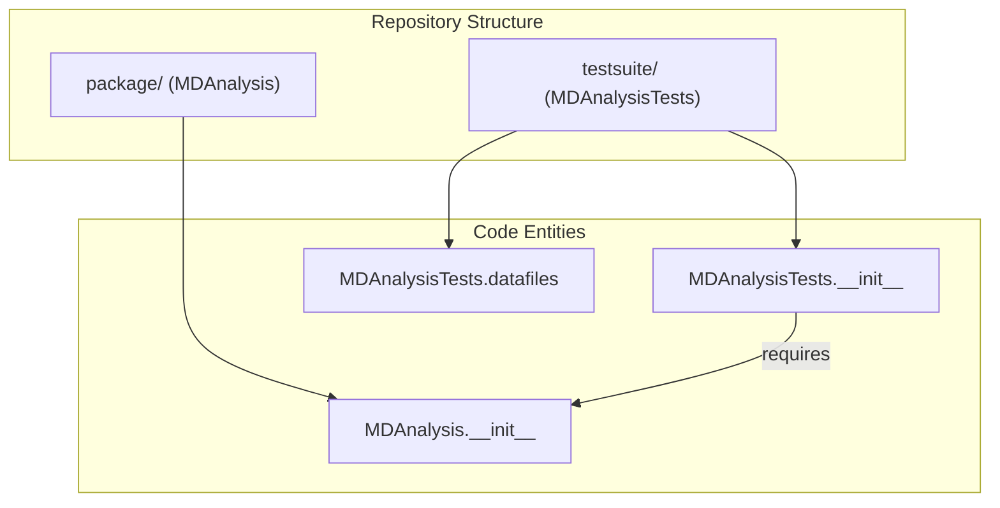
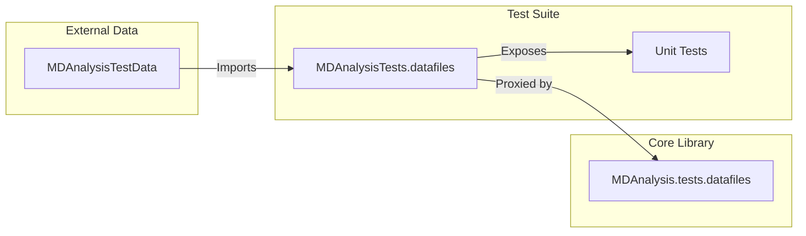
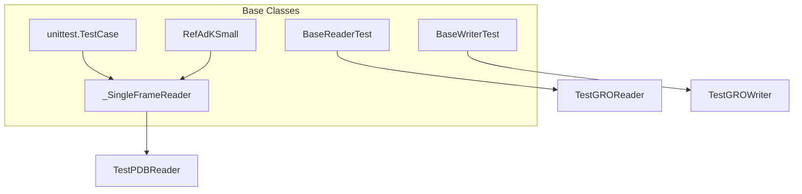

# Testing Framework

<details>
<summary>Relevant source files</summary>

The following files were used as context for generating this wiki page:

- [package/AUTHORS](package/AUTHORS)
- [package/CHANGELOG](package/CHANGELOG)
- [package/MDAnalysis/__init__.py](package/MDAnalysis/__init__.py)
- [package/MDAnalysis/units.py](package/MDAnalysis/units.py)
- [package/MDAnalysis/version.py](package/MDAnalysis/version.py)
- [package/setup.py](package/setup.py)
- [testsuite/MDAnalysisTests/__init__.py](testsuite/MDAnalysisTests/__init__.py)
- [testsuite/MDAnalysisTests/coordinates/base.py](testsuite/MDAnalysisTests/coordinates/base.py)
- [testsuite/MDAnalysisTests/coordinates/test_gro.py](testsuite/MDAnalysisTests/coordinates/test_gro.py)
- [testsuite/MDAnalysisTests/coordinates/test_pdb.py](testsuite/MDAnalysisTests/coordinates/test_pdb.py)
- [testsuite/MDAnalysisTests/coordinates/test_pqr.py](testsuite/MDAnalysisTests/coordinates/test_pqr.py)
- [testsuite/MDAnalysisTests/coordinates/test_xdr.py](testsuite/MDAnalysisTests/coordinates/test_xdr.py)
- [testsuite/MDAnalysisTests/coordinates/test_xyz.py](testsuite/MDAnalysisTests/coordinates/test_xyz.py)
- [testsuite/MDAnalysisTests/datafiles.py](testsuite/MDAnalysisTests/datafiles.py)
- [testsuite/MDAnalysisTests/dummy.py](testsuite/MDAnalysisTests/dummy.py)
- [testsuite/MDAnalysisTests/test_api.py](testsuite/MDAnalysisTests/test_api.py)
- [testsuite/MDAnalysisTests/utils/test_authors.py](testsuite/MDAnalysisTests/utils/test_authors.py)
- [testsuite/MDAnalysisTests/utils/test_datafiles.py](testsuite/MDAnalysisTests/utils/test_datafiles.py)
- [testsuite/MDAnalysisTests/utils/test_failure.py](testsuite/MDAnalysisTests/utils/test_failure.py)
- [testsuite/MDAnalysisTests/utils/test_imports.py](testsuite/MDAnalysisTests/utils/test_imports.py)
- [testsuite/MDAnalysisTests/utils/test_log.py](testsuite/MDAnalysisTests/utils/test_log.py)
- [testsuite/MDAnalysisTests/utils/test_meta.py](testsuite/MDAnalysisTests/utils/test_meta.py)
- [testsuite/MDAnalysisTests/utils/test_modelling.py](testsuite/MDAnalysisTests/utils/test_modelling.py)
- [testsuite/MDAnalysisTests/utils/test_persistence.py](testsuite/MDAnalysisTests/utils/test_persistence.py)
- [testsuite/MDAnalysisTests/utils/test_qcprot.py](testsuite/MDAnalysisTests/utils/test_qcprot.py)
- [testsuite/MDAnalysisTests/utils/test_selections.py](testsuite/MDAnalysisTests/utils/test_selections.py)
- [testsuite/MDAnalysisTests/utils/test_transformations.py](testsuite/MDAnalysisTests/utils/test_transformations.py)
- [testsuite/MDAnalysisTests/utils/test_units.py](testsuite/MDAnalysisTests/utils/test_units.py)
- [testsuite/setup.py](testsuite/setup.py)

</details>


This document describes the testing framework used in MDAnalysis, including the package structure, the use of test datafiles, pytest configuration, and implementation details for writing and running tests.

## Overview

MDAnalysis employs a robust testing architecture where the test suite is maintained as a separate, installable package called `MDAnalysisTests`. This separation ensures that the core library remains lightweight while providing a comprehensive suite of tests for developers and users to verify installations.



Sources: [testsuite/MDAnalysisTests/__init__.py:24-33](), [testsuite/setup.py:77-88]()

## Package Structure and Versions

The `MDAnalysisTests` package must always match the version of the `MDAnalysis` package. If the versions do not match, an `ImportError` is raised [testsuite/MDAnalysisTests/__init__.py:30-33]().

- **MDAnalysis version**: Defined in `package/MDAnalysis/version.py` [package/MDAnalysis/version.py:70-70]().
- **MDAnalysisTests version**: Defined in `testsuite/MDAnalysisTests/__init__.py` [testsuite/MDAnalysisTests/__init__.py:100-100]().
- **Synchronization**: The `setup.py` scripts in both the `package/` and `testsuite/` directories use a `RELEASE` variable to keep these in sync [package/setup.py:61-61](), [testsuite/setup.py:78-78]().

### The Test Runner
The package provides a `run()` function in the top-level `MDAnalysisTests` namespace that wraps `pytest.main()` [testsuite/MDAnalysisTests/__init__.py:135-137]().

Sources: [testsuite/MDAnalysisTests/__init__.py:99-137](), [package/MDAnalysis/version.py:66-70]()

## Test Datafiles Manifest

MDAnalysis relies on a large collection of simulation data for unit testing. These files are managed through `MDAnalysisTests.datafiles`.

### Data Flow
The data files are actually located in a separate repository/package called `MDAnalysisTestData`, but they are exposed through the `MDAnalysisTests.datafiles` module for convenience [testsuite/MDAnalysisTests/datafiles.py:33-37]().



### Key Data References
The manifest defines constants for various file formats used in testing, such as:
- **Topology Files**: `PSF`, `PDB_small`, `GRO`, `TPR`, `PRM7` [testsuite/MDAnalysisTests/datafiles.py:40-213]().
- **Trajectory Files**: `DCD`, `XTC`, `TRR`, `NCDF`, `H5MD_xvf` [testsuite/MDAnalysisTests/datafiles.py:41-102]().

Sources: [testsuite/MDAnalysisTests/datafiles.py:24-215](), [testsuite/MDAnalysisTests/utils/test_datafiles.py:50-77]()

## Pytest Configuration

The testing framework uses `pytest` and integrates with `numpy.testing` utilities.

### Configuration and Filters
The framework is configured to be "loud" about `DeprecationWarning` from the `MDAnalysis` module while ignoring them from third-party dependencies [package/MDAnalysis/__init__.py:206-209]().

### Utility Functions
`MDAnalysisTests.util` provides several helper functions for common testing patterns:
- `block_import`: Simulates a missing dependency [testsuite/MDAnalysisTests/__init__.py:126-126]().
- `no_deprecated_call`: Ensures code does not trigger deprecation warnings [testsuite/MDAnalysisTests/__init__.py:128-128]().
- `assert_nowarns`: Verifies that no warnings are raised during execution [testsuite/MDAnalysisTests/__init__.py:130-130]().

Sources: [testsuite/MDAnalysisTests/__init__.py:125-131](), [package/MDAnalysis/__init__.py:206-209]()

## Implementation Details

### Test Base Classes
MDAnalysis uses base classes to standardize testing across different file formats and readers. These are primarily located in `MDAnalysisTests.coordinates.base`.



- **`_SingleFrameReader`**: Provides standard tests for single-frame formats like PDB or GRO, checking `n_atoms`, `n_frames`, `dt`, and `pickle` support [testsuite/MDAnalysisTests/coordinates/base.py:44-173]().
- **`BaseReference`**: A container for reference data (coordinates, dimensions, auxiliary data) used to validate reader output [testsuite/MDAnalysisTests/coordinates/base.py:175-212]().

### Testing Universe Creation
Tests often use the `make_Universe` utility from `MDAnalysisTests.dummy` to create mock systems without needing external files [testsuite/MDAnalysisTests/__init__.py:132-132]().

### Integration with Environment
The test suite sets specific environment variables during initialization:
- `DUECREDIT_ENABLE = "yes"`: Enables citation collection during tests [testsuite/MDAnalysisTests/__init__.py:117-117]().
- Backends for plotting are typically set to `agg` via `MPLBACKEND` in CI to handle headless environments [testsuite/MDAnalysisTests/__init__.py:119-123]().

Sources: [testsuite/MDAnalysisTests/__init__.py:107-132](), [testsuite/MDAnalysisTests/coordinates/base.py:44-212]()

## Writing and Running Tests

### Command Line Usage
To run all tests:
```bash
pytest --pyargs MDAnalysisTests
```
To run in parallel using `pytest-xdist`:
```bash
pytest -n 4 --pyargs MDAnalysisTests
```

### Test Case Example (Gromacs Reader)
The `_GromacsReader` base class implements shared logic for XTC and TRR testing, including verification of `rewind()`, `next()`, `jump()`, and `slice()` operations [testsuite/MDAnalysisTests/coordinates/test_xdr.py:109-215]().

| Test Method | Purpose | Code Pointer |
| :--- | :--- | :--- |
| `test_rewind_xdrtrj` | Ensures trajectory resets to frame 0 | [testsuite/MDAnalysisTests/coordinates/test_xdr.py:129-132]() |
| `test_jump_xdrtrj` | Tests random access indexing | [testsuite/MDAnalysisTests/coordinates/test_xdr.py:139-141]() |
| `test_unitcell` | Validates rhombic dodecahedron dimensions | [testsuite/MDAnalysisTests/coordinates/test_xdr.py:177-186]() |

Sources: [testsuite/MDAnalysisTests/__init__.py:38-51](), [testsuite/MDAnalysisTests/coordinates/test_xdr.py:109-215]()

---