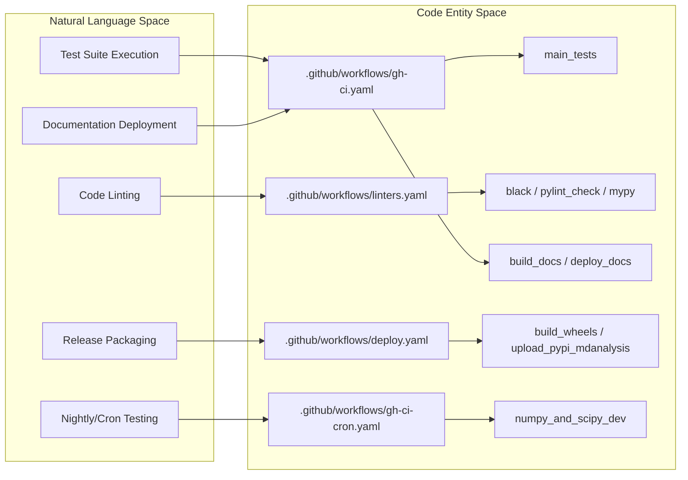
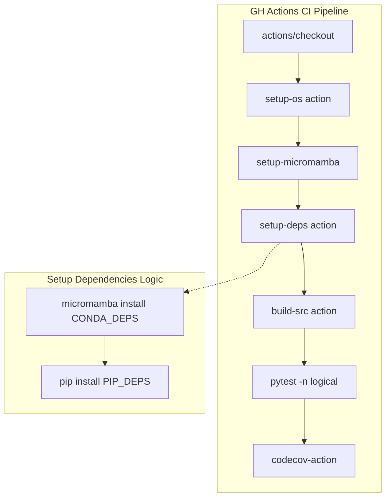
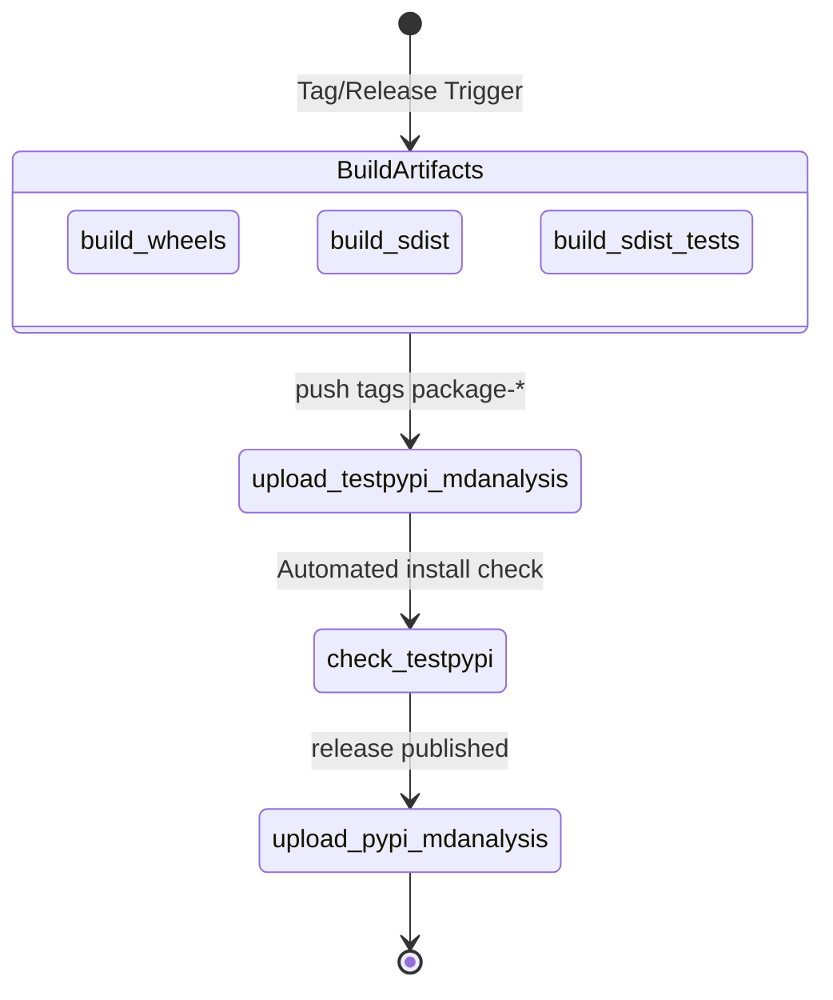

# Continuous Integration

Relevant source files

The following files were used as context for generating this wiki page:

- [.cirrus.star](.cirrus.star)
- [.github/actions/build-src/action.yaml](.github/actions/build-src/action.yaml)
- [.github/actions/setup-deps/action.yaml](.github/actions/setup-deps/action.yaml)
- [.github/workflows/deploy.yaml](.github/workflows/deploy.yaml)
- [.github/workflows/gh-ci-cron.yaml](.github/workflows/gh-ci-cron.yaml)
- [.github/workflows/gh-ci.yaml](.github/workflows/gh-ci.yaml)
- [.github/workflows/labels.yaml](.github/workflows/labels.yaml)
- [.github/workflows/linters.yaml](.github/workflows/linters.yaml)
- [.readthedocs.yml](.readthedocs.yml)
- [azure-pipelines.yml](azure-pipelines.yml)
- [maintainer/change_release.sh](maintainer/change_release.sh)
- [maintainer/ci/cirrus-ci.yml](maintainer/ci/cirrus-ci.yml)
- [maintainer/ci/cirrus-deploy.yml](maintainer/ci/cirrus-deploy.yml)
- [maintainer/conda/environment.yml](maintainer/conda/environment.yml)
- [maintainer/update_json_stubs_sitemap.py](maintainer/update_json_stubs_sitemap.py)
- [package/doc/sphinx/source/conf.py](package/doc/sphinx/source/conf.py)
- [package/pyproject.toml](package/pyproject.toml)
- [package/requirements.txt](package/requirements.txt)
- [testsuite/pyproject.toml](testsuite/pyproject.toml)

This document describes the continuous integration (CI) system used in the MDAnalysis project. It covers the CI workflows, testing infrastructure, and deployment pipelines that ensure code quality and reliability. For information about the testing framework itself, see [Testing Framework](#6.2).

## Overview

MDAnalysis uses GitHub Actions as its primary CI platform, with additional testing on Azure Pipelines. The CI system automatically runs tests, linting, and builds documentation whenever code changes are pushed to the repository or pull requests are opened. This ensures that code changes don't break existing functionality and maintain code quality standards.

### System Mapping: CI Workflow to Code Entities

The following diagram maps high-level CI tasks to the specific GitHub Action workflow files and jobs defined in the codebase.

Sources: [.github/workflows/gh-ci.yaml:1-24](), [.github/workflows/linters.yaml:1-20](), [.github/workflows/deploy.yaml:1-33](), [.github/workflows/gh-ci-cron.yaml:1-30]()

## Main CI Workflow

The main CI workflow runs on every pull request and push to the `develop` branch [[.github/workflows/gh-ci.yaml:2-8]](). It utilizes a concurrency group strategy to cancel in-progress runs for the same PR to save resources [[.github/workflows/gh-ci.yaml:11-16]]().

### Test Matrix

The main test matrix in `main_tests` ensures compatibility across modern Python versions and architectures [[.github/workflows/gh-ci.yaml:23-34]]().

| Python Version | Operating Systems | Cython Pin | Coverage |
|----------------|-------------------|------------|----------|
| 3.11, 3.12, 3.13| ubuntu-latest    | cython<3.1 | True     |
| 3.14           | ubuntu-latest     | cython>=3.1| False    |
| 3.13           | macOS-14 (arm64)  | cython<3.1 | True     |
| 3.13           | ubuntu-24.04-arm  | cython>3.1 | False    |
| 3.11 (numpy_min)| ubuntu-latest    | cython<3.1 | True     |

Sources: [.github/workflows/gh-ci.yaml:23-76]()

### CI Pipeline Execution Flow

The workflow relies on composite actions to modularize environment setup.

Sources: [.github/workflows/gh-ci.yaml:81-154](), [.github/actions/setup-deps/action.yaml:114-196]()

## Documentation Build and Deployment

The `build_docs` job builds the Sphinx documentation using a dedicated environment containing `mdanalysis-sphinx-theme` and bibliography extensions [[.github/workflows/gh-ci.yaml:156-187]](). The documentation configuration is defined in `package/doc/sphinx/source/conf.py` [[package/doc/sphinx/source/conf.py:1-50]]().

### Documentation Lifecycle
1.  **Build**: Uses the `build-src` action with `build-docs: true` [[.github/workflows/gh-ci.yaml:188-194]]().
2.  **Verify**: Runs `sphinx-build -b doctest` on pull requests to ensure code snippet accuracy [[.github/workflows/gh-ci.yaml:195-200]]().
3.  **Deploy**: On pushes to `develop`, the workflow executes `maintainer/update_json_stubs_sitemap.py` to manage versioned documentation directories and update the global `versions.json` [[.github/workflows/gh-ci.yaml:201-228]]() [[maintainer/update_json_stubs_sitemap.py:76-118]]().

Sources: [.github/workflows/gh-ci.yaml:156-228](), [maintainer/update_json_stubs_sitemap.py:1-205](), [package/doc/sphinx/source/conf.py:1-118]()

## Package Building and Distribution

The `deploy.yaml` workflow manages the creation of binary wheels and source distributions (sdist) for both the main package and the testsuite [[.github/workflows/deploy.yaml:31-122]]().

### cibuildwheel Configuration
MDAnalysis uses `pypa/cibuildwheel` to compile C extensions for multiple platforms [[.github/workflows/deploy.yaml:52-60]]().
- **Linux**: `manylinux_x86_64` on `ubuntu-22.04` [[.github/workflows/deploy.yaml:40]]().
- **Windows**: `win_amd64` on `windows-2022` [[.github/workflows/deploy.yaml:41]]().
- **macOS**: `macosx_*` (arm64) on `macos-14` [[.github/workflows/deploy.yaml:42]]().

### Release Lifecycle

Sources: [.github/workflows/deploy.yaml:31-235]()

## Scheduled (Cron) CI

To handle the "moving target" of the Python ecosystem, scheduled runs (Tuesdays and Fridays) perform deep compatibility checks [[.github/workflows/gh-ci-cron.yaml:1-5]]().

1.  **numpy_and_scipy_dev**: Installs nightly wheels from the scientific-python-nightly-wheels index to catch breaking changes in upstream dependencies [[.github/workflows/gh-ci-cron.yaml:30-69]]().
2.  **native_march**: Modifies `package/setup.cfg` via `sed` to inject `-march=native -mtune=native` flags, testing platform-specific optimizations [[.github/workflows/gh-ci-cron.yaml:88-123]]().
3.  **pip-only-develop**: Tests the installation without Conda/Micromamba to ensure `pyproject.toml` dependencies are correctly specified for pure-pip environments [[.github/workflows/gh-ci-cron.yaml:184-211]]().
4.  **conda-latest-release**: Verifies that the version currently available on `conda-forge` remains functional [[.github/workflows/gh-ci-cron.yaml:224-258]]().

Sources: [.github/workflows/gh-ci-cron.yaml:1-265]()

## Code Quality and Linting

The `linters.yaml` workflow enforces style and type safety [[.github/workflows/linters.yaml:1-106]]().

-   **Black**: Enforces a 79-character line length as configured in `package/pyproject.toml` [[.github/workflows/linters.yaml:20-48]]() [[package/pyproject.toml:128-129]]().
-   **Pylint**: Uses `package/.pylintrc` to check both the core library and the test suite [[.github/workflows/linters.yaml:50-70]]().
-   **MyPy**: Performs static type checking on `package/MDAnalysis/` [[.github/workflows/linters.yaml:72-105]]().

Sources: [.github/workflows/linters.yaml:1-105](), [package/pyproject.toml:128-150]()

## Azure Pipelines

Azure Pipelines provides a secondary validation layer, primarily for Windows environments and ABI compatibility checks [[azure-pipelines.yml:18-58]]().

-   **Wheel Testing**: Jobs like `Win-Python313-64bit-full-wheel` install the package from a pre-built wheel and then pin to the **minimum supported NumPy version** (e.g., 2.1.0 or 1.26.0) to verify ABI compatibility across the NumPy 1.x/2.x transition [[azure-pipelines.yml:34-57]]() [[azure-pipelines.yml:95-102]]().
-   **Full Dependency Check**: Installs a wide array of optional binaries including `rdkit`, `chemfiles`, and `pytng` to ensure integration remains stable on Windows [[azure-pipelines.yml:103-121]]().

Sources: [azure-pipelines.yml:1-140]()

## Dependency Specification

The CI environment is defined by several overlapping files:
- **`package/pyproject.toml`**: The definitive source for build-system requirements (`Cython`, `numpy`, `setuptools`) and runtime dependencies [[package/pyproject.toml:1-43]]().
- **`.github/actions/setup-deps/action.yaml`**: A composite action that maps input flags (like `full-deps`) to specific package names for both Conda and Pip [[.github/actions/setup-deps/action.yaml:1-113]]().
- **`maintainer/conda/environment.yml`**: A reference environment for local development mirroring CI [[maintainer/conda/environment.yml:1-42]]().
- **`testsuite/pyproject.toml`**: Defines metadata and data file inclusions for the `MDAnalysisTests` package [[testsuite/pyproject.toml:1-135]]().

Sources: [package/pyproject.toml:1-103](), [.github/actions/setup-deps/action.yaml:1-197](), [maintainer/conda/environment.yml:1-42](), [testsuite/pyproject.toml:1-135]()

---