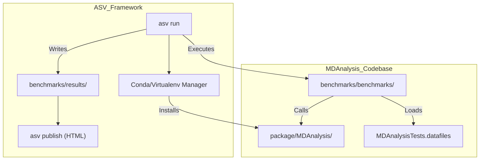
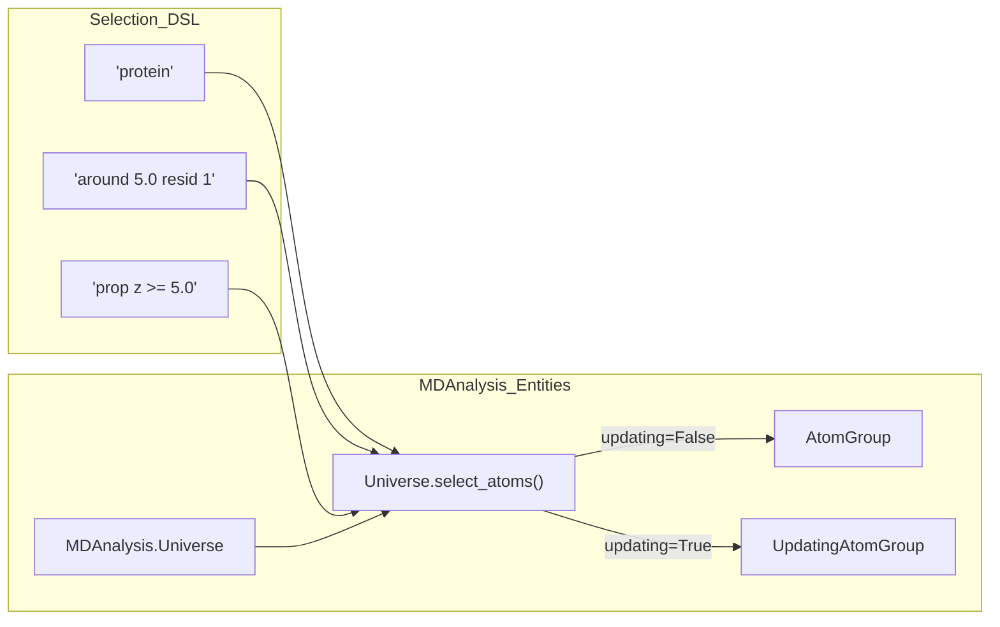

# Benchmarking

Relevant source files

The following files were used as context for generating this wiki page:

- [.gitignore](.gitignore)
- [benchmarks/README.rst](benchmarks/README.rst)
- [benchmarks/asv.conf.json](benchmarks/asv.conf.json)
- [benchmarks/benchmarks/GRO.py](benchmarks/benchmarks/GRO.py)
- [benchmarks/benchmarks/__init__.py](benchmarks/benchmarks/__init__.py)
- [benchmarks/benchmarks/ag_methods.py](benchmarks/benchmarks/ag_methods.py)
- [benchmarks/benchmarks/analysis/distances.py](benchmarks/benchmarks/analysis/distances.py)
- [benchmarks/benchmarks/analysis/leaflet.py](benchmarks/benchmarks/analysis/leaflet.py)
- [benchmarks/benchmarks/analysis/psa.py](benchmarks/benchmarks/analysis/psa.py)
- [benchmarks/benchmarks/analysis/rdf.py](benchmarks/benchmarks/analysis/rdf.py)
- [benchmarks/benchmarks/analysis/rms.py](benchmarks/benchmarks/analysis/rms.py)
- [benchmarks/benchmarks/import.py](benchmarks/benchmarks/import.py)
- [benchmarks/benchmarks/selections.py](benchmarks/benchmarks/selections.py)
- [benchmarks/benchmarks/topology.py](benchmarks/benchmarks/topology.py)
- [benchmarks/benchmarks/traj_reader.py](benchmarks/benchmarks/traj_reader.py)
- [maintainer/adapt_sitemap.py](maintainer/adapt_sitemap.py)
- [package/MDAnalysis/analysis/hydrogenbonds/hbond_analysis.py](package/MDAnalysis/analysis/hydrogenbonds/hbond_analysis.py)
- [package/MDAnalysis/coordinates/TRC.py](package/MDAnalysis/coordinates/TRC.py)
- [package/MDAnalysis/lib/_cutil.pyx](package/MDAnalysis/lib/_cutil.pyx)
- [testsuite/MDAnalysisTests/analysis/test_hydrogenbonds_analysis.py](testsuite/MDAnalysisTests/analysis/test_hydrogenbonds_analysis.py)
- [testsuite/MDAnalysisTests/coordinates/test_trc.py](testsuite/MDAnalysisTests/coordinates/test_trc.py)
- [testsuite/MDAnalysisTests/core/test_wrap.py](testsuite/MDAnalysisTests/core/test_wrap.py)
- [testsuite/MDAnalysisTests/data/gromos11/gromos11_traj_vac_1_extra_pos.trc.gz](testsuite/MDAnalysisTests/data/gromos11/gromos11_traj_vac_1_extra_pos.trc.gz)
- [testsuite/MDAnalysisTests/data/gromos11/gromos11_traj_vac_1_missing_pos.trc.gz](testsuite/MDAnalysisTests/data/gromos11/gromos11_traj_vac_1_missing_pos.trc.gz)
- [testsuite/MDAnalysisTests/data/gromos11/gromos11_traj_vac_1_whitespace.trc.gz](testsuite/MDAnalysisTests/data/gromos11/gromos11_traj_vac_1_whitespace.trc.gz)
- [testsuite/MDAnalysisTests/lib/test_cutil.py](testsuite/MDAnalysisTests/lib/test_cutil.py)
- [testsuite/MDAnalysisTests/utils/test_streamio.py](testsuite/MDAnalysisTests/utils/test_streamio.py)

The MDAnalysis project utilizes the **Airspeed Velocity (ASV)** framework to monitor performance over time and prevent regressions. Benchmarking is critical for a library dealing with large-scale molecular dynamics data, where performance in trajectory reading, atom selection, and mathematical analysis directly impacts user workflows.

The benchmarking suite is located in the `benchmarks/` directory of the repository and covers core functionality including file I/O, atom group operations, and analysis modules [[benchmarks/asv.conf.json:40-40]]().

## System Architecture and Data Flow

The benchmarking system operates by installing specific versions of MDAnalysis into isolated environments and running a suite of timed Python classes.

### ASV Configuration
The `asv.conf.json` file defines the benchmarking environment, including supported Python versions (e.g., 3.11, 3.14), repository locations, and build commands [[benchmarks/asv.conf.json:24-27]](). It specifies `conda` as the default environment type and includes `MDAnalysisTests` in the matrix to ensure datafiles are available [[benchmarks/asv.conf.json:33-44]]().

### Data Flow for Benchmarking
The following diagram illustrates how ASV interacts with the MDAnalysis codebase and test data to generate performance metrics.

**ASV Execution Flow**

Sources: [[benchmarks/asv.conf.json:1-54]](), [[benchmarks/benchmarks/traj_reader.py:1-37]]()

## Trajectory Reader Benchmarks

Trajectory reading is a primary bottleneck. The suite benchmarks different formats (XTC, TRR, DCD, NCDF, TRC, PDB) for two main operations:
1. **Creation**: The time taken to initialize a reader object like `DCDReader` or `XTCReader` [[benchmarks/benchmarks/traj_reader.py:47-62]]().
2. **Iteration (Striding)**: The time taken to iterate through every `Timestep` of a trajectory [[benchmarks/benchmarks/traj_reader.py:64-81]]().

| Class | Method | Target |
| :--- | :--- | :--- |
| `TrajReaderCreation` | `time_reads` | Reader initialization [[benchmarks/benchmarks/traj_reader.py:57-62]]() |
| `TrajReaderIteration` | `time_strides` | `for ts in reader_object: pass` [[benchmarks/benchmarks/traj_reader.py:75-81]]() |

Sources: [[benchmarks/benchmarks/traj_reader.py:37-81]]()

## AtomGroup and Selection Benchmarks

Performance of `AtomGroup` methods and the selection DSL is tracked across different system sizes (number of atoms).

### AtomGroup Methods
The `AtomGroupMethodsBench` class evaluates core geometric and topological operations such as `center()`, `bbox()`, `rotate()`, and `guess_bonds()` [[benchmarks/benchmarks/ag_methods.py:11-208]](). These are parameterized by `num_atoms` (10 to 10,000) [[benchmarks/benchmarks/ag_methods.py:20-21]]().

### Selection System
The selection system benchmarks evaluate the efficiency of the `select_atoms` method.
* **Simple Selections**: Static keywords like `protein`, `backbone`, or `resname LYS` [[benchmarks/benchmarks/selections.py:9-39]]().
* **Geometric Selections**: Complex queries involving spatial logic (e.g., `around`, `sphzone`, `cylayer`) with varying flags for `updating` (dynamic evaluations) and `periodic` (PBC awareness) [[benchmarks/benchmarks/selections.py:41-83]]().

**Selection Entity Mapping**

Sources: [[benchmarks/benchmarks/ag_methods.py:11-21]](), [[benchmarks/benchmarks/selections.py:9-83]]()

## Analysis Module Benchmarks

Analysis benchmarks typically evaluate the `run()` lifecycle of classes inheriting from `AnalysisBase`.

### Radial Distribution Function (RDF)
The `SimpleRdfBench` and `SimpleRdfsBench` classes track the performance of `InterRDF` and `InterRDF_s` [[benchmarks/benchmarks/analysis/rdf.py:14-69]](). They are parameterized by:
* `nbins`: Number of histogram bins [[benchmarks/benchmarks/analysis/rdf.py:17-17]]().
* `natoms`: Size of the selection [[benchmarks/benchmarks/analysis/rdf.py:17-17]]().
* `npairs`: Number of atom group pairs for `InterRDF_s` [[benchmarks/benchmarks/analysis/rdf.py:46-46]]().

### RMSD and RMSF
* **RMSD**: Benchmarks track the `rmsd` function and the `RMSD` analysis class, comparing performance with and without weights or superposition [[benchmarks/benchmarks/analysis/rms.py:15-70]]().
* **RMSF**: Evaluates fluctuation calculations over trajectories, supporting different `step` sizes [[benchmarks/benchmarks/analysis/rms.py:72-89]]().

Sources: [[benchmarks/benchmarks/analysis/rdf.py:14-70]](), [[benchmarks/benchmarks/analysis/rms.py:15-89]]()

## Implementation Details

### Low-level Utility Benchmarking
Performance of critical Cythonized utilities in `MDAnalysis.lib._cutil` is vital for core speed. Operations like `unique_int_1d` (finding unique integers) and `inverse_int_index` (mapping values to unique indices) are foundational for `AtomGroup` indexing [[package/MDAnalysis/lib/_cutil.pyx:54-152]]().

### Setup and Teardown
To ensure timing accuracy, expensive operations like loading a `Universe` or creating an analysis object are performed in the `setup` method, which is not included in the timed execution [[benchmarks/benchmarks/analysis/rdf.py:21-35]](), [[benchmarks/benchmarks/ag_methods.py:23-30]]().

### Maintenance
* **Ignore Results**: The `.gitignore` file is configured to exclude local benchmark environments (`benchmarks/env`), generated HTML (`benchmarks/html`), and raw results (`benchmarks/results`) [[.gitignore:42-45]]().
* **CI Integration**: Benchmarks are typically run on a schedule to update the performance history at [https://www.mdanalysis.org/benchmarks/](https://www.mdanalysis.org/benchmarks/).

Sources: [[package/MDAnalysis/lib/_cutil.pyx:54-152]](), [[benchmarks/benchmarks/ag_methods.py:23-30]](), [[.gitignore:42-45]]()

---