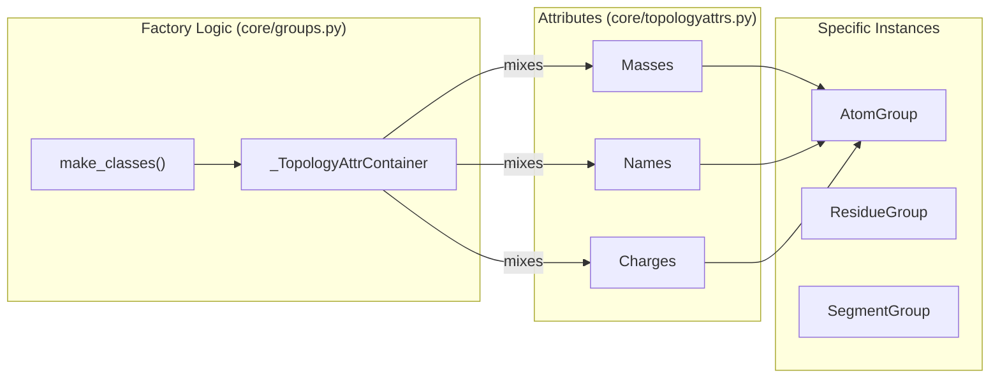
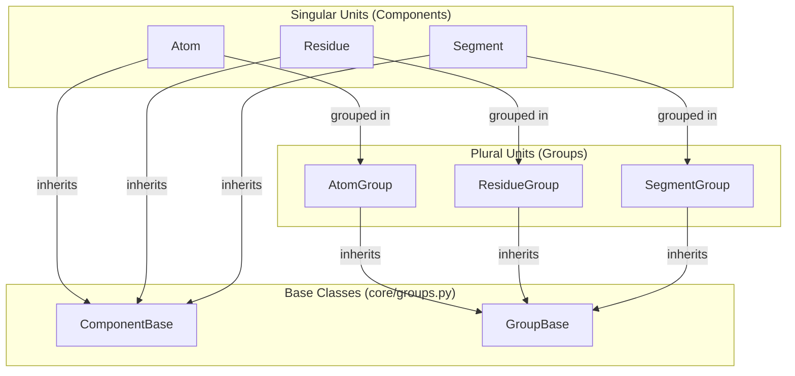

# Glossary

<details>
<summary>Relevant source files</summary>

The following files were used as context for generating this wiki page:

- [.git-blame-ignore-revs](.git-blame-ignore-revs)
- [package/AUTHORS](package/AUTHORS)
- [package/CHANGELOG](package/CHANGELOG)
- [package/MDAnalysis/__init__.py](package/MDAnalysis/__init__.py)
- [package/MDAnalysis/analysis/base.py](package/MDAnalysis/analysis/base.py)
- [package/MDAnalysis/analysis/gnm.py](package/MDAnalysis/analysis/gnm.py)
- [package/MDAnalysis/analysis/lineardensity.py](package/MDAnalysis/analysis/lineardensity.py)
- [package/MDAnalysis/analysis/polymer.py](package/MDAnalysis/analysis/polymer.py)
- [package/MDAnalysis/coordinates/DCD.py](package/MDAnalysis/coordinates/DCD.py)
- [package/MDAnalysis/coordinates/__init__.py](package/MDAnalysis/coordinates/__init__.py)
- [package/MDAnalysis/coordinates/base.py](package/MDAnalysis/coordinates/base.py)
- [package/MDAnalysis/core/groups.py](package/MDAnalysis/core/groups.py)
- [package/MDAnalysis/core/topology.py](package/MDAnalysis/core/topology.py)
- [package/MDAnalysis/core/topologyattrs.py](package/MDAnalysis/core/topologyattrs.py)
- [package/MDAnalysis/core/universe.py](package/MDAnalysis/core/universe.py)
- [package/MDAnalysis/due.py](package/MDAnalysis/due.py)
- [package/MDAnalysis/exceptions.py](package/MDAnalysis/exceptions.py)
- [package/MDAnalysis/lib/_distopia.py](package/MDAnalysis/lib/_distopia.py)
- [package/MDAnalysis/lib/distances.py](package/MDAnalysis/lib/distances.py)
- [package/MDAnalysis/lib/formats/include/endianswap.h](package/MDAnalysis/lib/formats/include/endianswap.h)
- [package/MDAnalysis/lib/formats/include/readdcd.h](package/MDAnalysis/lib/formats/include/readdcd.h)
- [package/MDAnalysis/lib/formats/libdcd.pxd](package/MDAnalysis/lib/formats/libdcd.pxd)
- [package/MDAnalysis/lib/formats/libdcd.pyx](package/MDAnalysis/lib/formats/libdcd.pyx)
- [package/MDAnalysis/lib/log.py](package/MDAnalysis/lib/log.py)
- [package/MDAnalysis/lib/mdamath.py](package/MDAnalysis/lib/mdamath.py)
- [package/MDAnalysis/lib/nsgrid.pyx](package/MDAnalysis/lib/nsgrid.pyx)
- [package/MDAnalysis/lib/util.py](package/MDAnalysis/lib/util.py)
- [package/MDAnalysis/topology/__init__.py](package/MDAnalysis/topology/__init__.py)
- [package/MDAnalysis/units.py](package/MDAnalysis/units.py)
- [package/MDAnalysis/version.py](package/MDAnalysis/version.py)
- [package/doc/sphinx/source/documentation_pages/coordinates_modules.rst](package/doc/sphinx/source/documentation_pages/coordinates_modules.rst)
- [package/doc/sphinx/source/documentation_pages/topology_modules.rst](package/doc/sphinx/source/documentation_pages/topology_modules.rst)
- [package/setup.py](package/setup.py)
- [testsuite/MDAnalysisTests/__init__.py](testsuite/MDAnalysisTests/__init__.py)
- [testsuite/MDAnalysisTests/analysis/test_base.py](testsuite/MDAnalysisTests/analysis/test_base.py)
- [testsuite/MDAnalysisTests/analysis/test_gnm.py](testsuite/MDAnalysisTests/analysis/test_gnm.py)
- [testsuite/MDAnalysisTests/analysis/test_lineardensity.py](testsuite/MDAnalysisTests/analysis/test_lineardensity.py)
- [testsuite/MDAnalysisTests/analysis/test_persistencelength.py](testsuite/MDAnalysisTests/analysis/test_persistencelength.py)
- [testsuite/MDAnalysisTests/coordinates/test_dcd.py](testsuite/MDAnalysisTests/coordinates/test_dcd.py)
- [testsuite/MDAnalysisTests/coordinates/test_reader_api.py](testsuite/MDAnalysisTests/coordinates/test_reader_api.py)
- [testsuite/MDAnalysisTests/core/test_atomgroup.py](testsuite/MDAnalysisTests/core/test_atomgroup.py)
- [testsuite/MDAnalysisTests/core/test_copying.py](testsuite/MDAnalysisTests/core/test_copying.py)
- [testsuite/MDAnalysisTests/core/test_groups.py](testsuite/MDAnalysisTests/core/test_groups.py)
- [testsuite/MDAnalysisTests/core/test_topology.py](testsuite/MDAnalysisTests/core/test_topology.py)
- [testsuite/MDAnalysisTests/core/test_topologyattrs.py](testsuite/MDAnalysisTests/core/test_topologyattrs.py)
- [testsuite/MDAnalysisTests/core/test_universe.py](testsuite/MDAnalysisTests/core/test_universe.py)
- [testsuite/MDAnalysisTests/data/legacy_DCD_c36_coords.npy](testsuite/MDAnalysisTests/data/legacy_DCD_c36_coords.npy)
- [testsuite/MDAnalysisTests/datafiles.py](testsuite/MDAnalysisTests/datafiles.py)
- [testsuite/MDAnalysisTests/formats/test_libdcd.py](testsuite/MDAnalysisTests/formats/test_libdcd.py)
- [testsuite/MDAnalysisTests/lib/test_distances.py](testsuite/MDAnalysisTests/lib/test_distances.py)
- [testsuite/MDAnalysisTests/lib/test_log.py](testsuite/MDAnalysisTests/lib/test_log.py)
- [testsuite/MDAnalysisTests/lib/test_nsgrid.py](testsuite/MDAnalysisTests/lib/test_nsgrid.py)
- [testsuite/MDAnalysisTests/lib/test_util.py](testsuite/MDAnalysisTests/lib/test_util.py)
- [testsuite/MDAnalysisTests/utils/test_authors.py](testsuite/MDAnalysisTests/utils/test_authors.py)
- [testsuite/MDAnalysisTests/utils/test_datafiles.py](testsuite/MDAnalysisTests/utils/test_datafiles.py)
- [testsuite/MDAnalysisTests/utils/test_failure.py](testsuite/MDAnalysisTests/utils/test_failure.py)
- [testsuite/MDAnalysisTests/utils/test_imports.py](testsuite/MDAnalysisTests/utils/test_imports.py)
- [testsuite/MDAnalysisTests/utils/test_log.py](testsuite/MDAnalysisTests/utils/test_log.py)
- [testsuite/MDAnalysisTests/utils/test_meta.py](testsuite/MDAnalysisTests/utils/test_meta.py)
- [testsuite/MDAnalysisTests/utils/test_modelling.py](testsuite/MDAnalysisTests/utils/test_modelling.py)
- [testsuite/MDAnalysisTests/utils/test_persistence.py](testsuite/MDAnalysisTests/utils/test_persistence.py)
- [testsuite/MDAnalysisTests/utils/test_qcprot.py](testsuite/MDAnalysisTests/utils/test_qcprot.py)
- [testsuite/MDAnalysisTests/utils/test_selections.py](testsuite/MDAnalysisTests/utils/test_selections.py)
- [testsuite/MDAnalysisTests/utils/test_transformations.py](testsuite/MDAnalysisTests/utils/test_transformations.py)
- [testsuite/MDAnalysisTests/utils/test_units.py](testsuite/MDAnalysisTests/utils/test_units.py)
- [testsuite/setup.py](testsuite/setup.py)

</details>


This glossary defines codebase-specific terms, jargon, and domain concepts used within MDAnalysis. It is intended to help onboarding engineers navigate the relationships between molecular dynamics concepts and their implementation in the code.

## Core Concepts

### Universe
The central object in MDAnalysis that ties a **Topology** (the static structure) to a **Trajectory** (the time-dependent coordinates) [package/MDAnalysis/core/universe.py:29-30](). It serves as the primary entry point for almost all analysis tasks [package/MDAnalysis/core/universe.py:30-31]().

### Topology
A static description of the molecular system, containing the number of atoms, residues, and segments, as well as their connectivity (bonds, angles, etc.) [package/MDAnalysis/core/topology.py:1-20](). It is represented by the `Topology` class [package/MDAnalysis/core/universe.py:94]().

### Timestep
A data structure representing a single snapshot in time of a simulation [package/MDAnalysis/coordinates/timestep.py:1-50](). It holds dynamic data such as positions, velocities, and forces for that specific frame [package/MDAnalysis/coordinates/base.py:99-100]().

### AtomGroup
A container for a set of atoms. It is the most important object for data manipulation, providing access to coordinates and topology attributes for the selected subset [package/MDAnalysis/core/groups.py:31-33]().

---

## Technical Jargon & Abbreviations

| Term | Definition | Code Pointer |
| :--- | :--- | :--- |
| **AG** | Abbreviation for `AtomGroup`. | [package/MDAnalysis/core/groups.py:49]() |
| **U** | Common variable name for a `Universe` instance. | [package/MDAnalysis/core/universe.py:47]() |
| **TS** | Abbreviation for `Timestep`. | [package/MDAnalysis/coordinates/timestep.py:1]() |
| **PBC** | Periodic Boundary Conditions. Used to simulate infinite systems by wrapping atoms back into a unit cell. | [package/MDAnalysis/lib/distances.py:134]() |
| **SIMD** | Single Instruction, Multiple Data. Hardware acceleration used in the `distopia` backend for fast distance calculations. | [package/MDAnalysis/lib/distances.py:51-53]() |
| **ISA** | Instruction Set Architecture. Relevant for hardware-specific optimizations in `distopia`. | [package/MDAnalysis/lib/distances.py:95-96]() |
| **NSGrid** | Neighbor Search Grid. A spatial partitioning data structure used to accelerate distance-based selections and analysis. | [package/MDAnalysis/lib/nsgrid.pyx:1-20]() |

**Sources:** [package/MDAnalysis/core/universe.py:29-31](), [package/MDAnalysis/core/groups.py:31-33](), [package/MDAnalysis/lib/distances.py:51-100](), [package/MDAnalysis/lib/nsgrid.pyx:1-20]().

---

## Domain Entity Mapping

The following diagram bridges the gap between high-level molecular biology concepts and the specific Python classes used to represent them in MDAnalysis.

### Entity Relationship Diagram
This diagram shows how the `Universe` orchestrates the relationship between static data (`Topology`) and dynamic data (`Reader`).

```mermaid
graph TD
    subgraph "Natural Language Space"
        ["Molecular System"]
        ["Static Structure"]
        ["Motion Data"]
    end

    subgraph "Code Entity Space"
        U["Universe (core/universe.py)"]
        Top["Topology (core/topology.py)"]
        Read["ReaderBase (coordinates/base.py)"]
        TS["Timestep (coordinates/timestep.py)"]
    end

    ["Molecular System"] --> U
    ["Static Structure"] --> Top
    ["Motion Data"] --> Read
    
    U -- "contains" --> Top
    U -- "manages" --> Read
    Read -- "yields" --> TS
    Top -- "defines" --> AG["AtomGroup (core/groups.py)"]
```
**Sources:** [package/MDAnalysis/core/universe.py:29-31](), [package/MDAnalysis/core/groups.py:49-57](), [package/MDAnalysis/coordinates/base.py:80-82]().

---

## Topology Attributes System

MDAnalysis uses a sophisticated class factory system to handle topology data (like masses, names, or charges).

### TopologyAttr
A class that manages a specific property for atoms, residues, or segments [package/MDAnalysis/core/topologyattrs.py:28-32]().
*   **Singular**: The name used to access the attribute on a single component (e.g., `atom.name`) [package/MDAnalysis/core/topologyattrs.py:196]().
*   **Attrname**: The name used to access the attribute on a group (e.g., `atomgroup.names`) [package/MDAnalysis/core/topologyattrs.py:199]().

### Class Factory Implementation
The `make_classes` function in `groups.py` dynamically creates `Universe`-specific versions of `AtomGroup`, `ResidueGroup`, etc., by mixing in the available `TopologyAttr` objects [package/MDAnalysis/core/groups.py:143-174]().


**Sources:** [package/MDAnalysis/core/groups.py:143-174](), [package/MDAnalysis/core/topologyattrs.py:28-32]().

---

## Implementation Details

### Backends
MDAnalysis supports multiple execution backends for performance-critical operations, particularly in `MDAnalysis.lib.distances` [package/MDAnalysis/lib/distances.py:35-41]().
*   **Serial**: Standard C/Cython implementation [package/MDAnalysis/lib/distances.py:47]().
*   **OpenMP**: Parallel implementation using multi-threading [package/MDAnalysis/lib/distances.py:49-50]().
*   **Distopia**: SIMD-accelerated library for extreme performance on supported ISAs [package/MDAnalysis/lib/distances.py:51-53]().

### IO System
*   **ReaderBase**: Base class for multi-frame trajectory readers [package/MDAnalysis/coordinates/base.py:80-82]().
*   **WriterBase**: Base class for writing coordinates to disk [package/MDAnalysis/coordinates/base.py:102-103]().
*   **NamedStream**: A wrapper that allows memory buffers (like `io.StringIO`) to be treated as files by the `Universe` [package/MDAnalysis/lib/util.py:75-79]().

### Selection Language
A Domain Specific Language (DSL) used to filter atoms. It is parsed in `MDAnalysis.core.selection` [package/MDAnalysis/core/groups.py:121](). Common keywords include `resname`, `resid`, `name`, and geometric operators like `around` [package/MDAnalysis/core/topologyattrs.py:72]().

### Data Structure Hierarchy
The relationship between chemical units and their group containers follows a singular/plural pattern managed by the `make_classes` factory.



**Sources:** [package/MDAnalysis/lib/distances.py:42-54](), [package/MDAnalysis/coordinates/base.py:80-103](), [package/MDAnalysis/lib/util.py:75-79](), [package/MDAnalysis/core/groups.py:143-174]().