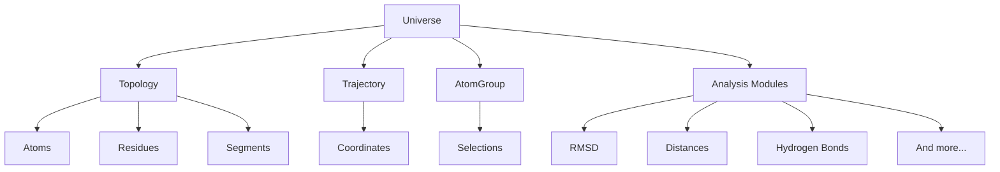

MDAnalysis is a powerful Python library designed for the analysis of molecular dynamics simulations, serving as an essential toolkit for scientists working with molecular-scale systems. From drug-protein interactions to novel materials research, MDAnalysis provides a comprehensive framework that bridges the gap between complex simulation data and meaningful scientific insights.

## What is MDAnalysis?

At its core, MDAnalysis is a **Python library** that enables researchers to read, analyze, and manipulate molecular dynamics trajectories generated by popular simulation packages including GROMACS, Amber, NAMD, CHARMM, LAMMPS, and many others. The library is developed by scientists for scientists, making it particularly attuned to the real-world needs of researchers in computational chemistry, biophysics, and materials science.

The library's architecture is built around a central concept: the **Universe**. A Universe represents a complete molecular system, combining both the topology (the static description of atoms, bonds, and molecular structure) and the trajectory (the time evolution of atomic positions). This unified approach allows users to seamlessly navigate through simulation data while maintaining the structural context of their molecular systems.

Sources: [README.rst#L1-L10](README.rst#L1-L10), [__init__.py#L15-L25](package/MDAnalysis/__init__.py#L15-L25)

## Core Architecture

MDAnalysis follows a modular design that separates concerns while maintaining an intuitive interface for users. The architecture can be visualized as follows:



The **Universe** serves as the central hub that connects all components. When you create a Universe, you're essentially building a complete representation of your molecular system that includes:

- **Topology information**: The static structure of your system (atoms, residues, bonds, etc.)
- **Trajectory data**: The time-series of atomic coordinates from your simulation
- **Selection capabilities**: Powerful tools to select subsets of atoms based on various criteria
- **Analysis framework**: A rich set of tools for computing structural and dynamic properties

Sources: [universe.py#L15-L30](package/MDAnalysis/core/universe.py#L15-L30), [__init__.py#L60-L80](package/MDAnalysis/__init__.py#L60-L80)

## Key Features

MDAnalysis stands out for its comprehensive feature set designed to address the full workflow of molecular dynamics analysis:

### 1. **Multi-format Support**
The library supports an extensive range of file formats, making it compatible with virtually all major molecular dynamics simulation packages. This includes support for trajectory formats (DCD, XTC, TRR, and more) and topology formats (PSF, PDB, GRO, TOP, and others).

### 2. **Powerful Atom Selection**
MDAnalysis implements a sophisticated selection language inspired by CHARMM, allowing users to select atoms based on complex criteria. You can select atoms by name, residue, properties, or spatial relationships, enabling precise targeting of specific molecular features.

### 3. **NumPy Integration**
Atomic data is exposed as NumPy arrays, providing seamless integration with Python's scientific computing ecosystem. This design choice enables fast computations and easy data manipulation using familiar NumPy operations.

### 4. **Extensive Analysis Library**
The library includes a comprehensive collection of analysis algorithms covering:
- Structural analysis (RMSD, RMSF, PCA)
- Distance and contact analysis
- Hydrogen bonding analysis
- Density calculations
- Polymer and nucleic acid analysis
- And many more specialized analyses

### 5. **Performance Optimization**
Time-critical operations are implemented in C for speed, ensuring that the library can handle large molecular systems and long trajectories efficiently.

Sources: [README.rst#L10-L15](README.rst#L10-L15), [analysis/](package/MDAnalysis/analysis/)

## Getting Started: A Simple Example

To demonstrate how MDAnalysis works in practice, let's look at a typical workflow. The following example shows how to load a simulation, select atoms, and perform a basic analysis:

```python
import MDAnalysis as mda

# Load simulation results with a single line
u = mda.Universe('topol.tpr', 'traj.trr')

# Select atoms (e.g., all oxygen and hydrogen atoms in water)
water = u.select_atoms('resname SOL and (name OW or name HW1 or name HW2)')

# Access atomic data as NumPy arrays
positions = water.positions
velocities = water.velocities

# Calculate the center of mass for each frame
com_trajectory = []
for ts in u.trajectory:
    com = water.center_of_mass()
    com_trajectory.append(com)
```

This simple example illustrates the core workflow: **load → select → analyze**. The Universe object provides access to all atoms in the system, the selection language allows you to focus on specific parts of interest, and the trajectory iteration enables time-series analysis.

> [!TIP]
> The power of MDAnalysis lies in its ability to handle complex molecular systems while maintaining a simple, intuitive interface. Even though the underlying computations can be complex, the user-facing API remains clean and accessible.

Sources: [README.rst#L30-L45](README.rst#L30-L45), [__init__.py#L60-L90](package/MDAnalysis/__init__.py#L60-L90)

## Who Uses MDAnalysis?

MDAnalysis has been adopted by a diverse scientific community working on various types of molecular systems:

- **Structural biologists** studying protein dynamics and conformational changes
- **Drug discovery researchers** analyzing protein-ligand interactions
- **Materials scientists** investigating polymers, nanomaterials, and soft matter
- **Biophysicists** exploring membrane dynamics and protein folding
- **Computational chemists** developing and validating force fields

The library's flexibility and comprehensive feature set make it suitable for both routine analysis tasks and cutting-edge research applications.

## Community and Support

MDAnalysis is more than just a software library—it's a vibrant scientific project with:

- **Open governance model**: The project follows transparent governance practices
- **Active development**: Regular updates and new features from a dedicated development team
- **Comprehensive documentation**: Detailed user guides, tutorials, and API documentation
- **Community support**: GitHub Discussions for questions and community interaction
- **Academic recognition**: Well-cited in scientific literature with proper attribution guidelines

The project is fiscally sponsored by NumFOCUS, a nonprofit organization supporting open-source scientific computing, ensuring its long-term sustainability and development.

Sources: [README.rst#L20-L30](README.rst#L20-L30), [README.rst#L50-L60](README.rst#L50-L60)

## Next Steps

This overview provides a glimpse into MDAnalysis's capabilities. To dive deeper, we recommend:

1. **Installation**: Follow the Installation Guide to set up MDAnalysis on your system
2. **Quick Start**: Try the Basic Usage Tutorial for hands-on experience
3. **Trajectory Analysis**: Explore specific analysis workflows in the Trajectory Analysis section
4. **Community Engagement**: Join the GitHub Discussions to connect with other users

MDAnalysis bridges the gap between complex molecular simulation data and meaningful scientific insights, making it an indispensable tool for researchers in computational molecular sciences.