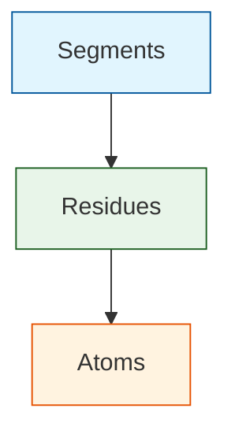

In MDAnalysis, the data models and topology system form the foundation of how molecular structures are represented and manipulated. Understanding this hierarchy is essential for effectively working with molecular dynamics simulations and performing complex analyses.

## The Hierarchical Topology Model

MDAnalysis organizes molecular structures in a three-level hierarchy: **Atoms** → **Residues** → **Segments**. This hierarchical approach mirrors how we naturally think about molecular systems - individual atoms group together to form residues (like amino acids), and residues group together to form segments (like protein chains or molecules).



This hierarchy is managed by the core `Topology` class, which serves as an in-memory, array-based topology database that maintains the relationships between these levels. `Sources: [package/MDAnalysis/core/topology.py#L451-L460](package/MDAnalysis/core/topology.py#L451-L460)`

## The Core Topology Class

The `Topology` class is the central data model that coordinates all topology information. It uses a `TransTable` internally to efficiently manage the mappings between atoms, residues, and segments:

```python
# Creating a basic topology
from MDAnalysis.core.topology import Topology

# Create a topology with 10 atoms, 3 residues, and 1 segment
top = Topology(n_atoms=10, n_res=3, n_seg=1)
```

The `Topology` class provides several key properties and methods:

- `n_atoms`, `n_residues`, `n_segments`: Get the count of each level
- `add_TopologyAttr()`: Add new topology attributes (like masses, charges, etc.)
- `copy()`: Create a deep copy of the topology

`Sources: [package/MDAnalysis/core/topology.py#L462-L540](package/MDAnalysis/core/topology.py#L462-L540)`

## TransTable: Managing Hierarchical Relationships

The `TransTable` class is the workhorse that handles the complex mappings between hierarchy levels. It maintains bidirectional relationships:

- **Upward mappings**: atom → residue, residue → segment
- **Downward mappings**: residue → atoms, segment → residues

```python
# Example of TransTable usage
from MDAnalysis.core.topology import TransTable

# Create translation table for 5 atoms in 2 residues
tt = TransTable(n_atoms=5, n_residues=2, n_segments=1)

# Get residue indices for atoms 0, 1, 2
residue_indices = tt.atoms2residues([0, 1, 2])

# Get all atoms in residue 0
atom_indices = tt.residues2atoms_1d([0])
```

The `TransTable` uses efficient NumPy arrays and lazy evaluation to provide fast lookups while minimizing memory usage. `Sources: [package/MDAnalysis/core/topology.py#L140-L149](package/MDAnalysis/core/topology.py#L140-L149)`

## Topology Objects: Atoms, Residues, and Segments

While the `Topology` class manages the overall structure, individual components are represented by topology objects. These objects inherit from the base `TopologyObject` class and provide specific functionality for each level of the hierarchy.

### Bonds and Interactions

MDAnalysis represents molecular interactions through specialized topology objects:

```python
# Bond example
from MDAnalysis.core.topologyobjects import Bond

# Create a bond between atoms 0 and 1
bond = Bond(np.array([0, 1]), universe)

# Get bond length
length = bond.length(pbc=True)

# Get the partner atom
partner = bond.partner(atom)
```

The `Bond` class and its relatives (`Angle`, `Dihedral`, etc.) provide methods for:
- Geometric calculations (lengths, angles)
- Partner atom lookup
- Type and order information

`Sources: [package/MDAnalysis/core/topologyobjects.py#L156-L200](package/MDAnalysis/core/topologyobjects.py#L156-L200)`

### Topology Groups

For handling collections of topology objects, MDAnalysis provides `TopologyGroup`. This container class efficiently manages groups of bonds, angles, or other interactions:

```python
from MDAnalysis.core.topologyobjects import TopologyGroup

# Create a group of bonds
bond_group = TopologyGroup(bond_indices, universe, btype='bond')

# Select bonds by type
specific_bonds = bond_group.select_bonds([('C', 'N')])

# Get bonds intersecting with an atom group
subset_bonds = bond_group.atomgroup_intersection(atom_group)
```

`TopologyGroup` supports slicing, boolean indexing, and efficient operations on large collections of topology objects. `Sources: [package/MDAnalysis/core/topologyobjects.py#L537-L591](package/MDAnalysis/core/topologyobjects.py#L537-L591)`

## Topology Attributes

The topology system is extensible through topology attributes. These attributes store additional information about atoms, residues, or segments, such as:

- Atomic masses and charges
- Residue names and IDs
- Segment IDs
- Custom user-defined properties

```python
# Adding custom attributes to a topology
from MDAnalysis.core.topologyattrs import Masses, Charges

top.add_TopologyAttr(Masses([12.0, 14.0, 16.0]))  # Add masses
top.add_TopologyAttr(Charges([0.0, 0.5, -0.5]))   # Add charges
```

Attributes are stored efficiently and can be accessed through the topology object or through the higher-level Universe interface. `Sources: [package/MDAnalysis/core/topology.py#L530-L540](package/MDAnalysis/core/topology.py#L530-L540)`

> [!TIP]
> The topology system in MDAnalysis is designed for both performance and flexibility. When working with large systems, the array-based storage and lazy evaluation ensure efficient memory usage while providing fast access to hierarchical relationships.

## Practical Example: Building a Custom Topology

Let's put these concepts together by creating a simple water molecule topology:

```python
import numpy as np
from MDAnalysis.core.topology import Topology
from MDAnalysis.core.topologyattrs import Masses, Charges

# Create topology for 3 atoms (H2O)
top = Topology(n_atoms=3, n_res=1, n_seg=1)

# Add atomic properties
top.add_TopologyAttr(Masses([16.0, 1.0, 1.0]))     # O, H, H masses
top.add_TopologyAttr(Charges([-0.8, 0.4, 0.4]))   # O, H, H charges

# Access topology information
print(f"Number of atoms: {top.n_atoms}")
print(f"Number of residues: {top.n_residues}")
print(f"Atomic masses: {top.masses}")
print(f"Atomic charges: {top.charges}")
```

This example demonstrates how the topology system integrates atomic properties within the hierarchical structure, providing a complete representation of molecular topology.

`Sources: [package/MDAnalysis/core/topology.py#L462-L504](package/MDAnalysis/core/topology.py#L462-L504)`

## Performance Considerations

The topology system is optimized for performance in several ways:

1. **Array-based storage**: Uses NumPy arrays for efficient memory usage and fast operations
2. **Lazy evaluation**: Downward mappings (residue→atoms, segment→residues) are computed only when needed
3. **Cached properties**: Frequently accessed values are cached to avoid recomputation
4. **Efficient indexing**: The TransTable provides O(1) complexity for upward mappings

When working with very large systems, these optimizations ensure that topology operations remain efficient even for millions of atoms.

`Sources: [package/MDAnalysis/core/topology.py#L68-L137](package/MDAnalysis/core/topology.py#L68-L137)`

## Extending the Topology System

The topology system is designed to be extensible. You can:

1. **Create custom topology attributes** by subclassing `TopologyAttr`
2. **Define new topology objects** for specialized molecular features
3. **Add custom interaction types** by extending the bond/angle/dihedral hierarchy
4. **Implement custom parsers** to support new file formats

This extensibility makes MDAnalysis adaptable to a wide range of molecular simulation scenarios and research needs.

`Sources: [package/MDAnalysis/core/topology.py#L24-L33](package/MDAnalysis/core/topology.py#L24-L33)`