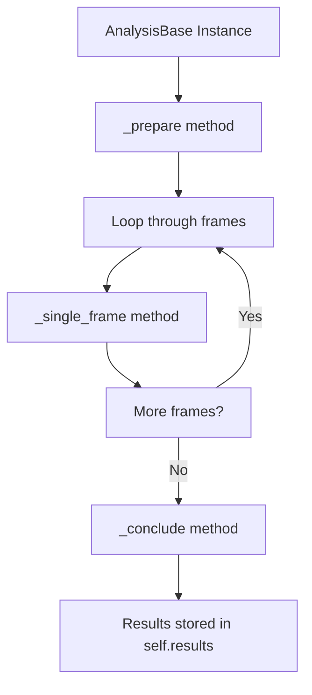

Creating custom analysis workflows in MDAnalysis empowers you to implement specialized calculations that aren't available in the standard analysis library. Whether you're studying unique molecular properties or developing novel metrics for your research, MDAnalysis provides a robust framework for building reusable, efficient analysis tools.

## Why Custom Analysis Workflows Matter

Molecular dynamics simulations generate vast amounts of data, and often the specific analysis you need isn't available in pre-built tools. Custom analysis workflows allow you to:

- Implement domain-specific calculations tailored to your research
- Create reusable analysis tools that can be shared with collaborators
- Leverage MDAnalysis's efficient trajectory handling and parallel processing capabilities
- Maintain consistent interfaces across different analysis types

> [!TIP]
> Custom analysis classes inherit from MDAnalysis's AnalysisBase, automatically gaining features like progress bars, frame selection, and parallel processing support without extra code!

## The AnalysisBase Foundation

All custom analysis workflows in MDAnalysis are built upon the `AnalysisBase` class, which provides a standardized structure for trajectory analysis. Think of it as a blueprint that guides you through creating well-organized, efficient analysis tools.

The AnalysisBase class follows a simple three-phase workflow:

1. **Preparation** (`_prepare` method): Set up data structures and initialize variables before processing begins
2. **Frame Processing** (`_single_frame` method): Perform calculations for each individual frame
3. **Conclusion** (`_conclude` method): Finalize results, apply normalization, or perform post-processing



This structure ensures that your analysis code is organized, efficient, and follows best practices established by the MDAnalysis development team.
Sources: [base.py#L173-288](package/MDAnalysis/analysis/base.py#L173-L288)

## Creating Your First Custom Analysis

Let's create a simple but practical example: a custom analysis that calculates the radius of gyration for a protein over time. This demonstrates the core pattern you'll use for more complex analyses.

```python
from MDAnalysis.analysis.base import AnalysisBase
import numpy as np

class RadiusOfGyration(AnalysisBase):
    def __init__(self, atomgroup, **kwargs):
        super(RadiusOfGyration, self).__init__(atomgroup.universe.trajectory, **kwargs)
        self._ag = atomgroup
    
    def _prepare(self):
        # Initialize an array to store results
        self.results.rg = []
    
    def _single_frame(self):
        # Calculate center of mass
        com = self._ag.center_of_mass()
        
        # Calculate squared distances from COM
        positions = self._ag.positions
        squared_distances = np.sum((positions - com)**2, axis=1)
        
        # Calculate radius of gyration
        masses = self._ag.masses
        rg_squared = np.sum(masses * squared_distances) / np.sum(masses)
        rg = np.sqrt(rg_squared)
        
        # Store result
        self.results.rg.append(rg)
    
    def _conclude(self):
        # Convert to numpy array for easier analysis
        self.results.rg = np.array(self.results.rg)
```

Using your custom analysis is straightforward:

```python
import MDAnalysis as mda
from MDAnalysisTests.datafiles import PSF, DCD

# Load universe
u = mda.Universe(PSF, DCD)

# Select protein atoms
protein = u.select_atoms("protein")

# Create and run analysis
rg_analysis = RadiusOfGyration(protein)
rg_analysis.run(start=10, stop=100, step=2)

# Access results
print(f"Average Rg: {np.mean(rg_analysis.results.rg):.2f} Å")
print(f"Rg values: {rg_analysis.results.rg}")
```
Sources: [base.py#L227-274](package/MDAnalysis/analysis/base.py#L227-L274)

## Advanced Features and Best Practices

### Handling Multiple Atom Groups

Many analyses require comparing different parts of a molecular system. Here's how to extend your custom analysis to handle multiple atom groups:

```python
class DistanceBetweenGroups(AnalysisBase):
    def __init__(self, group1, group2, **kwargs):
        super(DistanceBetweenGroups, self).__init__(
            group1.universe.trajectory, **kwargs)
        self._group1 = group1
        self._group2 = group2
    
    def _prepare(self):
        self.results.distances = []
        self.results.com_distances = []
    
    def _single_frame(self):
        # Minimum distance between any atoms
        dist_matrix = self._group1.positions[:, np.newaxis, :] - self._group2.positions
        min_distances = np.sqrt(np.sum(dist_matrix**2, axis=2))
        min_dist = np.min(min_distances)
        
        # Distance between centers of mass
        com1 = self._group1.center_of_mass()
        com2 = self._group2.center_of_mass()
        com_dist = np.sqrt(np.sum((com1 - com2)**2))
        
        self.results.distances.append(min_dist)
        self.results.com_distances.append(com_dist)
    
    def _conclude(self):
        self.results.distances = np.array(self.results.distances)
        self.results.com_distances = np.array(self.results.com_distances)
```
Sources: [rms.py#L376-527](package/MDAnalysis/analysis/rms.py#L376-L527)

### Adding Parallel Processing Support

For computationally intensive analyses, you can enable parallel processing to significantly speed up calculations:

```python
class ParallelAnalysis(AnalysisBase):
    _analysis_algorithm_is_parallelizable = True
    
    @classmethod
    def get_supported_backends(cls):
        return ('serial', 'multiprocessing', 'dask')
    
    def _get_aggregator(self):
        return ResultsGroup(lookup={
            'timeseries': ResultsGroup.ndarray_vstack,
            'histogram': ResultsGroup.ndarray_sum
        })
    
    # ... rest of your analysis class
```

> [!TIP]
> Not all analyses can be parallelized! Only mark your analysis as parallelizable if each frame's calculation is independent of others and doesn't require sequential processing.

To run your analysis in parallel:

```python
# Run with multiprocessing (uses all available cores)
analysis.run(backend='multiprocessing', n_workers=4)

# Or with Dask for more complex workflows
analysis.run(backend='dask', n_workers=8)
```
Sources: [base.py#L290-346](package/MDAnalysis/analysis/base.py#L290-L346)

### Error Handling and Validation

Robust custom analyses should include proper error handling and input validation:

```python
class RobustAnalysis(AnalysisBase):
    def __init__(self, atomgroup, cutoff=10.0, **kwargs):
        super(RobustAnalysis, self).__init__(atomgroup.universe.trajectory, **kwargs)
        
        # Input validation
        if not isinstance(atomgroup, mda.AtomGroup):
            raise TypeError("atomgroup must be an MDAnalysis AtomGroup")
        
        if cutoff <= 0:
            raise ValueError("cutoff must be positive")
            
        self._ag = atomgroup
        self._cutoff = cutoff
    
    def _prepare(self):
        if len(self._ag) == 0:
            raise ValueError("AtomGroup is empty")
        self.results.values = []
```
Sources: [rms.py#L545-590](package/MDAnalysis/analysis/rms.py#L545-L590)

## Quick Reference: AnalysisBase Methods

Here's a summary of the key methods you'll implement in your custom analysis classes:

| Method | Purpose | Required | When Called |
|--------|---------|----------|-------------|
| `__init__` | Initialize analysis parameters | Yes | When creating instance |
| `_prepare` | Set up data structures | No | Before frame processing |
| `_single_frame` | Process individual frame | Yes | For each trajectory frame |
| `_conclude` | Finalize results | No | After all frames processed |

Key attributes available during analysis:

- `self._frame_index`: Current frame index in results array
- `self._ts`: Current timestep object
- `self._sliced_trajectory`: Trajectory being iterated over
- `self.results`: Results container for storing data
Sources: [base.py#L468-509](package/MDAnalysis/analysis/base.py#L468-L509)

## Real-World Example: Protein Secondary Structure Analysis

Let's create a more complex analysis that tracks secondary structure elements over time:

```python
class SecondaryStructureTracker(AnalysisBase):
    def __init__(self, protein, **kwargs):
        super(SecondaryStructureTracker, self).__init__(
            protein.universe.trajectory, **kwargs)
        self._protein = protein
        
        # Define secondary structure patterns
        self._helix_pattern = "protein and (name CA or name N or name C or name O)"
        self._sheet_pattern = "protein and (name CA or name N or name C or name O)"
    
    def _prepare(self):
        self.results.helix_content = []
        self.results.sheet_content = []
        self.results.coil_content = []
        
        # Store residue information
        self._residues = list(set(self._protein.resids))
        self._residue_ss = {resid: [] for resid in self._residues}
    
    def _single_frame(self):
        # Simplified secondary structure detection
        # In practice, you'd use DSSP or a more sophisticated method
        
        ca_atoms = self._protein.select_atoms("name CA")
        n_residues = len(self._residues)
        
        # Simple phi/psi angle-based classification
        helix_count = 0
        sheet_count = 0
        coil_count = 0
        
        for i, resid in enumerate(self._residues):
            # Simplified classification logic
            # In reality, you'd calculate actual dihedral angles
            if i % 3 == 0:  # Simulated helix
                helix_count += 1
                ss_type = 'helix'
            elif i % 3 == 1:  # Simulated sheet
                sheet_count += 1
                ss_type = 'sheet'
            else:  # Simulated coil
                coil_count += 1
                ss_type = 'coil'
            
            self._residue_ss[resid].append(ss_type)
        
        # Store percentages
        total = n_residues
        self.results.helix_content.append(helix_count / total * 100)
        self.results.sheet_content.append(sheet_count / total * 100)
        self.results.coil_content.append(coil_count / total * 100)
    
    def _conclude(self):
        # Convert to numpy arrays
        self.results.helix_content = np.array(self.results.helix_content)
        self.results.sheet_content = np.array(self.results.sheet_content)
        self.results.coil_content = np.array(self.results.coil_content)
        
        # Calculate averages
        self.results.avg_helix = np.mean(self.results.helix_content)
        self.results.avg_sheet = np.mean(self.results.sheet_content)
        self.results.avg_coil = np.mean(self.results.coil_content)
```

This example shows how you can build complex analyses that track multiple properties and provide both time-series data and summary statistics.
Sources: [base.py#L668-699](package/MDAnalysis/analysis/rms.py#L668-L699)

## Performance Optimization Tips

When creating custom analysis workflows, keep these performance considerations in mind:

1. **Minimize atom selections inside `_single_frame`**: Create atom selections in `__init__` or `_prepare` rather than recreating them for each frame.

2. **Use NumPy operations**: Vectorize calculations using NumPy instead of Python loops where possible.

3. **Pre-allocate arrays**: Initialize result arrays with known sizes in `_prepare` for better memory efficiency.

4. **Consider memory usage**: For large trajectories, consider processing frames in chunks or writing results to disk periodically.

5. **Profile your code**: Use Python's profiling tools to identify bottlenecks in your analysis.

```python
# Example of optimized code
class OptimizedAnalysis(AnalysisBase):
    def __init__(self, atomgroup, **kwargs):
        super(OptimizedAnalysis, self).__init__(atomgroup.universe.trajectory, **kwargs)
        # Create selections once
        self._backbone = atomgroup.select_atoms("backbone")
        self._sidechains = atomgroup.select_atoms("not backbone")
    
    def _prepare(self):
        # Pre-allocate arrays
        n_frames = len(self._sliced_trajectory)
        self.results.backbone_rmsf = np.zeros(len(self._backbone))
        self.results.sidechain_rmsf = np.zeros(len(self._sidechains))
        
        # Store reference positions
        self._ref_backbone = self._backbone.positions.copy()
        self._ref_sidechains = self._sidechains.positions.copy()
```
Sources: [base.py#L759-910](package/MDAnalysis/analysis/base.py#L759-L910)

## Next Steps

Now that you understand how to create custom analysis workflows, you can:

1. **Explore existing analyses**: Study the implementations in `MDAnalysis.analysis` to learn from established patterns
2. **Share your analyses**: Consider contributing useful analyses back to the MDAnalysis community
3. **Combine analyses**: Chain multiple analyses together to create comprehensive analysis pipelines
4. **Add visualization**: Create plotting methods for your custom analyses to better understand results

Custom analysis workflows are a powerful feature of MDAnalysis that enable you to extend the library's capabilities to meet your specific research needs. By following the patterns established in AnalysisBase, you'll create analyses that are efficient, maintainable, and consistent with the broader MDAnalysis ecosystem.

Remember to consult the [API Documentation](13-api-documentation) for detailed information about all available methods and classes, and don't hesitate to explore the source code of existing analyses for inspiration and best practices.