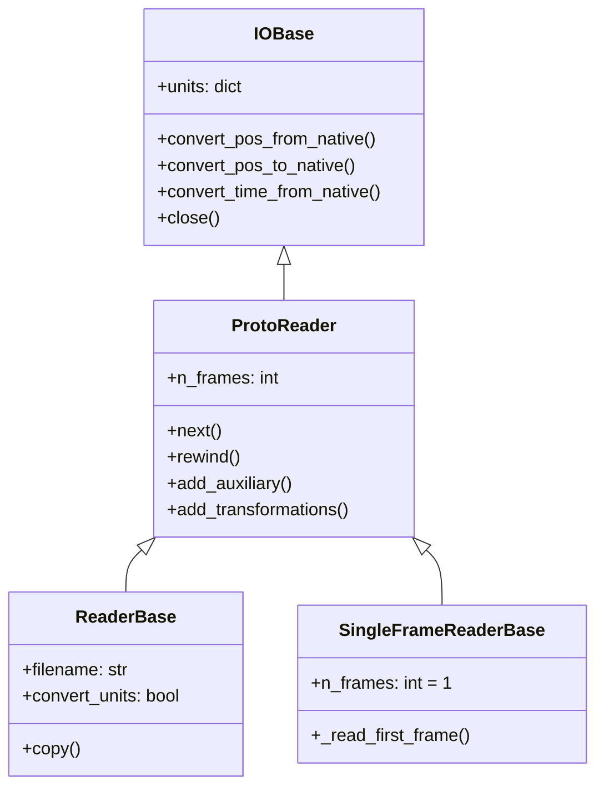

MDAnalysis provides comprehensive support for reading and writing a wide variety of molecular dynamics file formats. The library's architecture is designed to make it easy to work with different coordinate/trajectory files, topology files, and auxiliary data formats while maintaining a consistent interface.

## Architecture Overview

The file format support in MDAnalysis is built around a well-designed class hierarchy that separates concerns and provides a consistent API for all supported formats. The core architecture consists of several key components:

- **ReaderBase** - The base class for all trajectory readers that extends ProtoReader with proper resource management
- **ProtoReader** - A lightweight base class for Readers without a `__del__` method, providing most of the core functionality
- **IOBase** - Bundles common functionality for trajectory I/O, including unit conversions
- **SingleFrameReaderBase** - Specialized base class for formats that only contain a single frame

The system uses a metaclass-based registration system where new readers are automatically registered when their classes are created, making the format system extensible and dynamic.
Sources: [package/MDAnalysis/coordinates/base.py#L1449-1476](package/MDAnalysis/coordinates/base.py#L1449-1476), [package/MDAnalysis/coordinates/base.py#L640-665](package/MDAnalysis/coordinates/base.py#L640-665), [package/MDAnalysis/coordinates/base.py#L348-357](package/MDAnalysis/coordinates/base.py#L348-357)

## Coordinate/Trajectory Formats

MDAnalysis supports over 40 different coordinate and trajectory file formats, covering the most widely used formats in molecular dynamics simulations. The coordinate readers are located in the `package/MDAnalysis/coordinates/` directory, with each format implemented as a separate module.

### Popular Supported Formats

| Format | Description | Reader Class |
|--------|-------------|--------------|
| DCD | CHARMM/NAMD trajectory | DCDReader |
| XTC | GROMACS compressed trajectory | XTCReader |
| TRR | GROMACS full precision trajectory | TRRReader |
| PDB | Protein Data Bank format | PDBReader |
| GRO | GROMACS structure format | GROReader |
| LAMMPS | LAMMPS dump format | LAMMPSReader |
| XYZ | Generic coordinate format | XYZReader |
| H5MD | HDF5-based molecular dynamics | H5MDReader |

Each coordinate reader implements the standard trajectory API, providing methods like `next()`, `rewind()`, and frame indexing via `[]`. The readers also handle unit conversions automatically, ensuring data is always available in MDAnalysis's standard units (Å for length, ps for time).
Sources: [package/MDAnalysis/coordinates/__init__.py](package/MDAnalysis/coordinates/__init__.py), [package/MDAnalysis/coordinates/base.py#L700-720](package/MDAnalysis/coordinates/base.py#L700-720)

### Example: Reading a Trajectory

```python
import MDAnalysis as mda

# Load a GROMACS trajectory
u = mda.Universe("topology.pdb", "trajectory.xtc")

# Access frames
print(f"Number of frames: {len(u.trajectory)}")
print(f"Time step: {u.trajectory.dt} ps")

# Iterate through frames
for ts in u.trajectory:
    print(f"Frame {ts.frame}: time = {ts.time} ps")
    # ts.positions contains coordinates for all atoms
```

The readers provide efficient access to trajectory data with features like frame slicing, auxiliary data support, and on-the-fly transformations.
Sources: [package/MDAnalysis/coordinates/base.py#L680-682](package/MDAnalysis/coordinates/base.py#L680-682), [package/MDAnalysis/coordinates/base.py#L725-757](package/MDAnalysis/coordinates/base.py#L725-757)

## Topology Formats

Topology files contain information about the molecular system structure, including atoms, residues, bonds, and other structural information. MDAnalysis supports numerous topology formats through parsers in the `package/MDAnalysis/topology/` directory.

### Supported Topology Formats

| Format | Description | Parser Class |
|--------|-------------|--------------|
| PSF | CHARMM/NAMD topology | PSFParser |
| PDB | Protein Data Bank (with connectivity) | PDBParser |
| GRO | GROMACS structure | GROParser |
| TOP | GROMACS topology | TOPParser |
| ITP | GROMACS include topology | ITPParser |
| MOL2 | Tripos Sybyl format | MOL2Parser |
| TPR | GROMACS run input file | TPRParser |

The topology parsers create a consistent internal representation of the molecular system, making it easy to work with different formats interchangeably.
Sources: [package/MDAnalysis/topology/__init__.py](package/MDAnalysis/topology/__init__.py), [package/MDAnalysis/topology/base.py](package/MDAnalysis/topology/base.py)

## Unit Conversion System

One of the key features of MDAnalysis's file format support is its robust unit conversion system. Different simulation packages use different units, and MDAnalysis handles these conversions automatically and transparently.

The `IOBase` class provides methods for converting between native format units and MDAnalysis's base units:

- `convert_pos_from_native()` and `convert_pos_to_native()` for length units
- `convert_velocities_from_native()` and `convert_velocities_to_native()` for velocity units  
- `convert_time_from_native()` and `convert_time_to_native()` for time units
- `convert_forces_from_native()` and `convert_forces_to_native()` for force units

This ensures that regardless of the input format, all data is available in consistent units within MDAnalysis.
Sources: [package/MDAnalysis/coordinates/base.py#L359-390](package/MDAnalysis/coordinates/base.py#L359-390), [package/MDAnalysis/coordinates/base.py#L515-541](package/MDAnalysis/coordinates/base.py#L515-541)

> [!TIP]
> The unit conversion system works automatically in the background, so you don't need to worry about the original units used in your files. All coordinates will be in Angstroms, times in picoseconds, and velocities in Angstroms/picosecond by default.

## Auxiliary Data Support

MDAnalysis can read auxiliary data alongside trajectory coordinates, such as temperature, pressure, or energy values stored in separate files. This is handled through the auxiliary data system.

```python
# Add auxiliary data to a trajectory
u.trajectory.add_auxiliary("temperature", "temperature.xvg")

# Access auxiliary data
for ts in u.trajectory:
    print(f"Frame {ts.frame}: T = {ts.aux.temperature} K")
```

The auxiliary data system supports various formats and automatically synchronizes the auxiliary data with the trajectory frames.
Sources: [package/MDAnalysis/coordinates/base.py#L1080-1100](package/MDAnalysis/coordinates/base.py#L1080-1100), [package/MDAnalysis/auxiliary/__init__.py](package/MDAnalysis/auxiliary/__init__.py)

## Format Detection and Registration

MDAnalysis uses an automatic format detection system that identifies file types based on file extensions and content. The `_Readermeta` metaclass automatically registers new reader classes when they are defined, making the system easily extensible.



This architecture allows new formats to be added by simply creating a new reader class that inherits from the appropriate base class and defines the required methods.
Sources: [package/MDAnalysis/coordinates/base.py#L617-638](package/MDAnalysis/coordinates/base.py#L617-638), [package/MDAnalysis/coordinates/base.py#L1449-1476](package/MDAnalysis/coordinates/base.py#L1449-1476)

## Writing Trajectories

MDAnalysis also supports writing trajectories in various formats. Each reader can provide an appropriate writer through the `Writer()` method, or you can use the generic `Writer()` function to create a writer for a specific format.

```python
import MDAnalysis as mda

# Read a trajectory
u = mda.Universe("topology.pdb", "input.xtc")

# Write in a different format
with mda.Writer("output.dcd", u.atoms.n_atoms) as w:
    for ts in u.trajectory:
        w.write(u.atoms)
```

The writers maintain consistency with the readers, ensuring that data written in one format can be read back correctly.
Sources: [package/MDAnalysis/coordinates/base.py#L764-789](package/MDAnalysis/coordinates/base.py#L764-789)

## Extending Format Support

Adding support for new file formats is straightforward in MDAnalysis. To add a new coordinate format:

1. Create a new module in the `coordinates/` directory
2. Implement a reader class that inherits from `ReaderBase` or `ProtoReader`
3. Define the required methods: `_read_next_timestep()`, `_reopen()`, and `close()`
4. Set the `format` class attribute to register the format

The system will automatically detect and register the new format, making it immediately available to users.
Sources: [package/MDAnalysis/coordinates/base.py#L624-633](package/MDAnalysis/coordinates/base.py#L624-633), [package/MDAnalysis/coordinates/base.py#L791-798](package/MDAnalysis/coordinates/base.py#L791-798)

## Performance Considerations

MDAnalysis is designed with performance in mind for large trajectory files:

- **Memory efficiency**: Only one frame is loaded into memory at a time by default
- **Frame slicing**: You can efficiently access specific frames or frame ranges without loading the entire trajectory
- **Parallel processing**: Some formats support parallel reading for improved performance
- **Cython optimizations**: Critical components are optimized with Cython for speed

For very large trajectories, consider using frame iteration or slicing to process only the frames you need, rather than loading the entire trajectory at once.
Sources: [package/MDAnalysis/coordinates/base.py#L300-345](package/MDAnalysis/coordinates/base.py#L300-345), [package/MDAnalysis/coordinates/base.py#L1036-1077](package/MDAnalysis/coordinates/base.py#L1036-1077)

## Conclusion

MDAnalysis provides comprehensive, extensible, and efficient support for a wide range of molecular dynamics file formats. The well-designed architecture makes it easy to work with different formats while maintaining a consistent API, automatic unit conversions, and good performance characteristics. Whether you're working with common formats like PDB and XTC or specialized formats, MDAnalysis likely has you covered, and the extensible design makes it easy to add support for new formats as needed.