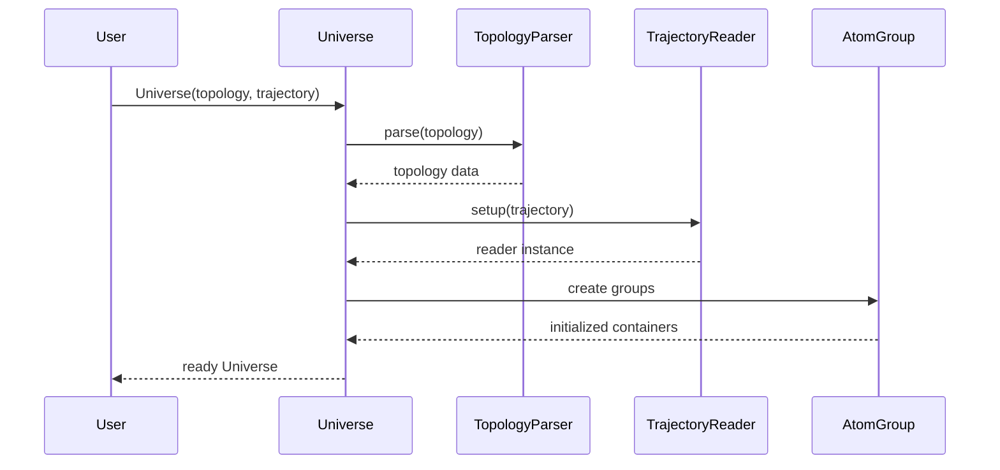
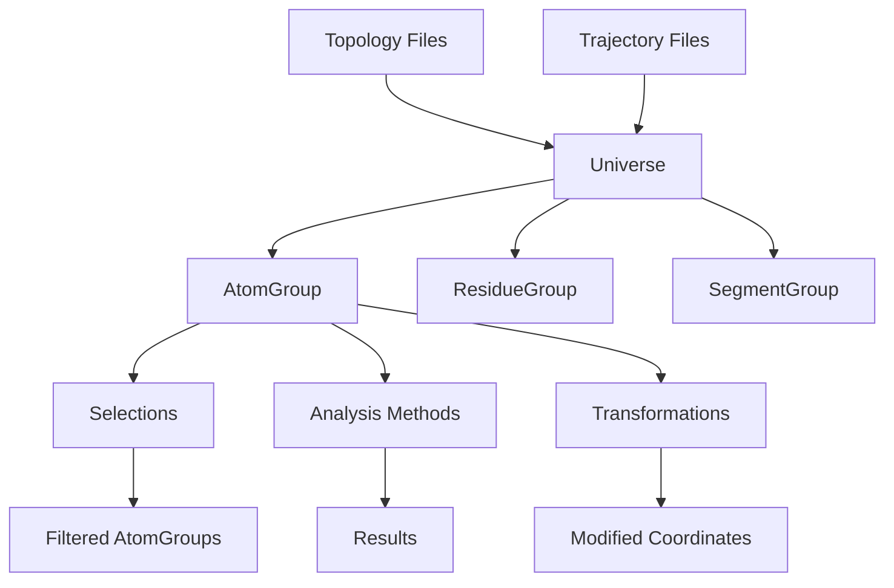

The core architecture of MDAnalysis is built around two fundamental concepts: the **Universe** and **AtomGroup**. These components work together to provide a powerful, flexible framework for molecular dynamics analysis. Understanding this architecture is essential for effectively using and extending MDAnalysis.

## The Universe: Central Hub of Molecular Systems

At the heart of MDAnalysis lies the **Universe** class, which serves as the central container for all information describing a molecular system. Think of the Universe as a complete simulation environment that ties together topology and trajectory data into a cohesive whole.

The Universe acts as the orchestrator that manages:
- **Topology information**: The static description of the molecular system (atoms, residues, bonds, etc.)
- **Trajectory data**: The time-evolving coordinates of the system
- **Coordinate transformations**: Operations to manipulate and analyze the molecular structure

```python
import MDAnalysis as mda

# Create a Universe from topology and trajectory files
u = mda.Universe("topology.psf", "trajectory.dcd")

# Access fundamental components
print(f"Total atoms: {u.atoms.n_atoms}")
print(f"Total residues: {u.residues.n_residues}")
print(f"Total segments: {u.segments.n_segments}")
```

Sources: [package/MDAnalysis/core/universe.py#L307-L311](package/MDAnalysis/core/universe.py#L307-L311), [package/MDAnalysis/core/__init__.py#L34-L36](package/MDAnalysis/core/__init__.py#L34-L36)

### Universe Initialization and Data Loading

When you create a Universe, it automatically handles the complex process of parsing topology and trajectory files. The initialization process follows these key steps:

1. **Topology parsing**: Reads the molecular structure from files like PSF, PDB, or GRO
2. **Trajectory reader setup**: Configures appropriate readers for coordinate data
3. **Attribute generation**: Creates AtomGroup, ResidueGroup, and SegmentGroup containers
4. **Topology attribute processing**: Sets up bonds, angles, and other structural information



Sources: [package/MDAnalysis/core/universe.py#L224-L253](package/MDAnalysis/core/universe.py#L224-L253), [package/MDAnalysis/core/universe.py#L281-L304](package/MDAnalysis/core/universe.py#L281-L304)

## AtomGroup: The Workhorse of Molecular Analysis

If the Universe is the stage, then **AtomGroup** is the main actor. An AtomGroup represents a collection of atoms and provides the primary interface for virtually all operations in MDAnalysis. Whether you're selecting specific atoms, calculating properties, or performing analysis, you'll likely be working with AtomGroups.

AtomGroups are incredibly versatile:
- They can represent any subset of atoms (from single atoms to the entire system)
- They provide access to atomic properties (positions, velocities, masses, etc.)
- They support mathematical operations and selections
- They serve as the foundation for more complex analysis workflows

```python
# Select atoms using powerful selection syntax
protein = u.select_atoms("protein")
water = u.select_atoms("resname SOL and around 5.0 protein")

# Access atomic properties
positions = protein.positions  # numpy array of coordinates
masses = protein.masses       # numpy array of masses
center_of_mass = protein.center_of_mass()

# Perform operations
combined = protein + water  # concatenate groups
intersection = protein & water  # find common atoms
```

Sources: [package/MDAnalysis/core/groups.py#L29-L35](package/MDAnalysis/core/groups.py#L29-L35), [package/MDAnalysis/core/__init__.py#L38-L42](package/MDAnalysis/core/__init__.py#L38-L42)

### Hierarchical Organization: Atoms, Residues, and Segments

MDAnalysis organizes molecular systems in a natural hierarchy that mirrors how chemists think about molecular structures:

| Level | Container | Individual Unit | Description |
|-------|-----------|-----------------|-------------|
| Atomic | AtomGroup | Atom | Individual particles with coordinates and properties |
| Residue | ResidueGroup | Residue | Groups of atoms forming molecular building blocks |
| Segment | SegmentGroup | Segment | Collections of residues (e.g., protein chains, solvent molecules) |

This hierarchical design allows you to work at the appropriate level of abstraction for your analysis:

```python
# Work at different hierarchical levels
atom = u.atoms[0]              # Single atom
residue = u.residues[0]        # Single residue  
segment = u.segments[0]        # Single segment

# Access relationships
print(f"Atom {atom.ix} is in residue {residue.resid}")
print(f"Residue {residue.resid} is in segment {segment.segid}")
print(f"Segment contains {len(segment.residues)} residues")
```

Sources: [package/MDAnalysis/core/groups.py#L37-40](package/MDAnalysis/core/groups.py#L37-40), [package/MDAnalysis/core/groups.py#L77-91](package/MDAnalysis/core/groups.py#L77-91)

## GroupBase: The Foundation for Container Operations

Underlying the specific group types (AtomGroup, ResidueGroup, SegmentGroup) is the **GroupBase** class, which provides a rich set of operations for manipulating collections of molecular components. This base class ensures consistent behavior across all group types and enables powerful set-like operations.

GroupBase provides two categories of operations:

1. **Order-preserving operations**: Maintain element order and allow duplicates
2. **Set-like operations**: Treat groups as mathematical sets (unique, sorted elements)

```python
# Order-preserving operations
group1 = u.atoms[:10]
group2 = u.atoms[5:15]
combined = group1 + group2          # Concatenation
difference = group1.subtract(group2) # Remove elements

# Set-like operations  
union = group1 | group2             # Union (unique, sorted)
intersection = group1 & group2      # Intersection
is_subset = group1.issubset(group2) # Subset test
```

Sources: [package/MDAnalysis/core/groups.py#L545-L600](package/MDAnalysis/core/groups.py#L545-L600)

> [!TIP]
> The distinction between order-preserving and set-like operations is crucial for molecular analysis. Order-preserving operations maintain the original atom ordering from your topology file, which is essential for trajectory analysis. Set-like operations are useful for finding unique atoms or comparing selections.

## Data Flow and Architecture Integration

The core architecture follows a clear data flow pattern that enables efficient molecular analysis:



This architecture ensures that:
- **Data consistency**: All groups reference the same Universe, preventing inconsistencies
- **Memory efficiency**: Groups are lightweight views into the underlying data
- **Performance**: Operations are optimized for large molecular systems
- **Flexibility**: Easy to extend with new analysis methods and transformations

```python
# Example of integrated architecture usage
u = mda.Universe("topology.psf", "trajectory.dcd")

# All groups reference the same universe
protein = u.select_atoms("protein")
backbone = protein.select_atoms("name CA or N or C or O")

# Analysis methods work seamlessly
rmsd = backbone.rmsd(backbone)  # Compare to reference

# Transformations modify coordinates in place
from MDAnalysis.transformations import translate
protein.transform(translate([10, 0, 0]))  # Shift protein
```

Sources: [package/MDAnalysis/core/universe.py#L449-479](package/MDAnalysis/core/universe.py#L449-479), [package/MDAnalysis/core/groups.py#L519-L542](package/MDAnalysis/core/groups.py#L519-L542)

## Key Design Principles

The core architecture of MDAnalysis is built on several important design principles that make it both powerful and user-friendly:

### 1. **Unified Interface**
All molecular components (atoms, residues, segments) follow similar patterns, making the API consistent and predictable.

### 2. **Lazy Evaluation**
Operations are performed only when needed, improving performance for large systems.

### 3. **Memory Efficiency**
Groups act as views into underlying data rather than copies, minimizing memory usage.

### 4. **Extensibility**
The modular design allows easy addition of new analysis methods, file formats, and transformations.

```python
# Example of extensibility
class CustomAnalysis:
    def __init__(self, atomgroup):
        self.ag = atomgroup
    
    def calculate(self):
        # Custom analysis logic
        return custom_result

# Works seamlessly with existing architecture
protein = u.select_atoms("protein")
analysis = CustomAnalysis(protein)
result = analysis.calculate()
```

Sources: [package/MDAnalysis/core/universe.py#L427-431](package/MDAnalysis/core/universe.py#L427-L431), [package/MDAnalysis/core/groups.py#L2091-2099](package/MDAnalysis/core/groups.py#L2091-2099)

## Conclusion

The core architecture of MDAnalysis, centered around the Universe and AtomGroup classes, provides a robust foundation for molecular dynamics analysis. By understanding these fundamental components and their relationships, you can leverage the full power of MDAnalysis for your research needs.

The hierarchical organization, consistent API design, and extensible architecture make MDAnalysis both accessible for beginners and powerful for advanced users. Whether you're performing simple selections or complex analysis workflows, the core architecture ensures efficient, reliable, and maintainable code.
