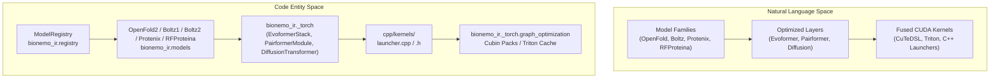

# Overview

Relevant source files

The following files were used as context for generating this wiki page:

- [.agents/skills/make-data-pipeline/SKILL.md](.agents/skills/make-data-pipeline/SKILL.md)
- [.agents/skills/module-onboard/SKILL.md](.agents/skills/module-onboard/SKILL.md)
- [AGENTS.md](AGENTS.md)
- [CHANGELOG.md](CHANGELOG.md)
- [README.md](README.md)
- [docs/README.md](docs/README.md)
- [docs/contributing.md](docs/contributing.md)
- [docs/install.md](docs/install.md)
- [docs/overview.mdx](docs/overview.mdx)
- [docs/ref/api.md](docs/ref/api.md)
- [docs/ref/support-matrix.md](docs/ref/support-matrix.md)
- [fern/fern.config.json](fern/fern.config.json)
- [fern/src/check_fern_versions.py](fern/src/check_fern_versions.py)
- [fern/src/release_notes.py](fern/src/release_notes.py)
- [fern/src/test_check_fern_versions.py](fern/src/test_check_fern_versions.py)

BioNeMo Inference Runtime (BioIR) is NVIDIA's library for accelerated biomolecular structure-prediction and generative protein design [README.md:13-25](), [docs/ref/architecture.md:11-21](). It provides high-throughput, GPU-accelerated pipelines that translate biomolecular inputs—such as FASTA sequences, A3M multiple sequence alignments (MSAs), and template structures—directly into PDB/mmCIF coordinate files and comprehensive confidence metrics (pLDDT, pTM, ipTM, PAE) [README.md:13-14](), [docs/ref/architecture.md:11-21]().

BioIR supports major structure-prediction and generative model families, including AlphaFold2, OpenFold2, OpenFold3, Boltz-1, Boltz-2, Protenix, and RFProteina [README.md:165-170](), [docs/ref/support-matrix.md:38-48](), [CHANGELOG.md:53-60](). Unlike traditional deployment stacks requiring ahead-of-time engine compilation or model export steps, BioIR models remain standard PyTorch `nn.Module` instances [README.md:23-25](), [docs/ref/architecture.md:17-21](). Acceleration is achieved through inference-optimized PyTorch layers, CUDA graph capture on supported modules, and custom NVIDIA CuTeDSL and Triton fused kernels [docs/overview.mdx:13-26](), [docs/ref/architecture.md:50-68]().

### Diagram: End-to-End Pipeline Bridge

```mermaid
flowchart TD
    subgraph NaturalLanguage["Natural Language Space"]
        IN["End-to-End Prediction Request"] --> P["Parser & Ingestion"]
        P --> F["Featurization & Tokens"]
        F --> E["GPU Inference Engine"]
        E --> W["PDB/mmCIF Writer"]
    end
    subgraph CodeSpace["Code Entity Space"]
        IN_CODE["InputRequest\nbionemo_ir.data.schemas"] --> PARSER_CODE["ParserStage\nbionemo_ir.pipeline.stages.parser_stage"]
        PARSER_CODE --> TOKEN_CODE["TokenizerStage\nbionemo_ir.pipeline.stages.tokenizer_stage"]
        TOKEN_CODE --> FEAT_CODE["FeatureGeneratorStage\nbionemo_ir.pipeline.stages.feature_generator_stage"]
        FEAT_CODE --> PROC_CODE["build_processor()\nbionemo_ir.api.processor"]
        PROC_CODE --> ENGINE_CODE["FoldingEngineStage\nbionemo_ir.pipeline.stages.engine_stage"]
        ENGINE_CODE --> WRITER_CODE["WriterStage\nbionemo_ir.pipeline.stages.writer_stage"]
    end
```

Sources: [README.md:20-25](), [docs/ref/api.md:12-46](), [docs/ref/architecture.md:73-124]()

## High-Level Architecture

The BioIR architecture bridges high-throughput orchestration with tuned tensor operations through a modular stack:

1. **Five-Stage End-to-End Pipeline**: Orchestrates ingestion and processing via `ParserStage`, `TokenizerStage`, `FeatureGeneratorStage`, `FoldingEngineStage`, and `WriterStage` [docs/ref/architecture.md:73-97](). Execution can run sequentially via serial processors or be distributed across GPU replicas using Ray Data [docs/overview.mdx:85-119](), [docs/ref/architecture.md:124-136]().
2. **Model Registry & Feature Factories**: Implements data flows (Pattern A and Pattern B) using modular context generators, feature generators, collators, and transforms customized for specific model requirements [docs/ref/config.md:30-62]().
3. **Optimized Torch Modules (`_torch`)**: Supplies optimized primitive blocks including `EvoformerStack`, `PairformerModule`, triangle multiplication/attention nodes, diffusion transformers, structure modules, and confidence heads [README.md:13-19](), [docs/ref/architecture.md:11-15]().
4. **GPU Kernel Stack**: Incorporates custom fused operations (such as `adaln_layernorm_sigmoid`, gated sigmoid, dual GEMMs, outer product mean, and pair-weighted averaging) accelerated via CuTeDSL C++ launchers, Triton kernels, and precompiled cubin packs [README.md:13-15](), [docs/ref/architecture.md:50-68]().

### Diagram: Model Architecture and Kernel Optimization Bridge

Sources: [README.md:13-28](), [docs/ref/architecture.md:50-68](), [docs/ref/support-matrix.md:28-48]()

Sources: [README.md:13-26](), [docs/overview.mdx:13-26](), [docs/ref/architecture.md:11-136](), [docs/ref/config.md:9-122]()

---

## 1.1 Getting Started and Installation

This section covers installation requirements, driver dependencies, release wheel installation via PyPI, environment configuration using `uv` or `conda`, source build workflows with development containers (`docker/dev.sh`), weight staging for supported models, and running end-to-end folding examples.

For complete setup guides, requirements, and execution instructions, see [docs/install.md]() and [README.md]().

Sources: [README.md:27-111](), [docs/install.md:7-185]()

---

## 1.2 Repository Layout and Public API

This section documents the repository layout across `bionemo_ir/`, `cpp/`, `tests/`, `docs/`, and `examples/`, alongside the public Python API surface. It details how to invoke end-to-end structure prediction using `build_processor`, manage input schemas (`InputRequest`, `Polymer`, `MSARecord`, `Template`), and initialize model constructors with configuration objects.

For the complete API reference, parameter definitions, and request formats, see [docs/ref/api.md]() and [docs/ref/architecture.md]().

Sources: [docs/ref/api.md:7-154](), [docs/ref/architecture.md:11-49]()

---