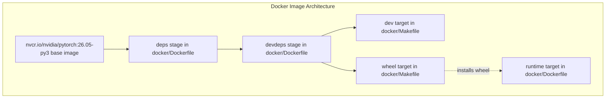

# Getting Started and Installation

<details>
<summary>Relevant source files</summary>

The following files were used as context for generating this wiki page:

- [.nspect-allowlist.toml](.nspect-allowlist.toml)
- [CHANGELOG.md](CHANGELOG.md)
- [README.md](README.md)
- [bionemo_ir/_torch/custom_ops/attn_epilogue/cutedsl.py](bionemo_ir/_torch/custom_ops/attn_epilogue/cutedsl.py)
- [bionemo_ir/_torch/custom_ops/gated_sigmoid/cutedsl.py](bionemo_ir/_torch/custom_ops/gated_sigmoid/cutedsl.py)
- [bionemo_ir/_torch/custom_ops/transition_mlp/cutedsl.py](bionemo_ir/_torch/custom_ops/transition_mlp/cutedsl.py)
- [bionemo_ir/models/rfproteina/__init__.py](bionemo_ir/models/rfproteina/__init__.py)
- [bionemo_ir/models/rfproteina/convert.py](bionemo_ir/models/rfproteina/convert.py)
- [bionemo_ir/models/rfproteina/modeling.py](bionemo_ir/models/rfproteina/modeling.py)
- [docs/install.md](docs/install.md)
- [docs/ref/api.md](docs/ref/api.md)
- [docs/ref/docker-images.md](docs/ref/docker-images.md)
- [docs/ref/support-matrix.md](docs/ref/support-matrix.md)
- [fern/src/check_fern_versions.py](fern/src/check_fern_versions.py)
- [fern/src/release_notes.py](fern/src/release_notes.py)
- [fern/src/test_check_fern_versions.py](fern/src/test_check_fern_versions.py)
- [scripts/fetch_weights.sh](scripts/fetch_weights.sh)
- [tests/_torch/test_rfd4_beam_search.py](tests/_torch/test_rfd4_beam_search.py)
- [tests/_torch/test_rfd4_modules.py](tests/_torch/test_rfd4_modules.py)
- [tests/ops/test_gated_sigmoid.py](tests/ops/test_gated_sigmoid.py)

</details>


## Purpose and Scope

This page provides comprehensive technical instructions for installing, configuring, and running the BioNeMo Inference Runtime (BioIR) package. It covers system requirements and prerequisites, release wheel installation via PyPI, building from source inside the development container (`docker/Dockerfile`, `docker/Makefile`) [docs/ref/docker-images.md:10-12](), staging required model checkpoints (`scripts/fetch_weights.sh`) [scripts/fetch_weights.sh:17-19](), and executing the end-to-end folding and quickstart examples under `examples/folding/run_demo.py` [README.md:106] [docs/ref/api.md:17-18]().

Sources: `README.md:9-15]`, `docs/install.md:7-12]`, `docs/ref/docker-images.md:10-12]`, `scripts/fetch_weights.sh:17-19]()`

---

## 1. System Requirements and Prerequisites

BioIR is engineered for GPU-accelerated structure prediction and generative design on Linux environments equipped with modern NVIDIA hardware. Before installing the release wheel or setting up the development workspace, verify that your host system satisfies the requirements outlined below.

### Hardware and OS Requirements
- **Operating System:** A Linux distribution supporting modern NVIDIA drivers with `glibc` 2.34 or newer (release wheels are tagged `manylinux_2_34`) [README.md:43-46] [docs/install.md:16-20]().
- **CPU Architecture:** `x86_64` (AMD64) or `aarch64` (ARM64) [README.md:44] [docs/install.md:21]().
- **GPU:** An NVIDIA GPU supporting mixed FP32/BF16 tensor operations. Release-qualified architectures include **H200, H100, A100, L40S, GB200, and GB300** [README.md:67-69] [docs/install.md:39-43]().
- **NVIDIA Driver:** Driver version **580 or higher** (providing `libcuda.so.1`) [README.md:47] [docs/install.md:23-56](). Older driver versions relying on the CUDA forward-compatibility shim are unsupported due to stability issues during extended inference runs [README.md:48-50] [docs/install.md:58-61]().
- **Python:** CPython **3.12, 3.13, or 3.14**. Release wheels utilize the stable ABI (`cp312-abi3`) [README.md:51-52] [docs/install.md:24]().
- **Container Tooling:** Docker Engine and the NVIDIA Container Toolkit for building and developing from source within the container workspace [README.md:53-54] [docs/dev.md:27-28]().

Sources: `README.md:43-55]`, `docs/install.md:14-65]`, `docs/dev.md:25-35]()`

---

## 2. Installing the Release Wheel

The recommended method for consuming BioIR in downstream applications is installing the precompiled wheel from PyPI [docs/install.md:66-72](). The wheel bundles precompiled CUDA kernels and extension binaries, eliminating the requirement for a local CUDA Toolkit or `nvcc` compiler on the target host [README.md:71-80] [docs/install.md:54-56]().

### Creating a Python Environment
Create and activate an isolated Python environment using `uv`, `conda`, or Python's built-in `venv` module [docs/install.md:98-152](). For instance, using `uv`:
```bash
uv venv --python 3.12 --managed-python --seed .venv
source .venv/bin/activate
python -m pip install --upgrade pip
```
[docs/install.md:109-115] [docs/install.md:160-163]()

### Installing `bionemo-ir`
Install the package directly from PyPI:
```bash
python -m pip install bionemo-ir
```
[README.md:76] [docs/install.md:82-84]()

Verify the installation:
```bash
python -c "import bionemo_ir; print(bionemo_ir.__version__)"
```
[docs/ref/docker-images.md:133-137]()

Sources: `README.md:71-84]`, `docs/install.md:80-165]()`

---

## 3. Developer Container and Source Build Workflow

For modifying source code or running the test suite, clone the repository with Git LFS submodules and utilize the provided container workflow orchestrated by `docker/Dockerfile` and `docker/Makefile` [README.md:86-114] [docs/ref/docker-images.md:9-12]().

```bash
git lfs install &&
  GIT_LFS_SKIP_SMUDGE=0 \
    git clone --recurse-submodules \
      git@github.com:NVIDIA-BioNeMo/BioNeMo-Inference-Runtime.git &&
  cd BioNeMo-Inference-Runtime
```
[README.md:88-97]()

### Docker Build Stages
The project maintains a multi-stage Docker build pipeline defined in `docker/Dockerfile` and managed via `docker/Makefile` [docs/ref/docker-images.md:9-12]().

Diagram: Docker Build Pipeline and Container Targets (Natural Language to Code Entity Space)

Sources: `docs/ref/docker-images.md:10-72]`, `docker/Dockerfile:1-150]`, `docker/Makefile:1-50]()`

### Launching the Development Environment
Run the interactive helper script to provision or join the persistent development container:
```bash
docker/dev.sh
```
[README.md:113] [docs/ref/docker-images.md:91-101]()

Inside the container shell, perform an editable installation of the package:
```bash
uv pip install --no-deps -e .
```
[README.md:120] [docs/ref/docker-images.md:77-81]()

Sources: `README.md:86-135]`, `docs/ref/docker-images.md:7-146]`, `docker/dev.sh()`

---

## 4. Checkpoint Hubs and Weight Staging

Inference models require pre-trained checkpoint weights. The repository provides the staging script `scripts/fetch_weights.sh` to download model parameters and metadata directly into the local probe cache (`~/.cache/bionemo_ir` or `$BIOIR_CACHE`) [scripts/fetch_weights.sh:17-41] [docs/ref/docker-images.md:103-110]().

### Staging Model Checkpoints
To fetch checkpoints for a specific model family (e.g., `boltz-2` or `openfold3`):
```bash
scripts/fetch_weights.sh --model boltz-2
```
[README.md:105] [scripts/fetch_weights.sh:17-32]()

For gated checkpoints requiring authentication (such as OpenFold3), configure your Hugging Face token prior to running the staging script:
```bash
export HF_TOKEN=hf_...
scripts/fetch_weights.sh --model openfold3
```
[scripts/fetch_weights.sh:104-107]()

Sources: `scripts/fetch_weights.sh:1-120]`, `docs/ref/model-weights.md()`

---

## 5. Running Folding and Quickstart Examples

With dependencies installed and model weights staged in the local cache directory, you can execute the folding and design demonstration scripts under `examples/folding/` [README.md:106] [examples/folding/run_demo.py]().

Diagram: End-to-End Execution Flow and Processor Pipeline (Natural Language to Code Entity Space)
```mermaid
flowchart TD
    subgraph "Weight Staging Space"
        FetchScript[""scripts/fetch_weights.sh""] --> SharedCache[""bionemo_ir.CACHE_DIR (~/.cache/bionemo_ir)""]
    end
    subgraph "Execution Space"
        DemoScript[""examples/folding/run_demo.py""] --> InputReq[""bionemo_ir.data.schemas.InputRequest""]
        InputReq --> EngineProc[""bionemo_ir.pipeline.engine_proc.build_processor""]
        SharedCache --> EngineProc
        EngineProc --> OutputResults[""PDB/mmCIF structures and scores.json""]
    end
```
Sources: `scripts/fetch_weights.sh:37-46]`, `examples/folding/run_demo.py()`, `bionemo_ir/pipeline/engine_proc.py()`, `docs/ref/api.md:12-44]()`

### Running the Demo Script
Execute the quickstart inference pipeline using bundled sample inputs:
```bash
python examples/folding/run_demo.py --output-dir output
```
[README.md:106] [examples/folding/run_demo.py]()

This script invokes `build_processor`, parses input FASTA/MSA records, constructs tensors through feature generators, runs the five-stage pipeline (`ParserStage`, `TokenizerStage`, `FeatureGeneratorStage`, `FoldingEngineStage`, `WriterStage`), and writes output structures along with confidence scores (`pLDDT`, `pTM`, `ipTM`, `PAE`) to the designated output directory [docs/ref/api.md:12-38] [examples/folding/run_demo.py]().

Sources: `README.md:97-128]`, `docs/ref/api.md:12-44]`, `examples/folding/run_demo.py()`

---