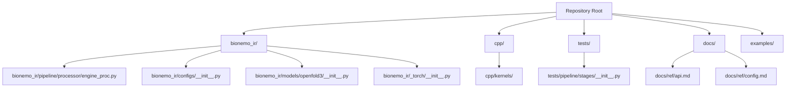
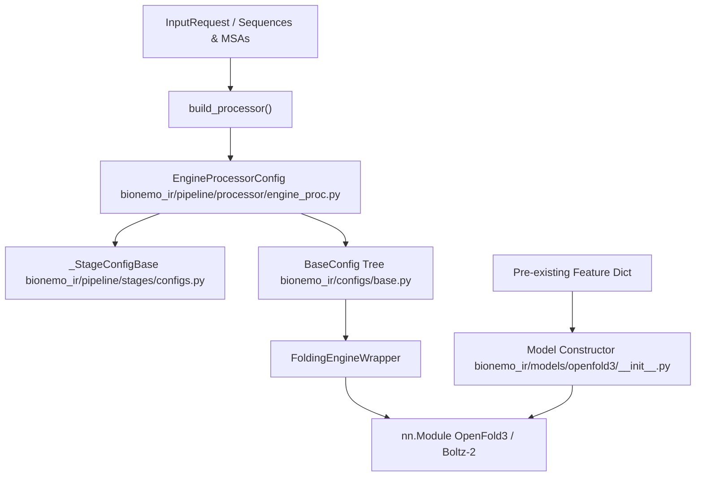
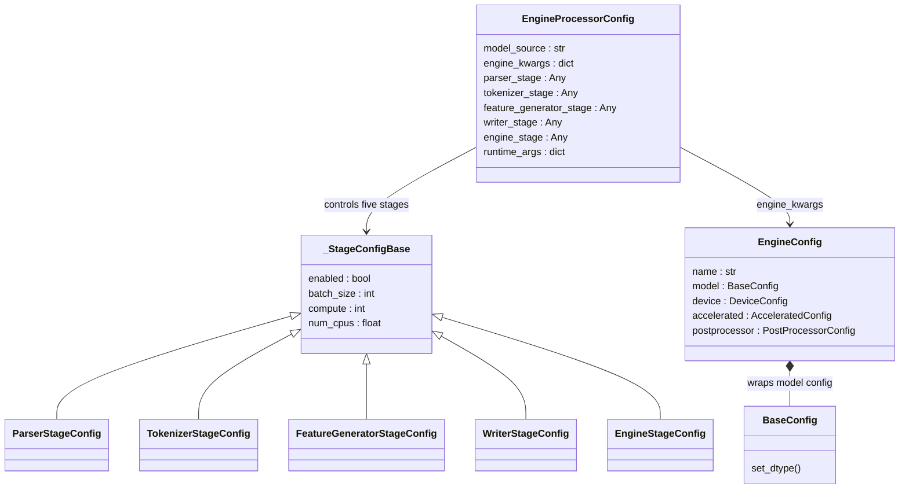

# Repository Layout and Public API

Relevant source files

The following files were used as context for generating this wiki page:

- [.agents/skills/make-data-pipeline/SKILL.md](.agents/skills/make-data-pipeline/SKILL.md)
- [.agents/skills/module-onboard/SKILL.md](.agents/skills/module-onboard/SKILL.md)
- [AGENTS.md](AGENTS.md)
- [CHANGELOG.md](CHANGELOG.md)
- [README.md](README.md)
- [docs/README.md](docs/README.md)
- [docs/contributing.md](docs/contributing.md)
- [docs/install.md](docs/install.md)
- [docs/overview.mdx](docs/overview.mdx)
- [docs/ref/api.md](docs/ref/api.md)
- [docs/ref/support-matrix.md](docs/ref/support-matrix.md)
- [examples/module_onboarding/rf3_pairformer/convert/convert_weights.py](examples/module_onboarding/rf3_pairformer/convert/convert_weights.py)
- [fern/fern.config.json](fern/fern.config.json)
- [fern/src/check_fern_versions.py](fern/src/check_fern_versions.py)
- [fern/src/release_notes.py](fern/src/release_notes.py)
- [fern/src/test_check_fern_versions.py](fern/src/test_check_fern_versions.py)

## Purpose and Scope

This page maps the repository layout of the BioNeMo Inference Runtime (BioIR) codebase and details its public API surface. It covers the organization of the Python package (`bionemo_ir/`), C++ kernels (`cpp/`), test suites (`tests/`), documentation (`docs/`), and examples (`examples/`). It also specifies the production entry points (`build_processor`), direct model constructors, and the dual Pydantic configuration hierarchy.

Sources: `docs/ref/api.md:1-25`, `README.md:26-30`

---

## 1. Repository Layout

The BioIR codebase is structured into core Python packages for pipeline execution, tensor modeling, and data handling, alongside C++ extensions, test suites, documentation, and runnable examples.

### Directory Mapping to Code Entities

*Diagram: High-level repository layout bridging folders to key code entry points.*

Sources: `docs/ref/api.md:1-25`, `bionemo_ir/pipeline/processor/engine_proc.py:1-50`, `bionemo_ir/configs/__init__.py:1-20`

### Package Breakdown

| Directory / Path | Role and Key Contents |
| ---------------- | --------------------- |
| `bionemo_ir/` | Main Python package containing pipeline orchestration, model definitions, configurations, and data parsers [docs/ref/api.md:22-24]() |
| `bionemo_ir/_torch/` | Optimized PyTorch modules, layers, transformer stacks (`EvoformerStack`, `PairformerModule`), diffusion components, and CUDA graph wrappers [README.md:26-30](). |
| `bionemo_ir/configs/` | Shared Pydantic primitives (`BaseConfig`, `PairformerConfig`, `DiffusionTransformerConfig`) [bionemo_ir/configs/__init__.py:16-18](). |
| `bionemo_ir/models/` | Family-specific model roots, configuration registries, and modeling entrypoints (e.g., `openfold3`, `boltz`) [bionemo_ir/models/openfold3/__init__.py:1-19](). |
| `bionemo_ir/pipeline/` | Five-stage processor architecture (`ParserStage`, `TokenizerStage`, `FeatureGeneratorStage`, `FoldingEngineStage`, `WriterStage`) [bionemo_ir/pipeline/processor/engine_proc.py:24-30](). |
| `cpp/` | C++ source files, CuTeDSL launchers, custom operator bindings, and compiled cubin registries under `cpp/kernels/` [docs/install.md:165-170](). |
| `tests/` | Unit and integration tests covering pipeline stages, modules, and numerical parity checks [tests/pipeline/stages/__init__.py:1-14](). |
| `docs/` | Documentation site source, including configuration and API reference markdown files [docs/ref/api.md:1-20](). |
| `examples/` | Runnable demonstration scripts (`examples/folding/run_demo.py`) and declarative JSON data samples [docs/ref/api.md:17-18](). |

Sources: `docs/ref/api.md:1-25`, `bionemo_ir/configs/__init__.py:1-28`, `bionemo_ir/pipeline/processor/engine_proc.py:22-30`, `tests/pipeline/stages/__init__.py:1-15`

---

## 2. Public API Surface

BioIR exposes two primary ways to execute structure-prediction models:
1. **`build_processor`** — The production pipeline entry point that orchestrates parsing, tokenization, featurization, engine execution, and PDB/CIF writing [docs/ref/api.md:11-13]().
2. **Model Constructor + `forward`** — Direct instantiation of an `nn.Module` configured via Pydantic model configs, executed on a pre-existing feature dictionary [docs/ref/api.md:14-15]().

### API Flow and Code Mapping

*Diagram: Mapping user interaction modes and configuration structures to internal Python classes.*

Sources: `docs/ref/api.md:11-15`, `bionemo_ir/pipeline/processor/engine_proc.py:50-79`, `bionemo_ir/configs/__init__.py:16-17`, `bionemo_ir/models/openfold3/__init__.py:16-18`

---

## 3. Configuration Architecture

BioIR relies on two distinct Pydantic configuration trees that meet at the engine boundary [docs/ref/config.md:9-16]().

*Diagram: Configuration hierarchy and relationship between pipeline processors, stage configs, and model config trees.*

Sources: `docs/ref/config.md:9-78`, `bionemo_ir/pipeline/processor/engine_proc.py:50-101`, `bionemo_ir/pipeline/stages/configs.py:29-98`

### Pipeline Stage Configurations

Stage configurations inherit from `_StageConfigBase` and accept booleans, dictionaries, or typed configuration objects [bionemo_ir/pipeline/stages/configs.py:29-42](). They are resolved via `resolve_stage_config()` [bionemo_ir/pipeline/stages/configs.py:99-142]():

| Stage Config Class | Corresponding Stage | Key Configuration Parameters |
| ------------------ | ------------------- | ---------------------------- |
| `ParserStageConfig` | `ParserStage` | `batch_size`, `compute`, `runtime_env` [bionemo_ir/pipeline/stages/configs.py:29-54]() |
| `TokenizerStageConfig` | `TokenizerStage` | `init_context` (e.g., passing `random_seed` for RDKit initialization) [bionemo_ir/pipeline/stages/configs.py:57-65]() |
| `FeatureGeneratorStageConfig` | `FeatureGeneratorStage` | `init_context`, `drop_keys` [bionemo_ir/pipeline/stages/configs.py:68-73]() |
| `WriterStageConfig` | `WriterStage` | `output_path`, `format` (`"pdb"`, `"cif"`) [bionemo_ir/pipeline/stages/configs.py:75-86]() |
| `EngineStageConfig` | `FoldingEngineStage` | `parallelism_mode` (`ParallelismMode.REPLICA`), `num_gpus` [bionemo_ir/pipeline/stages/configs.py:88-97]() |

Sources: `bionemo_ir/pipeline/stages/configs.py:29-142`, `docs/ref/config.md:85-121`

---

## 4. Input Request Schemas

When using `build_processor`, input requests are defined declaratively via Pydantic schemas in `bionemo_ir.data.schemas` [docs/ref/api.md:40-47](). 

- **`InputRequest`**: Groups an `input_id` with a list of `Polymer` instances [docs/ref/api.md:43-64]().
- **`Polymer`**: Specifies `polymer_type` (`"protein"`, `"rna"`, `"dna"`, `"ccd_ligand"`, `"smiles_ligand"`), `chain_id`, `sequence`, `msas` (`list[MSARecord]`), `paired_msas`, and `templates` (`list[Template]`) [docs/ref/api.md:67-77]().

Sources: `docs/ref/api.md:40-82`, `bionemo_ir/pipeline/processor/engine_proc.py:50-70`

---