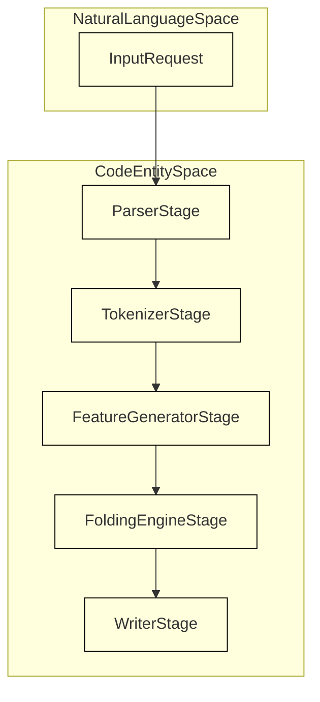
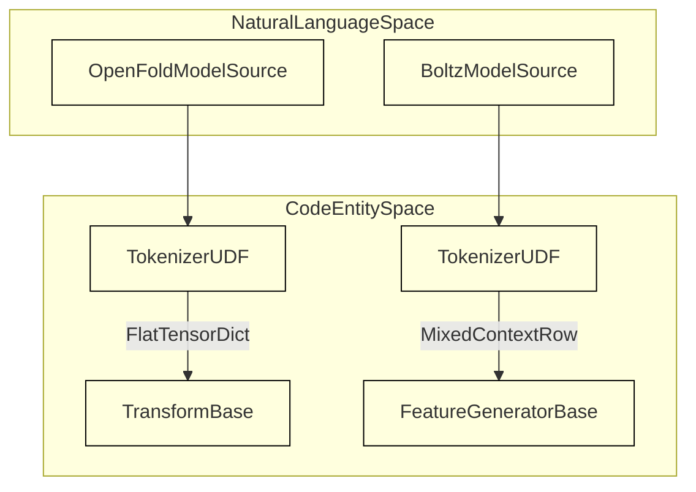

# Inference Pipeline

Relevant source files

The following files were used as context for generating this wiki page:

- [bionemo_ir/models/boltz2/config.py](bionemo_ir/models/boltz2/config.py)
- [bionemo_ir/models/openfold3/config.py](bionemo_ir/models/openfold3/config.py)
- [bionemo_ir/pipeline/engine.py](bionemo_ir/pipeline/engine.py)
- [bionemo_ir/pipeline/models/boltz2/feature_factory.py](bionemo_ir/pipeline/models/boltz2/feature_factory.py)
- [bionemo_ir/pipeline/processor/engine_proc.py](bionemo_ir/pipeline/processor/engine_proc.py)
- [bionemo_ir/pipeline/processor/utils.py](bionemo_ir/pipeline/processor/utils.py)
- [bionemo_ir/pipeline/stages/feature_generator_stage.py](bionemo_ir/pipeline/stages/feature_generator_stage.py)
- [bionemo_ir/pipeline/stages/tokenizer_stage.py](bionemo_ir/pipeline/stages/tokenizer_stage.py)
- [bionemo_ir/pipeline/utils/__init__.py](bionemo_ir/pipeline/utils/__init__.py)
- [docs/ray.md](docs/ray.md)
- [tests/_torch/test_openfold3_compact_confidence.py](tests/_torch/test_openfold3_compact_confidence.py)
- [tests/pipeline/feature_generator/test_feature_generator_udf.py](tests/pipeline/feature_generator/test_feature_generator_udf.py)
- [tests/pipeline/test_engine_proc_compact_confidence.py](tests/pipeline/test_engine_proc_compact_confidence.py)
- [tests/pipeline/test_processor_ray_setup.py](tests/pipeline/test_processor_ray_setup.py)

The inference pipeline in BioNeMo Inference Runtime (BioIR) provides a modular, GPU-accelerated processing engine that transforms raw molecular inputs (such as FASTA sequences, Multiple Sequence Alignments, and structure files) into predicted 3D structures (PDB/mmCIF) through a structured five-stage architecture [`.agents/skills/make-data-pipeline/architecture-reference.md:70-106](). This page provides a high-level overview of the pipeline abstractions, data flow patterns, and stage coordination mechanisms. For detailed technical specifications, see the child pages below:
- [Pipeline Stages and Processor Engine](#2.1)
- [Model Registry and Feature Factories](#2.2)
- [Data I/O: Parsers, Schemas, and Writers](#2.3)

---

## Architecture Overview

The pipeline processes records asynchronously across distributed workers or local threads using execution engines orchestrated by `EngineProcessorConfig` [bionemo_ir/pipeline/processor/engine_proc.py:53-125](). Each stage encapsulates a specific phase of data preparation, tensor construction, neural network inference, or output formatting.

*Figure 1: High-level mapping from raw input requests to structural output through the five pipeline stages.*

Sources: `[bionemo_ir/pipeline/processor/engine_proc.py:53-125](), [.agents/skills/make-data-pipeline/architecture-reference.md:70-106]()`

---

## Pipeline Stages and Processor Engine

The inference runtime executes data transformations across five sequential stages configured via `EngineProcessorConfig` [bionemo_ir/pipeline/processor/engine_proc.py:53-125]() and executed using Ray actor pools or serial execution primitives [tests/pipeline/test_processor_ray_setup.py:75-107]():
1. **Parse**: Ingests raw inputs (`InputRequest`) via `ParserStage`, parsing FASTA, A3M, and coordinate files into structured numpy records [`.agents/skills/make-data-pipeline/architecture-reference.md:73-75]()].
2. **Tokenize**: Maps parsed tokens and sequences into initial context representations using `TokenizerStage` and `TokenizerUDF` [bionemo_ir/pipeline/stages/tokenizer_stage.py:26-85]().
3. **Featurize**: Materializes model-specific tensors through `FeatureGeneratorStage` and `FeatureGeneratorUDF`, executing feature generators and collators [bionemo_ir/pipeline/stages/feature_generator_stage.py:29-110]().
4. **Engine**: Executes optimized PyTorch model inference and recycling iterations within `FoldingEngineStage` [`.agents/skills/make-data-pipeline/architecture-reference.md:85]()].
5. **Write**: Converts model output coordinates back into standard PDB or mmCIF format files via `WriterStage` [`.agents/skills/make-data-pipeline/architecture-reference.md:86]()].

For deep dives into stage base classes, stage configurations, and multi-process batch execution, see [Pipeline Stages and Processor Engine](#2.1).

Sources: `[bionemo_ir/pipeline/processor/engine_proc.py:53-125](), [bionemo_ir/pipeline/stages/tokenizer_stage.py:26-85](), [bionemo_ir/pipeline/stages/feature_generator_stage.py:29-110](), [.agents/skills/make-data-pipeline/architecture-reference.md:70-106]()`

---

## Model Registry and Feature Factories

Model configurations and components are decoupled from the execution engine using `ModelRegistry` and feature factory abstractions [bionemo_ir/registry.py:29-113](). BioIR supports distinct data flow patterns depending on the model family, managing context generation and tensor transformations through UDF execution hooks [bionemo_ir/pipeline/stages/tokenizer_stage.py:50-83](), [bionemo_ir/pipeline/stages/feature_generator_stage.py:66-101]().

*Figure 2: Architectural distinction between Pattern A (flat tensors) and Pattern B (mixed context rows) data flows mapped to pipeline code entities.*

For detailed breakdowns of model routing, feature factories, transforms, and model-specific pipelines (OpenFold2/3 and Boltz-1/2), see [Model Registry and Feature Factories](#2.2).

Sources: `[bionemo_ir/registry.py:29-113](), [bionemo_ir/pipeline/stages/tokenizer_stage.py:50-83](), [bionemo_ir/pipeline/stages/feature_generator_stage.py:66-101](), [.agents/skills/make-data-pipeline/architecture-reference.md:45-66]()`

---

## Data I/O: Parsers, Schemas, and Writers

Input validation, sequence formats, and coordinate file generation are governed by robust schemas configured within `EngineProcessorConfig` stages [bionemo_ir/pipeline/processor/engine_proc.py:62-77](). The I/O layer ensures strict type safety between asynchronous execution workers and file storage.

For detailed documentation on input parsers (FASTA, MSA, CIF), data schemas, PDB/mmCIF writers, and chemical constants tables, see [Data I/O: Parsers, Schemas, and Writers](#2.3).

Sources: `[bionemo_ir/pipeline/processor/engine_proc.py:62-77]()`

---