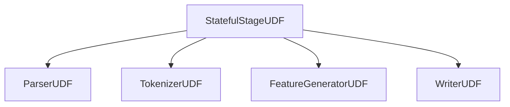
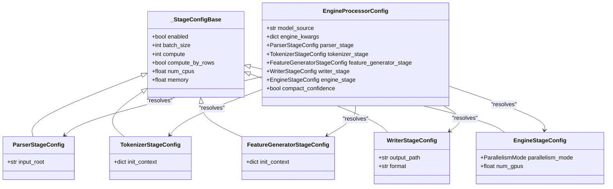

# Pipeline Stages and Processor Engine

Relevant source files

The following files were used as context for generating this wiki page:

- [bionemo_ir/data/path.py](bionemo_ir/data/path.py)
- [bionemo_ir/dsl_kernels/cute_cache.py](bionemo_ir/dsl_kernels/cute_cache.py)
- [bionemo_ir/models/boltz2/config.py](bionemo_ir/models/boltz2/config.py)
- [bionemo_ir/models/openfold3/config.py](bionemo_ir/models/openfold3/config.py)
- [bionemo_ir/pipeline/models/boltz2/feature_context.py](bionemo_ir/pipeline/models/boltz2/feature_context.py)
- [bionemo_ir/pipeline/models/openfold3/feature_factory.py](bionemo_ir/pipeline/models/openfold3/feature_factory.py)
- [bionemo_ir/pipeline/processor/base.py](bionemo_ir/pipeline/processor/base.py)
- [bionemo_ir/pipeline/processor/engine_proc.py](bionemo_ir/pipeline/processor/engine_proc.py)
- [bionemo_ir/pipeline/processor/utils.py](bionemo_ir/pipeline/processor/utils.py)
- [bionemo_ir/pipeline/stages/base.py](bionemo_ir/pipeline/stages/base.py)
- [bionemo_ir/pipeline/stages/configs.py](bionemo_ir/pipeline/stages/configs.py)
- [bionemo_ir/pipeline/stages/writer_stage.py](bionemo_ir/pipeline/stages/writer_stage.py)
- [bionemo_ir/pipeline/utils/_rng.py](bionemo_ir/pipeline/utils/_rng.py)
- [tests/_torch/test_cute_cache.py](tests/_torch/test_cute_cache.py)
- [tests/_torch/test_openfold3_compact_confidence.py](tests/_torch/test_openfold3_compact_confidence.py)
- [tests/data/test_path.py](tests/data/test_path.py)
- [tests/pipeline/models/openfold3/test_conformer_augmentation.py](tests/pipeline/models/openfold3/test_conformer_augmentation.py)
- [tests/pipeline/parser/test_parser_stage.py](tests/pipeline/parser/test_parser_stage.py)
- [tests/pipeline/stages/test_writer_scores.py](tests/pipeline/stages/test_writer_scores.py)
- [tests/pipeline/stages/test_writer_stage.py](tests/pipeline/stages/test_writer_stage.py)
- [tests/pipeline/test_engine_proc_compact_confidence.py](tests/pipeline/test_engine_proc_compact_confidence.py)
- [tests/pipeline/test_processor_base.py](tests/pipeline/test_processor_base.py)
- [tests/pipeline/test_processor_ray_setup.py](tests/pipeline/test_processor_ray_setup.py)

## Purpose and Scope

This page covers the execution architecture of the BioNeMo Inference Runtime (BioIR) pipeline. It details the stage base classes, configuration schemas, individual processing stages (Parser, Tokenizer, Feature Generator, Engine, and Writer), and the processor engines (`EngineProcessor`, `SerialProcessor`) that orchestrate execution across CPU and GPU resources.

Sources: [`bionemo_ir/pipeline/processor/engine_proc.py:1-52()`](), [`bionemo_ir/pipeline/processor/base.py:1-156()`]()

---

## Stage Base Classes and Abstractions

The inference pipeline is built upon stateful user-defined functions (`StatefulStageUDF` and `StatefulStage`) that operate on columnar batches of input data. Stages are abstracted as asynchronous processors that transform tabular dictionaries containing records, intermediate states, and computed tensors.

*Diagram 1: Stage base class inheritance mapping Natural Language Space to Code Entity Space via `StatefulStageUDF`.*

Sources: [`bionemo_ir/pipeline/stages/base.py:1-50()`](), [`bionemo_ir/pipeline/stages/writer_stage.py:55-90()`]()

---

## Stage Configurations and Pydantic Schemas

Pipeline execution parameters are governed by Pydantic configuration models rooted in `EngineProcessorConfig` [`bionemo_ir/pipeline/processor/engine_proc.py:53-125()`]. Each stage accepts a corresponding stage configuration class inheriting from `_StageConfigBase` [`bionemo_ir/pipeline/stages/configs.py:29-51()`].

*Diagram 2: Configuration schema class hierarchy linking Pydantic components (`EngineProcessorConfig` and `_StageConfigBase`).*

Sources: [`bionemo_ir/pipeline/processor/engine_proc.py:53-125()`](), [`bionemo_ir/pipeline/stages/configs.py:29-150()`]()

---

## Pipeline Stage Implementations

The sequential execution pipeline comprises five main processing stages:

### 1. Parser Stage
Consumes raw sequence records, FASTA/MSA files, or JSON input requests and unpacks them into structured internal representations.
* **Core Classes**: `ParserStage`, `ParserUDF` [`bionemo_ir/pipeline/stages/parser_stage.py:1-40()`]
* **Configuration**: `ParserStageConfig` [`bionemo_ir/pipeline/stages/configs.py:53-61()`]

Sources: [`bionemo_ir/pipeline/stages/configs.py:53-61()`]()

### 2. Tokenizer Stage
Executes context generation and transforms across parsed elements, building residue indices, token embeddings, and structural contexts.
* **Core Classes**: `TokenizerStage`, `TokenizerUDF` [`bionemo_ir/pipeline/stages/tokenizer_stage.py:1-40()`]
* **Configuration**: `TokenizerStageConfig` [`bionemo_ir/pipeline/stages/configs.py:64-72()`]

Sources: [`bionemo_ir/pipeline/stages/configs.py:64-72()`]()

### 3. Feature Generator Stage
Applies model-specific feature generators and collators to assemble PyTorch tensors required by the neural network trunks.
* **Core Classes**: `FeatureGeneratorStage`, `FeatureGeneratorUDF` [`bionemo_ir/pipeline/stages/feature_generator_stage.py:1-40()`]
* **Configuration**: `FeatureGeneratorStageConfig` [`bionemo_ir/pipeline/stages/configs.py:75-80()`]

Sources: [`bionemo_ir/pipeline/stages/configs.py:75-80()`]()

### 4. Engine Stage
Wraps the compiled PyTorch `nn.Module` inside `FoldingEngine` and `FoldingEngineWrapper`, managing batch execution, precision settings, recycling loops, and CUDA graph capture.
* **Core Classes**: `FoldingEngine`, `FoldingEngineWrapper`, `EngineStageConfig` [`bionemo_ir/pipeline/stages/configs.py:95-104()`]
* **Configuration**: `EngineStageConfig`

Sources: [`bionemo_ir/pipeline/stages/configs.py:95-104()`]()

### 5. Writer Stage
Serializes model output structures into PDB or mmCIF file formats via `WriterUDF`, appending confidence metrics (pLDDT, PAE, PDE) with precision formatting and array encoding.
* **Core Classes**: `WriterStage`, `WriterUDF` [`bionemo_ir/pipeline/stages/writer_stage.py:55-116()`]
* **Configuration**: `WriterStageConfig` [`bionemo_ir/pipeline/stages/configs.py:82-92()`]

Sources: [`bionemo_ir/pipeline/stages/writer_stage.py:55-116()`](), [`bionemo_ir/pipeline/stages/configs.py:82-92()`]()

---

## Ray and Serial Processors

The runtime supports both in-process serial execution (`SerialProcessor`) and distributed execution via Ray Data (`Processor` / `_ProcessorBase`), governed by the `executor_backend` flag in `ProcessorConfig` [`bionemo_ir/pipeline/processor/base.py:28-87()`].

*Diagram 3: End-to-end data flow through pipeline stages from input datasets to output file targets.*

Sources: [`bionemo_ir/pipeline/processor/engine_proc.py:126-163()`](), [`bionemo_ir/pipeline/processor/base.py:28-87()`]()

---